<picture>
  <source media="(prefers-color-scheme: dark)" srcset="docs/readme-hero-night.svg">
  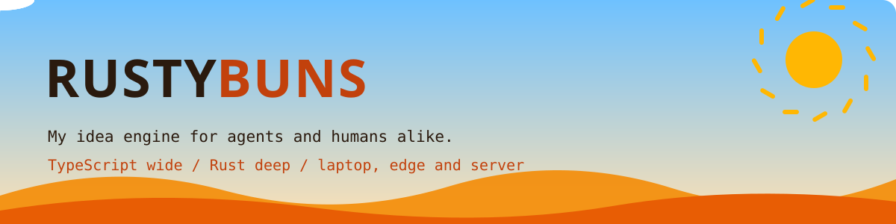
</picture>

<p align="center">
  <a href="https://rustybuns-playground.notryanquinn.workers.dev"><b>Open the Playground</b></a> &nbsp;/&nbsp;
  <a href="GETTING_STARTED.md">Getting started</a> &nbsp;/&nbsp;
  <a href="EXAMPLES.md">Examples</a> &nbsp;/&nbsp;
  <a href="REFERENCE.md">Reference</a>
</p>

# 🥐 Rusty Buns - My Idea Engine for Agents and Humans alike

**Rusty Buns is one dev dependency that gives you three ideas:**

1. **TypeScript wide, Rust deep.** Write all of the app in TypeScript. Use Rust only for the one path that must be faster.
2. **Buy into the simple primitives, and we move you across the web and the desktop.** An app has five small parts, and the same app runs on a laptop, on the edge and on a server.
3. **The agentic idea engine.** One language, one config file, and a stack that boots on your computer. You and your agents can make an idea into an app quickly.

The code is yours. Rusty Buns does not change `src/`, and it is not in your bundle. To remove it, use `git rm`.

Install it and try it:

```sh
pnpm add -D @rustybuns/cli @rustybuns/shell-bun
pnpm exec rustybuns init                # reads your app, writes rustybuns.config.ts
pnpm exec rustybuns build desktop       # dist/<name>-<os>-<arch>: one file, double-click it
pnpm exec rustybuns deploy              # Cloudflare, plus a Hetzner or Railway box
```

> **Alpha, `0.1.12`.** Bun can have problems on Windows. If it does, build on a Linux server, and tell me. The Cloudflare deploy is tested from start to end, and the Railway and Hetzner boxes are tested live. If a new release does not install, your package manager's minimum release age can be the cause. [Getting started](GETTING_STARTED.md) has a one-minute fix.

**Try it live:** The [Playground](https://rustybuns-playground.notryanquinn.workers.dev) lists each example app, with a way to play it, download it or read its source. Rusty Buns deployed all of them.

<table>
<tr><td width="33%" align="center"><a href="https://park-hide-seek.notryanquinn.workers.dev">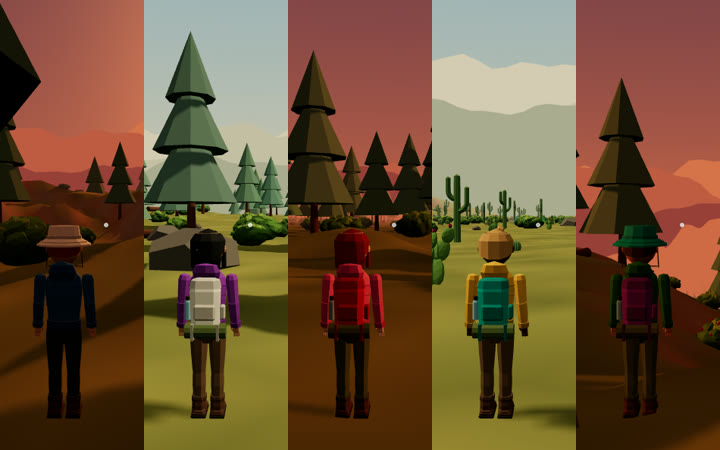<br><b>Park Hide &amp; Seek</b></a></td><td width="33%" align="center"><a href="https://git-recon.notryanquinn.workers.dev"><br><b>Git Recon</b></a></td><td width="33%" align="center"><a href="https://skatetechpark.notryanquinn.workers.dev">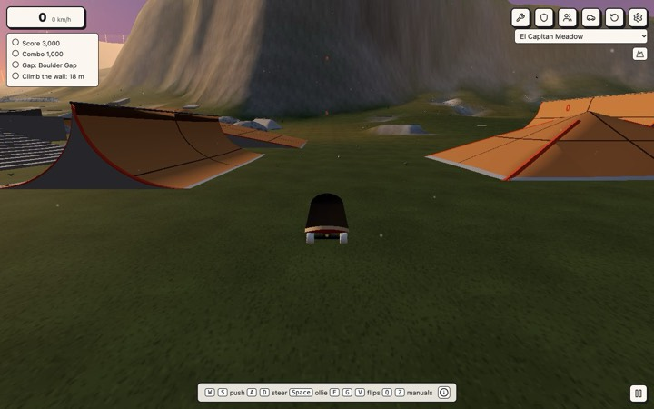<br><b>Skate Tech Park</b></a></td></tr>
<tr><td width="33%" align="center"><a href="https://alien-disc-golf.notryanquinn.workers.dev">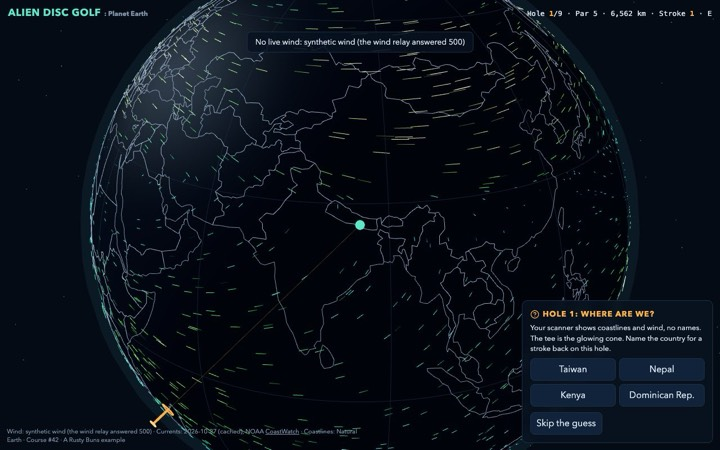<br><b>Alien Disc Golf</b></a></td><td width="33%" align="center"><a href="https://two-fronts.notryanquinn.workers.dev">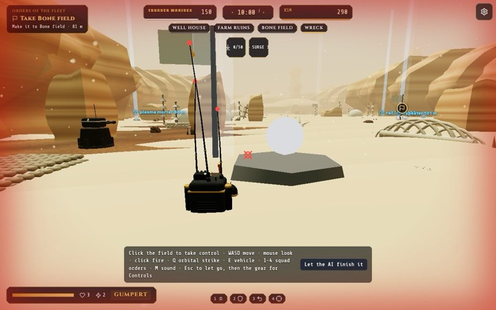<br><b>Two Fronts</b></a></td><td width="33%" align="center"><a href="https://supersplatspyshot.notryanquinn.workers.dev">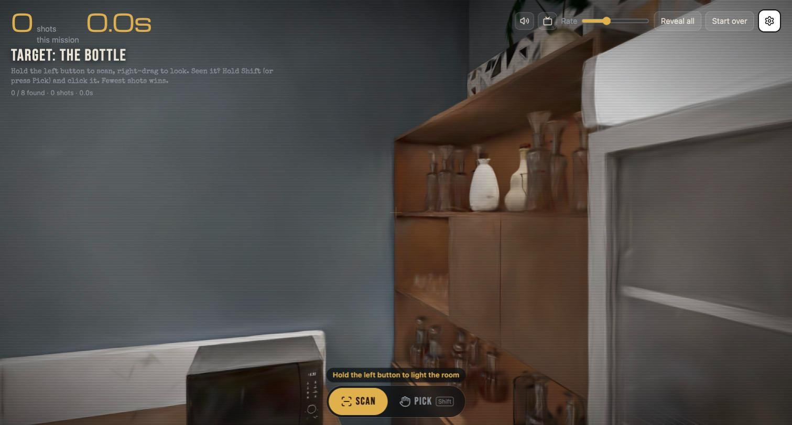<br><b>Super Spy Splat Shot</b></a></td></tr>
</table>

<p align="center"><sub>Click a card to play the game. Almost all of the games have a multiplayer mode.</sub></p>

## 1. TypeScript wide, Rust deep

**Wide interop.** The page, the backend, the config and the deploy are all TypeScript. You can use each framework, npm package and Cloudflare binding directly. There is no IPC bridge, no command layer and no YAML.

**Deep power when you need it.** Some work is too slow in TypeScript (audio, physics, geometry, a solver). Write only that part in Rust:

- **On the desktop and the box**, `@rustybuns/native` loads a Rust cdylib through `bun:ffi` and calls it directly.
- **In the page or on the edge**, the same crate runs as wasm.
- **Rust is always optional.** Each Rust engine has a TypeScript twin that gives the same answer, and the app uses the twin if Rust cannot load.

Start in TypeScript. Use Rust only where it gives a clear increase in speed. More in [Rust when you need it, TypeScript always](#rust-when-you-need-it-typescript-always).

## 2. Buy into the simple primitives, and we move you

**Each web app with a backend has five parts:**

| Primitive | What it is | The Cloudflare shape you write against |
|---|---|---|
| **http** | the way in, simple and not time-critical | a `fetch` handler |
| **comms** | live messages, and faster | Durable Objects and WebSockets |
| **storage** | data that you keep | D1, KV and R2 |
| **memory** | fast data that a restart removes | the isolate or the process |
| **identity** | who each user is | your Worker, Access, or a token |

**Cloudflare gave each part a small, standard shape.** You write your code for those shapes one time.

**Rusty Buns gives each shape a local twin on Bun and sqlite.** Thus the same app runs in three places from one `rustybuns.config.ts`:

- **The desktop.** One file for each OS, which a user double-clicks. The backend runs on a local Bun host, and the UI opens in Chrome. See [A one-file desktop app in real Chrome](#a-one-file-desktop-app-in-real-chrome).
- **The edge.** A Cloudflare Worker with D1, KV, R2 and Durable Objects, deployed from the same list of bindings. See [One config, three targets](#one-config-three-targets).
- **A server.** The same binary on a Railway or Hetzner box, with sqlite on a volume.

**Mobile is not a target.** A phone app must feel like the phone, and thus we think that it is best as a native app in SwiftUI or Kotlin. You can still keep the backend on the edge and make the native app a thin client of it. See [A native iOS app as a thin client](#a-native-ios-app-as-a-thin-client).

Your code is the same on each target, and no Rusty Buns code is in your app. Thus Rusty Buns is a meta metaframework: a framework for frameworks. It does not replace Vite, React, RWSDK, TanStack Start, Elysia, Wasp or Solid. It works on top of them, and it is a Bun program. The preferred stack is **Vite, Bun, TypeScript, Rust, Alchemy and Effect**.

The five primitives are good architecture, with or without Rusty Buns. [The five primitives](ADOPTION.md#the-five-primitives) shows each primitive on AWS, Vercel and Fly.

## 3. The agentic idea engine

Think of an idea in the morning and play it in the afternoon. The stack is simple for a person. For the same reasons, it is safe and fast for a coding agent:

- **It is small.** One language and one config file. Change one line, and Rusty Buns generates the rest.
- **It boots with no cloud account.** sqlite replaces each binding. An agent can run, test and break the real app on a laptop at no cost.
- **Agents can see it and operate it.** The app renders in Chrome. Pages give their buttons to agents through WebMCP, not through screenshots ([WEBMCP.md](WEBMCP.md)).
- **Nothing costs money until you approve it.** `plan` prints each billable resource, `deploy` stops if no plan matches, and `destroy` removes what it made.
- **Many agents work at the same time.** [Agent Office](apps/agent-office/README.md) (made by WebDevCody: [project](https://github.com/AgentSystemLabs/agent-office), [GitHub](https://github.com/webdevcody), [YouTube](https://www.youtube.com/@webdevcody), [X](https://x.com/webdevcody)) gives each agent a desk and a worktree. [codeSplitter](apps/codesplitter/README.md) lets them change the same repo at the same time.

The examples are the proof: games, a DAW, a circuit editor, a CRM and the office itself. Claude Code is a co-author of almost all of the commits. More in [Built for coding agents](#built-for-coding-agents).

## Why a team can bet on it

- **Your app is not locked in.** Each shape that Rusty Buns asks you to use is a Cloudflare standard. The tool is a Bun program, and thus a build needs Bun 1.4+, also on a Node team. Your users do not install it.
- **Nothing costs money until you approve it.** The full stack runs on your disk, and no cloud resource exists before you approve a plan.
- **Typed from end to end.** The config gives your bindings their types, and the deploy is a typed stack. A missing part stops the compiler before a server exists.
- **Tested on real apps.** [FRAMEWORK_COVERAGE.md](FRAMEWORK_COVERAGE.md) counts the public GitHub apps for each framework that boot with no changes.

## Features

Each feature is one line. Click **More** for the long version.

The core features are first. Then come the features that keep a team safe, and then the other things that Rusty Buns can package.

### One config, three targets

Your app runs as a desktop binary, a Cloudflare Worker and a Linux server, all from `rustybuns.config.ts`.

<details><summary>More</summary>

`rustybuns.config.ts` is the only Rusty Buns file that you own. `init` reads your app and writes this file. Rusty Buns generates the host, the wrangler config and the infrastructure from it, and thus the three targets always agree.

```
                  rustybuns.config.ts
       ┌───────────────────┼────────────────────┐
    desktop              edge                  box
  Bun + sqlite      Worker + D1/KV/R2/DO    Bun + sqlite on a volume
  one binary        your vite build         Railway or Hetzner
```

More in [The five primitives](ADOPTION.md#the-five-primitives) and [How it works](REFERENCE.md#how-it-works).

</details>

### How I map resources to services based on setup

Each app is http, comms, storage, memory and identity.

<details><summary>More</summary>

| Primitive | Cloudflare | Railway or Hetzner box | Desktop |
|---|---|---|---|
| **http** | CF Worker's `fetch` | `Bun.serve()` | `Bun.serve()` or localhost offline |
| **comms** | Durable Object WebSockets | the same class, in-process | the same class, in-process |
| **storage** | D1, KV, R2 | sqlite and a folder on a volume | sqlite and a folder in `~/.<app-name>/` |
| **memory** | per-request isolate, no FFI | the whole process, Rust over FFI | the whole process, Rust over FFI |
| **identity** | your Worker or Cloudflare Access | a guest id | a per-launch token |

You write your code for the Cloudflare shape one time. More tables:

- [The five primitives](ADOPTION.md#the-five-primitives): each primitive on AWS, Vercel and Fly
- [Where things run](REFERENCE.md#where-things-run): each binding on each target (git, images, email, secrets)
- [Each framework, as the five primitives](FRAMEWORKS.md#each-framework-as-the-five-primitives): each framework's features as primitives

</details>

### Every Cloudflare binding has an easy local twin

D1, KV, R2 and Durable Objects run on sqlite and a folder on your disk. The full stack boots with no cloud account and no bill.

<details><summary>More</summary>

Bun is the only runtime that has each necessary part built in:

| Bun gives us | So you get |
|---|---|
| `bun build --compile` | one file for each OS, cross-compiled on one machine |
| `bun:sqlite` | D1, KV and Durable Object storage on a laptop, with no database to install |
| `Bun.serve` with WebSockets | Durable Objects with sockets that hibernate, in-process |
| `bun:ffi` | direct calls to Rust cdylibs, with a TypeScript fallback |
| `Bun.spawn` with a terminal | real PTYs without node-gyp (see [agent-office](apps/agent-office/README.md)) |

**The twins refuse what the edge refuses**, with the edge's error:

- a D1 query with more than 100 bound parameters
- a KV key larger than 512 bytes
- a queue message larger than 128 KB
- a Durable Object value larger than 2 MiB

Thus a query that works locally also works on the first deploy. The desktop and box hosts also measure each request. A request gets the edge's 503 if it adds more than 128 MB to the process, or uses more CPU than `worker.cpuMs`. `RB_CPU_MS=10` sets the Free plan's limit.

**Postgres apps keep their database.** On the edge, a `hyperdrive` binding puts Cloudflare Hyperdrive in front of the database. The desktop and the box connect directly to the same `DATABASE_URL`. `init` adds the binding when the app uses `pg`, `postgres`, or Drizzle or Prisma on postgresql. With `local: "pglite"`, an offline desktop also gets Postgres: PGlite runs in the data dir and applies your migrations at boot. The stack can also own the database: `origin: { neon: { branch: "prod" } }` makes a Neon project and branch at deploy.

**An app that uses wrangler keeps what its config declares.** `init` copies these items:

- the bindings, which include Workflows, Vectorize, Analytics Engine, Worker Loaders and Containers
- the queue consumers and their dead-letter queues
- the routes, custom domains and observability

Each `env.<name>` block becomes a stage, which you deploy with `--stage <name>`.

On the desktop, some bindings are stand-ins:

- **Workflows** run in-process, and sqlite keeps their steps, sleeps and events. If a restart stops a run, the run continues from the same step.
- **Vectorize.** An index is a sqlite table, and a query is an exact scan.
- **Analytics Engine.** The points go into `analytics.sqlite`.
- **The Worker Loader** runs its code in the host's process, which is not a sandbox.
- **Workers AI** has no local model. `env.AI` answers `@cf/baai/bge-*` embeddings with a small built-in embedder. The embedder puts texts with the same words and word stems near each other, but it does not know meanings. Each other call replies that it runs only on Cloudflare.
- **Email sending, rate limits and Containers** are not on the desktop, and the app runs without them.
- **An outbound `fetch`** with `cf: { cacheTtl }` or `cacheEverything` gets its answer from an in-process cache for that TTL, as with the edge cache.

D1 migrations apply at boot, and `"use server"` functions run against sqlite. The result is [a full-stack framework, by accident](REFERENCE.md#a-full-stack-framework-by-accident).

</details>

### A one-file desktop app in real Chrome

`build desktop` gives you one file for each OS that a user can double-click. Your backend runs on a local Bun host, and the UI opens in the user's Chrome.

<details><summary>More</summary>

**Why not Electron?** With Electron, you write two programs that communicate through IPC: a Node main process and a renderer. Each app includes a full Chromium. That backend cannot go to the edge, and you must write it again to move it to a server. Rusty Buns has no main process. Your backend is a standard web `fetch` handler.

Cloudflare runs the same handler. On a laptop, the handler serves your page to the Chrome that you have. On a server, it serves the page to all users.

**Why not Tauri?** Tauri is lighter. But your backend becomes Rust commands, and your UI runs in the OS webview: WebKit on macOS and Linux, WebView2 on Windows. Each webview has its own gaps. Rusty Buns keeps the backend in TypeScript and renders in real Chrome. Thus `SharedArrayBuffer`, WebGPU, AudioWorklets and Web MIDI work.

We do use Tauri as a thin wrapper for the system items that we want. We like Tauri, and we do not try to replace it. Your desktop app can also be a full Tauri app: the backend is all Rust, and the webview does not use the TypeScript and Bun parts. Our aim is maximum flexibility and maximum interop. For us, app core logic that you can move is more important than the implementation.

The Rusty Buns host binds to `127.0.0.1`, accepts a request only with the per-launch token, and keeps your data in `~/.<app-name>/`. Your users do not install Bun, because Bun is in the binary. Details are in [The host](REFERENCE.md#the-host).

**Bring your own server.** Some Vite frontends have a dev server that proxies `/api` to their own Node server. Such an app keeps that server:

- `targets.desktop.server` bundles the server into the binary, and the host runs it as a second process. Its data is in the app's data dir, and WebSockets work.
- If a proxy sends `/api` to one server and `/img` to a different server, the two servers run.
- Native addons (`sharp`, `better-sqlite3`) are included, with a build for each target. If an addon cannot be included, the build stops and gives its name. The app does not fail at launch.
- `init` does this setup when it finds the servers.
- This is for the desktop and the box only, because a Worker cannot run a Node server.

**Opens on a Mac without a warning.** On a Mac that has a Developer ID certificate, `build desktop --sign` signs the darwin binaries. `--notarize <profile>` also sends a `.zip` of each binary to Apple. The profile is the one that you saved with `xcrun notarytool store-credentials`, and thus your Apple password stays in the keychain.

</details>

### Your bindings are typed from the config

Your handler's bindings type comes from the config (`EnvOf<typeof config>`). If you delete a binding from `rustybuns.config.ts`, the typecheck fails at each place that still uses it.

<details><summary>More</summary>

`defineConfig` keeps the binding names and types that you wrote. A var is a `string`. A secret is a `string`, or `string | undefined` when it is `optional`. For each other binding, you give the type:

```ts
import type config from "../rustybuns.config";
import type { EnvOf } from "@rustybuns/cli/config";

type Bindings = EnvOf<typeof config, { d1: D1Database; kv: KVNamespace; r2: R2Bucket }>;
```

These are types only. Rusty Buns generates nothing and adds nothing to your bundle.

</details>

### Things are functions

An operation is one function with a name, a schema and a permission. HTTP, MCP, WebMCP, a CLI and a skill file are thin views of that function.

<details><summary>More</summary>

`@rustybuns/ops` has no dependencies. Auth occurs at the edge, and `ops.call` checks the permission again on each run. See [OPS.md](OPS.md).

</details>

### PLAN STEP: Plan before anything costs money; See the resource matrix

`plan` typechecks the generated stack and shows what it will create and bill. `deploy` runs only if there is a plan for that same config, and then it asks you.

<details><summary>More</summary>

The deploy side is a typed Alchemy and Effect stack. Cloudflare, Hetzner and Railway are each a typed Layer. To change a target, change one line of config. The compiler tells you what is missing before the deploy creates a resource. `plan` and `deploy` print each billable resource and mark it as fixed or usage. They refuse a large Hetzner box unless the config permits it. `destroy` removes all that the deploy created.

`plan` compares your config only with the Alchemy state. `drift` does the opposite: it reads the live account again and shows what changed outside the stack. Examples are a dashboard edit, a `wrangler deploy` and a deleted resource. `drift` changes nothing. `drift --repair` puts the account back to the last deploy. It asks for the same two confirmations as a real destroy, and it does not run without a terminal.

To try a different person's repo, use `plan --offline`. It builds and typechecks with no login, and it lists the full stack as creates. It does not touch their account or your account.

The fan-out causes the monthly bill. Thus the desktop and box hosts count each binding call for each request, cron tick and queue message. `plan --usage` makes a monthly estimate from such a run. It also flags a cron that keeps a Durable Object awake all day ([COSTS.md](COSTS.md#what-it-would-cost-a-month-plan---usage)).

See [Typed deploys](REFERENCE.md#typed-deploys-thanks-to-effect), [Deploy to Hetzner](REFERENCE.md#deploy-to-hetzner), [Deploy to Railway](REFERENCE.md#deploy-to-railway), [DigitalOcean by hand](REFERENCE.md#deploy-to-digitalocean-by-hand) and [COSTS.md](COSTS.md).

</details>

### Why not just add in a CMS engine? I did.

An app's script text is in `content/*.json`. `bun run cms` in the app serves these files as textarea forms that save to the files. The same editor translates the text into `content/<lang>/`.

<details><summary>More</summary>

`packages/cms` reads the shape from the file itself. A form can change text, but it cannot add, remove or retype a key. The editor listens only on `127.0.0.1`. A string gets one box. A list of strings gets one box with one line for each string.

These apps use it:

- [Two Fronts](apps/two-fronts/README.md): radio, chatter, cutscene lines, places
- [Git Recon](apps/git-recon/README.md): the director's radio, gags, chapter stories
- codeSplitter's landing page (`apps/codesplitter/content/landing.json`): the hero, the scroll lines, and each section's heading and blurb

To add a game, move its lines into a `content/` folder, import them, and add a `cms` script like theirs.

**Translations.** **Add a language** on the editor's front page makes `content/<lang>/` (`es`, `pt-BR`). Each file gets a translate page that shows the original line below each box. A translation keeps the source's shape and numbers. A blank line shows the original text, and thus a language that is not complete still works.

In code:

- `localize(source, translation)` from `@rustybuns/cms/locale` gives the source with the translated lines in place.
- `pickLocale(navigator.languages, have, "en")` selects a language (`es-MX` reads `es`).

How the apps use it:

- codeSplitter's landing page and `/concepts` bundle each `content/<lang>/` at build time. They read `?lang=es` or the browser's languages.
- Two Fronts and Git Recon select a language one time at boot. `localizeContent` writes it into the `content/*.json` that their sims import, before the sim reads a line. Thus a replay stays a replay.
- TerraViz's Shared Sphere serves each globe its tour in that browser's language. The steps and numbers come from the original.

</details>

### Smoke test an app without laying a finger on it (help test it out more and report back!)

`rustybuns smoke [dir]` copies your app to a temporary folder, then installs it, builds it and starts it on the local twins. It tells you if the home page answered. It deploys nothing and changes nothing in your folder.

<details><summary>More</summary>

The copy has no `.env` or `.dev.vars`, and each secret that the app names gets a fake value. The run has an empty HOME and no cloud logins. On macOS, the host runs in Seatbelt, Apple's sandbox.

The command tries the mode that `init` selects, and then the app's own Worker build, if there is one. If it fails, it tells you which step stopped: `install`, `init`, `build`, `boot` or `request`. It deletes all of its files after the run unless you use `--keep`. It reads no account, and thus it costs nothing. The same steps run on public GitHub repos in [FRAMEWORK_COVERAGE.md](FRAMEWORK_COVERAGE.md).

`--edge-like` makes the local run more like the edge:

- It evicts idle Durable Objects after 70 seconds.
- It names each `process.env` read that occurs at import time.
- It restarts the host after each 100 requests, which resets module globals.

`RB_EDGE_LIKE=1` sets the same mode for any host. `RB_EDGE_RECYCLE=N` sets the number of requests between restarts (0 means never).

</details>

### Players report bugs straight into this repo

A signed-in player presses Report in a game. The report arrives here as an issue with the `external` tag and the game's name.

<details><summary>More</summary>

`POST /api/report` on [eqosys](apps/eqosys/README.md) takes the game's token, and thus it knows which game and which account sent the report. It files a GitHub issue with the labels `external`, `game:<id>` and `bug` or `enhancement`. The reporter is an opaque id, never an email. `@mentions` in the text are made safe. The limits are 5 reports an hour and 20 a day for each account, and 5 a minute for each IP.

A game adds the corner button with `reportButton()` from its `eqosys()` client (`@rustybuns/util/report`). The button has the game's eqosys skin. `eqosys({ ..., skin: { theme, css } })` takes `--ui-*` tokens (packages/ui) and extra rules one time. The account chip (`accountChip(slot)`), the achievement toast, the report form, the party lobby and the spaces panel all use this skin.

</details>

### Achievements on one account across every game

A game unlocks an achievement with one call. The player's eqosys page shows each game's achievements, earned and locked.

<details><summary>More</summary>

Each game's catalog is in [eqosys](apps/eqosys/README.md) (`src/achievements.ts`). Thus a game can unlock only what it lists, and eqosys can show "3 of 8" without a request to the game.

- In a page, `achieve(id)` from the `eqosys()` client (`@rustybuns/util/eqosys`) sends the unlock with the game's token. It answers if the unlock was new, and it shows the achievement toast the first time. A page asks only one time for each achievement.
- An unlock that a player earns while signed out stays in the page and goes up at the next sign-in.
- Secret achievements stay hidden until the player earns them.
- Nine games have catalogs: Alien Disc Golf, Skate Tech Park, Delayed Reaction, Two Fronts, Mythic Masters, Park Hide & Seek, Git Recon, Hippo Tycoon and Super Spy Splat Shot.
- A friend gets one notification for each new unlock, and the Friends tab shows each friend's count.
- Sign-in is quick. If a player is signed in to eqosys and has used the game before, `/login` sends them back immediately, with no page between.

</details>

### GDPR on one account, kept in the person's region

A player can download all that eqosys holds about them in one file. When a player deletes the account, eqosys shreds that player's key, and the backups become unreadable too.

<details><summary>More</summary>

`@rustybuns/util/privacy` is the part that any app can use:

- `regionOf(request.cf)` tells you if a person is in Europe (EU, EEA, UK, Switzerland).
- A `Holder` list tells what the app keeps, why (its GDPR basis) and for how long.
- `dossier()` makes the person's download from that list.
- `seal` and `unseal` are AES-256-GCM with a key for each person, bound to the place where the bytes belong.
- `Vault` is the body of a Durable Object for each person. It holds that key, a consent ledger and a log of the requests.

In [eqosys](apps/eqosys/README.md):

- A European's vault is made in the EU's Durable Object jurisdiction.
- Cloud saves are sealed with the vault's key.
- The privacy page and `GET /api/privacy/export` read the same `HOLDERS` list.
- When a person deletes the account, eqosys shreds the vault first. Thus a save that is still in D1's 30 days of history cannot be opened.
- GitHub, Google and Apple tokens are also kept encrypted.

</details>

### Studios: one account that plays, keeps, makes and ships

A studio is an eqosys account that makes apps, and it can be one person or a business. QNTBR is the first studio, and it holds each Q app.

<details><summary>More</summary>

A person's eqosys account plays, and a studio's account makes. Each studio has members (owner, admin, maker) and a shelf of the apps that it makes. Each app has four doors:

- play it
- keep your things in it
- make it (its codeSplitter repo)
- ship it (what is live)

The super admin's QNTBR studio is made the first time that they open eqosys, and its shelf has each app in `APPS`. The Studio tab on the eqosys home shows each studio that you are in, your role, its members and the shelf. An owner or admin adds people there by email, and any person can make a studio (`src/app/Studio.tsx`). The tools are `eq_studios`, `eq_studio_make` and `eq_studio_add`.

Qollab is the Durable Object layer below this: a hub for each player, and a party or space for each room. The plan is in [apps/eqosys/VISION.md](apps/eqosys/VISION.md).

</details>

### The Library takes other studios' games, after a review

A studio puts its own game in the eqosys Library as a draft and sends it to review. After the super admin lists it, any person can sign in to it.

<details><summary>More</summary>

`APPS` stays ours, in code. A studio's game is a listing in D1 with the same fields (`src/listings.ts`). A draft signs in only the members of its own studio. Thus the maker tests the real sign-in from the real site first.

- The Studio tab has a form for each game, for the studio's owners and admins: save, send to review, and pull. `eq_listing_save` does the same.
- `eq_listing_send` puts the game in the queue.
- `eq_listing_review` lists it, or refuses it with a note.
- `eq_listing_pull` removes it. Its tokens stop at the door, and the players' saves go after 30 days.

A listed game's tile names its studio. The reports from its players stay in eqosys, and its studio reads them on the Studio tab. They do not go to the issues of this repo. The game gets the shared achievements (`played`, and `alpha` or `beta` when its maturity agrees). Each check of who can sign in or call asks `appOf`, which reads the listings one time a minute for each isolate. The design is in [apps/eqosys/LIBRARY.md](apps/eqosys/LIBRARY.md).

</details>

### Real visitors, told from agents and bots, across the Q sites

The eqosys super admin sees who came to eqosys, the Playground and each app that calls eqosys. People who tapped or scrolled are counted apart from scripts, headless browsers and crawlers.

<details><summary>More</summary>

`@rustybuns/util/visitors` (`kindOf(headers)`) does the sort, and codeSplitter's insights use the same code:

- A Mozilla browser that sends the `sec-fetch-*` headers is a person.
- A crawler that names itself is a bot.
- All others (curl, AI clients, headless or spoofed browsers) are agents.

[eqosys](apps/eqosys/README.md#visitors-who-is-really-here) counts each request that it answers, under the app whose page sent the request. Static sites send a beacon to `POST /api/visit`: a view on open, and "engaged" on the first tap, key or scroll. The "engaged" beacon is what makes a person real.

A caller is a hash of the IP and browser with a daily salt, and thus eqosys keeps no IP. The admin's visits are not counted. eqosys keeps 30 days.

</details>

### Keys you can take back (experimental)

Test stacks make their own secrets on create and remove them on destroy. Prod secrets come from 1Password, behind your Touch ID.

<details><summary>More</summary>

Set `experimental.wheel` to `"agent"`. Then CI and agents can create stacks as often as necessary, and there is nothing to rotate. Set it to `"human"`, and prod secrets resolve from 1Password at deploy time. In the two modes, a committed `.env.schema` lists each secret by name, never by value. Thus any machine knows what is necessary. The 1Password path is not tested yet. See [Who holds the keys](REFERENCE.md#who-holds-the-keys-experimental).

Tell me if you want more support here.

</details>

### Leaving is a `git rm` away though we would be sad

Rusty Buns is a dev dependency: some lines in `package.json` and one config file. It does not change `src/`. You write your app logic one time, and it runs on each target that Rusty Buns supports.

<details><summary>More</summary>

There is no framework API to remove. Your app stays a `fetch` handler with D1, KV, R2 and Durable Object bindings. Adopt Rusty Buns one target at a time, and remove it the same way. See [Adopting it in steps](ADOPTION.md#adopting-it-in-steps).

</details>

### Defaults you can take over

The defaults are a start point, like a UI component that you copy. Change one part, or `eject` the deploy program and own all of it. With good defaults, you use your time on the idea and not on the framework.

<details><summary>More</summary>

Rusty Buns generates the host, the wrangler config and the Alchemy stack from `rustybuns.config.ts`. When a default does not fit, change that part and keep the rest. Examples: Postgres in place of D1, your own server with the host, Rust or TypeScript for the hot path. `rustybuns eject` copies the Alchemy program to your repo, and then you own it. See [Adopting it in steps](ADOPTION.md#adopting-it-in-steps).

</details>

### Rusty Buns is a joke name because you need neither

The minimum is Vite, which builds the page, and Bun, which runs the backend. All other parts (Alchemy, Effect, Cloudflare, Rust, Hetzner, Railway) are options. Add one when you want it, and remove it when you do not.

<details><summary>More</summary>

TypeScript connects to all of the parts. Bun is the host on the desktop and on a box, and it can call directly into Rust. In the browser, the same Rust runs as WebAssembly.

- **Deploy tools are opt-in.** A project that builds only the desktop binary does not run `add deploy`, and thus it does not get Alchemy or Effect.
- **Rust is an optional engine** with a TypeScript twin.
- **Each deploy target is one Layer.** You can replace it with a different Layer or omit it.

Your `src/` imports none of these parts. Thus you can remove any of them, and your app does not change. See [Adopting it in steps](ADOPTION.md#adopting-it-in-steps).

</details>

### Static sites box too, no app needed

`rustybuns init` in a plain HTML, Jekyll, Hugo or MkDocs repo packages its build output for the desktop and the web. A GitHub Pages site is one example.

<details><summary>More</summary>

There is no `package.json` to read. Thus `init` looks for the site itself:

- an `index.html` at the top, or in `docs/`, `public/`, `site/` or `www/`
- a Jekyll `_config.yml` with its `_layouts/`
- a `hugo.toml`
- a `mkdocs.yml`

`init` writes a config that uses the generator's own build (`rustybuns jekyll build`, `hugo`, `mkdocs build`), or `rustybuns copy-site` for hand-written HTML. It also writes a `package.json` that has Rusty Buns as a dev dependency. The web side is an assets-only Worker. The Worker and the desktop app answer a missing page with the nearest `404.html`. Like Cloudflare and GitHub Pages, the host serves `/ops` from `ops.html`.

**Jekyll.** `init` puts `_config.rustybuns.yml` on top of your config. This file:

- keeps `dist/`, `desktop/` and the Rusty Buns files out of the site
- serves from `/`, not from a Pages `baseurl`
- sets the defaults that GitHub Pages adds itself (a page with no `layout` gets your `page` or `default` layout)

The other Pages extras need their gems:

- Markdown with no front matter, rendered as a page
- `.md` links that point at the `.html`
- titles from a first heading
- a `README.md` as its folder's index

`init` turns on the ones that your pages use, and the build installs them.

`rustybuns jekyll build` runs your own Jekyll when your Ruby is 3 or later, through `bundle exec` if there is a Gemfile. If not, it runs in a `ruby:3.3` Docker container, because macOS includes Ruby 2.6. The container's gems are in a Docker volume, and thus only the first build waits for the install.

**Hugo and MkDocs** must be installed. `init` tells you when one is not on your PATH.

</details>

### Pages Functions run as a Worker

A Cloudflare Pages project's `functions/` folder becomes a Worker on each target, and the handlers do not change.

<details><summary>More</summary>

`init` finds a Pages project: a `functions/` folder that has handlers, and no Worker `main`. It sets the Worker build to start with `rustybuns pages-functions`. This command writes `.rustybuns/pages/`:

- one route for each file, in the order that Pages uses (`[id].ts` is a param, `[[path]].ts` is a catch-all)
- the `_middleware` chain
- a small adapter that gives each handler Pages' own context (`request`, `env`, `params`, `data`, `next`, `waitUntil`)

The Worker gets requests before the static files, as Pages Functions do. `public/_routes.json` still sends its excludes directly to the files. A new file in `functions/` is a new route on the next build. The adapter is copied into the app and imports nothing, and thus Rusty Buns stays out of the bundle.

We tested this on a Pages app with 100 routes, two middlewares, D1, KV, R2 and Vectorize. It boots on the desktop with no edits.

</details>

### Postgres instead of D1

Replace D1 with your own Postgres: PGlite on the desktop, and Hyperdrive in front of Neon, Supabase or RDS on the edge.

<details><summary>More</summary>

This is a code change, not a config switch. D1's `env.DB.prepare(...)` has the shape of sqlite. Thus your code uses a Postgres client (`pg`, `postgres`, Drizzle or Prisma) through `env.HYPERDRIVE.connectionString`. `init` adds the `hyperdrive` binding when it finds a client. The desktop and the box connect to `DATABASE_URL`, or they serve PGlite from the data dir with `local: "pglite"`.

KV, Durable Object storage, queues and workflows still use sqlite locally. Only the relational database moves. [borg-postgres](apps/borg-postgres/README.md) runs the same Worker on the edge and on the desktop, and it checks inserts, `jsonb`, rollback and concurrent upserts. The caveats (PGlite is one shared session) are in [Where things run](REFERENCE.md#where-things-run).

</details>

### An Elysia app, unchanged, as a desktop file

A real Elysia and Drizzle backend becomes one binary with its own Postgres, and its `src/` does not change. It does not run on Cloudflare yet.

<details><summary>More</summary>

[elysia-conduit](apps/elysia-conduit/RUSTYBUNS.md) is bedstack's RealWorld backend (Elysia 1.4, Drizzle, postgres.js), copied in with no changes. A short entry exports `new Elysia().use(setupApp)` in place of their `.listen()`. A `hyperdrive` binding with `local: "pglite"` applies their Drizzle migrations at boot. Their own Postman suite (32 requests, 311 assertions) passes on the dev host and on the 109 MB compiled binary.

The problems are listed too. The entry must copy the PGlite port into their `POSTGRES_*` variables. On Workers, the unchanged app breaks in five ways ([#2278](https://github.com/QuinnsCode/RustyBuns/issues/2278)). The first is a Postgres client that is built at import time.

</details>

### Rust when you need it, TypeScript always

Add a Rust engine for the hot path. It comes with a TypeScript twin that gives the same answer, and the app uses the twin if Rust cannot load.

<details><summary>More</summary>

Use Rust only when TypeScript is not fast enough. `@rustybuns/native` loads a cdylib through `bun:ffi` on the host, or you ship the crate as wasm in the page. It returns null when it cannot load, and then you use the TypeScript path. These examples run the two side by side, to show the speed that Rust gives you: [tscircuit-desktop](apps/tscircuit-desktop/README.md) (up to 22x), [fm-daw](apps/fm-daw/README.md) (bit-identical audio) and [auto-rig](apps/auto-rig/README.md).

</details>

### A native iOS app as a thin client

The backend stays on the edge, and a native app is a thin client of the same http and comms. The first tools are a SwiftUI shell, a USDZ model export and a shared Swift package.

<details><summary>More</summary>

Keep your Worker and its Rust engine (as wasm) on the edge. The logic stays in one place, and the screens stay native.

- **[native/ios](native/ios/README.md)** is the first step: a SwiftUI shell that shows a deployed app on the full screen. `bun run ios <url>` opens it in the simulator.
- **`bun run usdz`** converts each `apps/*/public/models/*.glb` to USDZ in `dist/ios/`, for screens that RealityKit or SceneKit draws. It uses headless Blender. It bakes the vertex colours into textures, because iOS's USD shader ignores vertex colours.
- **`bun run usdz models`** does the same for the procedural models in `packages/models` (roadster, plants).
- **`bun run usdz beasts`** converts each Mythic Masters beast's `*.rig.json` to a skinned USDZ, with no Blender. The file has the UsdSkel skeleton, the skin weights and the rest pose. The tips and feet are in the prim's customData.
- **IK stays on the server.** The sim knows the position of each foot. Thus a native client gets joint poses from the sim, and we do not port the closed-chain solver ([#2895](https://github.com/QuinnsCode/RustyBuns/issues/2895)).
- **[RustyBunsKit](packages/ios-kit/README.md)** is one Swift package for the parts that all native apps share: an eqosys sign-in that stays signed in, the friends hub and the protocol version handshake. The Park Hide & Seek client uses it.

</details>

### LAN multiplayer with no server

A desktop app can host its world for other copies of the app on the same network. The page turns this on and off at runtime.

<details><summary>More</summary>

Each guest runs its own binary and opens one WebSocket to the host machine. Nothing else goes across the network: the page, the assets and the server actions stay behind the host's token. To host on an address other than loopback, you must set a passphrase of 12 characters or more. [Hippo Tycoon](apps/hippo-tycoon/README.md) plays solo, couch, LAN party and online rooms from one game class. See [Multiplayer on a LAN](REFERENCE.md#multiplayer-on-a-lan).

</details>

### A fast loop, and it tells you how fast

A desktop build takes approximately one second. Each build and deploy prints the time of each step and what changed since the last run.

<details><summary>More</summary>

`build desktop --check` typechecks before the client build, and thus you see a type error in much less than one second. Rusty Buns selects the checker: `bun check` (Bun 1.4.3, canary only at this time), then tsc-rs, then `tsc`. It saves the step times to `.rustybuns/profile/`, to show how much time a checker or a Bun upgrade saved. See [Type checking and per-step timing](REFERENCE.md#type-checking-and-per-step-timing).

</details>

### Thousands of battles at low priority

Two Fronts plays thousands of headless battles to balance itself. The battles are low-priority background work in the scheduler's CPU budget. The result is a report that you can scrub.

<details><summary>More</summary>

`bun apps/two-fronts/scripts/sim.ts --n 1000 --hero both --handicap 0,0.3,0.6` plays the battles on worker threads. If you ask for it, a scripted player takes the hero's seat. The run uses the shell-bun scheduler's `balanced` budget: approximately 60% of the CPU and 50% of the memory by default. `--jobs` sets the number of workers, and the default is the number of cores. Thus you can still use the machine while it works. Nothing leaves your machine, and nothing is billed.

It writes `dist/balance/report.json` and a self-contained `report.html`:

- win rates by sector
- how often the hero beats a foe that has 30% or 60% more
- a heatmap of each side's positions, with a time slider
- a replay of sampled battles that you can scrub

Other tools use the same scheduler.

</details>

### Background work that steps aside (experimental)

Work on a host can have realtime, high, normal or low priority. Low work slows down while your machine is busy.

<details><summary>More</summary>

`scheduler()` in `@rustybuns/shell-bun/priority` runs normal and low jobs in a budget that you set. The budget can be numbers, like the default "60% of the CPU, 50% of the memory". It can also be a persona: `power-user`, `background-beatdown` or `background-burner`. Realtime and high work never waits, and one core stays free for it.

When the machine stays above the budget for approximately 30 seconds, the scheduler halves the number of low jobs that can run. This number can go down to zero. It goes back up one at a time when the machine is quiet. Child processes of low jobs run at OS background priority (`taskpolicy -b` on macOS, `nice` on Linux).

- **Who uses it.** The GitHub trial harness runs its installs, builds and hosts as low work, and thus you can use a laptop during a sweep (`--persona`, `--priority`). A host's crons and queue consumers share one scheduler and also run as low work. `RB_PERSONA` at launch (or a box's `persona`) selects the budget. `worker.cronPriority` or a consumer's `priority` raises them. The scheduler stops a cron run or queue batch that hangs after 15 minutes.
- **Memory.** A job can tell the scheduler how much memory it usually needs, and it starts only if that amount fits. `scheduler.spawn()` runs a command as a job and measures the real use, which includes children. The scheduler stops a job that goes above its own `maxMb`. On Linux, `maxMb` is also a hard cgroup cap. When background work goes above the budget, the scheduler stops the newest job and queues it again. If the job set `pause: true`, the scheduler pauses it (SIGSTOP) and resumes it later.
- **Worker threads.** `scheduler.worker(priority, url, data)` runs CPU-heavy JS on a worker thread in the same slots. With `warm: n`, it keeps up to n completed workers loaded for the next job on the same module. This skips startup and keeps JIT-compiled code (auto-rig rigs approximately two times as fast this way). A host keeps none unless `targets.desktop.warm` (or `RB_WARM`) sets a number. Idle workers count against the memory budget. On the desktop host, list the module in `targets.desktop.workers` and name it with `new URL("./worker.ts", import.meta.url)`. The build bundles it next to the host, and into the binary.
- **Checkpoints.** A long job can call `job.checkpoint()` between steps. At a checkpoint, a stopped job stops fully. A low job gives its slot to normal work that waits, and it continues when there is room. `job.checkpoint(release)` lets a job release memory before it gives up its slot. `scheduler.runEffect()` runs an Effect as the job. Thus a stop interrupts the Effect at any point, and its cleanup runs. Time in the parked or paused state does not count toward `timeoutMs`.

</details>

### Dockerfiles you can build and run locally (coming soon)

Containers are not complete yet. `rustybuns containers` lists your container bindings, and it builds, runs and smoke-tests their images for `linux/amd64`.

<details><summary>More</summary>

Each image shows as built, stale or not built, with its size. `run` starts an image on a free port, waits until it answers and streams its logs. Only the `--env` values that you pass go to it. `--prod-like` puts a run behind the app's own egress gate, on a network with no other exit. `smoke` exits non-zero if an image does not boot. CI smoke-tests the images that a PR touches. `deploy` checks that Docker runs before any Alchemy work. See [Containers](REFERENCE.md#containers).

</details>

### Built for coding agents

One language, one config file, the full stack on your computer, and a UI that an agent can operate in Chrome.

<details><summary>More</summary>

The stack is simple for a person. For the same reasons, it is safe to give to an agent. There is one language and one config file. The real app boots locally on sqlite, and it renders in Chrome, which agents can operate. There is more:

- **Small context, more tokens for the work.** In code mode, codeSplitter's MCP server lists its 138 tools in 1,054 tokens, not 30,240. Pages give their buttons to agents through WebMCP, not through screenshots. The numbers and guard rails are in [WEBMCP.md](WEBMCP.md).
- **Guard rails.** `plan` and `deploy` catch a mistake before a server exists. `protect: true` on a database, bucket, queue, vector index, Durable Object or container (or the Worker) makes `destroy` keep it. `plan`, `deploy` and `destroy` print a `[KEPT]` / `[REMOVED]` list first. See [Keep a resource through destroy](REFERENCE.md#config).
- **A host that cannot get your keys.** The dev host starts without your `.env`, auto-install or credential env vars. `run desktop --sandbox` puts the host in a macOS Seatbelt jail, with no access to `~/.ssh`, cloud logins and keychains. `plan`, `deploy` and `dev` also keep the Cloudflare token and other deploy logins out of the Worker build. See [Running code you didn't write](REFERENCE.md#running-code-you-didnt-write).
- **Rust with no risk.** An agent can write the Rust engine and prove, sample by sample, that it matches the TypeScript engine.
- **CI that explains its waits.** `bun scripts/ci-report.ts` reads one week of `apps` and `typecheck` runs. It shows where the queue time and job-minutes went, and which tests blocked many PRs at the same time. It also shows what a move of suites to a schedule saves.

Claude Code is a co-author of almost all of the commits in this repo. Some were written at desks in [Agent Office](apps/agent-office/README.md), which is one of the examples below.

</details>

### A page's functions are its agent's tools and your Cmd+K

One list of plain functions for each page becomes WebMCP tools, `window.__commands` and a Cmd/Ctrl+K palette.

<details><summary>More</summary>

`addCommands` from `@rustybuns/util/commands` takes functions in WebMCP's tool shape. `mountPalette` from `@rustybuns/util/palette` puts the same list behind Cmd/Ctrl+K for a person. An agent in the browser and a person at the keyboard call the same function the same way. A script without WebMCP calls `__commands.run(name, args)`. Two Fronts, Delayed Reaction, Park Hide & Seek, Skate Tech Park and Mythic Masters' gallery use it. See [WEBMCP.md](WEBMCP.md#one-list-for-agents-and-people).

</details>

### Any frame of any scene, one link away

A game's cutscenes are director scenes. `?scene=<name>&t=<seconds>` holds any frame of any scene.

<details><summary>More</summary>

`@rustybuns/util/director` plays scenes one at a time. A scene has camera takes (`reel.ts`), timed lines, cards and photos. `seek(t)` and `paused` hold a frame. Each game names its scenes in a table, and thus the same link opens any of them. `window.__scenes` lists and plays them for `bun run probe`.

`bun run shots <app>` shoots each named screen and scene at the size of a phone, a tablet and a desk, into `apps/<app>/docs/shots-<date>/`. Mythic Masters' tapes and standoffs run on it, and Git Recon's credits and outtakes also run on it.

</details>

### Cutscenes you can watch again, once you've seen them

A scene that the game selects becomes a memory when it plays to its end. The game lists the memories, and you can play them again.

<details><summary>More</summary>

`@rustybuns/util/memories` keeps the scenes that you have seen on the device. The game wraps the scenes that it wants to keep (`memories.mark(scene, { id, scene, title, args })`) as it plays them, and it passes each director frame to `step`. A scene that plays to its end is filed. A skip counts, but a scene that you walk away from does not. To play a memory again, the game calls `playNamed` from its own scene table, at the place where you stand now.

- Mythic Masters lists the tapes, arrivals, landmarks, sightings and first bindings in the journal's Regions chapter, under "Remembered".
- Git Recon's menu offers the newsreel and the credits after you roll them at the top of the climb. It also offers each in-level set piece that you have seen to its end: the insertion, the strike, the roadster jump, the hovercraft, the landing craft, the barrage, the extraction and the others. A set piece is live gameplay and has no scene of its own, so `src/sim/rewatch.ts` builds its level again, stages the beat there, and plays it with scripted input (`?scene=jump` plays one by name).

</details>

### Accessible by default

You can use the docs site with only a screen reader and a keyboard. It has reading settings: dyslexia-friendly fonts (Atkinson Hyperlegible, OpenDyslexic), larger text and wider spacing.

<details><summary>More</summary>

Our aim is WCAG 2.2 AA. The reading settings and the theme are also WebMCP tools, and thus an agent can change them for you. [ACCESSIBILITY.md](ACCESSIBILITY.md) tells you what is covered and how to report a barrier.

</details>

## Nerdy things RustyBuns gets you

The parts that a team will be glad to find in the stack. Each has its own entry above:

- **Your machine stays usable.** [Background work that steps aside](#background-work-that-steps-aside-experimental) runs low work in a CPU and memory budget. [The Two Fronts balance sim](#thousands-of-battles-at-low-priority) uses it for thousands of headless battles.
- **A fast loop, with numbers.** [Build timings](#a-fast-loop-and-it-tells-you-how-fast) are saved for each step.
- **Free local twins.** [Every Cloudflare binding has an easy local twin](#every-cloudflare-binding-has-an-easy-local-twin), and [a plan comes before anything costs money](#plan-step-plan-before-anything-costs-money-see-the-resource-matrix).

## What's the catch?

- **No native menus, tray, installers or auto-update yet.** If you need a window that feels native today, use Electron or Tauri. Mac signing and notarization are built in (`build desktop --sign`, `--notarize`) and need only an Apple Developer ID. Windows signing is not built yet.
- **The desktop app is a Chrome tab, not its own window.** It renders in the user's Chrome (or default browser), not in a bundled browser. When the user closes the tab, the host does not stop. The app has no dock or taskbar entry, and the user must have Chrome installed. There are no deep links (`myapp://`), file associations, global shortcuts or native file dialogs. System access is not the gap: the Bun host has the filesystem, processes, sqlite and FFI. The window and the OS hooks around it are missing. A thin native window around the same host (Tauri, for example) can add them, and the backend does not move.
- **To update, the user downloads a new binary manually.** The plan: the host fetches a new hashed binary, checks the hash, replaces itself and restarts. A Worker or R2 serves a manifest. On a Mac, the new binary must be signed and notarized, or Gatekeeper can quarantine it. This is not tested.
- **You build on macOS or Linux, not on Windows.** Windows is a target, not a build machine. Build the Windows binary on a Mac or a Linux server. A Rust cdylib cross-compiles only to Linux (in Docker). wasm crates go anywhere.
- **Windows has the fewest tests.** CI boots one app with no backend on Windows on Arm. No app with a backend runs on Windows in CI yet. If you build in WSL or run a binary on Windows (x64 or Arm), [tell us](https://github.com/QuinnsCode/RustyBuns/issues/new) what worked and what did not.
- **The binary is approximately 60 to 110 MB**, because Bun is in it. The size depends on the app. It is one file with no install step, but it is not small.
- **The twins are not workerd.** They are the production runtime for the laptop and the box, not a copy of the Workers runtime. The limits match. Some bindings (Vectorize, Workers AI, the Worker Loader) are stand-ins. `rustybuns dev` still runs workerd for edge work. The full list is in [Where the twins differ from the edge](ADOPTION.md#where-the-twins-differ-from-the-edge).
- **Same code, different assumptions.** The desktop has a long-lived process, one user and a local sqlite file. The edge has isolates that start and stop, many users and D1. There is no sync between them. These differences change app logic, not only bindings: [Where the same code stops being the same](ADOPTION.md#where-the-same-code-stops-being-the-same).
- **Alpha, one maintainer.** The examples are the test bed, not a portfolio. More in [Questions people ask](ADOPTION.md#questions-people-ask).

Do you have a web app with a backend, and do you want it on a laptop, on the edge *and* on a server? No other tool does all three from one codebase.

## See it work

Each example is one codebase that runs as a desktop binary. The multiplayer examples also run on Cloudflare from the same code.

> **Caution: the example apps are provided as is.** I build and change them almost each day. They change quickly, and they have had no formal security review. Some examples run coding agents, spawn shells or use API credits for you. Run them on a machine and a network that you trust. Keep your API keys private. Read the code before you connect an example to something important. There is no warranty. See [LICENSING.md](LICENSING.md).

<!-- apps: written by `bun run docs` from docs/readme/apps.json -->

### Featured: codeSplitter

The code host for the agentic era. Much of the other work exists because of it. [Try it](https://codesplitter.notryanquinn.workers.dev).

<table>
<tr><td align="center" valign="top"><a href="apps/codesplitter/README.md">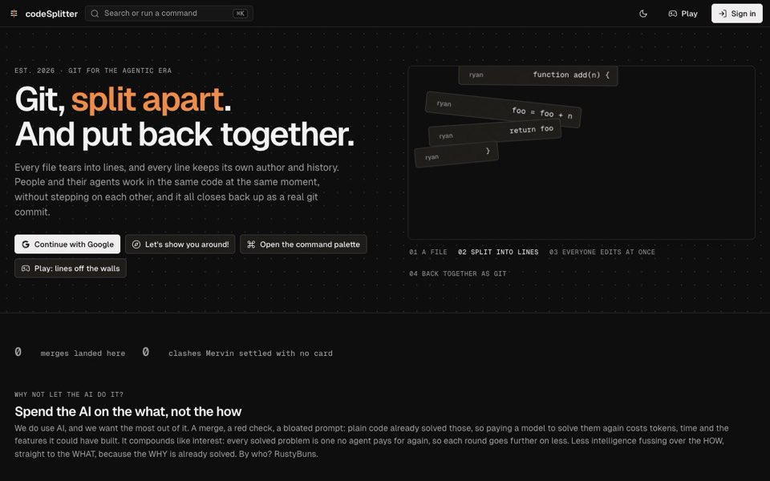</a><br><a href="apps/codesplitter/README.md" title="A code host for the agentic era. Each file is a Durable Object, and agents edit line by line. It has real git on Cloudflare Artifacts and an MCP server. One codebase runs on the edge and as a desktop app. Try it"><b>codeSplitter</b></a><br><sub><a href="https://codesplitter.notryanquinn.workers.dev">Play</a></sub></td></tr>
</table>

<details><summary>What each one proves</summary>

- **[codeSplitter](apps/codesplitter/README.md)**: A code host for the agentic era. Each file is a Durable Object, and agents edit line by line. It has real git on Cloudflare Artifacts and an MCP server. One codebase runs on the edge and as a desktop app. [Try it](https://codesplitter.notryanquinn.workers.dev)

</details>

### Games

These are for fun. Most of them play in the browser, and each one runs as a desktop app. They are in the same order as in eqosys.

<table>
<tr><td align="center" valign="top"><a href="apps/park-hide-seek/README.md"></a><br><a href="apps/park-hide-seek/README.md" title="3D hide and seek on real Yosemite terrain. The page, a LAN host or the edge can run the game. Each player gets only what they can see. Play it"><b>Park Hide & Seek</b></a><br><sub><a href="https://park-hide-seek.notryanquinn.workers.dev">Play</a></sub></td><td align="center" valign="top"><a href="apps/git-recon/README.md"></a><br><a href="apps/git-recon/README.md" title="A repo as a shooter level. Its folders become compounds and its files become buildings, on real ground (Yosemite, or any lat/long) or in a plastic-army kitchen and garden. Git commands are the weapons. Play alone in the page, with up to 64 players in a LAN battle, or online in a Durable Object for each room."><b>Git Recon</b></a><br><sub><a href="https://git-recon.notryanquinn.workers.dev">Play</a></sub></td><td align="center" valign="top"><a href="apps/skate-tech-park/README.md"></a><br><a href="apps/skate-tech-park/README.md" title="Skate a street spot, or fly a rocket roadster with ten cold-gas thrusters across the gap. It is a three.js page on a pure fixed-step sim, which the tests run headless."><b>Skate Tech Park</b></a><br><sub><a href="https://skatetechpark.notryanquinn.workers.dev">Play</a></sub></td><td align="center" valign="top"><a href="apps/alien-disc-golf/README.md"></a><br><a href="apps/alien-disc-golf/README.md" title="Disc golf where the course is the planet: nine holes between random countries on a three.js globe. NOAA's live wind carries the disc, and a high throw rides the jet stream. The Worker relays the latest GFS grid from NOMADS, and the page decodes the GRIB2. Guess the tee's country to get one stroke back."><b>Alien Disc Golf</b></a><br><sub><a href="https://alien-disc-golf.notryanquinn.workers.dev">Play</a></sub></td></tr>
<tr><td align="center" valign="top"><a href="apps/delayed-reaction/README.md">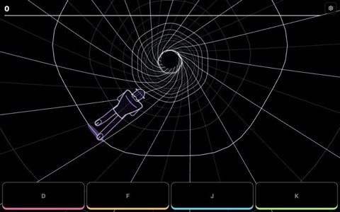</a><br><a href="apps/delayed-reaction/README.md" title="A phone-first rhythm game. You sprint through a neon tunnel that rolls. A ring calls a note, and you answer one bar later on one of four thumb pads. Your answers echo back through a dub delay. The sim plays in beats with no page, and thus a test runs each level."><b>Delayed Reaction</b></a><br><sub>Coming soon</sub></td><td align="center" valign="top"><a href="apps/two-fronts/README.md">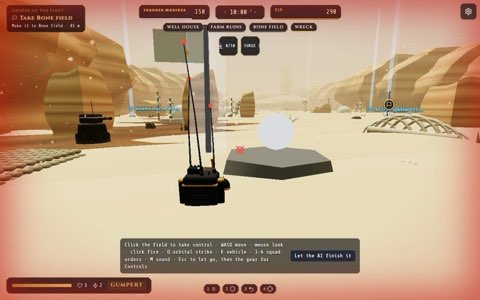</a><br><a href="apps/two-fronts/README.md" title="Thunder Marines against the Wooka horde: a turn-based galactic war with three.js hero battles in orbit and on six worlds. There is one world for each kind of sector: redwood forest, desert, ruined city, glowing alien night, beach and deep-space station. The two parts were built apart and connect through small JSON types (a spec in, a result out). Play the AI or hotseat in the page, or a friend online through a Durable Object for each campaign."><b>Two Fronts</b></a><br><sub><a href="https://two-fronts.notryanquinn.workers.dev">Play</a></sub></td><td align="center" valign="top"><a href="apps/hippo-tycoon/README.md">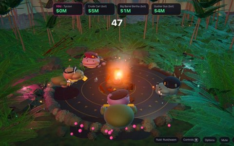</a><br><a href="apps/hippo-tycoon/README.md" title="One game class runs as a Durable Object on Cloudflare and in-process in the binary: solo, couch, LAN party and online rooms."><b>Hippo Tycoon</b></a><br><sub><a href="https://hippo-ty32kk4m44sz57g2i6knvzzb7o-production.up.railway.app">Play</a></sub></td><td align="center" valign="top"><a href="apps/splat-spray/README.md">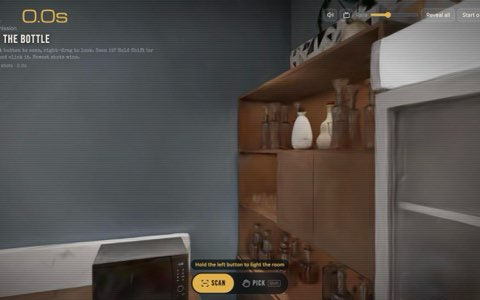</a><br><a href="apps/splat-spray/README.md" title="A spy game in a pitch-dark Gaussian-splat room. A short config makes the three.js page a desktop app, and the same page races friends online on a Worker."><b>Super Spy Splat Shot</b></a><br><sub><a href="https://supersplatspyshot.notryanquinn.workers.dev">Play</a></sub></td></tr>
<tr><td align="center" valign="top"><a href="apps/mythic-masters/README.md">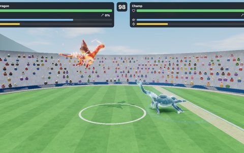</a><br><a href="apps/mythic-masters/README.md" title="A 3D creature arena brawler where mass, height and stats shape each body, and flyers must come down. A headless bot-vs-bot tuner keeps 76 folklore beasts near a 50% win rate, from a 6 kg jackalope to a one-tonne lake monster. One arena layout has a skin for each built region, on a route of 64."><b>Mythic Masters</b></a><br><sub><a href="https://mythic-masters.notryanquinn.workers.dev">Play</a></sub></td><td align="center" valign="top"><a href="apps/excalibrawl/README.md">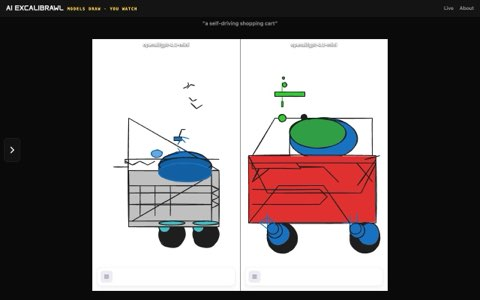</a><br><a href="apps/excalibrawl/README.md" title="A drawing fight each hour. Clef and Clef Flash select only a move, shape, colour, grid cell and size from a picture of their halves. Or two text models write a drawing language that uses few tokens. Clef is the referee, and a fight costs two cents or less. Replays are in R2, and a Durable Object has the live socket."><b>Excalibrawl</b></a><br><sub><a href="https://excalibrawl.notryanquinn.workers.dev">Play</a></sub></td></tr>
</table>

<details><summary>What each one proves</summary>

- **[Park Hide & Seek](apps/park-hide-seek/README.md)**: 3D hide and seek on real Yosemite terrain. The page, a LAN host or the edge can run the game. Each player gets only what they can see. [Play it](https://park-hide-seek.notryanquinn.workers.dev)
- **[Git Recon](apps/git-recon/README.md)**: A repo as a shooter level. Its folders become compounds and its files become buildings, on real ground (Yosemite, or any lat/long) or in a plastic-army kitchen and garden. Git commands are the weapons. Play alone in the page, with up to 64 players in a LAN battle, or online in a Durable Object for each room.
- **[Skate Tech Park](apps/skate-tech-park/README.md)**: Skate a street spot, or fly a rocket roadster with ten cold-gas thrusters across the gap. It is a three.js page on a pure fixed-step sim, which the tests run headless.
- **[Alien Disc Golf](apps/alien-disc-golf/README.md)**: Disc golf where the course is the planet: nine holes between random countries on a three.js globe. NOAA's live wind carries the disc, and a high throw rides the jet stream. The Worker relays the latest GFS grid from NOMADS, and the page decodes the GRIB2. Guess the tee's country to get one stroke back.
- **[Delayed Reaction](apps/delayed-reaction/README.md)**: A phone-first rhythm game. You sprint through a neon tunnel that rolls. A ring calls a note, and you answer one bar later on one of four thumb pads. Your answers echo back through a dub delay. The sim plays in beats with no page, and thus a test runs each level.
- **[Two Fronts](apps/two-fronts/README.md)**: Thunder Marines against the Wooka horde: a turn-based galactic war with three.js hero battles in orbit and on six worlds. There is one world for each kind of sector: redwood forest, desert, ruined city, glowing alien night, beach and deep-space station. The two parts were built apart and connect through small JSON types (a spec in, a result out). Play the AI or hotseat in the page, or a friend online through a Durable Object for each campaign.
- **[Hippo Tycoon](apps/hippo-tycoon/README.md)**: One game class runs as a Durable Object on Cloudflare and in-process in the binary: solo, couch, LAN party and online rooms.
- **[Super Spy Splat Shot](apps/splat-spray/README.md)**: A spy game in a pitch-dark Gaussian-splat room. A short config makes the three.js page a desktop app, and the same page races friends online on a Worker.
- **[Mythic Masters](apps/mythic-masters/README.md)**: A 3D creature arena brawler where mass, height and stats shape each body, and flyers must come down. A headless bot-vs-bot tuner keeps 76 folklore beasts near a 50% win rate, from a 6 kg jackalope to a one-tonne lake monster. One arena layout has a skin for each built region, on a route of 64.
- **[Excalibrawl](apps/excalibrawl/README.md)**: A drawing fight each hour. Clef and Clef Flash select only a move, shape, colour, grid cell and size from a picture of their halves. Or two text models write a drawing language that uses few tokens. Clef is the referee, and a fight costs two cents or less. Replays are in R2, and a Durable Object has the live socket.

</details>

### One account, one front door

These connect the apps: one sign-in for all of them, and one page that lists them.

<table>
<tr><td align="center" valign="top"><a href="apps/eqosys/README.md">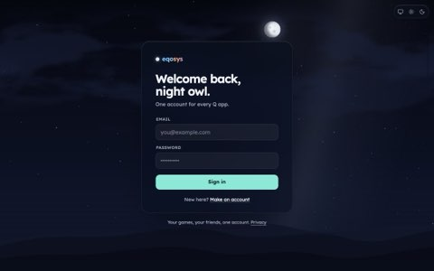</a><br><a href="apps/eqosys/README.md" title="Your home for each Q game: your games, friends, saves and studio on one account. Below it is Better Auth on D1, with a PKCE code handoff to each app and a signed token that the app can check alone. It knows which app each person came from and what they can do in each. A Durable Object for each person holds friends, presence and notifications. It is also a plain OpenID provider for a site's own Better Auth or a native app."><b>eqosys</b></a><br><sub><a href="https://eqosys.qntbr.com">Play</a></sub></td><td align="center" valign="top"><a href="apps/playground/README.md">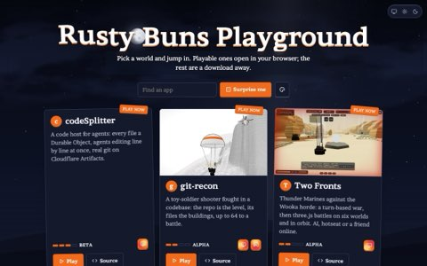</a><br><a href="apps/playground/README.md" title="One page that lists each app with a way to try it: Play, Download or Source. It has static assets only, and thus it costs nothing."><b>Playground</b></a></td><td align="center" valign="top"><a href="apps/qollab/README.md" title="Realtime rooms for any app on Cloudflare: rooms, seats, parties, presence and saves in one call. It is built into eqosys as its own Worker, with a Durable Object for each player and each room."><b>Qollab</b></a></td></tr>
</table>

<details><summary>What each one proves</summary>

- **[eqosys](apps/eqosys/README.md)**: Your home for each Q game: your games, friends, saves and studio on one account. Below it is Better Auth on D1, with a PKCE code handoff to each app and a signed token that the app can check alone. It knows which app each person came from and what they can do in each. A Durable Object for each person holds friends, presence and notifications. It is also a plain OpenID provider for a site's own Better Auth or a native app.
- **[Playground](apps/playground/README.md)**: One page that lists each app with a way to try it: Play, Download or Source. It has static assets only, and thus it costs nothing.
- **[Qollab](apps/qollab/README.md)**: Realtime rooms for any app on Cloudflare: rooms, seats, parties, presence and saves in one call. It is built into eqosys as its own Worker, with a Durable Object for each player and each room.

</details>

### My apps

Real tools for real work. Some have their own license.

<table>
<tr><td align="center" valign="top"><a href="apps/what-would-fantano-say/README.md">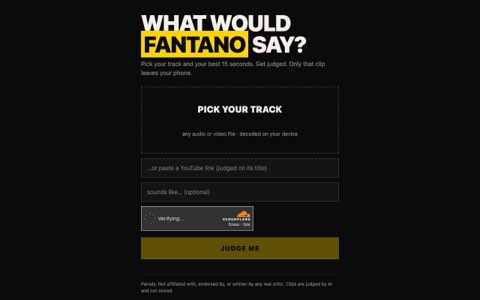</a><br><a href="apps/what-would-fantano-say/README.md" title="A parody music critic as an RWSDK Worker. The phone decodes the song and selects a 15 s clip. Cloudflare's Clef-omni judges it for approximately $5 for each 100,000 reviews. It is behind a rate limit, Turnstile, an edge cache and a daily budget."><b>What Would Fantano Say</b></a><br><sub><a href="https://what-would-fantano-say.notryanquinn.workers.dev">Play</a></sub></td><td align="center" valign="top"><a href="apps/brianfloresblitzing/README.md">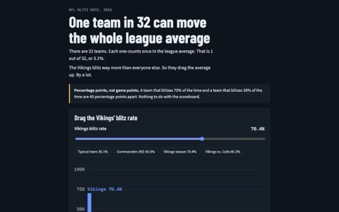</a><br><a href="apps/brianfloresblitzing/README.md" title="One static page (&quot;One Team in 32&quot;), which a Cloudflare Worker serves as plain assets. There is no Worker code."><b>One Team in 32</b></a></td><td align="center" valign="top"><a href="apps/qcrm/README.md">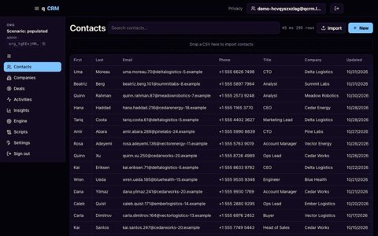</a><br><a href="apps/qcrm/README.md" title="A CRM with MCP built in, a Rust wasm engine in the browser, office sync, signed webhooks and a desktop build. It has roles for a real place and hashed org ids. QNTBR-licensed."><b>qCRM</b></a><br><sub><a href="https://qcrm.qntbr.com">Play</a></sub></td><td align="center" valign="top"><a href="apps/geoboxq/README.md">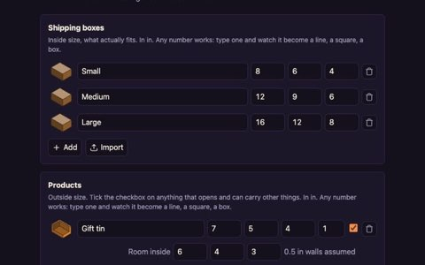</a><br><a href="apps/geoboxq/README.md" title="A fit checker for shipping boxes, with a Rust engine that packs boxes in boxes. Private license."><b>GeoBoxQ</b></a><br><sub><a href="https://geoboxq-worker-live-ryanquinn-tjhne4lpmumy6kz5.notryanquinn.workers.dev">Play</a></sub></td></tr>
<tr><td align="center" valign="top"><a href="apps/at-lens/README.md">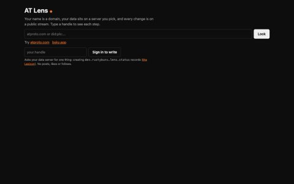</a><br><a href="apps/at-lens/README.md" title="Type a handle and watch the AT Protocol work: domain to DID to data server to typed records, checked in the two directions. Then see the account live on the Jetstream firehose. Sign in with atproto OAuth to write a record of our own Lexicon and watch it come back. No keys and no bindings."><b>AT Lens</b></a></td><td align="center" valign="top"><a href="apps/sharesplat/README.md">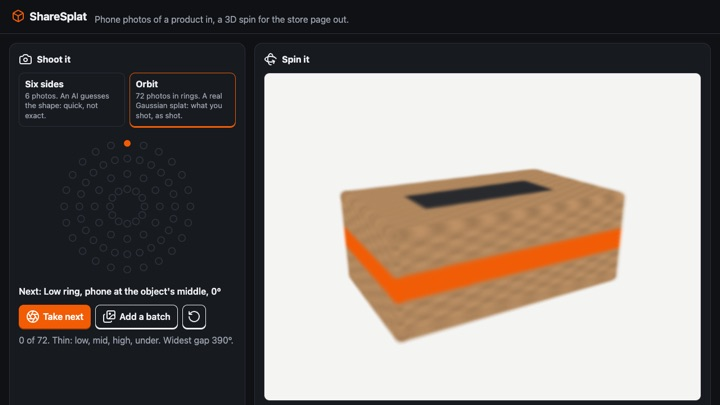</a><br><a href="apps/sharesplat/README.md" title="Product photos become a 3D spin for a store page. A guided shot list on the phone takes six sides for an AI-guessed mesh, or 72 photos in rings for a real Gaussian splat. A turntable splat viewer has a Shopify embed that you paste in."><b>ShareSplat</b></a><br><sub><a href="https://sharesplat.notryanquinn.workers.dev">Play</a></sub></td><td align="center" valign="top"><a href="apps/geoboxq-shopify/README.md" title="A small wrapper that turns a Shopify cart into the store's own box."><b>GeoBoxQ for Shopify</b></a></td><td align="center" valign="top"><a href="apps/artstewengine/README.md" title="A small RWSDK app on D1 with a Better Auth admin page. Add who has paid, and the sealed engine of qCRM gets its key only for a paid license."><b>artstewengine</b></a></td></tr>
</table>

<details><summary>What each one proves</summary>

- **[What Would Fantano Say](apps/what-would-fantano-say/README.md)**: A parody music critic as an RWSDK Worker. The phone decodes the song and selects a 15 s clip. Cloudflare's Clef-omni judges it for approximately $5 for each 100,000 reviews. It is behind a rate limit, Turnstile, an edge cache and a daily budget.
- **[One Team in 32](apps/brianfloresblitzing/README.md)**: One static page ("One Team in 32"), which a Cloudflare Worker serves as plain assets. There is no Worker code.
- **[qCRM](apps/qcrm/README.md)**: A CRM with MCP built in, a Rust wasm engine in the browser, office sync, signed webhooks and a desktop build. It has roles for a real place and hashed org ids. QNTBR-licensed.
- **[GeoBoxQ](apps/geoboxq/README.md)**: A fit checker for shipping boxes, with a Rust engine that packs boxes in boxes. Private license.
- **[AT Lens](apps/at-lens/README.md)**: Type a handle and watch the AT Protocol work: domain to DID to data server to typed records, checked in the two directions. Then see the account live on the Jetstream firehose. Sign in with atproto OAuth to write a record of our own Lexicon and watch it come back. No keys and no bindings.
- **[ShareSplat](apps/sharesplat/README.md)**: Product photos become a 3D spin for a store page. A guided shot list on the phone takes six sides for an AI-guessed mesh, or 72 photos in rings for a real Gaussian splat. A turntable splat viewer has a Shopify embed that you paste in.
- **[GeoBoxQ for Shopify](apps/geoboxq-shopify/README.md)**: A small wrapper that turns a Shopify cart into the store's own box.
- **[artstewengine](apps/artstewengine/README.md)**: A small RWSDK app on D1 with a Better Auth admin page. Add who has paid, and the sealed engine of qCRM gets its key only for a paid license.

</details>

### The workshop

Music, 3D and circuits: tools to make things. Where it helps, a Rust engine runs with a TypeScript engine.

<table>
<tr><td align="center" valign="top"><a href="apps/splat-rooms/README.md">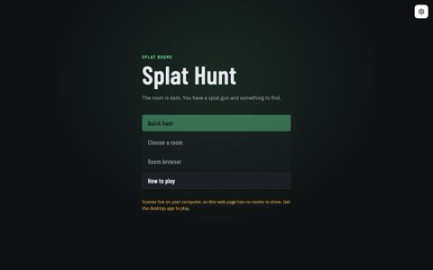</a><br><a href="apps/splat-rooms/README.md" title="A splat hunt game with a world class. Its 30 MB scenes stream from a folder on your disk and are never embedded."><b>Splat Rooms</b></a><br><sub><a href="https://splat-rooms.notryanquinn.workers.dev">Play</a></sub></td><td align="center" valign="top"><a href="apps/fm-daw/README.md">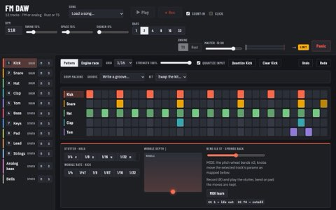</a><br><a href="apps/fm-daw/README.md" title="One Rust crate runs as wasm in the audio thread and through FFI on the host. Its output is bit-identical to the TypeScript engine."><b>FM Groovebox</b></a><br><sub><a href="https://fm-daw-worker-live-ryanquinn-ugis7btfi5dsu52t.notryanquinn.workers.dev">Play</a></sub></td><td align="center" valign="top"><a href="apps/auto-rig/README.md">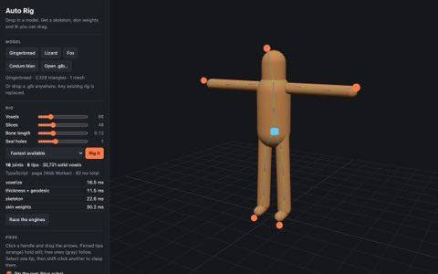</a><br><a href="apps/auto-rig/README.md" title="Auto-rigging a 3D model in Rust and TypeScript with identical output"><b>Auto Rig</b></a><br><sub><a href="https://auto-rig.notryanquinn.workers.dev">Play</a></sub></td><td align="center" valign="top"><a href="apps/meshy-studio/README.md">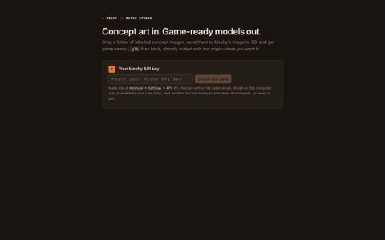</a><br><a href="apps/meshy-studio/README.md" title="A folder-based batch tool for the Meshy API: image, multi-image and text to 3D, texture, remesh, rig, animate and concept art. Your key stays local, and you see the price before each spend."><b>Meshy Studio</b></a></td></tr>
<tr><td align="center" valign="top"><a href="apps/tscircuit-desktop/README.md">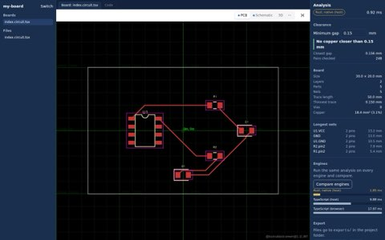</a><br><a href="apps/tscircuit-desktop/README.md" title="A heavy, real-world Vite app as one file, with a Rust engine up to 22x faster and a TypeScript fallback"><b>tscircuit Desktop</b></a></td><td align="center" valign="top"><a href="apps/motion-midi/README.md" title="One synth in Rust and in TypeScript, checked sample by sample"><b>Motion MIDI</b></a></td><td align="center" valign="top"><a href="apps/splat-desktop/README.md" title="PlayCanvas' SuperSplat editor as a desktop app. It works on a folder on your disk."><b>Splat Desktop</b></a></td><td align="center" valign="top"><a href="apps/pixel-rag/README.md" title="Add your screenshots and find the parts that look the same in all of them. Each worker, web or desktop, shares one Rust index."><b>Pixel RAG</b></a></td></tr>
</table>

<details><summary>What each one proves</summary>

- **[Splat Rooms](apps/splat-rooms/README.md)**: A splat hunt game with a world class. Its 30 MB scenes stream from a folder on your disk and are never embedded.
- **[FM Groovebox](apps/fm-daw/README.md)**: One Rust crate runs as wasm in the audio thread and through FFI on the host. Its output is bit-identical to the TypeScript engine.
- **[Motion MIDI](apps/motion-midi/README.md)**: One synth in Rust and in TypeScript, checked sample by sample
- **[Auto Rig](apps/auto-rig/README.md)**: Auto-rigging a 3D model in Rust and TypeScript with identical output
- **[Meshy Studio](apps/meshy-studio/README.md)**: A folder-based batch tool for the Meshy API: image, multi-image and text to 3D, texture, remesh, rig, animate and concept art. Your key stays local, and you see the price before each spend.
- **[Splat Desktop](apps/splat-desktop/README.md)**: PlayCanvas' SuperSplat editor as a desktop app. It works on a folder on your disk.
- **[tscircuit Desktop](apps/tscircuit-desktop/README.md)**: A heavy, real-world Vite app as one file, with a Rust engine up to 22x faster and a TypeScript fallback
- **[Pixel RAG](apps/pixel-rag/README.md)**: Add your screenshots and find the parts that look the same in all of them. Each worker, web or desktop, shares one Rust index.

</details>

### Everything else: frameworks, other people's apps and test fixtures

Sample apps from frameworks and apps from other people, which run with no code changes. Also the small apps that the tests use. A new app goes here first, until someone moves it to its section.

<table>
<tr><td align="center" valign="top"><a href="apps/hello-world/README.md" title="The first five minutes: a twenty-line page. The welcome tour finds it, lets three agents write it again at the same time, and then asks you to deploy it."><b>Hello World</b></a><br><sub><a href="https://hello-world.notryanquinn.workers.dev">Play</a></sub></td><td align="center" valign="top"><a href="apps/agent-office/README.md" title="Someone else's Node server (PTYs, WebSockets, a 3D client) as one binary, nothing forked"><b>Agent Office</b></a></td><td align="center" valign="top"><a href="apps/terraviz-demo/README.md" title="TerraViz is the Science On a Sphere globe of The Zyra Project (Apache-2.0, not ours). We clone it and run it with no code changes. Shared Sphere adds a room on one globe and a teacher's lock, so that a class follows one pair of hands. NOAA tour scripts stay in step on each screen, and a small Rust crate reads them as slides."><b>TerraViz</b></a></td><td align="center" valign="top"><a href="apps/nuxt-example/README.md" title="A Nuxt 4 app on the cloudflare-module preset of Nitro (one KV binding), as a desktop app with no edits. init reads it, and the host runs the Worker that Nitro built. The same shared HTTP journey checks it."><b>Nuxt</b></a></td><td align="center" valign="top"><a href="apps/qwik-example/README.md" title="A Qwik City app on its own cloudflare-pages adapter, as a desktop app with no edits. A routeLoader$ and a routeAction$ count in KV through platform.env. init reads the adapter's dist/_worker.js as it is."><b>Qwik City</b></a></td><td align="center" valign="top"><a href="apps/astro-example/README.md" title="An Astro site on @astrojs/cloudflare, as a desktop app with no edits. A server page and an API route count in KV through cloudflare:workers. init reads it as it is."><b>Astro</b></a></td></tr>
<tr><td align="center" valign="top"><a href="apps/elysia-example/README.md" title="An Elysia Worker as the Cloudflare guide of Elysia writes it (aot: false, cloudflare:workers), as a desktop app with no edits. init now reads Elysia."><b>Elysia</b></a></td><td align="center" valign="top"><a href="apps/sveltekit-example/README.md" title="A SvelteKit 3 app on the Cloudflare adapter, as a desktop app with no edits. It has a load from KV and a form action that increments it. It meets the same sample app contract as hono-example, and the same shared journey checks it."><b>SvelteKit</b></a></td><td align="center" valign="top"><a href="apps/solidstart-example/README.md" title="A SolidStart 2 app on the cloudflare_module preset of Nitro, as a desktop app with no edits. A &quot;use server&quot; query and an API route count in KV through cloudflare:workers. rustybuns init reads it as it is."><b>SolidStart</b></a></td><td align="center" valign="top"><a href="apps/react-router-example/README.md" title="React Router 7 on Cloudflare's own template (workers/app.ts, the Vite plugin, a loader and an action on KV), as a desktop app with no edits. It is the second framework on the shared sample-app journey."><b>React Router</b></a></td><td align="center" valign="top"><a href="apps/nextjs-example/README.md" title="A Next.js 16 app on @opennextjs/cloudflare (one KV binding), as a desktop app with no edits. init reads it, and the host runs the worker.js that OpenNext built. The same shared HTTP journey checks it."><b>Next.js</b></a></td><td align="center" valign="top"><a href="apps/svelte-spa-example/README.md" title="A client-only Svelte 5 + Vite app (no server) as a desktop app. Its counter is in a &quot;use server&quot; action that the host runs."><b>Svelte SPA</b></a></td></tr>
<tr><td align="center" valign="top"><a href="apps/vue-spa-example/README.md" title="A client-only Vue 3 + Vite app (no server) as a desktop app. Its counter is in a &quot;use server&quot; action that the host runs."><b>Vue SPA</b></a></td><td align="center" valign="top"><a href="apps/solid-spa-example/README.md" title="A client-only Solid + Vite app (no server) as a desktop app. Its counter is in a &quot;use server&quot; action that the host runs."><b>Solid SPA</b></a></td><td align="center" valign="top"><a href="apps/hono-example/README.md" title="A Hono Worker from Hono's own docs (one KV binding), as a desktop app with no edits. It is the sample app contract that each framework example meets, and one shared HTTP journey checks it."><b>Hono</b></a></td><td align="center" valign="top"><a href="apps/elysia-conduit/RUSTYBUNS.md" title="The RealWorld backend of bedstack (Elysia, Drizzle, postgres.js) with no source edits. It is a desktop binary on PGlite that passes their Postman suite. The doc lists the five ways that it breaks on Workers."><b>Elysia RealWorld</b></a></td><td align="center" valign="top"><a href="apps/tanstack-start-example/README.md" title="TanStack Start on Cloudflare's Vite plugin (server functions, a server route, D1 and KV) as a desktop app with no code changes."><b>TanStack Start</b></a></td><td align="center" valign="top"><a href="apps/agent-demo/README.md" title="A small snack-vote Worker that is seeded into codeSplitter. Some coding agents can build it at the same time and resolve a merge conflict on camera."><b>Agent Demo</b></a></td></tr>
<tr><td align="center" valign="top"><a href="apps/borg-postgres/README.md" title="A Postgres app keeps its database and moves its code: Hyperdrive on the edge, PGlite on the desktop."><b>Borg Postgres</b></a></td><td align="center" valign="top"><a href="apps/borg/README.md" title="Not an app: a small Worker that uses each binding one time. Thus one suite can check the local twins against a real deploy."><b>Borg</b></a></td><td align="center" valign="top"><a href="apps/spa-example/README.md" title="Not an app: a part of a real RWSDK game. The tests use it to check that init reads it correctly."><b>SPA fixture</b></a></td><td align="center" valign="top"><a href="apps/example/README.md" title="A full Worker (D1, KV, a Durable Object) as a desktop binary in half a second, and a Rust FFI probe with a TypeScript fallback."><b>Worker example</b></a></td></tr>
</table>

<details><summary>What each one proves</summary>

- **[Hello World](apps/hello-world/README.md)**: The first five minutes: a twenty-line page. The welcome tour finds it, lets three agents write it again at the same time, and then asks you to deploy it.
- **[Agent Office](apps/agent-office/README.md)**: Someone else's Node server (PTYs, WebSockets, a 3D client) as one binary, nothing forked
- **[TerraViz](apps/terraviz-demo/README.md)**: TerraViz is the Science On a Sphere globe of The Zyra Project (Apache-2.0, not ours). We clone it and run it with no code changes. Shared Sphere adds a room on one globe and a teacher's lock, so that a class follows one pair of hands. NOAA tour scripts stay in step on each screen, and a small Rust crate reads them as slides.
- **[Nuxt](apps/nuxt-example/README.md)**: A Nuxt 4 app on the `cloudflare-module` preset of Nitro (one KV binding), as a desktop app with no edits. `init` reads it, and the host runs the Worker that Nitro built. The same shared HTTP journey checks it.
- **[Qwik City](apps/qwik-example/README.md)**: A Qwik City app on its own `cloudflare-pages` adapter, as a desktop app with no edits. A `routeLoader$` and a `routeAction$` count in KV through `platform.env`. `init` reads the adapter's `dist/_worker.js` as it is.
- **[Astro](apps/astro-example/README.md)**: An Astro site on `@astrojs/cloudflare`, as a desktop app with no edits. A server page and an API route count in KV through `cloudflare:workers`. `init` reads it as it is.
- **[Elysia](apps/elysia-example/README.md)**: An Elysia Worker as the Cloudflare guide of Elysia writes it (`aot: false`, `cloudflare:workers`), as a desktop app with no edits. `init` now reads Elysia.
- **[SvelteKit](apps/sveltekit-example/README.md)**: A SvelteKit 3 app on the Cloudflare adapter, as a desktop app with no edits. It has a `load` from KV and a form action that increments it. It meets the same sample app contract as hono-example, and the same shared journey checks it.
- **[SolidStart](apps/solidstart-example/README.md)**: A SolidStart 2 app on the `cloudflare_module` preset of Nitro, as a desktop app with no edits. A `"use server"` query and an API route count in KV through `cloudflare:workers`. `rustybuns init` reads it as it is.
- **[React Router](apps/react-router-example/README.md)**: React Router 7 on Cloudflare's own template (`workers/app.ts`, the Vite plugin, a loader and an action on KV), as a desktop app with no edits. It is the second framework on the shared sample-app journey.
- **[Next.js](apps/nextjs-example/README.md)**: A Next.js 16 app on `@opennextjs/cloudflare` (one KV binding), as a desktop app with no edits. `init` reads it, and the host runs the `worker.js` that OpenNext built. The same shared HTTP journey checks it.
- **[Svelte SPA](apps/svelte-spa-example/README.md)**: A client-only Svelte 5 + Vite app (no server) as a desktop app. Its counter is in a `"use server"` action that the host runs.
- **[Vue SPA](apps/vue-spa-example/README.md)**: A client-only Vue 3 + Vite app (no server) as a desktop app. Its counter is in a `"use server"` action that the host runs.
- **[Solid SPA](apps/solid-spa-example/README.md)**: A client-only Solid + Vite app (no server) as a desktop app. Its counter is in a `"use server"` action that the host runs.
- **[Hono](apps/hono-example/README.md)**: A Hono Worker from Hono's own docs (one KV binding), as a desktop app with no edits. It is the sample app contract that each framework example meets, and one shared HTTP journey checks it.
- **[Elysia RealWorld](apps/elysia-conduit/RUSTYBUNS.md)**: The RealWorld backend of bedstack (Elysia, Drizzle, postgres.js) with no source edits. It is a desktop binary on PGlite that passes their Postman suite. The doc lists the five ways that it breaks on Workers.
- **[TanStack Start](apps/tanstack-start-example/README.md)**: TanStack Start on Cloudflare's Vite plugin (server functions, a server route, D1 and KV) as a desktop app with no code changes.
- **[Agent Demo](apps/agent-demo/README.md)**: A small snack-vote Worker that is seeded into codeSplitter. Some coding agents can build it at the same time and resolve a merge conflict on camera.
- **[Borg Postgres](apps/borg-postgres/README.md)**: A Postgres app keeps its database and moves its code: Hyperdrive on the edge, PGlite on the desktop.
- **[Borg](apps/borg/README.md)**: Not an app: a small Worker that uses each binding one time. Thus one suite can check the local twins against a real deploy.
- **[SPA fixture](apps/spa-example/README.md)**: Not an app: a part of a real RWSDK game. The tests use it to check that `init` reads it correctly.
- **[Worker example](apps/example/README.md)**: A full Worker (D1, KV, a Durable Object) as a desktop binary in half a second, and a Rust FFI probe with a TypeScript fallback.

</details>

<!-- /apps -->

**Say hi:** I am Ryan Quinn, [QuinnsCode](https://github.com/QuinnsCode) on GitHub. Put bugs, ideas and "this broke on my machine" reports in [issues](https://github.com/QuinnsCode/RustyBuns/issues).

**Someone else's app, unchanged:** [TerraViz](https://github.com/zyra-project/terraviz) by The Zyra Project, led by Eric Hackathorn (NOAA Global Systems Laboratory), Apache-2.0. It is a Pages app with a 3D globe, approximately 100 API routes, D1, KV, R2 and Vectorize. `bun apps/terraviz-demo/run.ts` clones it and runs it on Rusty Buns with no code changes. This only shows how Rusty Buns maps an existing app to its primitives. It is not a fork, and TerraViz's code is not in this repo. Credit, license and run instructions: [apps/terraviz-demo](apps/terraviz-demo/README.md).

**Try one with no build:** Download the desktop binary for [Hippo Tycoon](https://github.com/QuinnsCode/RustyBuns/releases?q=hippo-tycoon-v&expanded=true), [Park Hide & Seek](https://github.com/QuinnsCode/RustyBuns/releases?q=park-hide-seek-v&expanded=true), [Super Spy Splat Shot](https://github.com/QuinnsCode/RustyBuns/releases?q=splat-spray-v&expanded=true) or [FM Groovebox](https://github.com/QuinnsCode/RustyBuns/releases?q=fm-daw-v&expanded=true). Each is one file for Mac, Windows or Linux. They are not signed yet:

- **On a Mac**, the first launch needs one Terminal command. The release page has it. [APPLE_SIGNING.md](APPLE_SIGNING.md) is the plan to fix that.
- **On Windows**, click past SmartScreen. [WINDOWS_LINUX_SIGNING.md](WINDOWS_LINUX_SIGNING.md) is that plan, and it tells you that Linux needs no key.

To run them from source, see [EXAMPLES.md](EXAMPLES.md). It has two lines for each app, and you need no experience.

## Get started

You need Bun 1.4+ and an app that builds with `vite build`. If your app uses Create React App or Vue CLI, `rustybuns init --port-vite` moves it to Vite first.

```sh
pnpm add -D @rustybuns/cli @rustybuns/shell-bun
pnpm exec rustybuns init                          # prints what it found and writes one config
pnpm exec rustybuns add desktop
pnpm exec rustybuns build desktop --dev && pnpm exec rustybuns run desktop
```

Your app opens in Chrome. It runs on a local Bun host with sqlite behind each binding. To deploy to the cloud:

```sh
pnpm exec rustybuns add deploy     # pinned Alchemy + Effect
pnpm exec rustybuns plan           # creates nothing, shows what it will create
pnpm exec rustybuns deploy         # stops without a matching plan, then asks you
pnpm exec rustybuns destroy        # removes everything it created
```

## Read more

- [ABOUT.md](ABOUT.md): why it exists (it started with grass) and who makes it
- [GETTING_STARTED.md](GETTING_STARTED.md): the full procedure, step by step
- [MAC_SETUP.md](MAC_SETUP.md): how to set up a new Mac to run the office and agents, and a second Mac as their test machine
- [AGENT_PROMPTS.md](AGENT_PROMPTS.md): prompts that you paste into your coding agent to try Rusty Buns on your repo
- [REFERENCE.md](REFERENCE.md): each command and config key, the host, the Hetzner and Railway boxes, LAN multiplayer, and who holds the keys to secrets
- [ADOPTION.md](ADOPTION.md): who it is for, and how to adopt it (and remove it)
- [ACCESSIBILITY.md](ACCESSIBILITY.md): what is accessible today, the reading settings, and how to report a barrier
- [COSTS.md](COSTS.md): what each deploy can cost you, and how to set a limit
- [FRAMEWORKS.md](FRAMEWORKS.md): frameworks other than Vite + React
- [FRAMEWORK_COVERAGE.md](FRAMEWORK_COVERAGE.md): how many real GitHub apps for each framework run with no changes
- [notes/ROADMAP.md](notes/ROADMAP.md): the resource matrix, and the build order for what is built and what is not

## License

Apache-2.0. See [LICENSING.md](LICENSING.md).
