<picture>
  <source media="(prefers-color-scheme: dark)" srcset="docs/readme-hero-night.svg">
  
</picture>

<p align="center">
  <a href="https://rustybuns-playground.notryanquinn.workers.dev"><b>Open the Playground</b></a> &nbsp;/&nbsp;
  <a href="GETTING_STARTED.md">Getting started</a> &nbsp;/&nbsp;
  <a href="EXAMPLES.md">Examples</a> &nbsp;/&nbsp;
  <a href="REFERENCE.md">Reference</a>
</p>

# Rusty Buns: write your app logic once, ship it everywhere

**Write your app's logic one time in TypeScript and keep it typed across web, desktop (macOS, Windows, Linux) and the phone. Deploy it anywhere with the power of Effect and Alchemy. You own your code, we are just a dev dependency meta metaframework helping your own app code fit into as many places possibly with ease.**

**This has been my idea engine: a meta-metaframework, typed from front to back.** Where I can write the app logic once, and then just piece by piece add on each new place it runs (a desktop file, a Worker, a server, a phone). I can reuse so much code and not trigger constant scope-creep and rewrites. You and your coding agents add them one after another.

**I call it Rusty Buns, but your app needs neither Rust nor Bun.** You need Bun to build the app, but that can be done on a dev server. Your app and your users do not need it. On the edge, the app is a plain Worker which can be TS or even WASM Rust. The desktop file has Bun inside it, so a user installs nothing. Rust is an option for speed, and it has a great interop story from native to client to server. I use Rust and Bun because they connect to everything so well.

### Your app is a sandwich: the meat is yours, the bread is the place it runs

Your business logic is the meat: the rules, the state, the types. It is SUPER MEATY, and you write it one time. Each place your app runs is a different bread around it. Want the page? Brioche. The edge? A pretzel bun. A server, a desktop file, a phone? Rye, a bagel, sourdough. Swap the bread, and the meat does not change.

<table>
  <tr>
    <td width="50%"></td>
    <td width="50%"></td>
  </tr>
  <tr>
    <td><b>1. The meat.</b> Your app module, in TypeScript. It doesn't know where it runs.</td>
    <td><b>2. Swap the bread.</b> Each target is a thin layer around the same meat.</td>
  </tr>
  <tr>
    <td></td>
    <td></td>
  </tr>
  <tr>
    <td><b>3. Bring the bread, copy the sandwich.</b> Add a target once and the meat goes everywhere.</td>
    <td><b>4. A weird club? Easy.</b> TypeScript meat and Rust meat with the same layers give the same answer.</td>
  </tr>
  <tr>
    <td></td>
    <td valign="top"><b>5. Some bread is hard to cut.</b> The phone is crusty sourdough: it takes a minute. Cut it once, put it in the bread box, and every sandwich can have it.<br><br>It's your code, so your wild ideas are fair game. Two breads on one sandwich, a third target nobody asked for: stack it.</td>
  </tr>
</table>

<sub>Drawn by <code>bun scripts/sandwich-gifs.ts</code> from <code>docs/sandwich/scenes.js</code>.</sub>

### Why bother with Rusty Buns?

1. **You own your code.** Rusty Buns is a dev dependency, like shadcn or Better Auth. It does not change `src/`. `git rm` removes it. Wanna do something weird? Do it, your code is your code.
2. **Write it one time. It runs in four places.** Desktop, edge, server and phone.
3. **The front is basically a Vite app.** Use any framework on top. Rusty Buns adds the extras.
4. **The back goes where you choose.** Edge or server, serverless or serverful. It fits each host because your app uses only five simple parts: http, comms, storage, memory and identity. Cloudflare, Railway and Hetzner are built in today. Alchemy supports more, and you can add those yourself.
5. **Typed from front to back.** One language from the page to the deploy. The compiler finds the errors first. We also add Effect.ts in because Alchemy uses it so start experimenting with it.
6. **Add systems speed when you need it.** Use Rust in the page or the backend. Or use C, Zig or any library that Bun's FFI can load. Rust just offers the best interop from edge to server to native imo.
7. **It costs nothing until you say yes.** It runs on your laptop with no cloud account.
8. **Easy to test.** A full copy of the app is a folder. Make ten copies in one test. Alchemy and Rusty Buns make it easy!
9. **Agents work fast and safely.** Small stack, free local runs, many agents at the same time.

### \~The Future of the App Module\~

Put your business logic in one TypeScript module: the rules, the state and the types. The module does not know where it runs.

For each target, write only the thin part that connects the module to http, comms and storage. The logic does not move.

```
          your app module: the rules, the state, the types
                               │
            one interface for each of the five parts
                               │
     ┌───────────┬─────────────┼─────────────┬─────────────┐
  the page    a Worker      a server     the desktop     a test
  (Vite)      + a DO       (Bun+sqlite)  (one file)   (a temp folder)
```

- **Client to server.** The page and the backend import the same module. They agree on each rule and each message.
- **TypeScript to Rust.** When one path must be faster, put Rust behind the same interface. The TypeScript twin gives the same answer, so the rest of the app does not change.
- **DX and DevOps that scale.** A new target is a new thin part, not a rewrite. An edge, a box and a desktop app together is not a hard setup.
- **Tests with mini copies.** `localBindings(dir)` gives a temp folder its own D1, KV, R2 and Durable Object storage. Each copy is the real app, with no cloud and no network.

### The Primitives: really just simpler wrappers

Each part is one line of config. Each line runs on a laptop and on the edge:

| Part | One line in `rustybuns.config.ts` | On the edge | On a laptop or server |
|---|---|---|---|
| **http** | `worker: { main: "src/worker.ts" }` | a Worker `fetch` | `Bun.serve` |
| **comms** | `WORLD: { type: "durable_object", className: "World" }` | a Durable Object | a class in the process |
| **storage** | `DB: { type: "d1", databaseName: "my-app" }` | D1, KV, R2 | sqlite and a folder |
| **memory** | nothing to add | the isolate | the process |
| **identity** | `SESSION_SECRET: { type: "secret" }` | your Worker or Access | the same code |

You write `env.DB.prepare(...)` one time. Rusty Buns gives `env.DB` the correct twin for each place, with its type from the config.

### What Rusty Buns stands on

These parts must work for Rusty Buns to work. All other parts are options.

| Part | What it does here | Needed for |
|---|---|---|
| **TypeScript** | the one language for the page, the backend, the config and the deploy | everything |
| **Bun 1.4+** | runs the backend, gives sqlite, compiles the one-file desktop binary, loads Rust through `bun:ffi` | everything |
| **Vite** | builds the page, with any framework on top (React, RWSDK, TanStack Start, Solid) | everything |
| **The Cloudflare shapes** | `fetch`, Durable Objects, D1, KV and R2: the five primitives. Each has a local twin on Bun and sqlite | every target |
| **Effect** | the deploy is a set of typed Layers, and child processes, sockets and deploys clean up after a failure | deploying |
| **Alchemy** | the infrastructure as TypeScript: `plan`, `deploy`, `drift` and `destroy` against its typed state | deploying |
| **Chrome** | the desktop app's window | the desktop |

**Options:** Rust (with a TypeScript twin), Cloudflare itself, Railway, Hetzner, Postgres, SwiftUI for a native iOS client.

Install it and try it:

```sh
pnpm add -D @rustybuns/cli @rustybuns/shell-bun
pnpm exec rustybuns init                # reads your app, writes rustybuns.config.ts
pnpm exec rustybuns build desktop       # dist/<name>-<os>-<arch>: one file, double-click it
pnpm exec rustybuns deploy              # Cloudflare, plus a Hetzner or Railway box
```

> **Alpha, `0.1.12`.** Bun can have problems on Windows. If it does, build on a Linux server, and tell me. The Cloudflare deploy is tested from start to end, and the Railway and Hetzner boxes are tested live. If a new release does not install, your package manager's minimum release age can be the cause. [Getting started](GETTING_STARTED.md) has a one-minute fix.

**Try it live:** The [Playground](https://rustybuns-playground.notryanquinn.workers.dev) lists each example app, with a way to play it, download it or read its source. Rusty Buns deployed all of them.

<table>
<tr><td width="33%" align="center"><a href="https://park-hide-seek.notryanquinn.workers.dev">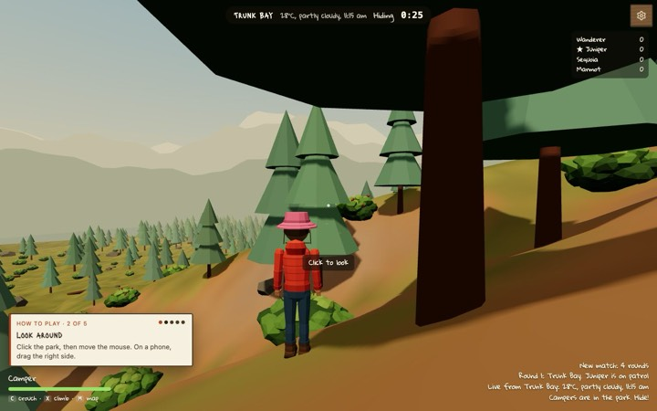<br><b>Park Hide &amp; Seek</b></a></td><td width="33%" align="center"><a href="https://git-recon.notryanquinn.workers.dev">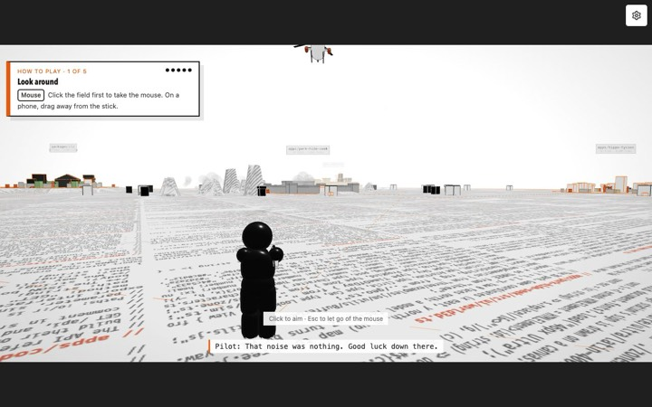<br><b>Git Recon</b></a></td><td width="33%" align="center"><a href="https://skatetechpark.notryanquinn.workers.dev">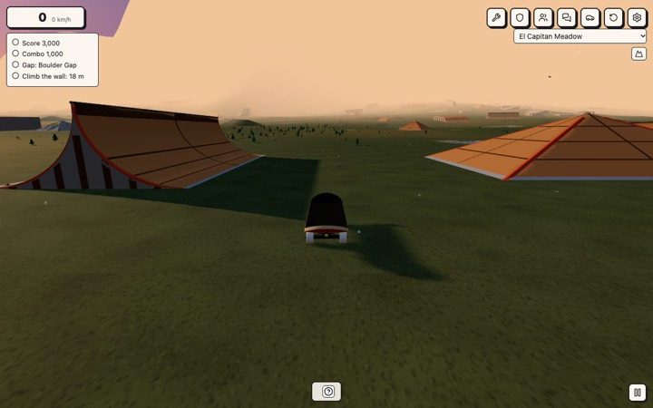<br><b>Skate Tech Park</b></a></td></tr>
<tr><td width="33%" align="center"><a href="https://alien-disc-golf.notryanquinn.workers.dev">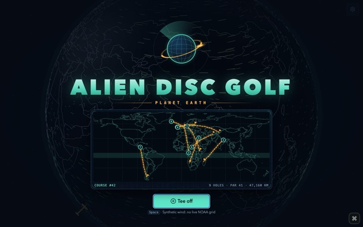<br><b>Alien Disc Golf</b></a></td><td width="33%" align="center"><a href="https://two-fronts.notryanquinn.workers.dev"><br><b>Two Fronts</b></a></td><td width="33%" align="center"><a href="https://supersplatspyshot.notryanquinn.workers.dev">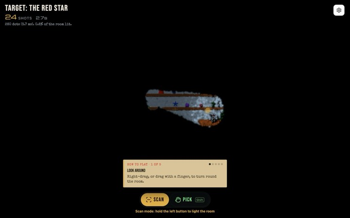<br><b>Super Spy Splat Shot</b></a></td></tr>
</table>

<p align="center"><sub>Click a card to play the game. Almost all of the games have a multiplayer mode.</sub></p>

## 1. TypeScript wide, Rust deep

**Wide interop.** The page, the backend, the config and the deploy are all TypeScript. You can use each framework, npm package and Cloudflare binding directly. There is no IPC bridge, no command layer and no YAML.

**Deep power when you need it.** Some work is too slow in TypeScript (audio, physics, geometry, a solver). Write only that part in Rust:

- **On the desktop and the box**, `@rustybuns/native` loads a Rust cdylib through `bun:ffi` and calls it directly.
- **In the page or on the edge**, the same crate runs as wasm.
- **Rust is always optional.** Each Rust engine has a TypeScript twin that gives the same answer, and the app uses the twin if Rust cannot load.

Start in TypeScript. Use Rust only where it gives a clear increase in speed. More in [Rust when you need it, TypeScript always](#rust-when-you-need-it-typescript-always).

## 2. Buy into the simple primitives, and we move you

**Each web app with a backend has five parts:**

| Primitive | What it is | The Cloudflare shape you write against |
|---|---|---|
| **http** | the way in, simple and not time-critical | a `fetch` handler |
| **comms** | live messages, and faster | Durable Objects and WebSockets |
| **storage** | data that you keep | D1, KV and R2 |
| **memory** | fast data that a restart removes | the isolate or the process |
| **identity** | who each user is | your Worker, Access, or a token |

**Cloudflare gave each part a small, standard shape.** You write your code for those shapes one time.

**Rusty Buns gives each shape a local twin on Bun and sqlite.** Thus the same app runs in each of these places from one `rustybuns.config.ts`:

- **The desktop.** One file for each OS, which a user double-clicks. The backend runs on a local Bun host, and the UI opens in Chrome. See [A one-file desktop app in real Chrome](#a-one-file-desktop-app-in-real-chrome).
- **The edge.** A Cloudflare Worker with D1, KV, R2 and Durable Objects, deployed from the same list of bindings. See [One config, three targets](#one-config-three-targets).
- **A server.** The same binary on a Railway or Hetzner box, with sqlite on a volume.

- **The phone.** The same page installs to the home screen and plays with no signal ([On the home screen](#on-the-home-screen-and-playable-with-no-signal)). When a screen must feel native, a SwiftUI app is a thin client of the same edge, and the logic stays in TypeScript ([A native iOS app as a thin client](#a-native-ios-app-as-a-thin-client)).

Your code is the same on each target, and no Rusty Buns code is in your app. Thus Rusty Buns is a meta metaframework: a framework for frameworks. It does not replace Vite, React, RWSDK, TanStack Start, Elysia, Wasp or Solid. It works on top of them, and it is a Bun program. The preferred stack is **Vite, Bun, TypeScript, Rust, Alchemy and Effect**.

The five primitives are good architecture, with or without Rusty Buns. [The five primitives](ADOPTION.md#the-five-primitives) shows each primitive on AWS, Vercel and Fly.

## 3. The agentic idea engine

Think of an idea in the morning and play it in the afternoon. The stack is simple for a person. For the same reasons, it is safe and fast for a coding agent:

- **It is small.** One language and one config file. Change one line, and Rusty Buns generates the rest.
- **It boots with no cloud account.** sqlite replaces each binding. An agent can run, test and break the real app on a laptop at no cost.
- **Agents can see it and operate it.** The app renders in Chrome. Pages give their buttons to agents through WebMCP, not through screenshots ([WEBMCP.md](WEBMCP.md)).
- **Nothing costs money until you approve it.** `plan` prints each billable resource, `deploy` stops if no plan matches, and `destroy` removes what it made.
- **Many agents work at the same time.** [Agent Office](apps/agent-office/README.md) (made by WebDevCody: [project](https://github.com/AgentSystemLabs/agent-office), [GitHub](https://github.com/webdevcody), [YouTube](https://www.youtube.com/@webdevcody), [X](https://x.com/webdevcody)) gives each agent a desk and a worktree. [codeSplitter](apps/codesplitter/README.md) lets them change the same repo at the same time.

The examples are the proof: games, a DAW, a circuit editor, a CRM and the office itself. Claude Code is a co-author of almost all of the commits. More in [Built for coding agents](#built-for-coding-agents).

## Why a team can bet on it

- **Your app is not locked in.** Each shape that Rusty Buns asks you to use is a Cloudflare standard. The tool is a Bun program, and thus a build needs Bun 1.4+, also on a Node team. Your users do not install it.
- **Nothing costs money until you approve it.** The full stack runs on your disk, and no cloud resource exists before you approve a plan.
- **Typed from end to end.** The config gives your bindings their types, and the deploy is a typed stack. A missing part stops the compiler before a server exists.
- **Tested on real apps.** [FRAMEWORK_COVERAGE.md](FRAMEWORK_COVERAGE.md) counts the public GitHub apps for each framework that boot with no changes.

## Features

Each feature is one line. Click **More** for the long version.

The core features are first. Then come the features that keep a team safe, and then the other things that Rusty Buns can package.

### One config, three targets

Your app runs as a desktop binary, a Cloudflare Worker and a Linux server, all from `rustybuns.config.ts`.

<details><summary>More</summary>

`rustybuns.config.ts` is the only Rusty Buns file that you own. `init` reads your app and writes this file. Rusty Buns generates the host, the wrangler config and the infrastructure from it, and thus the three targets always agree.

```
                  rustybuns.config.ts
       ┌───────────────────┼────────────────────┐
    desktop              edge                  box
  Bun + sqlite      Worker + D1/KV/R2/DO    Bun + sqlite on a volume
  one binary        your vite build         Railway or Hetzner
```

More in [The five primitives](ADOPTION.md#the-five-primitives) and [How it works](REFERENCE.md#how-it-works).

</details>

### How I map resources to services based on setup

Each app is http, comms, storage, memory and identity.

<details><summary>More</summary>

| Primitive | Cloudflare | Railway or Hetzner box | Desktop |
|---|---|---|---|
| **http** | CF Worker's `fetch` | `Bun.serve()` | `Bun.serve()` or localhost offline |
| **comms** | Durable Object WebSockets | the same class, in-process | the same class, in-process |
| **storage** | D1, KV, R2 | sqlite and a folder on a volume | sqlite and a folder in `~/.<app-name>/` |
| **memory** | per-request isolate, no FFI | the whole process, Rust over FFI | the whole process, Rust over FFI |
| **identity** | your Worker or Cloudflare Access | a guest id | a per-launch token |

You write your code for the Cloudflare shape one time. More tables:

- [The five primitives](ADOPTION.md#the-five-primitives): each primitive on AWS, Vercel and Fly
- [Where things run](REFERENCE.md#where-things-run): each binding on each target (git, images, email, secrets)
- [Each framework, as the five primitives](FRAMEWORKS.md#each-framework-as-the-five-primitives): each framework's features as primitives

</details>

### Every Cloudflare binding has an easy local twin

D1, KV, R2 and Durable Objects run on sqlite and a folder on your disk. The full stack boots with no cloud account and no bill.

<details><summary>More</summary>

Bun is the only runtime that has each necessary part built in:

| Bun gives us | So you get |
|---|---|
| `bun build --compile` | one file for each OS, cross-compiled on one machine |
| `bun:sqlite` | D1, KV and Durable Object storage on a laptop, with no database to install |
| `Bun.serve` with WebSockets | Durable Objects with sockets that hibernate, in-process |
| `bun:ffi` | direct calls to Rust cdylibs, with a TypeScript fallback |
| `Bun.spawn` with a terminal | real PTYs without node-gyp (see [agent-office](apps/agent-office/README.md)) |

**The twins refuse what the edge refuses**, with the edge's error:

- a D1 query with more than 100 bound parameters
- a KV key larger than 512 bytes
- a queue message larger than 128 KB
- a Durable Object value larger than 2 MiB

Thus a query that works locally also works on the first deploy. The desktop and box hosts also measure each request. A request gets the edge's 503 if it adds more than 128 MB to the process, or uses more CPU than `worker.cpuMs`. `RB_CPU_MS=10` sets the Free plan's limit.

**Postgres apps keep their database.** On the edge, a `hyperdrive` binding puts Cloudflare Hyperdrive in front of the database. The desktop and the box connect directly to the same `DATABASE_URL`. `init` adds the binding when the app uses `pg`, `postgres`, or Drizzle or Prisma on postgresql. With `local: "pglite"`, an offline desktop also gets Postgres: PGlite runs in the data dir and applies your migrations at boot. The stack can also own the database: `origin: { neon: { branch: "prod" } }` makes a Neon project and branch at deploy.

**An app that uses wrangler keeps what its config declares.** `init` copies these items:

- the bindings, which include Workflows, Vectorize, Analytics Engine, Worker Loaders and Containers
- the queue consumers and their dead-letter queues
- the routes, custom domains and observability

Each `env.<name>` block becomes a stage, which you deploy with `--stage <name>`.

On the desktop, some bindings are stand-ins:

- **Workflows** run in-process, and sqlite keeps their steps, sleeps and events. If a restart stops a run, the run continues from the same step.
- **Vectorize.** An index is a sqlite table, and a query is an exact scan.
- **Analytics Engine.** The points go into `analytics.sqlite`.
- **The Worker Loader** runs its code in the host's process, which is not a sandbox.
- **Workers AI** has no local model. `env.AI` answers `@cf/baai/bge-*` embeddings with a small built-in embedder. The embedder puts texts with the same words and word stems near each other, but it does not know meanings. Each other call replies that it runs only on Cloudflare.
- **Browser Run** (`{ type: "browser" }`, with `browser: "kitesurf"` on a call for the agent browser) has no local browser. `content` and `links` fetch the page with a plain fetch, so no script runs. Screenshots, PDFs and CDP sessions reply that they run only on Cloudflare.
- **Email sending, rate limits and Containers** are not on the desktop, and the app runs without them.
- **An outbound `fetch`** with `cf: { cacheTtl }` or `cacheEverything` gets its answer from an in-process cache for that TTL, as with the edge cache.

D1 migrations apply at boot, and `"use server"` functions run against sqlite. The result is [a full-stack framework, by accident](REFERENCE.md#a-full-stack-framework-by-accident).

</details>

### A one-file desktop app in real Chrome

`build desktop` gives you one file for each OS that a user can double-click. Your backend runs on a local Bun host, and the UI opens in the user's Chrome.

<details><summary>More</summary>

**Why not Electron?** With Electron, you write two programs that communicate through IPC: a Node main process and a renderer. Each app includes a full Chromium. That backend cannot go to the edge, and you must write it again to move it to a server. Rusty Buns has no main process. Your backend is a standard web `fetch` handler.

Cloudflare runs the same handler. On a laptop, the handler serves your page to the Chrome that you have. On a server, it serves the page to all users.

**Why not Tauri?** Tauri is lighter. But your backend becomes Rust commands, and your UI runs in the OS webview: WebKit on macOS and Linux, WebView2 on Windows. Each webview has its own gaps. Rusty Buns keeps the backend in TypeScript and renders in real Chrome. Thus `SharedArrayBuffer`, WebGPU, AudioWorklets and Web MIDI work.

We do use Tauri as a thin wrapper for the system items that we want. We like Tauri, and we do not try to replace it. Your desktop app can also be a full Tauri app: the backend is all Rust, and the webview does not use the TypeScript and Bun parts. Our aim is maximum flexibility and maximum interop. For us, app core logic that you can move is more important than the implementation.

The Rusty Buns host binds to `127.0.0.1`, accepts a request only with the per-launch token, and keeps your data in `~/.<app-name>/`. Your users do not install Bun, because Bun is in the binary. Details are in [The host](REFERENCE.md#the-host).

**Bring your own server.** Some Vite frontends have a dev server that proxies `/api` to their own Node server. Such an app keeps that server:

- `targets.desktop.server` bundles the server into the binary, and the host runs it as a second process. Its data is in the app's data dir, and WebSockets work.
- If a proxy sends `/api` to one server and `/img` to a different server, the two servers run.
- Native addons (`sharp`, `better-sqlite3`) are included, with a build for each target. If an addon cannot be included, the build stops and gives its name. The app does not fail at launch.
- `init` does this setup when it finds the servers.
- This is for the desktop and the box only, because a Worker cannot run a Node server.

**Opens on a Mac without a warning.** On a Mac that has a Developer ID certificate, `build desktop --sign` signs the darwin binaries. `--notarize <profile>` also sends a `.zip` of each binary to Apple. The profile is the one that you saved with `xcrun notarytool store-credentials`, and thus your Apple password stays in the keychain.

</details>

### Your bindings are typed from the config

Your handler's bindings type comes from the config (`EnvOf<typeof config>`). If you delete a binding from `rustybuns.config.ts`, the typecheck fails at each place that still uses it.

<details><summary>More</summary>

`defineConfig` keeps the binding names and types that you wrote. A var is a `string`. A secret is a `string`, or `string | undefined` when it is `optional`. For each other binding, you give the type:

```ts
import type config from "../rustybuns.config";
import type { EnvOf } from "@rustybuns/cli/config";

type Bindings = EnvOf<typeof config, { d1: D1Database; kv: KVNamespace; r2: R2Bucket }>;
```

These are types only. Rusty Buns generates nothing and adds nothing to your bundle.

</details>

### Things are functions

An operation is one function with a name, a schema and a permission. HTTP, MCP, WebMCP, a CLI and a skill file are thin views of that function.

<details><summary>More</summary>

`@rustybuns/ops` has no dependencies. Auth occurs at the edge, and `ops.call` checks the permission again on each run. See [OPS.md](OPS.md).

</details>

### PLAN STEP: Plan before anything costs money; See the resource matrix

`plan` typechecks the generated stack and shows what it will create and bill. `deploy` runs only if there is a plan for that same config, and then it asks you.

<details><summary>More</summary>

The deploy side is a typed Alchemy and Effect stack. Cloudflare, Hetzner and Railway are each a typed Layer. To change a target, change one line of config. The compiler tells you what is missing before the deploy creates a resource. `plan` and `deploy` print each billable resource and mark it as fixed or usage. They refuse a large Hetzner box unless the config permits it. `destroy` removes all that the deploy created.

`plan` compares your config only with the Alchemy state. `drift` does the opposite: it reads the live account again and shows what changed outside the stack. Examples are a dashboard edit, a `wrangler deploy` and a deleted resource. `drift` changes nothing. `drift --repair` puts the account back to the last deploy. It asks for the same two confirmations as a real destroy, and it does not run without a terminal.

To try a different person's repo, use `plan --offline`. It builds and typechecks with no login, and it lists the full stack as creates. It does not touch their account or your account.

To put a hard stop on model spend, give an `ai` binding a gateway: `AI: { type: "ai", gateway: { id: "my-app", spendCap: { cents: 500, window: "1 day" } } }`. The stack then makes a Cloudflare AI Gateway with that cap, and you can add a cache (`cacheTtl`) and a rate limit (`rateLimit: { limit, seconds }`). The gateway is bound as `env.AI`. A call that names the gateway (`env.AI.run(model, input, { gateway: { id: "my-app" } })`) goes through the cap. A call that does not name it skips the gateway.

The fan-out causes the monthly bill. Thus the desktop and box hosts count each binding call for each request, cron tick and queue message. `plan --usage` makes a monthly estimate from such a run. It also flags a cron that keeps a Durable Object awake all day ([COSTS.md](COSTS.md#what-it-would-cost-a-month-plan---usage)).

See [Typed deploys](REFERENCE.md#typed-deploys-thanks-to-effect), [Deploy to Hetzner](REFERENCE.md#deploy-to-hetzner), [Deploy to Railway](REFERENCE.md#deploy-to-railway), [DigitalOcean by hand](REFERENCE.md#deploy-to-digitalocean-by-hand) and [COSTS.md](COSTS.md).

</details>

### Know what a room costs before you pick where it lives

Run your real games side by side on one machine, fill them with players, and see the bill for an always-on room at the edge next to a share of one cheap server.

<details><summary>More</summary>

`bun scripts/one-box.ts` builds each game's box host (the same Bun bundle that Railway runs and a Hetzner box compiles). It starts the games next to each other, each on its own port and data dir, and opens rooms of sockets on each. Then it prints the memory that each game holds idle and with players in, and the cost: an awake Durable Object room on Cloudflare, against a share of one box. `--box-ram` and `--box-price` set the box, and the answer is how many games fit on it.

Then put them there: list the other apps under one app's `targets.box.apps` (`[{ dir: "../golf", port: 3001 }]`), and its `deploy` runs every one on the same Hetzner server, each its own unit with its own port and data folder ([Several apps on one box](REFERENCE.md#several-apps-on-one-box)).

eqosys's Scale tab does the same for Qollab's rooms: measured room CPU and Durable Object handler time, priced on Durable Objects, on Rivet and on a Hetzner box behind Cloudflare, with the points where one gets cheaper than another.

</details>

### Why not just add in a CMS engine? I did.

Change the words in your app without touching the code, and translate them, from one local page. `bun run cms` turns an app's `content/*.json` into forms that save back to the files, and the same page fills in `content/<lang>/` for each language.

<details><summary>More</summary>

`packages/cms` reads the shape from the file itself. A form can change text, but it cannot add, remove or retype a key. The editor listens only on `127.0.0.1`. A string gets one box. A list of strings gets one box with one line for each string.

These apps use it:

- [Copy Desk](apps/copy-desk/README.md): a bakery's whole site, its news posts (published by a number) and a Spanish translation
- [Two Fronts](apps/two-fronts/README.md): radio, chatter, cutscene lines, places
- [Git Recon](apps/git-recon/README.md): the director's radio, gags, chapter stories
- codeSplitter's landing page (`apps/codesplitter/content/landing.json`): the hero, the scroll lines, and each section's heading and blurb

To add a game, move its lines into a `content/` folder, import them, and add a `cms` script like theirs.

**The first 20 screens.** `bun run screens` opens one local page with the first 20 screens a new person is likely to see across the apps: eqosys's front door and sign-in, then each game's first screen, then the tools. Each screen shows its picture on a computer and on a phone beside a box for every line on it. Save writes that app's `content/first-screen.json` (or the file it already keeps its words in), and **Take new pictures** starts the app headless and looks again. `bun run screens --shots` takes every picture first. The list is `SCREENS` in `scripts/screens.ts`.

In an `index.html`, an empty element names its line, `<button data-copy="play"></button>` (`data-copy-placeholder="..."` for an attribute), and `firstScreen()` from `@rustybuns/util/copy` in `vite.config.ts` writes the words in as the page is served or built. A page whose script writes its words imports the JSON.

**Translations.** **Add a language** on the editor's front page makes `content/<lang>/` (`es`, `pt-BR`). Each file gets a translate page that shows the original line below each box. A translation keeps the source's shape and numbers. A blank line shows the original text, and thus a language that is not complete still works.

In code:

- `localize(source, translation)` from `@rustybuns/cms/locale` gives the source with the translated lines in place.
- `pickLocale(navigator.languages, have, "en")` selects a language (`es-MX` reads `es`).

How the apps use it:

- codeSplitter's landing page and `/concepts` bundle each `content/<lang>/` at build time. They read `?lang=es` or the browser's languages.
- Two Fronts and Git Recon select a language one time at boot. `localizeContent` writes it into the `content/*.json` that their sims import, before the sim reads a line. Thus a replay stays a replay.
- TerraViz's Shared Sphere serves each globe its tour in that browser's language. The steps and numbers come from the original.

</details>

### Test your app's journeys against a running copy

`rustybuns test` runs your journey tests against the app on the local emulators, or against a throwaway stage it deploys and destroys.

<details><summary>More</summary>

`rustybuns test` starts `rustybuns dev` on the local emulators, waits until the app answers, and then runs your journey tests against it. These are the test files with "journey" in the path, such as `test/journey/*.test.ts`, or the filters you name. The tests read the app's address from `RUSTYBUNS_TEST_URL`. This run is free and touches no account.

`rustybuns test --stage` deploys a throwaway stage (`test_$USER`, or `--stage=NAME`) instead, runs the same tests against it, and then destroys it, even when a test fails or you press Ctrl-C. It shows the price first and asks before the deploy (`--yes` in a script). It refuses a REAL stage. `--keep` leaves the stage up, and `--url URL` tests an app that is already running. [apps/example/test/journey](apps/example/test/journey/home.test.ts) has an example.

</details>

### Smoke test an app without laying a finger on it (help test it out more and report back!)

`rustybuns smoke [dir]` copies your app to a temporary folder, then installs it, builds it and starts it on the local twins. It tells you if the home page answered. It deploys nothing and changes nothing in your folder.

<details><summary>More</summary>

The copy has no `.env` or `.dev.vars`, and each secret that the app names gets a fake value. The run has an empty HOME and no cloud logins. On macOS, the host runs in Seatbelt, Apple's sandbox.

The command tries the mode that `init` selects, and then the app's own Worker build, if there is one. If it fails, it tells you which step stopped: `install`, `init`, `build`, `boot` or `request`. It deletes all of its files after the run unless you use `--keep`. It reads no account, and thus it costs nothing. The same steps run on public GitHub repos in [FRAMEWORK_COVERAGE.md](FRAMEWORK_COVERAGE.md).

`--edge-like` makes the local run more like the edge:

- It evicts idle Durable Objects after 70 seconds.
- It names each `process.env` read that occurs at import time.
- It restarts the host after each 100 requests, which resets module globals.

`RB_EDGE_LIKE=1` sets the same mode for any host. `RB_EDGE_RECYCLE=N` sets the number of requests between restarts (0 means never).

</details>

### Players report bugs straight into this repo

A signed-in player presses Report in a game. The report arrives here as an issue with the `external` tag and the game's name.

<details><summary>More</summary>

`POST /api/report` on [eqosys](apps/eqosys/README.md) takes the game's token, and thus it knows which game and which account sent the report. It files a GitHub issue with the labels `external`, `game:<id>` and `bug` or `enhancement`. The reporter is an opaque id, never an email. `@mentions` in the text are made safe. The limits are 5 reports an hour and 20 a day for each account, and 5 a minute for each IP.

A game adds the corner button with `reportButton()` from its `eqosys()` client (`@rustybuns/util/report`). The button has the game's eqosys skin. `eqosys({ ..., skin: { theme, css } })` takes `--ui-*` tokens (packages/ui) and extra rules one time. The account chip (`accountChip(slot)`), the achievement toast, the report form, the party lobby and the spaces panel all use this skin. A page that gives no skin gets the house look, which goes in the same way. A toast moves to stay off the account chip and off any element the page marks `data-eq-clear` (a corner button on a phone).

The surfaces move a little, and only with transform and opacity, so nothing waits on the motion. The chip starts with the eqosys badge. When you are signed in, press the badge and the name and Sign out fold into it, then fold back out. When you are signed out, the badge is only a mark and Sign in always shows. Sign in turns into Sign out. A party member's dot pops when they get ready, and Copy link shows a check. With reduced motion turned on, nothing moves.

</details>

### Parties, chat and voice for any game, with no server to write

Qollab gives a game friends, parties, room codes, chat, voice and cloud saves on the player's one account. The game keeps its own world, and it does not build a lobby again.

<details><summary>More</summary>

Qollab is the realtime layer under [eqosys](apps/eqosys/README.md), in its own Worker (`apps/qollab`). Each part is one Durable Object:

- **A hub for each player**: friends, who is online, notifications.
- **A party for each room code**: join, ready and start, party chat, voice, friends-only rooms, mute and report. The host's invite links are checked on the server. Who may join, mute, invite and report, and how long a party lives, are settings in one menu.
- **Seats**: after "start", a game asks Qollab who holds each seat, and the game's own Worker checks that the player was in the party. Each game had built this room again; now it is a call.
- **A space for each group that lasts**: text channels with history, and voice channels through Qlave. A game can mount the chat panel. A studio's space follows the studio's members.
- **Cloud saves**: the game owns the shape of a save, and Qollab keeps the sealed blob.

A game's live state, ticks and sync stay in the game, as fast as before. Qollab only knows who you play with. The split and the reasons are in [QOLLAB.md](apps/eqosys/QOLLAB.md).

</details>

### A friend gets in with one link, account or not

Send a party link or your friend link to someone who has never signed up, and they are in your lobby or on your friends list a minute later.

<details><summary>More</summary>

A party link carries the party's invite key, and whoever holds it comes in, whether or not they are the host's friend yet; the six-letter code alone still follows the host's "who can join by code" rule, and a new link retires the old one. Every person also has a friend link ([eqosys](apps/eqosys/README.md), `/add/<id>/<key>`, or `friendLink()` on a game's hub client): the person who opens it signs in or makes an account, presses "Be friends", and both sides are friends with no email typed and nothing to accept. A game signs a player in beside itself with `signInHere()` on the `eqosys()` client (`@rustybuns/util/eqosys`), which opens eqosys in a small window and hears the login back while the game keeps running, and falls back to the whole-page trip where a window is blocked. On eqosys's Account tab a person adds GitHub, Google or Apple to the account they are in, so every device opens the same games, friends, saves and achievements. The design is in [QOLLAB.md](apps/eqosys/QOLLAB.md#getting-in-links-not-homework).

</details>

### Achievements on one account across every game

A game unlocks an achievement with one call. The player's eqosys page shows each game's achievements, earned and locked.

<details><summary>More</summary>

Each game's catalog is in [eqosys](apps/eqosys/README.md) (`src/achievements.ts`). Thus a game can unlock only what it lists, and eqosys can show "3 of 8" without a request to the game.

- In a page, `achieve(id)` from the `eqosys()` client (`@rustybuns/util/eqosys`) sends the unlock with the game's token. It answers if the unlock was new, and it shows the achievement toast the first time. A page asks only one time for each achievement.
- An unlock that a player earns while signed out stays in the page and goes up at the next sign-in.
- Secret achievements stay hidden until the player earns them.
- Nine games have catalogs: Alien Disc Golf, Skate Tech Park, Delayed Reaction, Two Fronts, Mythic Masters, Park Hide & Seek, Git Recon, Hippo Tycoon and Super Spy Splat Shot.
- A friend gets one notification for each new unlock, and the Friends tab shows each friend's count.
- Sign-in is quick. If a player is signed in to eqosys and has used the game before, `/login` sends them back immediately, with no page between.

</details>

### A tutorial you do once

The first time you play, a coach card names one thing to do, waits until you do it, and moves on; after that it never shows again.

<details><summary>More</summary>

`tutorial({ prefix, steps, account })` from `@rustybuns/util/tutorial` takes steps of a title, a line, key caps and a `done()` check the card reads a few times a second. It can't be closed, so everyone does it once. Once is kept in the browser and on the eqosys account as the shared `tutorial` achievement ("Learned the ropes"), so a signed-in player on a new device skips it, and a guest's finish is held until their next sign-in. The card is an eqosys surface, so it wears the game's skin. Alien Disc Golf's hole 1 is the first one: guess the country, turn the aim, set the power, throw, and watch the wind take it.

Skate Tech Park's first ride on a park: push, turn, ollie, a kickflip, then a grind.

</details>

### GDPR on one account, kept in the person's region

A player can download all that eqosys holds about them in one file. When a player deletes the account, eqosys shreds that player's key, and the backups become unreadable too.

<details><summary>More</summary>

`@rustybuns/util/privacy` is the part that any app can use:

- `regionOf(request.cf)` tells you if a person is in Europe (EU, EEA, UK, Switzerland).
- A `Holder` list tells what the app keeps, why (its GDPR basis) and for how long.
- `dossier()` makes the person's download from that list.
- `seal` and `unseal` are AES-256-GCM with a key for each person, bound to the place where the bytes belong.
- `Vault` is the body of a Durable Object for each person. It holds that key, a consent ledger and a log of the requests.

In [eqosys](apps/eqosys/README.md):

- A European's vault is made in the EU's Durable Object jurisdiction.
- Cloud saves are sealed with the vault's key.
- The privacy page and `GET /api/privacy/export` read the same `HOLDERS` list.
- When a person deletes the account, eqosys shreds the vault first. Thus a save that is still in D1's 30 days of history cannot be opened.
- GitHub, Google and Apple tokens are also kept encrypted.

</details>

### Studios: one account that plays, keeps, makes and ships

A studio is an eqosys account that makes apps, and it can be one person or a business. QNTBR is the first studio, and it holds each Q app.

<details><summary>More</summary>

A person's eqosys account plays, and a studio's account makes. Each studio has members (owner, admin, maker) and a shelf of the apps that it makes. Each app has four doors:

- play it
- keep your things in it
- make it (its codeSplitter repo)
- ship it (what is live)

The super admin's QNTBR studio is made the first time that they open eqosys, and its shelf has each app in `APPS`. The Studio tab on the eqosys home shows each studio that you are in, your role, its members and the shelf. An owner or admin adds and takes out people there by email, and any person can make a studio (`src/app/Studio.tsx`). The tools are `eq_studios`, `eq_studio_make`, `eq_studio_add` and `eq_studio_remove`.

A studio can have its own Qollab space. Its members are the studio's members: a person who joins the studio is in every channel, and a person who leaves is out at once. The studio's owners and admins run the space (channels, mute and kick), and messages there can be up to 2000 characters (other chat stays at 280). People in the same studio also see each other online in the hub, without a friend request.

Qollab is the Durable Object layer below this: a hub for each player, and a party or space for each room. The plan is in [apps/eqosys/VISION.md](apps/eqosys/VISION.md).

</details>

### Queng, the Quantum Engine: make, play, meet and ship in one kit

The runtime packages, eqosys (the store side), Qollab (the players side), codeSplitter (the editor) and the Rusty Buns CLI (the ship step), named together as one game engine.

<details><summary>More</summary>

[ENGINE.md](ENGINE.md) puts the parts into one picture: what each one holds today, what every Q game has, what is
still missing (a list of the parts, a check of the game contract, a shared game loop, play beside the code) and the
order to build it in. A game still owns its own world and ticks, and imports each part directly. `bun run engine`
lists every part with its one-line doc and the apps that import it, so a part nobody uses shows up.

</details>

### A new game from a template, wired in from the start

One command, or the New game button on the eqosys Studio tab, makes a game with an eqosys sign-in, a Qollab party and a harness that agents can read.

<details><summary>More</summary>

The template is [apps/starter-game](apps/starter-game/README.md), a small game that is tested like any other app.

- `bun run new-game rocket-golf` copies it to `apps/rocket-golf` with the new id, title and `window.rocketGolf` handle, and adds its row to `HANDLES` in `scripts/probe.ts`.
- New game on the Studio tab (or the Make door of a studio's game that has no repo yet) opens codeSplitter, which makes a repo of yours from the same folder, with the same names changed (`POST /api/github/starter`). The repo is kept, and it has no upstream.

The steps that are left for a person (list the game on eqosys, and put its site in `SIGN_IN_FROM`) are in the new game's README.

</details>

### The Library takes other studios' games, after a review

A studio puts its own game in the eqosys Library as a draft and sends it to review. After the super admin lists it, any person can sign in to it.

<details><summary>More</summary>

`APPS` stays ours, in code. A studio's game is a listing in D1 with the same fields (`src/listings.ts`). A draft signs in only the members of its own studio. Thus the maker tests the real sign-in from the real site first.

- The Studio tab has a form for each game, for the studio's owners and admins: save, send to review, and pull. `eq_listing_save` does the same.
- `eq_listing_send` puts the game in the queue.
- `eq_listing_review` lists it, or refuses it with a note.
- `eq_listing_pull` removes it. Its tokens stop at the door, and the players' saves go after 30 days.

A listed game's tile names its studio. The reports from its players stay in eqosys, and its studio reads them on the Studio tab. They do not go to the issues of this repo. The game gets the shared achievements (`played`, and `alpha` or `beta` when its maturity agrees). Each check of who can sign in or call asks `appOf`, which reads the listings one time a minute for each isolate. The design is in [apps/eqosys/LIBRARY.md](apps/eqosys/LIBRARY.md).

</details>

### Real visitors, told from agents and bots, across the Q sites

The eqosys super admin sees who came to eqosys, the Playground and each app that calls eqosys. People who tapped or scrolled are counted apart from scripts, headless browsers and crawlers.

<details><summary>More</summary>

`@rustybuns/util/visitors` (`kindOf(headers)`) does the sort, and codeSplitter's insights use the same code:

- A Mozilla browser that sends the `sec-fetch-*` headers is a person.
- A crawler that names itself is a bot.
- All others (curl, AI clients, headless or spoofed browsers) are agents.

[eqosys](apps/eqosys/README.md#visitors-who-is-really-here) counts each request that it answers, under the app whose page sent the request. Static sites send a beacon to `POST /api/visit`: a view on open, and "engaged" on the first tap, key or scroll. The "engaged" beacon is what makes a person real.

A caller is a hash of the IP and browser with a daily salt, and thus eqosys keeps no IP. The admin's visits are not counted. eqosys keeps 30 days.

</details>

### Keys you can take back (experimental)

Test stacks make their own secrets on create and remove them on destroy. Prod secrets come from 1Password, behind your Touch ID.

<details><summary>More</summary>

Set `experimental.wheel` to `"agent"`. Then CI and agents can create stacks as often as necessary, and there is nothing to rotate. Set it to `"human"`, and prod secrets resolve from 1Password at deploy time. In the two modes, a committed `.env.schema` lists each secret by name, never by value. Thus any machine knows what is necessary. The 1Password path is not tested yet. See [Who holds the keys](REFERENCE.md#who-holds-the-keys-experimental).

Tell me if you want more support here.

</details>

### Leaving is a `git rm` away though we would be sad

Rusty Buns is a dev dependency: some lines in `package.json` and one config file. It does not change `src/`. You write your app logic one time, and it runs on each target that Rusty Buns supports.

<details><summary>More</summary>

There is no framework API to remove. Your app stays a `fetch` handler with D1, KV, R2 and Durable Object bindings. Adopt Rusty Buns one target at a time, and remove it the same way. See [Adopting it in steps](ADOPTION.md#adopting-it-in-steps).

</details>

### Defaults you can take over

The defaults are a start point, like a UI component that you copy. Change one part, or `eject` the deploy program and own all of it. With good defaults, you use your time on the idea and not on the framework.

<details><summary>More</summary>

Rusty Buns generates the host, the wrangler config and the Alchemy stack from `rustybuns.config.ts`. When a default does not fit, change that part and keep the rest. Examples: Postgres in place of D1, your own server with the host, Rust or TypeScript for the hot path. `rustybuns eject` copies the Alchemy program to your repo, and then you own it. See [Adopting it in steps](ADOPTION.md#adopting-it-in-steps).

</details>

### Rusty Buns is a joke name because you need neither

Your app needs neither Rust nor Bun: on the edge it is a plain Worker. The tool needs Vite, which builds the page, and Bun, which runs the local copies and the desktop file. To deploy, add Effect and Alchemy. All other parts (Cloudflare, Rust, Hetzner, Railway) are options. Add one when you want it, and remove it when you do not.

<details><summary>More</summary>

TypeScript connects to all of the parts. Bun is the host on the desktop and on a box, and it can call directly into Rust. In the browser, the same Rust runs as WebAssembly.

- **Deploy tools are opt-in.** A project that builds only the desktop binary does not run `add deploy`, and thus it does not get Alchemy or Effect.
- **Rust is an optional engine** with a TypeScript twin.
- **Each deploy target is one Layer.** You can replace it with a different Layer or omit it.

Your `src/` imports none of these parts. Thus you can remove any of them, and your app does not change. See [Adopting it in steps](ADOPTION.md#adopting-it-in-steps).

</details>

### Static sites box too, no app needed

`rustybuns init` in a plain HTML, Jekyll, Hugo or MkDocs repo packages its build output for the desktop and the web. A GitHub Pages site is one example.

<details><summary>More</summary>

There is no `package.json` to read. Thus `init` looks for the site itself:

- an `index.html` at the top, or in `docs/`, `public/`, `site/` or `www/`
- a Jekyll `_config.yml` with its `_layouts/`
- a `hugo.toml`
- a `mkdocs.yml`

`init` writes a config that uses the generator's own build (`rustybuns jekyll build`, `hugo`, `mkdocs build`), or `rustybuns copy-site` for hand-written HTML. It also writes a `package.json` that has Rusty Buns as a dev dependency. The web side is an assets-only Worker. The Worker and the desktop app answer a missing page with the nearest `404.html`. Like Cloudflare and GitHub Pages, the host serves `/ops` from `ops.html`.

**Jekyll.** `init` puts `_config.rustybuns.yml` on top of your config. This file:

- keeps `dist/`, `desktop/` and the Rusty Buns files out of the site
- serves from `/`, not from a Pages `baseurl`
- sets the defaults that GitHub Pages adds itself (a page with no `layout` gets your `page` or `default` layout)

The other Pages extras need their gems:

- Markdown with no front matter, rendered as a page
- `.md` links that point at the `.html`
- titles from a first heading
- a `README.md` as its folder's index

`init` turns on the ones that your pages use, and the build installs them.

`rustybuns jekyll build` runs your own Jekyll when your Ruby is 3 or later, through `bundle exec` if there is a Gemfile. If not, it runs in a `ruby:3.3` Docker container, because macOS includes Ruby 2.6. The container's gems are in a Docker volume, and thus only the first build waits for the install.

**Hugo and MkDocs** must be installed. `init` tells you when one is not on your PATH.

</details>

### Pages Functions run as a Worker

A Cloudflare Pages project's `functions/` folder becomes a Worker on each target, and the handlers do not change.

<details><summary>More</summary>

`init` finds a Pages project: a `functions/` folder that has handlers, and no Worker `main`. It sets the Worker build to start with `rustybuns pages-functions`. This command writes `.rustybuns/pages/`:

- one route for each file, in the order that Pages uses (`[id].ts` is a param, `[[path]].ts` is a catch-all)
- the `_middleware` chain
- a small adapter that gives each handler Pages' own context (`request`, `env`, `params`, `data`, `next`, `waitUntil`)

The Worker gets requests before the static files, as Pages Functions do. `public/_routes.json` still sends its excludes directly to the files. A new file in `functions/` is a new route on the next build. The adapter is copied into the app and imports nothing, and thus Rusty Buns stays out of the bundle.

We tested this on a Pages app with 100 routes, two middlewares, D1, KV, R2 and Vectorize. It boots on the desktop with no edits.

</details>

### Postgres instead of D1

Replace D1 with your own Postgres: PGlite on the desktop, and Hyperdrive in front of Neon, Supabase or RDS on the edge.

<details><summary>More</summary>

This is a code change, not a config switch. D1's `env.DB.prepare(...)` has the shape of sqlite. Thus your code uses a Postgres client (`pg`, `postgres`, Drizzle or Prisma) through `env.HYPERDRIVE.connectionString`. `init` adds the `hyperdrive` binding when it finds a client. The desktop and the box connect to `DATABASE_URL`, or they serve PGlite from the data dir with `local: "pglite"`.

KV, Durable Object storage, queues and workflows still use sqlite locally. Only the relational database moves. [borg-postgres](apps/borg-postgres/README.md) runs the same Worker on the edge and on the desktop, and it checks inserts, `jsonb`, rollback and concurrent upserts. The caveats (PGlite is one shared session) are in [Where things run](REFERENCE.md#where-things-run).

</details>

### An Elysia app, unchanged, as a desktop file

A real Elysia and Drizzle backend becomes one binary with its own Postgres, and its `src/` does not change. It does not run on Cloudflare yet.

<details><summary>More</summary>

[elysia-conduit](apps/frameworks/elysia-conduit/RUSTYBUNS.md) is bedstack's RealWorld backend (Elysia 1.4, Drizzle, postgres.js), copied in with no changes. A short entry exports `new Elysia().use(setupApp)` in place of their `.listen()`. A `hyperdrive` binding with `local: "pglite"` applies their Drizzle migrations at boot. Their own Postman suite (32 requests, 311 assertions) passes on the dev host and on the 109 MB compiled binary.

The problems are listed too. The entry must copy the PGlite port into their `POSTGRES_*` variables. On Workers, the unchanged app breaks in five ways ([#2278](https://github.com/QuinnsCode/RustyBuns/issues/2278)). The first is a Postgres client that is built at import time.

</details>

### Rust when you need it, TypeScript always

Add a Rust engine for the hot path. It comes with a TypeScript twin that gives the same answer, and the app uses the twin if Rust cannot load.

<details><summary>More</summary>

Use Rust only when TypeScript is not fast enough. `@rustybuns/native` loads a cdylib through `bun:ffi` on the host, or you ship the crate as wasm in the page. It returns null when it cannot load, and then you use the TypeScript path. These examples run the two side by side, to show the speed that Rust gives you: [tscircuit-desktop](apps/tscircuit-desktop/README.md) (up to 22x), [fm-daw](apps/fm-daw/README.md) (bit-identical audio) and [auto-rig](apps/auto-rig/README.md).

</details>

### On the home screen, and playable with no signal

One vite plugin makes a browser build installable: a full-screen icon on a phone's home screen, and the page plays offline.

<details><summary>More</summary>

`installable` from `@rustybuns/cli/installable` adds the web manifest, home-screen icons drawn in code, the iOS tags and a service worker that keeps every built file. Online, a page load still asks the network first, so a deploy shows up on the next visit; offline, the kept copy answers. Sockets and anything else outside the build go to the network as before. [Hippo Tycoon](apps/hippo-tycoon/README.md) uses it: solo and couch play in airplane mode. No Mac and no App Store review. The other roads to an iPhone (a WebView shell, native SwiftUI) are in [notes/IOS_HAPPY_PATHS.md](notes/IOS_HAPPY_PATHS.md).

</details>

### A native iOS app as a thin client

The backend stays on the edge, and a native app is a thin client of the same http and comms. The first tools are a SwiftUI shell, a USDZ model export and a shared Swift package.

<details><summary>More</summary>

Keep your Worker and its Rust engine (as wasm) on the edge. The logic stays in one place, and the screens stay native.

- **[native/ios](native/ios/README.md)** is the first step: a SwiftUI shell that shows a deployed app on the full screen. `bun run ios <url>` opens it in the simulator.
- **`bun run usdz`** converts each `apps/*/public/models/*.glb` to USDZ in `dist/ios/`, for screens that RealityKit or SceneKit draws. It uses headless Blender. It bakes the vertex colours into textures, because iOS's USD shader ignores vertex colours.
- **`bun run usdz models`** does the same for the procedural models in `packages/models` (roadster, plants).
- **`bun run usdz beasts`** converts each Mythic Masters beast's `*.rig.json` to a skinned USDZ, with no Blender. The file has the UsdSkel skeleton, the skin weights and the rest pose. The tips and feet are in the prim's customData.
- **IK stays on the server.** The sim knows the position of each foot. Thus a native client gets joint poses from the sim, and we do not port the closed-chain solver ([#2895](https://github.com/QuinnsCode/RustyBuns/issues/2895)).
- **[RustyBunsKit](packages/ios-kit/README.md)** is one Swift package for the parts that all native apps share: an eqosys sign-in that stays signed in, the friends hub and the protocol version handshake. The Park Hide & Seek client uses it.

</details>

### An Android app from a web page (spike)

Give a page a manifest and a service worker, and Chrome on Android installs it as an app that opens offline. No Android code.

<details><summary>More</summary>

[Pocket Dice](apps/pwa-example/README.md) is the smallest one: a Vite page in TypeScript, a Rust dice roller compiled to a 370-byte wasm module (with `mulberry32` from `@rustybuns/util` as its TypeScript twin and fallback), a service worker that a thirty-line Vite plugin fills with the build's files, and static Workers assets for the HTTPS that installing needs. Its test builds it and opens it in headless Chrome at phone size: Chrome's installability check must pass, and the page must load again from the cache with the server gone. The Play Store wrapper (a Trusted Web Activity) is the next step.

</details>

### An old app in the store asks to update, and does not just break

A store build stays on phones for months. The edge says which app versions it still serves, and an older one shows "Update to keep playing" with the store link.

<details><summary>More</summary>

`@rustybuns/util/protocol` is one file that the edge and the page import. Each client sends `pv`, its protocol version, with its socket hello and its JSON calls. A build from before versions existed sends none, which counts as 0. The edge keeps a floor: `tooOld(url, { min, store })` answers a call below it with HTTP 426, or accepts the socket, says why and closes it with code 4426. The page shows the update message, never a bare failure. A Steam build is the web page in a Chromium window, and `inStoreShell()` lets the page hide what a store forbids, such as a link out to a payment page. [RustyBunsKit](packages/ios-kit/README.md) does the same handshake for native iOS.

</details>

### LAN multiplayer with no server

A desktop app can host its world for other copies of the app on the same network. The page turns this on and off at runtime.

<details><summary>More</summary>

Each guest runs its own binary and opens one WebSocket to the host machine. Nothing else goes across the network: the page, the assets and the server actions stay behind the host's token. To host on an address other than loopback, you must set a passphrase of 12 characters or more. [Hippo Tycoon](apps/hippo-tycoon/README.md) plays solo, couch, LAN party and online rooms from one game class. See [Multiplayer on a LAN](REFERENCE.md#multiplayer-on-a-lan).

</details>

### A fast loop, and it tells you how fast

A desktop build takes approximately one second. Each build and deploy prints the time of each step and what changed since the last run.

<details><summary>More</summary>

`build desktop --check` typechecks before the client build, and thus you see a type error in much less than one second. Rusty Buns selects the checker: `bun check` (Bun 1.4.3, canary only at this time), then tsc-rs, then `tsc`. It saves the step times to `.rustybuns/profile/`, to show how much time a checker or a Bun upgrade saved. See [Type checking and per-step timing](REFERENCE.md#type-checking-and-per-step-timing).

</details>

### Thousands of battles at low priority

Two Fronts plays thousands of headless battles to balance itself. The battles are low-priority background work in the scheduler's CPU budget. The result is a report that you can scrub.

<details><summary>More</summary>

`bun apps/two-fronts/scripts/sim.ts --n 1000 --hero both --handicap 0,0.3,0.6` plays the battles on worker threads. If you ask for it, a scripted player takes the hero's seat. The run uses the shell-bun scheduler's `balanced` budget: approximately 60% of the CPU and 50% of the memory by default. `--jobs` sets the number of workers, and the default is the number of cores. Thus you can still use the machine while it works. Nothing leaves your machine, and nothing is billed.

It writes `dist/balance/report.json` and a self-contained `report.html`:

- win rates by sector
- how often the hero beats a foe that has 30% or 60% more
- a heatmap of each side's positions, with a time slider
- a replay of sampled battles that you can scrub

Other tools use the same scheduler.

</details>

### Background work that steps aside (experimental)

Work on a host can have realtime, high, normal or low priority. Low work slows down while your machine is busy.

<details><summary>More</summary>

`scheduler()` in `@rustybuns/shell-bun/priority` runs normal and low jobs in a budget that you set. The budget can be numbers, like the default "60% of the CPU, 50% of the memory". It can also be a persona: `power-user`, `background-beatdown` or `background-burner`. Realtime and high work never waits, and one core stays free for it.

When the machine stays above the budget for approximately 30 seconds, the scheduler halves the number of low jobs that can run. This number can go down to zero. It goes back up one at a time when the machine is quiet. Child processes of low jobs run at OS background priority (`taskpolicy -b` on macOS, `nice` on Linux).

- **Who uses it.** The GitHub trial harness runs its installs, builds and hosts as low work, and thus you can use a laptop during a sweep (`--persona`, `--priority`). A host's crons and queue consumers share one scheduler and also run as low work. `RB_PERSONA` at launch (or a box's `persona`) selects the budget. `worker.cronPriority` or a consumer's `priority` raises them. The scheduler stops a cron run or queue batch that hangs after 15 minutes.
- **Memory.** A job can tell the scheduler how much memory it usually needs, and it starts only if that amount fits. `scheduler.spawn()` runs a command as a job and measures the real use, which includes children. The scheduler stops a job that goes above its own `maxMb`. On Linux, `maxMb` is also a hard cgroup cap. When background work goes above the budget, the scheduler stops the newest job and queues it again. If the job set `pause: true`, the scheduler pauses it (SIGSTOP) and resumes it later.
- **Worker threads.** `scheduler.worker(priority, url, data)` runs CPU-heavy JS on a worker thread in the same slots. With `warm: n`, it keeps up to n completed workers loaded for the next job on the same module. This skips startup and keeps JIT-compiled code (auto-rig rigs approximately two times as fast this way). A host keeps none unless `targets.desktop.warm` (or `RB_WARM`) sets a number. Idle workers count against the memory budget. On the desktop host, list the module in `targets.desktop.workers` and name it with `new URL("./worker.ts", import.meta.url)`. The build bundles it next to the host, and into the binary.
- **Checkpoints.** A long job can call `job.checkpoint()` between steps. At a checkpoint, a stopped job stops fully. A low job gives its slot to normal work that waits, and it continues when there is room. `job.checkpoint(release)` lets a job release memory before it gives up its slot. `scheduler.runEffect()` runs an Effect as the job. Thus a stop interrupts the Effect at any point, and its cleanup runs. Time in the parked or paused state does not count toward `timeoutMs`.

</details>

### Dockerfiles you can build and run locally (coming soon)

Containers are not complete yet. `rustybuns containers` lists your container bindings, and it builds, runs and smoke-tests their images for `linux/amd64`.

<details><summary>More</summary>

Each image shows as built, stale or not built, with its size. `run` starts an image on a free port, waits until it answers and streams its logs. Only the `--env` values that you pass go to it. `--prod-like` puts a run behind the app's own egress gate, on a network with no other exit. `smoke` exits non-zero if an image does not boot. CI smoke-tests the images that a PR touches. `deploy` checks that Docker runs before any Alchemy work. See [Containers](REFERENCE.md#containers).

</details>

### Built for coding agents

One language, one config file, the full stack on your computer, and a UI that an agent can operate in Chrome.

<details><summary>More</summary>

The stack is simple for a person. For the same reasons, it is safe to give to an agent. There is one language and one config file. The real app boots locally on sqlite, and it renders in Chrome, which agents can operate. There is more:

- **Small context, more tokens for the work.** In code mode, codeSplitter's MCP server lists its 138 tools in 1,054 tokens, not 30,240. Pages give their buttons to agents through WebMCP, not through screenshots. The numbers and guard rails are in [WEBMCP.md](WEBMCP.md).
- **Guard rails.** `plan` and `deploy` catch a mistake before a server exists. `protect: true` on a database, bucket, queue, vector index, Durable Object or container (or the Worker) makes `destroy` keep it. `plan`, `deploy` and `destroy` print a `[KEPT]` / `[REMOVED]` list first. See [Keep a resource through destroy](REFERENCE.md#config).
- **A host that cannot get your keys.** The dev host starts without your `.env`, auto-install or credential env vars. `run desktop --sandbox` puts the host in a jail (Seatbelt on macOS, bubblewrap on Linux), with no access to `~/.ssh`, cloud logins and keychains. `plan`, `deploy` and `dev` also keep the Cloudflare token and other deploy logins out of the Worker build. See [Running code you didn't write](REFERENCE.md#running-code-you-didnt-write).
- **Rust with no risk.** An agent can write the Rust engine and prove, sample by sample, that it matches the TypeScript engine.
- **CI that explains its waits.** `bun scripts/ci-report.ts` reads one week of `apps` and `typecheck` runs. It shows where the queue time and job-minutes went, and which tests blocked many PRs at the same time. It also shows what a move of suites to a schedule saves.

Claude Code is a co-author of almost all of the commits in this repo. Some were written at desks in [Agent Office](apps/agent-office/README.md), which is one of the examples below.

</details>

### Release rings: ship all day, and only good code climbs out

A change merges in minutes, then climbs out through rings (hourly, daily, stable) as each wider test passes. A bad change stops at its ring, is found and is reverted by itself, and `main` never freezes.

<details><summary>More</summary>

A pull request proves its own feature and merges. "Safe to ship" moves to three clocks behind it. Each ring is a ref on `main` that only moves forward, so there are no release branches.

| Ring | When | Runs | Moves on when |
|---|---|---|---|
| PR | each push | typecheck, the tests of the apps it touched, the feature's journey | green, then Mervin merges it |
| hourly (`ring/hourly`) | on the hour, if `main` moved | every app's suite, desktop smoke, the package tests | its run is green |
| daily (`ring/daily`) | 10:17 UTC | phone smoke at every size, web builds, manual-run pre-checks | the newest commit with three green hourlies in a row |
| stable (`ring/stable`) | Monday | the dependency doctor, framework trials, a taste check by the owner | the newest daily, green three days running, and the owner's OK |

**When a ring goes red**, it stops moving and the rest of the work goes on. `scripts/ring-red.ts` checks that the red commit also fails on the builder Mac (not a flake), bisects the merges since the last green, and tells the worker whose PR did it. If no fix lands in 60 minutes, it opens a revert of that one commit.

**Rollback is a download, not a rebuild.** Each hourly keeps the binaries it built for 7 days, and `bun scripts/rings.ts rollback <ring> <app> <target>` fetches the newest green one. `bun run rings` prints one line for each ring: its commit, its age, its last red and how many PRs wait to climb into it.

**Lanes.** Normal PRs wait for the clocks. An owner-only express lane, which runs each ring's tests on one commit at once with no soak, is next ([#4586](https://github.com/QuinnsCode/RustyBuns/issues/4586)). The design is in [notes/RELEASE_RINGS.md](notes/RELEASE_RINGS.md).

</details>

### Merges that settle themselves, with no AI and no tokens

When many agents change the same files, Mervin settles the merges and Ester tells which red check is whose. They are plain code, so the answer is the same each time, in milliseconds, for free.

<details><summary>More</summary>

In one week this repo merged 966 pull requests, built by many agents at once. The thing that ran short was not the agents' intelligence. It was git: two agents add a line to the same list, two migrations get the same number, a red check that nobody can tell is theirs. Each one cost an agent a turn and tokens that bought no new work.

- **Mervin** merges by meaning, not by line. Two additions to one list both go in. A case that a person must choose becomes a card, not a conflict marker. The merge train takes one PR at a time onto a green `main`, and `bun scripts/preflight.ts` asks Mervin before you open a PR (below).
- **Ester** sorts red checks: caused by this PR, already red on `main`, or flaky. Thus an agent does not fix what it did not break.
- **Dexter** reads the agents' session transcripts and names the chores that they do by hand, which became the one-call tools below.

They are part of [codeSplitter](apps/codesplitter/README.md). The full story, with the numbers, is in [Mervin and Ester](apps/codesplitter/docs/mervin-and-ester.md).

</details>

### Know before you open a PR whether it will merge

`bun scripts/preflight.ts` finds the open PRs that change your files and plays the merges in memory, older PRs first, so you see a clash before anyone waits on it.

<details><summary>More</summary>

First it does the cheap part: one `gh pr list` and one `git diff`. If an open PR shares a file with you, Mervin's board merges those PRs and then your branch, and says how each of your files merges: fine, Mervin settles it (rebase after they land), different text (look), or a card (a person must choose). It also finds clashes that merge clean as text and break later, such as two migrations with one number or one export added twice. It exits 1 on a card, so a hook can stop and ask.

</details>

### Tests and builds run on a second Mac

The laptop you work on stays fast. Heavy tests and native builds go to a builder Mac on your network, which runs your working tree as it is, with no commit or push.

<details><summary>More</summary>

`bun run builder run apps/<app> bun test test/foo.test.ts` sends the working tree to the builder and runs the command there. `bun run builder origin/main` runs each suite that you touched. When GitHub Actions is down, `bun run builder all` runs everything that the required checks run on your committed branch and records a pass, and `bun run builder passed` lists what is ready to merge.

A valve in the agents' guard hook sends `bun test`, `bun run build`, `vite build` and `cargo build` to the builder, and waits while it is off. On battery it runs one suite at a time, and it waits below 20%. It also runs a full sweep twice a day, and its runs show in its own menu bar. Setup: [MAC_SETUP.md](MAC_SETUP.md#part-4-a-builder-20-min-plus-the-first-installs).

</details>

### Data from outside is checked, and the count of unchecked data only goes down

A request body or a fetch reply is "unknown" until a guard looks at it. CI finds each place that skips the look, and no file may get worse.

<details><summary>More</summary>

`@rustybuns/util/guard` writes a shape once (`obj`, `str`, `num`, `oneOf`, `arr`, `opt`), and the guard is the type (`type X = Of<typeof X>`). The server and the page import the same guard: the server writes `json(x satisfies Reply)`, and the page reads `getJson(url, Reply)`. Thus the two sides of the wire cannot drift.

`bun scripts/boundary-audit.ts` finds casts (`as { owner: string }`), `any` and `as never` on outside data. Each file has a count in `scripts/boundary-audit.allow.json`. CI fails when a count goes up, and also when a file got better but did not lower its count. The allowance only goes down.

</details>

### Tests that bite

A new test that still passes on the old code proves nothing. `bun scripts/test-bites.ts` runs your new tests against `main` and names each one that does.

<details><summary>More</summary>

It checks `origin/main` out into a scratch worktree, copies your changed test files over it and runs them there. A test that passes on the old code is printed, and the exit code is 1. `--lines` also lists the changed lines that no test ran. That is a report, not a gate, with no percentage to hit.

</details>

### Tests that cover more than their examples

Four kinds of test that each catch a whole class of mistake: rules tried on random input, the API held to its spec, agent runs replayed from a recording, and stricter compiler flags.

<details><summary>More</summary>

- **Property tests** (`apps/codesplitter/test/properties.test.ts`, with `fast-check`): a rule such as "text split into lines and joined again is the text" runs on a few hundred random inputs. A failure prints the smallest input that breaks the rule.
- **Contract tests** (`test/contract.test.ts`): a journey calls operations by id, and each body sent and each reply is checked against `src/openapi.ts`. Each operation with a required field must also refuse an empty body.
- **Cassettes** (`test/cassette.ts`): one real agent run is written down (the files it was given, the files it left, its answer). `cassette("name")` replays it, so an agent test needs no CLI, no login and no tokens. `CASSETTE=record` records it again.
- **Stricter types**: an app opts in to `noUncheckedIndexedAccess` and `exactOptionalPropertyTypes` in its own `tsconfig.json`, and `bun run knip` fails on an export that nothing imports in the apps `knip.json` lists. cron-swanson is the first.

</details>

### One call, not a loop: tools for the chores agents do

The jobs that agents did by hand in many small steps (wait for CI, read an issue, look at a game, read a big file) are each one command with a short answer.

<details><summary>More</summary>

- `bun run pr <n>`: waits for a PR's checks and prints one line for each result, with the log tail of a failed step.
- `bun run issue <n>`: an issue's brief, with the PRs that close it and the last comments.
- `bun run probe <app>`: a game's state as JSON from headless Chrome, plus its errors, with no tabs or screenshots.
- `bun run brief <app>`: an app's brief from its own files: what it is, its notes, scripts, tests, port and page handle.
- `bun run outline <file> [name]`: a file's symbols with line ranges, or one symbol's source. `--api` shows a package's exports as one-line signatures.
- Each script answers `--help` with its own top comment.

Dexter found these chores in the transcripts, so each tool replaces a loop that agents ran often. The specs are in [agentic-processes/CHORE_TOOLS.md](agentic-processes/CHORE_TOOLS.md).

</details>

### Hill climbs: a score that goes up round by round

Some work has no "done", only "better", like how a game feels or looks. A climb is a score and a target, and each round a fresh agent picks up the baton and moves the score up.

<details><summary>More</summary>

`bun run climbs` lists each open climb with its last score, its target and the days since anyone touched it. A round ends with a `Score:` line and a `Next:` line on the issue, and then the climb moves to a fresh issue so it stays at the top. `bun run climbs --next` hands the next round to a free worker. Three rounds with no gain stop the climb, and it waits for a person. The owner sees a climb once, when a judge scores it at the target.

</details>

### The owner's hands-on checks, in one window

Each thing that only a person can judge is its own issue. `bun run manual` opens each one in the right app and state, and Yes or No answers it.

<details><summary>More</summary>

A check that needs the owner (a sign-in, a live run, "does this feel right?") gets an issue titled `MANUAL RUN:` with the steps and a time, in a private repo of its own, so the public issues stay the ones people file. Agents check everything else first. `bun run manual` starts each app on a free port and opens the jump-to-state links that the issue needs. Yes comments and closes the issue, and No comments and leaves it open. `y` and `n` work on the keyboard.

</details>

### The Ledger: what a week of agents cost, and what it got

Tokens by model, code lines that landed for each percent of the plan, and the conflicts that Mervin saved, day by day and week by week.

<details><summary>More</summary>

`apps/agent-office/ester/ledger.ts` reads the session transcripts and git. It counts tokens by kind and model, subagents too, PRs merged, the code that landed on `main` and what Mervin, Ester and Dexter handed back. The weekly page compares each week with the last, and shows if the repo is growing or getting smaller. A day runs 10am to 10am, and `ledger-daily.ts` refreshes both pages.

</details>

### Agent skills: one for building with Rusty Buns, one for each app

`rustybuns skill add` puts a skill in your project that teaches your coding agent how to build with Rusty Buns.

<details><summary>More</summary>

The skill ships inside `@rustybuns/cli` (`skills/rustybuns/SKILL.md`). It covers the command loop (init, dev, plan, deploy, build), the five primitives, and the habits this repo's agents work by: check what comes in with a guard, one operation behind every door, import the shared helpers, effects at the edges, a TypeScript twin for any Rust, and tests of behaviour. `rustybuns skill` prints it. `rustybuns skill add` writes it to `.claude/skills/rustybuns/`, and `--dir .agents/skills` writes it for Codex. Run it again after an upgrade to bring it up to date.

In this repo the same file loads as the `rustybuns` skill. The `rustybuns-apps` skill sends an agent to `bun run brief <app>`, which builds an app's brief from the app's own README, notes, scripts, tests, port and page handle. That way there is no skill file for each app that can go out of date.

</details>

### A setup that other repos can copy

The rules, guard rails, chore tools and playbooks that run this repo's agents are written down so that a different repo can work the same way, with or without Claude Code.

<details><summary>More</summary>

[agentic-processes/](agentic-processes/README.md) has the rulebook as a template (`AGENTS.template.md`), the secrets, git and money rules and how to enforce them, the specs for the chore tools, and the playbooks: rebuilding a PR, merge waves, parallel workers, hill climbs, manual runs and audit rounds. It is documentation only. Nothing in this repo reads it.

</details>

### A page's functions are its agent's tools and your Cmd+K

One list of plain functions for each page becomes WebMCP tools, `window.__commands` and a Cmd/Ctrl+K palette.

<details><summary>More</summary>

`addCommands` from `@rustybuns/util/commands` takes functions in WebMCP's tool shape. `mountPalette` from `@rustybuns/util/palette` puts the same list behind Cmd/Ctrl+K for a person. An agent in the browser and a person at the keyboard call the same function the same way. A script without WebMCP calls `__commands.run(name, args)`. Two Fronts, Delayed Reaction, Park Hide & Seek, Skate Tech Park and Mythic Masters' gallery use it. See [WEBMCP.md](WEBMCP.md#one-list-for-agents-and-people).

</details>

### Any frame of any scene, one link away

A game's cutscenes are director scenes. `?scene=<name>&t=<seconds>` holds any frame of any scene.

<details><summary>More</summary>

`@rustybuns/util/director` plays scenes one at a time. A scene has camera takes (`reel.ts`), timed lines, cards and photos. `seek(t)` and `paused` hold a frame. Each game names its scenes in a table, and thus the same link opens any of them. `window.__scenes` lists and plays them for `bun run probe`.

`bun run shots <app>` shoots each named screen and scene at the size of a phone, a tablet and a desk, into `apps/<app>/docs/shots-<date>/`. Mythic Masters' tapes and standoffs run on it, and Git Recon's credits and outtakes also run on it.

`bun run card-shots` shoots every app's slides (up to four jump-to-state screenshots each, into `docs/cards/`). The first slide becomes the app's picture on eqosys, the playground and the gallery above, and thus one run brings all three up to date. `bun run card-shots <app>` does one app. A new app gets a row in `APPS` in `scripts/card-shots.ts`.

</details>

### Cutscenes you can watch again, once you've seen them

A scene that the game selects becomes a memory when it plays to its end. The game lists the memories, and you can play them again.

<details><summary>More</summary>

`@rustybuns/util/memories` keeps the scenes that you have seen on the device. The game wraps the scenes that it wants to keep (`memories.mark(scene, { id, scene, title, args })`) as it plays them, and it passes each director frame to `step`. A scene that plays to its end is filed. A skip counts, but a scene that you walk away from does not. To play a memory again, the game calls `playNamed` from its own scene table, at the place where you stand now.

- Mythic Masters lists the tapes, arrivals, landmarks, sightings and first bindings in the journal's Regions chapter, under "Remembered".
- Git Recon's menu offers the newsreel and the credits after you roll them at the top of the climb. It also offers each in-level set piece that you have seen to its end: the insertion, the strike, the roadster jump, the hovercraft, the landing craft, the barrage, the extraction and the others. A set piece is live gameplay and has no scene of its own, so `src/sim/rewatch.ts` builds its level again, stages the beat there, and plays it with scripted input (`?scene=jump` plays one by name).

</details>

### Trailers cut from real play

A script plays each app for real in Chrome, records it, and cuts short reels from it with zooms, slow motion and captions. eqosys plays a reel when you rest the pointer on a tile.

<details><summary>More</summary>

`bun scripts/trailers.ts` opens each app at a jump link in headless Chrome on the GPU and runs a script that plays it: keys held, the app's own `__commands` (a skate line, a shot, a set piece), and clicks. It keeps every frame at 60 fps, as a "take" in `~/.cache/rustybuns-trailers`, with a contact sheet of one frame each second. Then it cuts each "reel" from the takes. A reel is a list of cuts of 3 s or less, with a push or punch zoom, slow motion, a shake, a flash or a glitch. A reel can open calm and then burst in: `calmThenBurst` glides through quiet shots in muted colour, then snaps into the action with a zoom, flash and shake. Chrome draws the captions and title cards in Lexend, and ffmpeg joins the cuts into a muted MP4 of 1 or 2 MB in `apps/eqosys/public/trailers/`. The takes and the cuts are in `scripts/trailer-plans.ts`. eqosys reads `src/trailers.json`: a tile starts its app's first reel when the pointer rests on it, and an app's page plays all of its reels in turn, with a strip to pick one. With reduced motion or Save-Data turned on, nothing starts by itself.

</details>

### Every screen, from a small phone to an open foldable, checked by a robot

One command opens each web app on seven phones and a desktop, and draws a board of screenshots with each place where a layout broke.

<details><summary>More</summary>

`bun scripts/phone-smoke.ts` boots each app's dev server and drives Chrome over CDP at an iPhone SE, an iPhone 15, an iPhone 15 Pro Max, a Pixel 8, a Galaxy S23, a folding phone (outer screen and open, upright and sideways) and a desktop. It writes `dist/phone-smoke/index.html`: a screenshot for each screen, and a finding for a page wider than the screen, or a button that is cut off, covered or gone since the laptop layout. It needs only Chrome. `--shard 2/4` splits the apps across runners, and the daily release ring runs it at every size.

</details>

### One controls menu and one UI kit for every game

Each game gets the same cog menu for controls and gamepads, and the same soft, bold buttons and panels, painted in its own colours.

<details><summary>More</summary>

- **`@rustybuns/game-controls`** is the Controls panel that each game shares: look sensitivity for mouse, stick and touch, invert Y, a key list, gamepad support and profiles, saved for each game. Its sections fold, and a game can wear the house skin or its own theme. A game that passes `quality` gets a Rendering section (Auto, Low, Mid, High, and a Display tab when it uses tabs), and `lean` leaves out the rows it does not honour instead of greying them.
- **`@rustybuns/ui`** is the house kit: design tokens and small DOM components (button, chip, toggle, slider, tabs, panel, dialog, toast) with no dependencies. A game changes its look with CSS custom properties, not by forking the components. codeSplitter, eqosys, the Playground and the games use it.
- The eqosys surfaces in a game (the account chip, the report form, the lobby, the spaces panel, the tutorial card) take the same tokens, so they look like part of the game.

</details>

### Accessible by default

You can use the docs site with only a screen reader and a keyboard. It has reading settings: dyslexia-friendly fonts (Atkinson Hyperlegible, OpenDyslexic), larger text and wider spacing.

<details><summary>More</summary>

Our aim is WCAG 2.2 AA. The reading settings and the theme are also WebMCP tools, and thus an agent can change them for you. [ACCESSIBILITY.md](ACCESSIBILITY.md) tells you what is covered and how to report a barrier.

</details>

## Nerdy things RustyBuns gets you

The parts that a team will be glad to find in the stack. Each has its own entry above:

- **Your machine stays usable.** [Background work that steps aside](#background-work-that-steps-aside-experimental) runs low work in a CPU and memory budget. [The Two Fronts balance sim](#thousands-of-battles-at-low-priority) uses it for thousands of headless battles.
- **A fast loop, with numbers.** [Build timings](#a-fast-loop-and-it-tells-you-how-fast) are saved for each step.
- **Free local twins.** [Every Cloudflare binding has an easy local twin](#every-cloudflare-binding-has-an-easy-local-twin), and [a plan comes before anything costs money](#plan-step-plan-before-anything-costs-money-see-the-resource-matrix).
- **A swarm of agents that does not jam.** [Release rings](#release-rings-ship-all-day-and-only-good-code-climbs-out) keep `main` moving while a bad change is found and reverted. [Mervin and Ester](#merges-that-settle-themselves-with-no-ai-and-no-tokens) settle merges and sort red checks with plain code, and [preflight](#know-before-you-open-a-pr-whether-it-will-merge) sees a clash before anyone waits on it.

## What's the catch?

- **No native menus, tray, installers or auto-update yet.** If you need a window that feels native today, use Electron or Tauri. Mac signing and notarization are built in (`build desktop --sign`, `--notarize`) and need only an Apple Developer ID. Windows signing is not built yet.
- **The desktop app is a Chrome tab, not its own window.** It renders in the user's Chrome (or default browser), not in a bundled browser. When the user closes the tab, the host does not stop. The app has no dock or taskbar entry, and the user must have Chrome installed. There are no deep links (`myapp://`), file associations, global shortcuts or native file dialogs. System access is not the gap: the Bun host has the filesystem, processes, sqlite and FFI. The window and the OS hooks around it are missing. A thin native window around the same host (Tauri, for example) can add them, and the backend does not move.
- **To update, the user downloads a new binary manually.** The plan: the host fetches a new hashed binary, checks the hash, replaces itself and restarts. A Worker or R2 serves a manifest. On a Mac, the new binary must be signed and notarized, or Gatekeeper can quarantine it. This is not tested.
- **You build on macOS or Linux, not on Windows.** Windows is a target, not a build machine. Build the Windows binary on a Mac or a Linux server. A Rust cdylib cross-compiles only to Linux (in Docker). wasm crates go anywhere.
- **Windows has the fewest tests.** CI boots one app with no backend on Windows on Arm. No app with a backend runs on Windows in CI yet. If you build in WSL or run a binary on Windows (x64 or Arm), [tell us](https://github.com/QuinnsCode/RustyBuns/issues/new) what worked and what did not.
- **The binary is approximately 60 to 110 MB**, because Bun is in it. The size depends on the app. It is one file with no install step, but it is not small.
- **The twins are not workerd.** They are the production runtime for the laptop and the box, not a copy of the Workers runtime. The limits match. Some bindings (Vectorize, Workers AI, the Worker Loader) are stand-ins. `rustybuns dev` still runs workerd for edge work. The full list is in [Where the twins differ from the edge](ADOPTION.md#where-the-twins-differ-from-the-edge).
- **Same code, different assumptions.** The desktop has a long-lived process, one user and a local sqlite file. The edge has isolates that start and stop, many users and D1. There is no sync between them. These differences change app logic, not only bindings: [Where the same code stops being the same](ADOPTION.md#where-the-same-code-stops-being-the-same).
- **Alpha, one maintainer.** The examples are the test bed, not a portfolio. More in [Questions people ask](ADOPTION.md#questions-people-ask).

Do you have a web app with a backend, and do you want it on a laptop, on the edge *and* on a server? No other tool does all three from one codebase.

## See it work

Each example is one codebase that runs as a desktop binary. The multiplayer examples also run on Cloudflare from the same code.

> **Caution: the example apps are provided as is.** I build and change them almost each day. They change quickly, and they have had no formal security review. Some examples run coding agents, spawn shells or use API credits for you. Run them on a machine and a network that you trust. Keep your API keys private. Read the code before you connect an example to something important. There is no warranty. See [LICENSING.md](LICENSING.md).

<!-- apps: written by `bun run docs` from docs/readme/apps.json -->

### Featured: codeSplitter

The code host for the agentic era. Much of the other work exists because of it. [Try it](https://codesplitter.notryanquinn.workers.dev).

<table>
<tr><td align="center" valign="top"><a href="apps/codesplitter/README.md"></a><br><a href="apps/codesplitter/README.md" title="A code host for the agentic era. Each file is a Durable Object, and agents edit line by line. It has real git on Cloudflare Artifacts and an MCP server. One codebase runs on the edge and as a desktop app. Try it"><b>codeSplitter</b></a><br><sub><a href="https://codesplitter.notryanquinn.workers.dev">Play</a></sub></td></tr>
</table>

<details><summary>What each one proves</summary>

- **[codeSplitter](apps/codesplitter/README.md)**: A code host for the agentic era. Each file is a Durable Object, and agents edit line by line. It has real git on Cloudflare Artifacts and an MCP server. One codebase runs on the edge and as a desktop app. [Try it](https://codesplitter.notryanquinn.workers.dev)

</details>

### Games

These are for fun. Most of them play in the browser, and each one runs as a desktop app. They are in the same order as in eqosys.

<table>
<tr><td align="center" valign="top"><a href="apps/park-hide-seek/README.md">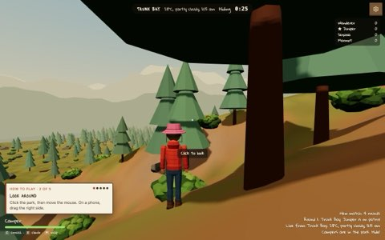</a><br><a href="apps/park-hide-seek/README.md" title="3D hide and seek on real Yosemite terrain. The page, a LAN host or the edge can run the game. Each player gets only what they can see. Play it"><b>Park Hide & Seek</b></a><br><sub><a href="https://park-hide-seek.notryanquinn.workers.dev">Play</a></sub></td><td align="center" valign="top"><a href="apps/git-recon/README.md"></a><br><a href="apps/git-recon/README.md" title="A repo as a shooter level. Its folders become compounds and its files become buildings, on real ground (Yosemite, or any lat/long) or in a plastic-army kitchen and garden. Git commands are the weapons. Play alone in the page, with up to 64 players in a LAN battle, or online in a Durable Object for each room."><b>Git Recon</b></a><br><sub><a href="https://git-recon.notryanquinn.workers.dev">Play</a></sub></td><td align="center" valign="top"><a href="apps/skate-tech-park/README.md"></a><br><a href="apps/skate-tech-park/README.md" title="Skate a street spot, or fly a rocket roadster with ten cold-gas thrusters across the gap. It is a three.js page on a pure fixed-step sim, which the tests run headless."><b>Skate Tech Park</b></a><br><sub><a href="https://skatetechpark.notryanquinn.workers.dev">Play</a></sub></td><td align="center" valign="top"><a href="apps/alien-disc-golf/README.md"></a><br><a href="apps/alien-disc-golf/README.md" title="Disc golf where the course is the planet: nine holes between random countries on a three.js globe. NOAA's live wind carries the disc, and a high throw rides the jet stream. The Worker relays the latest GFS grid from NOMADS, and the page decodes the GRIB2. Guess the tee's country to get one stroke back."><b>Alien Disc Golf</b></a><br><sub><a href="https://alien-disc-golf.notryanquinn.workers.dev">Play</a></sub></td></tr>
<tr><td align="center" valign="top"><a href="apps/delayed-reaction/README.md">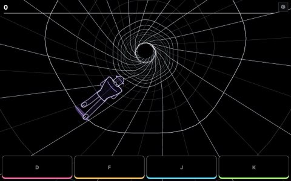</a><br><a href="apps/delayed-reaction/README.md" title="A phone-first rhythm game. You sprint through a neon tunnel that rolls. A ring calls a note, and you answer one bar later on one of four thumb pads. Your answers echo back through a dub delay. The sim plays in beats with no page, and thus a test runs each level."><b>Delayed Reaction</b></a><br><sub>Coming soon</sub></td><td align="center" valign="top"><a href="apps/two-fronts/README.md"></a><br><a href="apps/two-fronts/README.md" title="Thunder Marines against the Wooka horde: a turn-based galactic war with three.js hero battles in orbit and on six worlds. There is one world for each kind of sector: redwood forest, desert, ruined city, glowing alien night, beach and deep-space station. The two parts were built apart and connect through small JSON types (a spec in, a result out). Play the AI or hotseat in the page, or a friend online through a Durable Object for each campaign."><b>Two Fronts</b></a><br><sub><a href="https://two-fronts.notryanquinn.workers.dev">Play</a></sub></td><td align="center" valign="top"><a href="apps/hippo-tycoon/README.md"></a><br><a href="apps/hippo-tycoon/README.md" title="One game class runs as a Durable Object on Cloudflare and in-process in the binary: solo, couch, LAN party and online rooms."><b>Hippo Tycoon</b></a><br><sub><a href="https://hippo-ty32kk4m44sz57g2i6knvzzb7o-production.up.railway.app">Play</a></sub></td><td align="center" valign="top"><a href="apps/splat-spray/README.md"></a><br><a href="apps/splat-spray/README.md" title="A spy game in a pitch-dark Gaussian-splat room. A short config makes the three.js page a desktop app, and the same page races friends online on a Worker."><b>Super Spy Splat Shot</b></a><br><sub><a href="https://supersplatspyshot.notryanquinn.workers.dev">Play</a></sub></td></tr>
<tr><td align="center" valign="top"><a href="apps/mythic-masters/README.md"></a><br><a href="apps/mythic-masters/README.md" title="A 3D creature arena brawler where mass, height and stats shape each body, and flyers must come down. A headless bot-vs-bot tuner keeps 76 folklore beasts near a 50% win rate, from a 6 kg jackalope to a one-tonne lake monster. One arena layout has a skin for each built region, on a route of 64."><b>Mythic Masters</b></a><br><sub><a href="https://mythic-masters.notryanquinn.workers.dev">Play</a></sub></td><td align="center" valign="top"><a href="apps/excalibrawl/README.md">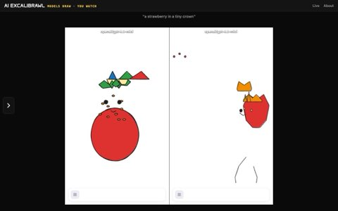</a><br><a href="apps/excalibrawl/README.md" title="A drawing fight each hour. Clef and Clef Flash select only a move, shape, colour, grid cell and size from a picture of their halves. Or two text models write a drawing language that uses few tokens. Clef is the referee, and a fight costs two cents or less. Replays are in R2, and a Durable Object has the live socket."><b>Excalibrawl</b></a><br><sub><a href="https://excalibrawl.notryanquinn.workers.dev">Play</a></sub></td><td align="center" valign="top"><a href="apps/fleet-commander/README.md"></a><br><a href="apps/fleet-commander/README.md" title="A real-time fleet battle from the bridge of a wedge destroyer: call plays for your wings of fighters, trade broadsides, hold the hyperspace lane and rake the base on the world below. Win a sector and command a dreadnought whose captains run their own wings."><b>Fleet Commander</b></a></td></tr>
</table>

<details><summary>What each one proves</summary>

- **[Park Hide & Seek](apps/park-hide-seek/README.md)**: 3D hide and seek on real Yosemite terrain. The page, a LAN host or the edge can run the game. Each player gets only what they can see. [Play it](https://park-hide-seek.notryanquinn.workers.dev)
- **[Git Recon](apps/git-recon/README.md)**: A repo as a shooter level. Its folders become compounds and its files become buildings, on real ground (Yosemite, or any lat/long) or in a plastic-army kitchen and garden. Git commands are the weapons. Play alone in the page, with up to 64 players in a LAN battle, or online in a Durable Object for each room.
- **[Skate Tech Park](apps/skate-tech-park/README.md)**: Skate a street spot, or fly a rocket roadster with ten cold-gas thrusters across the gap. It is a three.js page on a pure fixed-step sim, which the tests run headless.
- **[Alien Disc Golf](apps/alien-disc-golf/README.md)**: Disc golf where the course is the planet: nine holes between random countries on a three.js globe. NOAA's live wind carries the disc, and a high throw rides the jet stream. The Worker relays the latest GFS grid from NOMADS, and the page decodes the GRIB2. Guess the tee's country to get one stroke back.
- **[Delayed Reaction](apps/delayed-reaction/README.md)**: A phone-first rhythm game. You sprint through a neon tunnel that rolls. A ring calls a note, and you answer one bar later on one of four thumb pads. Your answers echo back through a dub delay. The sim plays in beats with no page, and thus a test runs each level.
- **[Two Fronts](apps/two-fronts/README.md)**: Thunder Marines against the Wooka horde: a turn-based galactic war with three.js hero battles in orbit and on six worlds. There is one world for each kind of sector: redwood forest, desert, ruined city, glowing alien night, beach and deep-space station. The two parts were built apart and connect through small JSON types (a spec in, a result out). Play the AI or hotseat in the page, or a friend online through a Durable Object for each campaign.
- **[Hippo Tycoon](apps/hippo-tycoon/README.md)**: One game class runs as a Durable Object on Cloudflare and in-process in the binary: solo, couch, LAN party and online rooms.
- **[Super Spy Splat Shot](apps/splat-spray/README.md)**: A spy game in a pitch-dark Gaussian-splat room. A short config makes the three.js page a desktop app, and the same page races friends online on a Worker.
- **[Mythic Masters](apps/mythic-masters/README.md)**: A 3D creature arena brawler where mass, height and stats shape each body, and flyers must come down. A headless bot-vs-bot tuner keeps 76 folklore beasts near a 50% win rate, from a 6 kg jackalope to a one-tonne lake monster. One arena layout has a skin for each built region, on a route of 64.
- **[Excalibrawl](apps/excalibrawl/README.md)**: A drawing fight each hour. Clef and Clef Flash select only a move, shape, colour, grid cell and size from a picture of their halves. Or two text models write a drawing language that uses few tokens. Clef is the referee, and a fight costs two cents or less. Replays are in R2, and a Durable Object has the live socket.
- **[Fleet Commander](apps/fleet-commander/README.md)**: A real-time fleet battle from the bridge of a wedge destroyer: call plays for your wings of fighters, trade broadsides, hold the hyperspace lane and rake the base on the world below. Win a sector and command a dreadnought whose captains run their own wings.

</details>

### One account, one front door

These connect the apps: one sign-in for all of them, and one page that lists them.

<table>
<tr><td align="center" valign="top"><a href="apps/eqosys/README.md">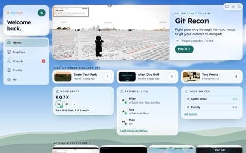</a><br><a href="apps/eqosys/README.md" title="Your home for each Q game: your games, friends, saves and studio on one account. Below it is Better Auth on D1, with a PKCE code handoff to each app and a signed token that the app can check alone. It knows which app each person came from and what they can do in each. A Durable Object for each person holds friends, presence and notifications. It is also a plain OpenID provider for a site's own Better Auth or a native app. PolyForm Noncommercial."><b>eqosys</b></a><br><sub><a href="https://eqosys.qntbr.com">Play</a></sub></td><td align="center" valign="top"><a href="apps/playground/README.md">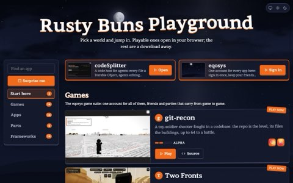</a><br><a href="apps/playground/README.md" title="One page that lists each app with a way to try it: Play, Download or Source. It has static assets only, and thus it costs nothing."><b>Playground</b></a></td><td align="center" valign="top"><a href="apps/qollab/README.md" title="Realtime rooms for any app on Cloudflare: rooms, seats, parties, presence and saves in one call. It is built into eqosys as its own Worker, with a Durable Object for each player and each room. PolyForm Noncommercial."><b>Qollab</b></a></td></tr>
</table>

<details><summary>What each one proves</summary>

- **[eqosys](apps/eqosys/README.md)**: Your home for each Q game: your games, friends, saves and studio on one account. Below it is Better Auth on D1, with a PKCE code handoff to each app and a signed token that the app can check alone. It knows which app each person came from and what they can do in each. A Durable Object for each person holds friends, presence and notifications. It is also a plain OpenID provider for a site's own Better Auth or a native app. PolyForm Noncommercial.
- **[Playground](apps/playground/README.md)**: One page that lists each app with a way to try it: Play, Download or Source. It has static assets only, and thus it costs nothing.
- **[Qollab](apps/qollab/README.md)**: Realtime rooms for any app on Cloudflare: rooms, seats, parties, presence and saves in one call. It is built into eqosys as its own Worker, with a Durable Object for each player and each room. PolyForm Noncommercial.

</details>

### My apps

Real tools for real work. Some have their own license.

<table>
<tr><td align="center" valign="top"><a href="apps/what-would-fantano-say/README.md">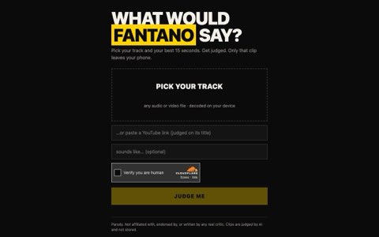</a><br><a href="apps/what-would-fantano-say/README.md" title="A parody music critic as an RWSDK Worker. The phone decodes the song and selects a 15 s clip. Cloudflare's Clef-omni judges it for approximately $5 for each 100,000 reviews. It is behind a rate limit, Turnstile, an edge cache and a daily budget."><b>What Would Fantano Say</b></a><br><sub><a href="https://what-would-fantano-say.notryanquinn.workers.dev">Play</a></sub></td><td align="center" valign="top"><a href="apps/brianfloresblitzing/README.md">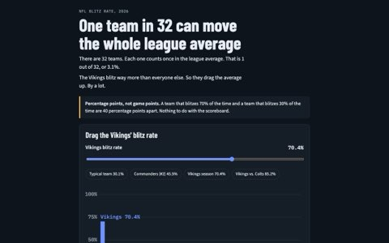</a><br><a href="apps/brianfloresblitzing/README.md" title="One static page (&quot;One Team in 32&quot;), which a Cloudflare Worker serves as plain assets. There is no Worker code."><b>One Team in 32</b></a><br><sub><a href="https://brianfloresblitzing.notryanquinn.workers.dev">Play</a></sub></td><td align="center" valign="top"><a href="apps/qcrm/README.md"></a><br><a href="apps/qcrm/README.md" title="A CRM with MCP built in, a Rust wasm engine in the browser, office sync, signed webhooks and a desktop build. It has roles for a real place and hashed org ids. PolyForm Noncommercial."><b>qCRM</b></a><br><sub><a href="https://qcrm.qntbr.com">Play</a></sub></td><td align="center" valign="top"><a href="apps/geoboxq/README.md"></a><br><a href="apps/geoboxq/README.md" title="A fit checker for shipping boxes, with a Rust engine that packs boxes in boxes. PolyForm Noncommercial."><b>GeoBoxQ</b></a><br><sub><a href="https://geoboxq-worker-live-ryanquinn-tjhne4lpmumy6kz5.notryanquinn.workers.dev">Play</a></sub></td></tr>
<tr><td align="center" valign="top"><a href="apps/at-lens/README.md"></a><br><a href="apps/at-lens/README.md" title="Type a handle and watch the AT Protocol work: domain to DID to data server to typed records, checked in the two directions. Then see the account live on the Jetstream firehose. Sign in with atproto OAuth to write a record of our own Lexicon and watch it come back. No keys and no bindings."><b>AT Lens</b></a></td><td align="center" valign="top"><a href="apps/qview3d/README.md">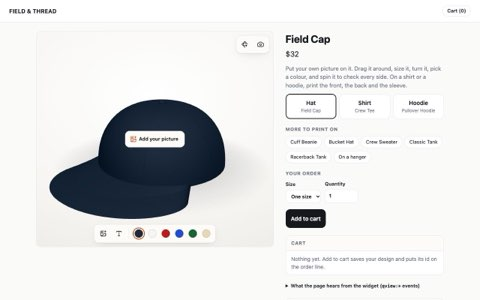</a><br><a href="apps/qview3d/README.md" title="A 3D product customiser for a shop page, from one script tag. Shoppers drag a photo over a hat or onto a tee or hoodie's front, back and sleeve, choose its colour and save a snapshot. A shop with another product makes a model of it from photos. Uploads go to R2 on signed links, in one folder for each org. PolyForm Noncommercial."><b>QView3D</b></a><br><sub><a href="https://qview3d.notryanquinn.workers.dev">Play</a></sub></td><td align="center" valign="top"><a href="apps/qview3d/README.md"></a><br><a href="apps/qview3d/README.md" title="A 3D product customiser for a shop page, from one script tag. Shoppers drag a photo over a hat or onto a top's front, back and sleeve (a tee, sweater, hoodie or tank), choose its colour and save a snapshot. A shop with another product makes a model of it from photos. Uploads go to R2 on signed links, in one folder for each org. PolyForm Noncommercial."><b>QView3D</b></a><br><sub><a href="https://qview3d.notryanquinn.workers.dev">Play</a></sub></td><td align="center" valign="top"><a href="apps/sharesplat/README.md"></a><br><a href="apps/sharesplat/README.md" title="Product photos become a 3D spin for a store page. A guided shot list on the phone takes six sides for an AI-guessed mesh, or 72 photos in rings for a real Gaussian splat. A turntable viewer cuts away the table and stray bits, then hosts the model at one link per product (R2, eqosys sign-in) for a Shopify theme block or a pasted embed."><b>ShareSplat</b></a><br><sub><a href="https://sharesplat.notryanquinn.workers.dev">Play</a></sub></td></tr>
<tr><td align="center" valign="top"><a href="apps/cron-swanson/README.md" title="Every alarm, reminder and cron job of every app on one page, in five lanes from async to yearly. A small Bun server ticks each minute, so a job fires within a second of its time."><b>Cron Swanson</b></a></td><td align="center" valign="top"><a href="apps/geoboxq-shopify/README.md" title="A small wrapper that turns a Shopify cart into the store's own box."><b>GeoBoxQ for Shopify</b></a></td><td align="center" valign="top"><a href="apps/artstewengine/README.md" title="A small RWSDK app on D1 with a Better Auth admin page. Add who has paid, and the sealed engine of qCRM gets its key only for a paid license."><b>artstewengine</b></a></td></tr>
</table>

<details><summary>What each one proves</summary>

- **[What Would Fantano Say](apps/what-would-fantano-say/README.md)**: A parody music critic as an RWSDK Worker. The phone decodes the song and selects a 15 s clip. Cloudflare's Clef-omni judges it for approximately $5 for each 100,000 reviews. It is behind a rate limit, Turnstile, an edge cache and a daily budget.
- **[One Team in 32](apps/brianfloresblitzing/README.md)**: One static page ("One Team in 32"), which a Cloudflare Worker serves as plain assets. There is no Worker code.
- **[qCRM](apps/qcrm/README.md)**: A CRM with MCP built in, a Rust wasm engine in the browser, office sync, signed webhooks and a desktop build. It has roles for a real place and hashed org ids. PolyForm Noncommercial.
- **[GeoBoxQ](apps/geoboxq/README.md)**: A fit checker for shipping boxes, with a Rust engine that packs boxes in boxes. PolyForm Noncommercial.
- **[AT Lens](apps/at-lens/README.md)**: Type a handle and watch the AT Protocol work: domain to DID to data server to typed records, checked in the two directions. Then see the account live on the Jetstream firehose. Sign in with atproto OAuth to write a record of our own Lexicon and watch it come back. No keys and no bindings.
- **[Cron Swanson](apps/cron-swanson/README.md)**: Every alarm, reminder and cron job of every app on one page, in five lanes from async to yearly. A small Bun server ticks each minute, so a job fires within a second of its time.
- **[QView3D](apps/qview3d/README.md)**: A 3D product customiser for a shop page, from one script tag. Shoppers drag a photo over a hat or onto a tee or hoodie's front, back and sleeve, choose its colour and save a snapshot. A shop with another product makes a model of it from photos. Uploads go to R2 on signed links, in one folder for each org. PolyForm Noncommercial.
- **[QView3D](apps/qview3d/README.md)**: A 3D product customiser for a shop page, from one script tag. Shoppers drag a photo over a hat or onto a top's front, back and sleeve (a tee, sweater, hoodie or tank), choose its colour and save a snapshot. A shop with another product makes a model of it from photos. Uploads go to R2 on signed links, in one folder for each org. PolyForm Noncommercial.
- **[ShareSplat](apps/sharesplat/README.md)**: Product photos become a 3D spin for a store page. A guided shot list on the phone takes six sides for an AI-guessed mesh, or 72 photos in rings for a real Gaussian splat. A turntable viewer cuts away the table and stray bits, then hosts the model at one link per product (R2, eqosys sign-in) for a Shopify theme block or a pasted embed.
- **[GeoBoxQ for Shopify](apps/geoboxq-shopify/README.md)**: A small wrapper that turns a Shopify cart into the store's own box.
- **[artstewengine](apps/artstewengine/README.md)**: A small RWSDK app on D1 with a Better Auth admin page. Add who has paid, and the sealed engine of qCRM gets its key only for a paid license.

</details>

### The workshop

Music, 3D and circuits: tools to make things. Where it helps, a Rust engine runs with a TypeScript engine.

<table>
<tr><td align="center" valign="top"><a href="apps/splat-rooms/README.md">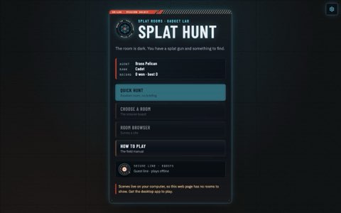</a><br><a href="apps/splat-rooms/README.md" title="A splat hunt game with a world class. Its 30 MB scenes stream from a folder on your disk and are never embedded."><b>Splat Rooms</b></a><br><sub><a href="https://splat-rooms.notryanquinn.workers.dev">Play</a></sub></td><td align="center" valign="top"><a href="apps/fm-daw/README.md">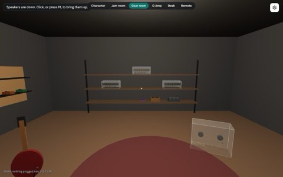</a><br><a href="apps/fm-daw/README.md" title="One Rust crate runs as wasm in the audio thread and through FFI on the host. Its output is bit-identical to the TypeScript engine."><b>FM Groovebox</b></a><br><sub><a href="https://fm-daw.notryanquinn.workers.dev">Play</a></sub></td><td align="center" valign="top"><a href="apps/motion-midi/README.md">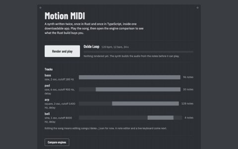</a><br><a href="apps/motion-midi/README.md" title="One synth in Rust and in TypeScript, checked sample by sample"><b>Motion MIDI</b></a></td><td align="center" valign="top"><a href="apps/auto-rig/README.md">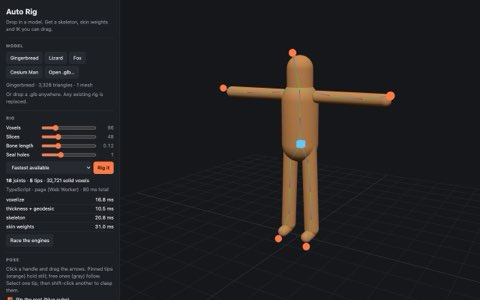</a><br><a href="apps/auto-rig/README.md" title="Auto-rigging a 3D model in Rust and TypeScript with identical output"><b>Auto Rig</b></a><br><sub><a href="https://auto-rig.notryanquinn.workers.dev">Play</a></sub></td></tr>
<tr><td align="center" valign="top"><a href="apps/meshy-studio/README.md">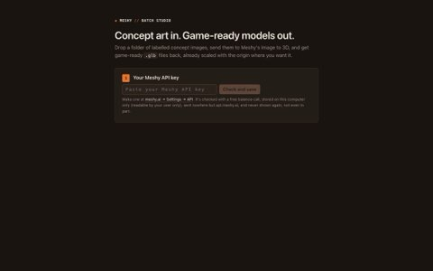</a><br><a href="apps/meshy-studio/README.md" title="A folder-based batch tool for the Meshy API: image, multi-image and text to 3D, texture, remesh, rig, animate and concept art. Your key stays local, and you see the price before each spend."><b>Meshy Studio</b></a></td><td align="center" valign="top"><a href="apps/tscircuit-desktop/README.md">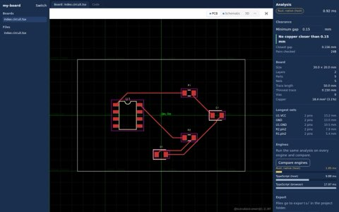</a><br><a href="apps/tscircuit-desktop/README.md" title="A heavy, real-world Vite app as one file, with a Rust engine up to 22x faster and a TypeScript fallback"><b>tscircuit Desktop</b></a></td><td align="center" valign="top"><a href="apps/pixel-rag/README.md"></a><br><a href="apps/pixel-rag/README.md" title="Add your screenshots and find the parts that look the same in all of them. Each worker, web or desktop, shares one Rust index."><b>Pixel RAG</b></a></td><td align="center" valign="top"><a href="apps/splat-desktop/README.md" title="PlayCanvas' SuperSplat editor as a desktop app. It works on a folder on your disk."><b>Splat Desktop</b></a></td></tr>
</table>

<details><summary>What each one proves</summary>

- **[Splat Rooms](apps/splat-rooms/README.md)**: A splat hunt game with a world class. Its 30 MB scenes stream from a folder on your disk and are never embedded.
- **[FM Groovebox](apps/fm-daw/README.md)**: One Rust crate runs as wasm in the audio thread and through FFI on the host. Its output is bit-identical to the TypeScript engine.
- **[Motion MIDI](apps/motion-midi/README.md)**: One synth in Rust and in TypeScript, checked sample by sample
- **[Auto Rig](apps/auto-rig/README.md)**: Auto-rigging a 3D model in Rust and TypeScript with identical output
- **[Meshy Studio](apps/meshy-studio/README.md)**: A folder-based batch tool for the Meshy API: image, multi-image and text to 3D, texture, remesh, rig, animate and concept art. Your key stays local, and you see the price before each spend.
- **[Splat Desktop](apps/splat-desktop/README.md)**: PlayCanvas' SuperSplat editor as a desktop app. It works on a folder on your disk.
- **[tscircuit Desktop](apps/tscircuit-desktop/README.md)**: A heavy, real-world Vite app as one file, with a Rust engine up to 22x faster and a TypeScript fallback
- **[Pixel RAG](apps/pixel-rag/README.md)**: Add your screenshots and find the parts that look the same in all of them. Each worker, web or desktop, shares one Rust index.

</details>

### Everything else: frameworks, other people's apps and test fixtures

Sample apps from frameworks and apps from other people, which run with no code changes. Also the small apps that the tests use. A new app goes here first, until someone moves it to its section.

<table>
<tr><td align="center" valign="top"><a href="apps/hello-world/README.md">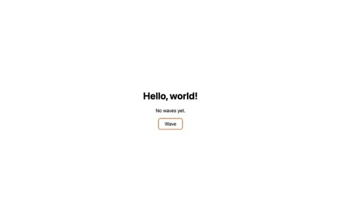</a><br><a href="apps/hello-world/README.md" title="The first five minutes: a twenty-line page. The welcome tour finds it, lets three agents write it again at the same time, and then asks you to deploy it."><b>Hello World</b></a><br><sub><a href="https://hello-world.notryanquinn.workers.dev">Play</a></sub></td><td align="center" valign="top"><a href="apps/load-in/README.md">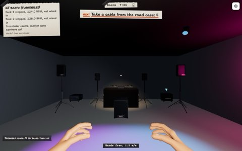</a><br><a href="apps/load-in/README.md" title="A first-person sound-crew sim on real numbers: carry the gear at its real weight, bowl out rolls of cable that weigh what cable weighs, wire power and signal, and aim the speakers, from a garage to an arena."><b>Sound Guy Simulator</b></a></td><td align="center" valign="top"><a href="apps/starter-game/README.md">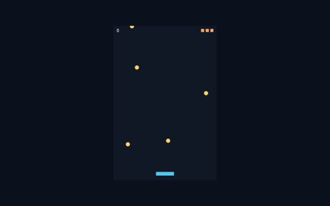</a><br><a href="apps/starter-game/README.md" title="The template a new game starts from: catch falling stars, with an eqosys sign-in, a Qollab party and a state() harness already in."><b>Starter Game</b></a></td><td align="center" valign="top"><a href="apps/frameworks/nuxt-example/README.md"></a><br><a href="apps/frameworks/nuxt-example/README.md" title="A Nuxt 4 app on the cloudflare-module preset of Nitro (one KV binding), as a desktop app with no edits. init reads it, and the host runs the Worker that Nitro built. The same shared HTTP journey checks it."><b>Nuxt</b></a></td></tr>
<tr><td align="center" valign="top"><a href="apps/frameworks/qwik-example/README.md">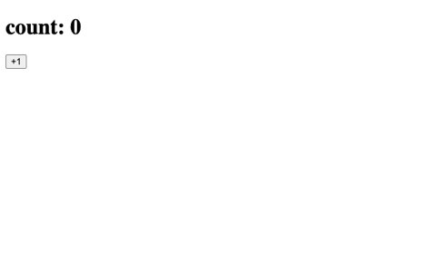</a><br><a href="apps/frameworks/qwik-example/README.md" title="A Qwik City app on its own cloudflare-pages adapter, as a desktop app with no edits. A routeLoader$ and a routeAction$ count in KV through platform.env. init reads the adapter's dist/_worker.js as it is."><b>Qwik City</b></a></td><td align="center" valign="top"><a href="apps/frameworks/astro-example/README.md"></a><br><a href="apps/frameworks/astro-example/README.md" title="An Astro site on @astrojs/cloudflare, as a desktop app with no edits. A server page and an API route count in KV through cloudflare:workers. init reads it as it is."><b>Astro</b></a></td><td align="center" valign="top"><a href="apps/frameworks/elysia-example/README.md"></a><br><a href="apps/frameworks/elysia-example/README.md" title="An Elysia Worker as the Cloudflare guide of Elysia writes it (aot: false, cloudflare:workers), as a desktop app with no edits. init now reads Elysia."><b>Elysia</b></a></td><td align="center" valign="top"><a href="apps/frameworks/sveltekit-example/README.md"></a><br><a href="apps/frameworks/sveltekit-example/README.md" title="A SvelteKit 3 app on the Cloudflare adapter, as a desktop app with no edits. It has a load from KV and a form action that increments it. It meets the same sample app contract as hono-example, and the same shared journey checks it."><b>SvelteKit</b></a></td></tr>
<tr><td align="center" valign="top"><a href="apps/frameworks/solidstart-example/README.md"></a><br><a href="apps/frameworks/solidstart-example/README.md" title="A SolidStart 2 app on the cloudflare_module preset of Nitro, as a desktop app with no edits. A &quot;use server&quot; query and an API route count in KV through cloudflare:workers. rustybuns init reads it as it is."><b>SolidStart</b></a></td><td align="center" valign="top"><a href="apps/frameworks/react-router-example/README.md"></a><br><a href="apps/frameworks/react-router-example/README.md" title="React Router 7 on Cloudflare's own template (workers/app.ts, the Vite plugin, a loader and an action on KV), as a desktop app with no edits. It is the second framework on the shared sample-app journey."><b>React Router</b></a></td><td align="center" valign="top"><a href="apps/frameworks/nextjs-example/README.md"></a><br><a href="apps/frameworks/nextjs-example/README.md" title="A Next.js 16 app on @opennextjs/cloudflare (one KV binding), as a desktop app with no edits. init reads it, and the host runs the worker.js that OpenNext built. The same shared HTTP journey checks it."><b>Next.js</b></a></td><td align="center" valign="top"><a href="apps/frameworks/svelte-spa-example/README.md"></a><br><a href="apps/frameworks/svelte-spa-example/README.md" title="A client-only Svelte 5 + Vite app (no server) as a desktop app. Its counter is in a &quot;use server&quot; action that the host runs."><b>Svelte SPA</b></a></td></tr>
<tr><td align="center" valign="top"><a href="apps/frameworks/vue-spa-example/README.md"></a><br><a href="apps/frameworks/vue-spa-example/README.md" title="A client-only Vue 3 + Vite app (no server) as a desktop app. Its counter is in a &quot;use server&quot; action that the host runs."><b>Vue SPA</b></a></td><td align="center" valign="top"><a href="apps/frameworks/solid-spa-example/README.md"></a><br><a href="apps/frameworks/solid-spa-example/README.md" title="A client-only Solid + Vite app (no server) as a desktop app. Its counter is in a &quot;use server&quot; action that the host runs."><b>Solid SPA</b></a></td><td align="center" valign="top"><a href="apps/frameworks/hono-example/README.md"></a><br><a href="apps/frameworks/hono-example/README.md" title="A Hono Worker from Hono's own docs (one KV binding), as a desktop app with no edits. It is the sample app contract that each framework example meets, and one shared HTTP journey checks it."><b>Hono</b></a></td><td align="center" valign="top"><a href="apps/frameworks/tanstack-start-example/README.md"></a><br><a href="apps/frameworks/tanstack-start-example/README.md" title="TanStack Start on Cloudflare's Vite plugin (server functions, a server route, D1 and KV) as a desktop app with no code changes."><b>TanStack Start</b></a></td></tr>
<tr><td align="center" valign="top"><a href="apps/copy-desk/README.md" title="A small business site on the built-in CMS: its words and news posts are JSON files you edit as forms and translate, with no code to touch."><b>Copy Desk</b></a></td><td align="center" valign="top"><a href="apps/test-swarm/README.md" title="Not an app: a Worker that queues our test runs for any of our Macs to lease, and posts the typecheck and apps statuses on GitHub when they pass."><b>Test Swarm</b></a></td><td align="center" valign="top"><a href="apps/pwa-example/README.md" title="A web page that Android installs as an app and that opens offline: a TypeScript page, a 370-byte Rust roller as wasm, a service worker and a manifest."><b>Pocket Dice (PWA)</b></a></td><td align="center" valign="top"><a href="apps/kitesurf-bench/README.md" title="Times Cloudflare's Kitesurf agent browser against Chromium on our own live pages, from inside a Worker. Deploy, press Run, copy the table, destroy."><b>Kitesurf Bench</b></a></td></tr>
<tr><td align="center" valign="top"><a href="apps/agent-office/README.md" title="Someone else's Node server (PTYs, WebSockets, a 3D client) as one binary, nothing forked"><b>Agent Office</b></a></td><td align="center" valign="top"><a href="apps/terraviz-demo/README.md" title="TerraViz is the Science On a Sphere globe of The Zyra Project (Apache-2.0, not ours). We clone it and run it with no code changes. Shared Sphere adds a room on one globe and a teacher's lock, so that a class follows one pair of hands. NOAA tour scripts stay in step on each screen, and a small Rust crate reads them as slides."><b>TerraViz</b></a></td><td align="center" valign="top"><a href="apps/frameworks/express-example/README.md" title="An Express server on Postgres, the server half of a Wasp app, as a desktop app with no edits. Bun runs Express beside the host, and PGlite in the data dir is its Postgres."><b>Express</b></a></td><td align="center" valign="top"><a href="apps/frameworks/elysia-conduit/RUSTYBUNS.md" title="The RealWorld backend of bedstack (Elysia, Drizzle, postgres.js) with no source edits. It is a desktop binary on PGlite that passes their Postman suite. The doc lists the five ways that it breaks on Workers."><b>Elysia RealWorld</b></a></td></tr>
<tr><td align="center" valign="top"><a href="apps/agent-demo/README.md" title="A small snack-vote Worker that is seeded into codeSplitter. Some coding agents can build it at the same time and resolve a merge conflict on camera."><b>Agent Demo</b></a></td><td align="center" valign="top"><a href="apps/borg-postgres/README.md" title="A Postgres app keeps its database and moves its code: Hyperdrive on the edge, PGlite on the desktop."><b>Borg Postgres</b></a></td><td align="center" valign="top"><a href="apps/borg/README.md" title="Not an app: a small Worker that uses each binding one time. Thus one suite can check the local twins against a real deploy."><b>Borg</b></a></td><td align="center" valign="top"><a href="apps/frameworks/spa-example/README.md" title="Not an app: a part of a real RWSDK game. The tests use it to check that init reads it correctly."><b>SPA fixture</b></a></td></tr>
<tr><td align="center" valign="top"><a href="apps/example/README.md" title="A full Worker (D1, KV, a Durable Object) as a desktop binary in half a second, and a Rust FFI probe with a TypeScript fallback."><b>Worker example</b></a></td></tr>
</table>

<details><summary>What each one proves</summary>

- **[Hello World](apps/hello-world/README.md)**: The first five minutes: a twenty-line page. The welcome tour finds it, lets three agents write it again at the same time, and then asks you to deploy it.
- **[Copy Desk](apps/copy-desk/README.md)**: A small business site on the built-in CMS: its words and news posts are JSON files you edit as forms and translate, with no code to touch.
- **[Sound Guy Simulator](apps/load-in/README.md)**: A first-person sound-crew sim on real numbers: carry the gear at its real weight, bowl out rolls of cable that weigh what cable weighs, wire power and signal, and aim the speakers, from a garage to an arena.
- **[Starter Game](apps/starter-game/README.md)**: The template a new game starts from: catch falling stars, with an eqosys sign-in, a Qollab party and a state() harness already in.
- **[Test Swarm](apps/test-swarm/README.md)**: Not an app: a Worker that queues our test runs for any of our Macs to lease, and posts the typecheck and apps statuses on GitHub when they pass.
- **[Pocket Dice (PWA)](apps/pwa-example/README.md)**: A web page that Android installs as an app and that opens offline: a TypeScript page, a 370-byte Rust roller as wasm, a service worker and a manifest.
- **[Kitesurf Bench](apps/kitesurf-bench/README.md)**: Times Cloudflare's Kitesurf agent browser against Chromium on our own live pages, from inside a Worker. Deploy, press Run, copy the table, destroy.
- **[Agent Office](apps/agent-office/README.md)**: Someone else's Node server (PTYs, WebSockets, a 3D client) as one binary, nothing forked
- **[TerraViz](apps/terraviz-demo/README.md)**: TerraViz is the Science On a Sphere globe of The Zyra Project (Apache-2.0, not ours). We clone it and run it with no code changes. Shared Sphere adds a room on one globe and a teacher's lock, so that a class follows one pair of hands. NOAA tour scripts stay in step on each screen, and a small Rust crate reads them as slides.
- **[Nuxt](apps/frameworks/nuxt-example/README.md)**: A Nuxt 4 app on the `cloudflare-module` preset of Nitro (one KV binding), as a desktop app with no edits. `init` reads it, and the host runs the Worker that Nitro built. The same shared HTTP journey checks it.
- **[Qwik City](apps/frameworks/qwik-example/README.md)**: A Qwik City app on its own `cloudflare-pages` adapter, as a desktop app with no edits. A `routeLoader$` and a `routeAction$` count in KV through `platform.env`. `init` reads the adapter's `dist/_worker.js` as it is.
- **[Astro](apps/frameworks/astro-example/README.md)**: An Astro site on `@astrojs/cloudflare`, as a desktop app with no edits. A server page and an API route count in KV through `cloudflare:workers`. `init` reads it as it is.
- **[Elysia](apps/frameworks/elysia-example/README.md)**: An Elysia Worker as the Cloudflare guide of Elysia writes it (`aot: false`, `cloudflare:workers`), as a desktop app with no edits. `init` now reads Elysia.
- **[SvelteKit](apps/frameworks/sveltekit-example/README.md)**: A SvelteKit 3 app on the Cloudflare adapter, as a desktop app with no edits. It has a `load` from KV and a form action that increments it. It meets the same sample app contract as hono-example, and the same shared journey checks it.
- **[SolidStart](apps/frameworks/solidstart-example/README.md)**: A SolidStart 2 app on the `cloudflare_module` preset of Nitro, as a desktop app with no edits. A `"use server"` query and an API route count in KV through `cloudflare:workers`. `rustybuns init` reads it as it is.
- **[React Router](apps/frameworks/react-router-example/README.md)**: React Router 7 on Cloudflare's own template (`workers/app.ts`, the Vite plugin, a loader and an action on KV), as a desktop app with no edits. It is the second framework on the shared sample-app journey.
- **[Next.js](apps/frameworks/nextjs-example/README.md)**: A Next.js 16 app on `@opennextjs/cloudflare` (one KV binding), as a desktop app with no edits. `init` reads it, and the host runs the `worker.js` that OpenNext built. The same shared HTTP journey checks it.
- **[Svelte SPA](apps/frameworks/svelte-spa-example/README.md)**: A client-only Svelte 5 + Vite app (no server) as a desktop app. Its counter is in a `"use server"` action that the host runs.
- **[Vue SPA](apps/frameworks/vue-spa-example/README.md)**: A client-only Vue 3 + Vite app (no server) as a desktop app. Its counter is in a `"use server"` action that the host runs.
- **[Solid SPA](apps/frameworks/solid-spa-example/README.md)**: A client-only Solid + Vite app (no server) as a desktop app. Its counter is in a `"use server"` action that the host runs.
- **[Hono](apps/frameworks/hono-example/README.md)**: A Hono Worker from Hono's own docs (one KV binding), as a desktop app with no edits. It is the sample app contract that each framework example meets, and one shared HTTP journey checks it.
- **[Express](apps/frameworks/express-example/README.md)**: An Express server on Postgres, the server half of a Wasp app, as a desktop app with no edits. Bun runs Express beside the host, and PGlite in the data dir is its Postgres.
- **[Elysia RealWorld](apps/frameworks/elysia-conduit/RUSTYBUNS.md)**: The RealWorld backend of bedstack (Elysia, Drizzle, postgres.js) with no source edits. It is a desktop binary on PGlite that passes their Postman suite. The doc lists the five ways that it breaks on Workers.
- **[TanStack Start](apps/frameworks/tanstack-start-example/README.md)**: TanStack Start on Cloudflare's Vite plugin (server functions, a server route, D1 and KV) as a desktop app with no code changes.
- **[Agent Demo](apps/agent-demo/README.md)**: A small snack-vote Worker that is seeded into codeSplitter. Some coding agents can build it at the same time and resolve a merge conflict on camera.
- **[Borg Postgres](apps/borg-postgres/README.md)**: A Postgres app keeps its database and moves its code: Hyperdrive on the edge, PGlite on the desktop.
- **[Borg](apps/borg/README.md)**: Not an app: a small Worker that uses each binding one time. Thus one suite can check the local twins against a real deploy.
- **[SPA fixture](apps/frameworks/spa-example/README.md)**: Not an app: a part of a real RWSDK game. The tests use it to check that `init` reads it correctly.
- **[Worker example](apps/example/README.md)**: A full Worker (D1, KV, a Durable Object) as a desktop binary in half a second, and a Rust FFI probe with a TypeScript fallback.

</details>

<!-- /apps -->

**Say hi:** I am Ryan Quinn, [QuinnsCode](https://github.com/QuinnsCode) on GitHub. Put bugs, ideas and "this broke on my machine" reports in [issues](https://github.com/QuinnsCode/RustyBuns/issues).

**Someone else's app, unchanged:** [TerraViz](https://github.com/zyra-project/terraviz) by The Zyra Project, led by Eric Hackathorn (NOAA Global Systems Laboratory), Apache-2.0. It is a Pages app with a 3D globe, approximately 100 API routes, D1, KV, R2 and Vectorize. `bun apps/terraviz-demo/run.ts` clones it and runs it on Rusty Buns with no code changes. This only shows how Rusty Buns maps an existing app to its primitives. It is not a fork, and TerraViz's code is not in this repo. Credit, license and run instructions: [apps/terraviz-demo](apps/terraviz-demo/README.md).

**Try one with no build:** Download the desktop binary for [Hippo Tycoon](https://github.com/QuinnsCode/RustyBuns/releases?q=hippo-tycoon-v&expanded=true), [Park Hide & Seek](https://github.com/QuinnsCode/RustyBuns/releases?q=park-hide-seek-v&expanded=true), [Super Spy Splat Shot](https://github.com/QuinnsCode/RustyBuns/releases?q=splat-spray-v&expanded=true) or [FM Groovebox](https://github.com/QuinnsCode/RustyBuns/releases?q=fm-daw-v&expanded=true). Each is one file for Mac, Windows or Linux. They are not signed yet:

- **On a Mac**, the first launch needs one Terminal command. The release page has it. [APPLE_SIGNING.md](APPLE_SIGNING.md) is the plan to fix that.
- **On Windows**, click past SmartScreen. [WINDOWS_LINUX_SIGNING.md](WINDOWS_LINUX_SIGNING.md) is that plan, and it tells you that Linux needs no key.

To run them from source, see [EXAMPLES.md](EXAMPLES.md). It has two lines for each app, and you need no experience.

## Get started

You need Bun 1.4+ and an app that builds with `vite build`. If your app uses Create React App or Vue CLI, `rustybuns init --port-vite` moves it to Vite first.

```sh
pnpm add -D @rustybuns/cli @rustybuns/shell-bun
pnpm exec rustybuns init                          # prints what it found and writes one config
pnpm exec rustybuns add desktop
pnpm exec rustybuns build desktop --dev && pnpm exec rustybuns run desktop
```

Your app opens in Chrome. It runs on a local Bun host with sqlite behind each binding. To deploy to the cloud:

```sh
pnpm exec rustybuns add deploy     # pinned Alchemy + Effect
pnpm exec rustybuns plan           # creates nothing, shows what it will create
pnpm exec rustybuns deploy         # stops without a matching plan, then asks you
pnpm exec rustybuns destroy        # removes everything it created
```

## Read more

- [ABOUT.md](ABOUT.md): why it exists (it started with grass) and who makes it
- [GETTING_STARTED.md](GETTING_STARTED.md): the full procedure, step by step
- [MAC_SETUP.md](MAC_SETUP.md): how to set up a new Mac to run the office and agents, and a second Mac as their test machine
- [AGENT_PROMPTS.md](AGENT_PROMPTS.md): prompts that you paste into your coding agent to try Rusty Buns on your repo
- [REFERENCE.md](REFERENCE.md): each command and config key, the host, the Hetzner and Railway boxes, LAN multiplayer, and who holds the keys to secrets
- [ADOPTION.md](ADOPTION.md): who it is for, and how to adopt it (and remove it)
- [ACCESSIBILITY.md](ACCESSIBILITY.md): what is accessible today, the reading settings, and how to report a barrier
- [COSTS.md](COSTS.md): what each deploy can cost you, and how to set a limit
- [FRAMEWORKS.md](FRAMEWORKS.md): frameworks other than Vite + React
- [FRAMEWORK_COVERAGE.md](FRAMEWORK_COVERAGE.md): how many real GitHub apps for each framework run with no changes
- [notes/ROADMAP.md](notes/ROADMAP.md): the resource matrix, and the build order for what is built and what is not
- [notes/INBOUND_TCP_GRPC.md](notes/INBOUND_TCP_GRPC.md): raw TCP and gRPC into Workers (Cloudflare beta, 2026-11-19), its Pro-zone cost gate, and where it would help (codeSplitter over ssh first)

## License

Apache-2.0, except qCRM, GeoBoxQ, eqosys and Qollab, which are under the PolyForm Noncommercial License 1.0.0 in their own directories. See [LICENSING.md](LICENSING.md).
