<picture>
  <source media="(prefers-color-scheme: dark)" srcset="docs/readme-hero-night.svg">
  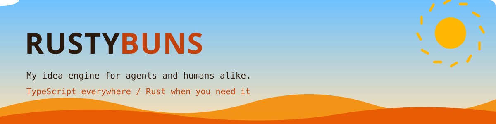
</picture>

<p align="center">
  <a href="https://rustybuns-playground.notryanquinn.workers.dev"><b>Open the Playground</b></a> &nbsp;/&nbsp;
  <a href="GETTING_STARTED.md">Getting started</a> &nbsp;/&nbsp;
  <a href="FEATURES.md">Features</a> &nbsp;/&nbsp;
  <a href="EXAMPLES.md">Examples</a> &nbsp;/&nbsp;
  <a href="REFERENCE.md">Reference</a>
</p>

# Rusty Buns: write your app logic once, ship it everywhere

**Use TypeScript to get first-class web and server interop across manywhere. Use Rust when you want it or need it: client, desktop, edge, cloud, server.**

Rusty Buns is a dev dependency. Your code stays yours, and `git rm` takes it out.

## The primitives

Every web app with a backend is five parts. Write against each one once:

| Part | One line in `rustybuns.config.ts` | On the edge | On a laptop or server |
|---|---|---|---|
| **http** | `worker: { main: "src/worker.ts" }` | a Worker `fetch` | `Bun.serve` |
| **comms** | `WORLD: { type: "durable_object", className: "World" }` | a Durable Object | a class in the process |
| **storage** | `DB: { type: "d1", databaseName: "my-app" }` | D1, KV, R2 | sqlite and a folder |
| **memory** | nothing to add | the isolate | the process |
| **identity** | `SESSION_SECRET: { type: "secret" }` | your Worker or Access | the same code |

That is the whole idea. The same app then runs as a desktop file, a Worker, a server and a phone page.

**Rust when you need it.** One crate runs through `bun:ffi` on the desktop and the server, and as wasm in the page and on the edge. Each Rust engine has a TypeScript twin that gives the same answer. [More](FEATURES.md#rust-when-you-need-it-typescript-always)

## Get started

```sh
pnpm add -D @rustybuns/cli @rustybuns/shell-bun
pnpm exec rustybuns init             # reads your app, writes rustybuns.config.ts
pnpm exec rustybuns build desktop    # one file, double-click it
pnpm exec rustybuns plan             # shows what a deploy will create, creates nothing
pnpm exec rustybuns deploy           # Cloudflare, plus a Hetzner or Railway box
```

> **Alpha, `0.1.12`.** You need Bun 1.4+ to build. Your users need nothing. [Getting started](GETTING_STARTED.md) has the full steps.

## See it work

Each example is one codebase that runs as a desktop binary. The multiplayer examples also run on Cloudflare from the same code.

> **Caution: the example apps are provided as is.** I build and change them almost each day. They change quickly, and they have had no formal security review. Some examples run coding agents, spawn shells or use API credits for you. Run them on a machine and a network that you trust. Keep your API keys private. Read the code before you connect an example to something important. There is no warranty. See [LICENSING.md](LICENSING.md).

<!-- apps: written by `bun run docs` from docs/readme/apps.json -->

### Featured: codeSplitter

The code host for the agentic era. Much of the other work exists because of it. [Try it](https://codesplitter.notryanquinn.workers.dev).

<table>
<tr><td align="center" valign="top"><a href="apps/codesplitter/README.md">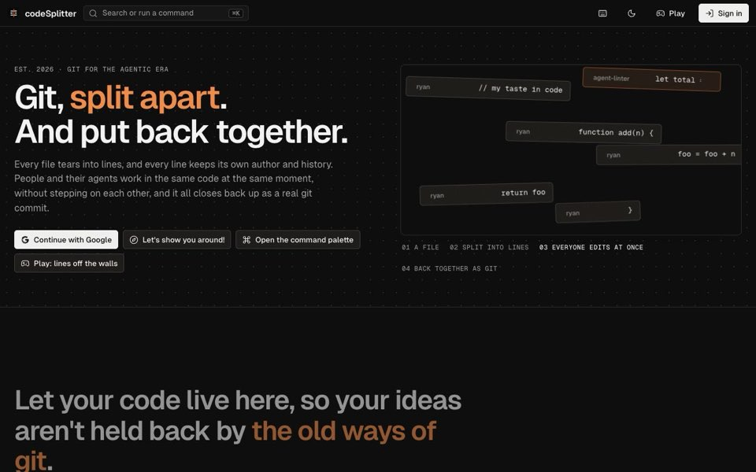</a><br><a href="apps/codesplitter/README.md" title="A code host for the agentic era. Each file is a Durable Object, and agents edit line by line. It has real git on Cloudflare Artifacts and an MCP server. One codebase runs on the edge and as a desktop app. Try it"><b>codeSplitter</b></a><br><sub><a href="https://codesplitter.notryanquinn.workers.dev">Play</a></sub></td></tr>
</table>

<details><summary>What each one proves</summary>

- **[codeSplitter](apps/codesplitter/README.md)**: A code host for the agentic era. Each file is a Durable Object, and agents edit line by line. It has real git on Cloudflare Artifacts and an MCP server. One codebase runs on the edge and as a desktop app. [Try it](https://codesplitter.notryanquinn.workers.dev)

</details>

### Games

These are for fun. Most of them play in the browser, and each one runs as a desktop app. They are in the same order as in eqosys.

<table>
<tr><td align="center" valign="top"><a href="apps/park-hide-seek/README.md"></a><br><a href="apps/park-hide-seek/README.md" title="3D hide and seek on real Yosemite terrain. The page, a LAN host or the edge can run the game. Each player gets only what they can see. Play it"><b>Park Hide & Seek</b></a><br><sub><a href="https://park-hide-seek.notryanquinn.workers.dev">Play</a></sub></td><td align="center" valign="top"><a href="apps/git-recon/README.md"></a><br><a href="apps/git-recon/README.md" title="A repo as a shooter level. Its folders become compounds and its files become buildings, on real ground (Yosemite, or any lat/long) or in a plastic-army kitchen and garden. Git commands are the weapons. Play alone in the page, with up to 64 players in a LAN battle, or online in a Durable Object for each room."><b>Git Recon</b></a><br><sub><a href="https://git-recon.notryanquinn.workers.dev">Play</a></sub></td><td align="center" valign="top"><a href="apps/skate-tech-park/README.md"></a><br><a href="apps/skate-tech-park/README.md" title="Skate a street spot, or fly a rocket roadster with ten cold-gas thrusters across the gap. It is a three.js page on a pure fixed-step sim, which the tests run headless."><b>Skate Tech Park</b></a><br><sub><a href="https://skatetechpark.notryanquinn.workers.dev">Play</a></sub></td><td align="center" valign="top"><a href="apps/alien-disc-golf/README.md"></a><br><a href="apps/alien-disc-golf/README.md" title="Disc golf where the course is the planet: nine holes between random countries on a three.js globe. NOAA's live wind carries the disc, and a high throw rides the jet stream. The Worker relays the latest GFS grid from NOMADS, and the page decodes the GRIB2. Guess the tee's country to get one stroke back."><b>Alien Disc Golf</b></a><br><sub><a href="https://alien-disc-golf.notryanquinn.workers.dev">Play</a></sub></td></tr>
<tr><td align="center" valign="top"><a href="apps/delayed-reaction/README.md"></a><br><a href="apps/delayed-reaction/README.md" title="A phone-first rhythm game. You sprint through a neon tunnel that rolls. A ring calls a note, and you answer one bar later on one of four thumb pads. Your answers echo back through a dub delay. The sim plays in beats with no page, and thus a test runs each level."><b>Delayed Reaction</b></a><br><sub>Coming soon</sub></td><td align="center" valign="top"><a href="apps/two-fronts/README.md">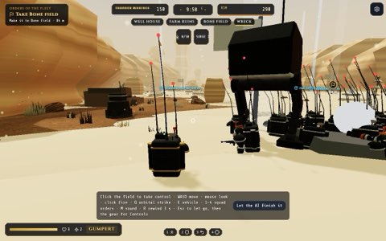</a><br><a href="apps/two-fronts/README.md" title="Thunder Marines against the Wooka horde: a turn-based galactic war with three.js hero battles in orbit and on six worlds. There is one world for each kind of sector: redwood forest, desert, ruined city, glowing alien night, beach and deep-space station. The two parts were built apart and connect through small JSON types (a spec in, a result out). Play the AI or hotseat in the page, or a friend online through a Durable Object for each campaign."><b>Two Fronts</b></a><br><sub><a href="https://two-fronts.notryanquinn.workers.dev">Play</a></sub></td><td align="center" valign="top"><a href="apps/hippo-tycoon/README.md">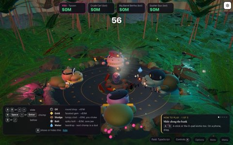</a><br><a href="apps/hippo-tycoon/README.md" title="One game class runs as a Durable Object on Cloudflare and in-process in the binary: solo, couch, LAN party and online rooms."><b>Hippo Tycoon</b></a><br><sub><a href="https://hippo-ty32kk4m44sz57g2i6knvzzb7o-production.up.railway.app">Play</a></sub></td><td align="center" valign="top"><a href="apps/splat-spray/README.md">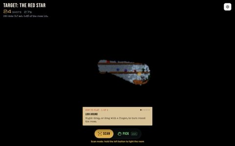</a><br><a href="apps/splat-spray/README.md" title="A spy game in a pitch-dark Gaussian-splat room. A short config makes the three.js page a desktop app, and the same page races friends online on a Worker."><b>Super Spy Splat Shot</b></a><br><sub><a href="https://supersplatspyshot.notryanquinn.workers.dev">Play</a></sub></td></tr>
<tr><td align="center" valign="top"><a href="apps/mythic-masters/README.md">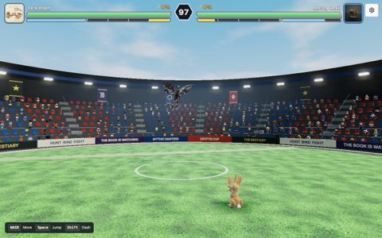</a><br><a href="apps/mythic-masters/README.md" title="A 3D creature arena brawler where mass, height and stats shape each body, and flyers must come down. A headless bot-vs-bot tuner keeps 76 folklore beasts near a 50% win rate, from a 6 kg jackalope to a one-tonne lake monster. One arena layout has a skin for each built region, on a route of 64."><b>Mythic Masters</b></a><br><sub><a href="https://mythic-masters.notryanquinn.workers.dev">Play</a></sub></td><td align="center" valign="top"><a href="apps/excalibrawl/README.md"></a><br><a href="apps/excalibrawl/README.md" title="A drawing fight each hour. Clef and Clef Flash select only a move, shape, colour, grid cell and size from a picture of their halves. Or two text models write a drawing language that uses few tokens. Clef is the referee, and a fight costs two cents or less. Replays are in R2, and a Durable Object has the live socket."><b>Excalibrawl</b></a><br><sub><a href="https://excalibrawl.notryanquinn.workers.dev">Play</a></sub></td><td align="center" valign="top"><a href="apps/fleet-commander/README.md">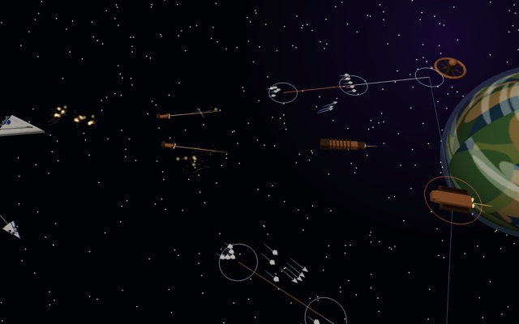</a><br><a href="apps/fleet-commander/README.md" title="A real-time fleet battle from the bridge of a wedge destroyer: call plays for your wings of fighters, trade broadsides, hold the hyperspace lane and rake the base on the world below. Win a sector and command a dreadnought whose captains run their own wings."><b>Fleet Commander</b></a></td></tr>
</table>

<details><summary>What each one proves</summary>

- **[Park Hide & Seek](apps/park-hide-seek/README.md)**: 3D hide and seek on real Yosemite terrain. The page, a LAN host or the edge can run the game. Each player gets only what they can see. [Play it](https://park-hide-seek.notryanquinn.workers.dev)
- **[Git Recon](apps/git-recon/README.md)**: A repo as a shooter level. Its folders become compounds and its files become buildings, on real ground (Yosemite, or any lat/long) or in a plastic-army kitchen and garden. Git commands are the weapons. Play alone in the page, with up to 64 players in a LAN battle, or online in a Durable Object for each room.
- **[Skate Tech Park](apps/skate-tech-park/README.md)**: Skate a street spot, or fly a rocket roadster with ten cold-gas thrusters across the gap. It is a three.js page on a pure fixed-step sim, which the tests run headless.
- **[Alien Disc Golf](apps/alien-disc-golf/README.md)**: Disc golf where the course is the planet: nine holes between random countries on a three.js globe. NOAA's live wind carries the disc, and a high throw rides the jet stream. The Worker relays the latest GFS grid from NOMADS, and the page decodes the GRIB2. Guess the tee's country to get one stroke back.
- **[Delayed Reaction](apps/delayed-reaction/README.md)**: A phone-first rhythm game. You sprint through a neon tunnel that rolls. A ring calls a note, and you answer one bar later on one of four thumb pads. Your answers echo back through a dub delay. The sim plays in beats with no page, and thus a test runs each level.
- **[Two Fronts](apps/two-fronts/README.md)**: Thunder Marines against the Wooka horde: a turn-based galactic war with three.js hero battles in orbit and on six worlds. There is one world for each kind of sector: redwood forest, desert, ruined city, glowing alien night, beach and deep-space station. The two parts were built apart and connect through small JSON types (a spec in, a result out). Play the AI or hotseat in the page, or a friend online through a Durable Object for each campaign.
- **[Hippo Tycoon](apps/hippo-tycoon/README.md)**: One game class runs as a Durable Object on Cloudflare and in-process in the binary: solo, couch, LAN party and online rooms.
- **[Super Spy Splat Shot](apps/splat-spray/README.md)**: A spy game in a pitch-dark Gaussian-splat room. A short config makes the three.js page a desktop app, and the same page races friends online on a Worker.
- **[Mythic Masters](apps/mythic-masters/README.md)**: A 3D creature arena brawler where mass, height and stats shape each body, and flyers must come down. A headless bot-vs-bot tuner keeps 76 folklore beasts near a 50% win rate, from a 6 kg jackalope to a one-tonne lake monster. One arena layout has a skin for each built region, on a route of 64.
- **[Excalibrawl](apps/excalibrawl/README.md)**: A drawing fight each hour. Clef and Clef Flash select only a move, shape, colour, grid cell and size from a picture of their halves. Or two text models write a drawing language that uses few tokens. Clef is the referee, and a fight costs two cents or less. Replays are in R2, and a Durable Object has the live socket.
- **[Fleet Commander](apps/fleet-commander/README.md)**: A real-time fleet battle from the bridge of a wedge destroyer: call plays for your wings of fighters, trade broadsides, hold the hyperspace lane and rake the base on the world below. Win a sector and command a dreadnought whose captains run their own wings.

</details>

### One account, one front door

These connect the apps: one sign-in for all of them, and one page that lists them.

<table>
<tr><td align="center" valign="top"><a href="apps/eqosys/README.md"></a><br><a href="apps/eqosys/README.md" title="Your home for each Q game: your games, friends, saves and studio on one account. Below it is Better Auth on D1, with a PKCE code handoff to each app and a signed token that the app can check alone. It knows which app each person came from and what they can do in each. A Durable Object for each person holds friends, presence and notifications. It is also a plain OpenID provider for a site's own Better Auth or a native app. PolyForm Noncommercial."><b>eqosys</b></a><br><sub><a href="https://eqosys.qntbr.com">Play</a></sub></td><td align="center" valign="top"><a href="apps/playground/README.md"></a><br><a href="apps/playground/README.md" title="One page that lists each app with a way to try it: Play, Download or Source. It has static assets only, and thus it costs nothing."><b>Playground</b></a></td><td align="center" valign="top"><a href="apps/qollab/README.md" title="Realtime rooms for any app on Cloudflare: rooms, seats, parties, presence and saves in one call. It is built into eqosys as its own Worker, with a Durable Object for each player and each room. PolyForm Noncommercial."><b>Qollab</b></a></td></tr>
</table>

<details><summary>What each one proves</summary>

- **[eqosys](apps/eqosys/README.md)**: Your home for each Q game: your games, friends, saves and studio on one account. Below it is Better Auth on D1, with a PKCE code handoff to each app and a signed token that the app can check alone. It knows which app each person came from and what they can do in each. A Durable Object for each person holds friends, presence and notifications. It is also a plain OpenID provider for a site's own Better Auth or a native app. PolyForm Noncommercial.
- **[Playground](apps/playground/README.md)**: One page that lists each app with a way to try it: Play, Download or Source. It has static assets only, and thus it costs nothing.
- **[Qollab](apps/qollab/README.md)**: Realtime rooms for any app on Cloudflare: rooms, seats, parties, presence and saves in one call. It is built into eqosys as its own Worker, with a Durable Object for each player and each room. PolyForm Noncommercial.

</details>

### My apps

Real tools for real work. Some have their own license.

<table>
<tr><td align="center" valign="top"><a href="apps/what-would-fantano-say/README.md"></a><br><a href="apps/what-would-fantano-say/README.md" title="A parody music critic as an RWSDK Worker. The phone decodes the song and selects a 15 s clip. Cloudflare's Clef-omni judges it for approximately $5 for each 100,000 reviews. It is behind a rate limit, Turnstile, an edge cache and a daily budget."><b>What Would Fantano Say</b></a><br><sub><a href="https://what-would-fantano-say.notryanquinn.workers.dev">Play</a></sub></td><td align="center" valign="top"><a href="apps/brianfloresblitzing/README.md"></a><br><a href="apps/brianfloresblitzing/README.md" title="One static page (&quot;One Team in 32&quot;), which a Cloudflare Worker serves as plain assets. There is no Worker code."><b>One Team in 32</b></a><br><sub><a href="https://brianfloresblitzing.notryanquinn.workers.dev">Play</a></sub></td><td align="center" valign="top"><a href="apps/qcrm/README.md">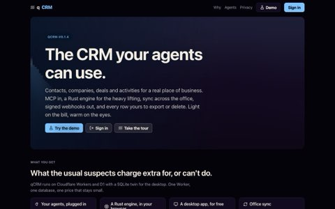</a><br><a href="apps/qcrm/README.md" title="A CRM with MCP built in, a Rust wasm engine in the browser, office sync, signed webhooks and a desktop build. It has roles for a real place and hashed org ids. PolyForm Noncommercial."><b>qCRM</b></a><br><sub><a href="https://qcrm.qntbr.com">Play</a></sub></td><td align="center" valign="top"><a href="apps/geoboxq/README.md">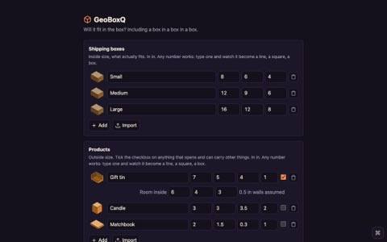</a><br><a href="apps/geoboxq/README.md" title="A fit checker for shipping boxes, with a Rust engine that packs boxes in boxes. PolyForm Noncommercial."><b>GeoBoxQ</b></a><br><sub><a href="https://geoboxq-worker-live-ryanquinn-tjhne4lpmumy6kz5.notryanquinn.workers.dev">Play</a></sub></td></tr>
<tr><td align="center" valign="top"><a href="apps/at-lens/README.md">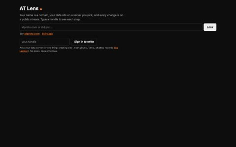</a><br><a href="apps/at-lens/README.md" title="Type a handle and watch the AT Protocol work: domain to DID to data server to typed records, checked in the two directions. Then see the account live on the Jetstream firehose. Sign in with atproto OAuth to write a record of our own Lexicon and watch it come back. No keys and no bindings."><b>AT Lens</b></a></td><td align="center" valign="top"><a href="apps/qview3d/README.md"></a><br><a href="apps/qview3d/README.md" title="A 3D product customiser for a shop page, from one script tag. Shoppers drag a photo over a hat or onto a tee or hoodie's front, back and sleeve, choose its colour and save a snapshot. A shop with another product makes a model of it from photos. Uploads go to R2 on signed links, in one folder for each org. PolyForm Noncommercial."><b>QView3D</b></a><br><sub><a href="https://qview3d.notryanquinn.workers.dev">Play</a></sub></td><td align="center" valign="top"><a href="apps/qview3d/README.md"></a><br><a href="apps/qview3d/README.md" title="A 3D product customiser for a shop page, from one script tag. Shoppers drag a photo over a hat or onto a top's front, back and sleeve (a tee, sweater, hoodie or tank), choose its colour and save a snapshot. A shop with another product makes a model of it from photos. Uploads go to R2 on signed links, in one folder for each org. PolyForm Noncommercial."><b>QView3D</b></a><br><sub><a href="https://qview3d.notryanquinn.workers.dev">Play</a></sub></td><td align="center" valign="top"><a href="apps/sharesplat/README.md">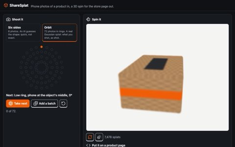</a><br><a href="apps/sharesplat/README.md" title="Product photos become a 3D spin for a store page. A guided shot list on the phone takes six sides for an AI-guessed mesh, or 72 photos in rings for a real Gaussian splat. A turntable viewer cuts away the table and stray bits, then hosts the model at one link per product (R2, eqosys sign-in) for a Shopify theme block or a pasted embed."><b>ShareSplat</b></a><br><sub><a href="https://sharesplat.notryanquinn.workers.dev">Play</a></sub></td></tr>
<tr><td align="center" valign="top"><a href="apps/cron-swanson/README.md" title="Every alarm, reminder and cron job of every app on one page, in five lanes from async to yearly. A small Bun server ticks each minute, so a job fires within a second of its time."><b>Cron Swanson</b></a></td><td align="center" valign="top"><a href="apps/geoboxq-shopify/README.md" title="A small wrapper that turns a Shopify cart into the store's own box."><b>GeoBoxQ for Shopify</b></a></td><td align="center" valign="top"><a href="apps/artstewengine/README.md" title="A small RWSDK app on D1 with a Better Auth admin page. Add who has paid, and the sealed engine of qCRM gets its key only for a paid license."><b>artstewengine</b></a></td></tr>
</table>

<details><summary>What each one proves</summary>

- **[What Would Fantano Say](apps/what-would-fantano-say/README.md)**: A parody music critic as an RWSDK Worker. The phone decodes the song and selects a 15 s clip. Cloudflare's Clef-omni judges it for approximately $5 for each 100,000 reviews. It is behind a rate limit, Turnstile, an edge cache and a daily budget.
- **[One Team in 32](apps/brianfloresblitzing/README.md)**: One static page ("One Team in 32"), which a Cloudflare Worker serves as plain assets. There is no Worker code.
- **[qCRM](apps/qcrm/README.md)**: A CRM with MCP built in, a Rust wasm engine in the browser, office sync, signed webhooks and a desktop build. It has roles for a real place and hashed org ids. PolyForm Noncommercial.
- **[GeoBoxQ](apps/geoboxq/README.md)**: A fit checker for shipping boxes, with a Rust engine that packs boxes in boxes. PolyForm Noncommercial.
- **[AT Lens](apps/at-lens/README.md)**: Type a handle and watch the AT Protocol work: domain to DID to data server to typed records, checked in the two directions. Then see the account live on the Jetstream firehose. Sign in with atproto OAuth to write a record of our own Lexicon and watch it come back. No keys and no bindings.
- **[Cron Swanson](apps/cron-swanson/README.md)**: Every alarm, reminder and cron job of every app on one page, in five lanes from async to yearly. A small Bun server ticks each minute, so a job fires within a second of its time.
- **[QView3D](apps/qview3d/README.md)**: A 3D product customiser for a shop page, from one script tag. Shoppers drag a photo over a hat or onto a tee or hoodie's front, back and sleeve, choose its colour and save a snapshot. A shop with another product makes a model of it from photos. Uploads go to R2 on signed links, in one folder for each org. PolyForm Noncommercial.
- **[QView3D](apps/qview3d/README.md)**: A 3D product customiser for a shop page, from one script tag. Shoppers drag a photo over a hat or onto a top's front, back and sleeve (a tee, sweater, hoodie or tank), choose its colour and save a snapshot. A shop with another product makes a model of it from photos. Uploads go to R2 on signed links, in one folder for each org. PolyForm Noncommercial.
- **[ShareSplat](apps/sharesplat/README.md)**: Product photos become a 3D spin for a store page. A guided shot list on the phone takes six sides for an AI-guessed mesh, or 72 photos in rings for a real Gaussian splat. A turntable viewer cuts away the table and stray bits, then hosts the model at one link per product (R2, eqosys sign-in) for a Shopify theme block or a pasted embed.
- **[GeoBoxQ for Shopify](apps/geoboxq-shopify/README.md)**: A small wrapper that turns a Shopify cart into the store's own box.
- **[artstewengine](apps/artstewengine/README.md)**: A small RWSDK app on D1 with a Better Auth admin page. Add who has paid, and the sealed engine of qCRM gets its key only for a paid license.

</details>

### The workshop

Music, 3D and circuits: tools to make things. Where it helps, a Rust engine runs with a TypeScript engine.

<table>
<tr><td align="center" valign="top"><a href="apps/splat-rooms/README.md"></a><br><a href="apps/splat-rooms/README.md" title="A splat hunt game with a world class. Its 30 MB scenes stream from a folder on your disk and are never embedded."><b>Splat Rooms</b></a><br><sub><a href="https://splat-rooms.notryanquinn.workers.dev">Play</a></sub></td><td align="center" valign="top"><a href="apps/fm-daw/README.md"></a><br><a href="apps/fm-daw/README.md" title="One Rust crate runs as wasm in the audio thread and through FFI on the host. Its output is bit-identical to the TypeScript engine."><b>FM Groovebox</b></a><br><sub><a href="https://fm-daw.notryanquinn.workers.dev">Play</a></sub></td><td align="center" valign="top"><a href="apps/motion-midi/README.md"></a><br><a href="apps/motion-midi/README.md" title="One synth in Rust and in TypeScript, checked sample by sample"><b>Motion MIDI</b></a></td><td align="center" valign="top"><a href="apps/auto-rig/README.md"></a><br><a href="apps/auto-rig/README.md" title="Auto-rigging a 3D model in Rust and TypeScript with identical output"><b>Auto Rig</b></a><br><sub><a href="https://auto-rig.notryanquinn.workers.dev">Play</a></sub></td></tr>
<tr><td align="center" valign="top"><a href="apps/meshy-studio/README.md"></a><br><a href="apps/meshy-studio/README.md" title="A folder-based batch tool for the Meshy API: image, multi-image and text to 3D, texture, remesh, rig, animate and concept art. Your key stays local, and you see the price before each spend."><b>Meshy Studio</b></a></td><td align="center" valign="top"><a href="apps/tscircuit-desktop/README.md"></a><br><a href="apps/tscircuit-desktop/README.md" title="A heavy, real-world Vite app as one file, with a Rust engine up to 22x faster and a TypeScript fallback"><b>tscircuit Desktop</b></a></td><td align="center" valign="top"><a href="apps/pixel-rag/README.md">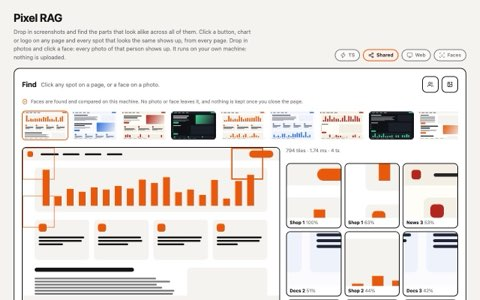</a><br><a href="apps/pixel-rag/README.md" title="Add your screenshots and find the parts that look the same in all of them. Each worker, web or desktop, shares one Rust index."><b>Pixel RAG</b></a></td><td align="center" valign="top"><a href="apps/splat-desktop/README.md" title="PlayCanvas' SuperSplat editor as a desktop app. It works on a folder on your disk."><b>Splat Desktop</b></a></td></tr>
</table>

<details><summary>What each one proves</summary>

- **[Splat Rooms](apps/splat-rooms/README.md)**: A splat hunt game with a world class. Its 30 MB scenes stream from a folder on your disk and are never embedded.
- **[FM Groovebox](apps/fm-daw/README.md)**: One Rust crate runs as wasm in the audio thread and through FFI on the host. Its output is bit-identical to the TypeScript engine.
- **[Motion MIDI](apps/motion-midi/README.md)**: One synth in Rust and in TypeScript, checked sample by sample
- **[Auto Rig](apps/auto-rig/README.md)**: Auto-rigging a 3D model in Rust and TypeScript with identical output
- **[Meshy Studio](apps/meshy-studio/README.md)**: A folder-based batch tool for the Meshy API: image, multi-image and text to 3D, texture, remesh, rig, animate and concept art. Your key stays local, and you see the price before each spend.
- **[Splat Desktop](apps/splat-desktop/README.md)**: PlayCanvas' SuperSplat editor as a desktop app. It works on a folder on your disk.
- **[tscircuit Desktop](apps/tscircuit-desktop/README.md)**: A heavy, real-world Vite app as one file, with a Rust engine up to 22x faster and a TypeScript fallback
- **[Pixel RAG](apps/pixel-rag/README.md)**: Add your screenshots and find the parts that look the same in all of them. Each worker, web or desktop, shares one Rust index.

</details>

### Everything else: frameworks, other people's apps and test fixtures

Sample apps from frameworks and apps from other people, which run with no code changes. Also the small apps that the tests use. A new app goes here first, until someone moves it to its section.

<table>
<tr><td align="center" valign="top"><a href="apps/hello-world/README.md"></a><br><a href="apps/hello-world/README.md" title="The first five minutes: a twenty-line page. The welcome tour finds it, lets three agents write it again at the same time, and then asks you to deploy it."><b>Hello World</b></a><br><sub><a href="https://hello-world.notryanquinn.workers.dev">Play</a></sub></td><td align="center" valign="top"><a href="apps/load-in/README.md"></a><br><a href="apps/load-in/README.md" title="A first-person sound-crew sim on real numbers: carry the gear at its real weight, bowl out rolls of cable that weigh what cable weighs, wire power and signal, and aim the speakers, from a garage to an arena."><b>Sound Guy Simulator</b></a></td><td align="center" valign="top"><a href="apps/starter-game/README.md"></a><br><a href="apps/starter-game/README.md" title="The template a new game starts from: catch falling stars, with an eqosys sign-in, a Qollab party and a state() harness already in."><b>Starter Game</b></a></td><td align="center" valign="top"><a href="apps/frameworks/nuxt-example/README.md"></a><br><a href="apps/frameworks/nuxt-example/README.md" title="A Nuxt 4 app on the cloudflare-module preset of Nitro (one KV binding), as a desktop app with no edits. init reads it, and the host runs the Worker that Nitro built. The same shared HTTP journey checks it."><b>Nuxt</b></a></td></tr>
<tr><td align="center" valign="top"><a href="apps/frameworks/qwik-example/README.md"></a><br><a href="apps/frameworks/qwik-example/README.md" title="A Qwik City app on its own cloudflare-pages adapter, as a desktop app with no edits. A routeLoader$ and a routeAction$ count in KV through platform.env. init reads the adapter's dist/_worker.js as it is."><b>Qwik City</b></a></td><td align="center" valign="top"><a href="apps/frameworks/astro-example/README.md"></a><br><a href="apps/frameworks/astro-example/README.md" title="An Astro site on @astrojs/cloudflare, as a desktop app with no edits. A server page and an API route count in KV through cloudflare:workers. init reads it as it is."><b>Astro</b></a></td><td align="center" valign="top"><a href="apps/frameworks/elysia-example/README.md"></a><br><a href="apps/frameworks/elysia-example/README.md" title="An Elysia Worker as the Cloudflare guide of Elysia writes it (aot: false, cloudflare:workers), as a desktop app with no edits. init now reads Elysia."><b>Elysia</b></a></td><td align="center" valign="top"><a href="apps/frameworks/sveltekit-example/README.md"></a><br><a href="apps/frameworks/sveltekit-example/README.md" title="A SvelteKit 3 app on the Cloudflare adapter, as a desktop app with no edits. It has a load from KV and a form action that increments it. It meets the same sample app contract as hono-example, and the same shared journey checks it."><b>SvelteKit</b></a></td></tr>
<tr><td align="center" valign="top"><a href="apps/frameworks/solidstart-example/README.md"></a><br><a href="apps/frameworks/solidstart-example/README.md" title="A SolidStart 2 app on the cloudflare_module preset of Nitro, as a desktop app with no edits. A &quot;use server&quot; query and an API route count in KV through cloudflare:workers. rustybuns init reads it as it is."><b>SolidStart</b></a></td><td align="center" valign="top"><a href="apps/frameworks/react-router-example/README.md"></a><br><a href="apps/frameworks/react-router-example/README.md" title="React Router 7 on Cloudflare's own template (workers/app.ts, the Vite plugin, a loader and an action on KV), as a desktop app with no edits. It is the second framework on the shared sample-app journey."><b>React Router</b></a></td><td align="center" valign="top"><a href="apps/frameworks/nextjs-example/README.md"></a><br><a href="apps/frameworks/nextjs-example/README.md" title="A Next.js 16 app on @opennextjs/cloudflare (one KV binding), as a desktop app with no edits. init reads it, and the host runs the worker.js that OpenNext built. The same shared HTTP journey checks it."><b>Next.js</b></a></td><td align="center" valign="top"><a href="apps/frameworks/svelte-spa-example/README.md"></a><br><a href="apps/frameworks/svelte-spa-example/README.md" title="A client-only Svelte 5 + Vite app (no server) as a desktop app. Its counter is in a &quot;use server&quot; action that the host runs."><b>Svelte SPA</b></a></td></tr>
<tr><td align="center" valign="top"><a href="apps/frameworks/vue-spa-example/README.md">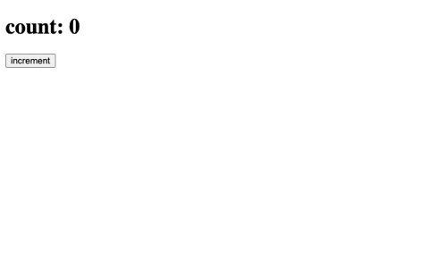</a><br><a href="apps/frameworks/vue-spa-example/README.md" title="A client-only Vue 3 + Vite app (no server) as a desktop app. Its counter is in a &quot;use server&quot; action that the host runs."><b>Vue SPA</b></a></td><td align="center" valign="top"><a href="apps/frameworks/solid-spa-example/README.md"></a><br><a href="apps/frameworks/solid-spa-example/README.md" title="A client-only Solid + Vite app (no server) as a desktop app. Its counter is in a &quot;use server&quot; action that the host runs."><b>Solid SPA</b></a></td><td align="center" valign="top"><a href="apps/frameworks/hono-example/README.md"></a><br><a href="apps/frameworks/hono-example/README.md" title="A Hono Worker from Hono's own docs (one KV binding), as a desktop app with no edits. It is the sample app contract that each framework example meets, and one shared HTTP journey checks it."><b>Hono</b></a></td><td align="center" valign="top"><a href="apps/frameworks/tanstack-start-example/README.md">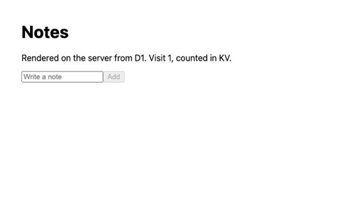</a><br><a href="apps/frameworks/tanstack-start-example/README.md" title="TanStack Start on Cloudflare's Vite plugin (server functions, a server route, D1 and KV) as a desktop app with no code changes."><b>TanStack Start</b></a></td></tr>
<tr><td align="center" valign="top"><a href="apps/copy-desk/README.md" title="A small business site on the built-in CMS: its words and news posts are JSON files you edit as forms and translate, with no code to touch."><b>Copy Desk</b></a></td><td align="center" valign="top"><a href="apps/hemyviz/README.md" title="Your Alchemy deployments, drawn live: every stack, every stage, every resource, in 2D, 2.5D and 3D, five ways each."><b>hemyviz</b></a></td><td align="center" valign="top"><a href="apps/test-swarm/README.md" title="Not an app: a Worker that queues our test runs for any of our Macs to lease, and posts the typecheck and apps statuses on GitHub when they pass."><b>Test Swarm</b></a></td><td align="center" valign="top"><a href="apps/pwa-example/README.md" title="A web page that Android installs as an app and that opens offline: a TypeScript page, a 370-byte Rust roller as wasm, a service worker and a manifest."><b>Pocket Dice (PWA)</b></a></td></tr>
<tr><td align="center" valign="top"><a href="apps/kitesurf-bench/README.md" title="Times Cloudflare's Kitesurf agent browser against Chromium on our own live pages, from inside a Worker. Deploy, press Run, copy the table, destroy."><b>Kitesurf Bench</b></a></td><td align="center" valign="top"><a href="apps/agent-office/README.md" title="Someone else's Node server (PTYs, WebSockets, a 3D client) as one binary, nothing forked"><b>Agent Office</b></a></td><td align="center" valign="top"><a href="apps/terraviz-demo/README.md" title="TerraViz is the Science On a Sphere globe of The Zyra Project (Apache-2.0, not ours). We clone it and run it with no code changes. Shared Sphere adds a room on one globe and a teacher's lock, so that a class follows one pair of hands. NOAA tour scripts stay in step on each screen, and a small Rust crate reads them as slides."><b>TerraViz</b></a></td><td align="center" valign="top"><a href="apps/frameworks/express-example/README.md" title="An Express server on Postgres, the server half of a Wasp app, as a desktop app with no edits. Bun runs Express beside the host, and PGlite in the data dir is its Postgres."><b>Express</b></a></td></tr>
<tr><td align="center" valign="top"><a href="apps/frameworks/elysia-conduit/RUSTYBUNS.md" title="The RealWorld backend of bedstack (Elysia, Drizzle, postgres.js) with no source edits. It is a desktop binary on PGlite that passes their Postman suite. The doc lists the five ways that it breaks on Workers."><b>Elysia RealWorld</b></a></td><td align="center" valign="top"><a href="apps/agent-demo/README.md" title="A small snack-vote Worker that is seeded into codeSplitter. Some coding agents can build it at the same time and resolve a merge conflict on camera."><b>Agent Demo</b></a></td><td align="center" valign="top"><a href="apps/borg-postgres/README.md" title="A Postgres app keeps its database and moves its code: Hyperdrive on the edge, PGlite on the desktop."><b>Borg Postgres</b></a></td><td align="center" valign="top"><a href="apps/borg/README.md" title="Not an app: a small Worker that uses each binding one time. Thus one suite can check the local twins against a real deploy."><b>Borg</b></a></td></tr>
<tr><td align="center" valign="top"><a href="apps/frameworks/spa-example/README.md" title="Not an app: a part of a real RWSDK game. The tests use it to check that init reads it correctly."><b>SPA fixture</b></a></td><td align="center" valign="top"><a href="apps/example/README.md" title="A full Worker (D1, KV, a Durable Object) as a desktop binary in half a second, and a Rust FFI probe with a TypeScript fallback."><b>Worker example</b></a></td></tr>
</table>

<details><summary>What each one proves</summary>

- **[Hello World](apps/hello-world/README.md)**: The first five minutes: a twenty-line page. The welcome tour finds it, lets three agents write it again at the same time, and then asks you to deploy it.
- **[Copy Desk](apps/copy-desk/README.md)**: A small business site on the built-in CMS: its words and news posts are JSON files you edit as forms and translate, with no code to touch.
- **[hemyviz](apps/hemyviz/README.md)**: Your Alchemy deployments, drawn live: every stack, every stage, every resource, in 2D, 2.5D and 3D, five ways each.
- **[Sound Guy Simulator](apps/load-in/README.md)**: A first-person sound-crew sim on real numbers: carry the gear at its real weight, bowl out rolls of cable that weigh what cable weighs, wire power and signal, and aim the speakers, from a garage to an arena.
- **[Starter Game](apps/starter-game/README.md)**: The template a new game starts from: catch falling stars, with an eqosys sign-in, a Qollab party and a state() harness already in.
- **[Test Swarm](apps/test-swarm/README.md)**: Not an app: a Worker that queues our test runs for any of our Macs to lease, and posts the typecheck and apps statuses on GitHub when they pass.
- **[Pocket Dice (PWA)](apps/pwa-example/README.md)**: A web page that Android installs as an app and that opens offline: a TypeScript page, a 370-byte Rust roller as wasm, a service worker and a manifest.
- **[Kitesurf Bench](apps/kitesurf-bench/README.md)**: Times Cloudflare's Kitesurf agent browser against Chromium on our own live pages, from inside a Worker. Deploy, press Run, copy the table, destroy.
- **[Agent Office](apps/agent-office/README.md)**: Someone else's Node server (PTYs, WebSockets, a 3D client) as one binary, nothing forked
- **[TerraViz](apps/terraviz-demo/README.md)**: TerraViz is the Science On a Sphere globe of The Zyra Project (Apache-2.0, not ours). We clone it and run it with no code changes. Shared Sphere adds a room on one globe and a teacher's lock, so that a class follows one pair of hands. NOAA tour scripts stay in step on each screen, and a small Rust crate reads them as slides.
- **[Nuxt](apps/frameworks/nuxt-example/README.md)**: A Nuxt 4 app on the `cloudflare-module` preset of Nitro (one KV binding), as a desktop app with no edits. `init` reads it, and the host runs the Worker that Nitro built. The same shared HTTP journey checks it.
- **[Qwik City](apps/frameworks/qwik-example/README.md)**: A Qwik City app on its own `cloudflare-pages` adapter, as a desktop app with no edits. A `routeLoader$` and a `routeAction$` count in KV through `platform.env`. `init` reads the adapter's `dist/_worker.js` as it is.
- **[Astro](apps/frameworks/astro-example/README.md)**: An Astro site on `@astrojs/cloudflare`, as a desktop app with no edits. A server page and an API route count in KV through `cloudflare:workers`. `init` reads it as it is.
- **[Elysia](apps/frameworks/elysia-example/README.md)**: An Elysia Worker as the Cloudflare guide of Elysia writes it (`aot: false`, `cloudflare:workers`), as a desktop app with no edits. `init` now reads Elysia.
- **[SvelteKit](apps/frameworks/sveltekit-example/README.md)**: A SvelteKit 3 app on the Cloudflare adapter, as a desktop app with no edits. It has a `load` from KV and a form action that increments it. It meets the same sample app contract as hono-example, and the same shared journey checks it.
- **[SolidStart](apps/frameworks/solidstart-example/README.md)**: A SolidStart 2 app on the `cloudflare_module` preset of Nitro, as a desktop app with no edits. A `"use server"` query and an API route count in KV through `cloudflare:workers`. `rustybuns init` reads it as it is.
- **[React Router](apps/frameworks/react-router-example/README.md)**: React Router 7 on Cloudflare's own template (`workers/app.ts`, the Vite plugin, a loader and an action on KV), as a desktop app with no edits. It is the second framework on the shared sample-app journey.
- **[Next.js](apps/frameworks/nextjs-example/README.md)**: A Next.js 16 app on `@opennextjs/cloudflare` (one KV binding), as a desktop app with no edits. `init` reads it, and the host runs the `worker.js` that OpenNext built. The same shared HTTP journey checks it.
- **[Svelte SPA](apps/frameworks/svelte-spa-example/README.md)**: A client-only Svelte 5 + Vite app (no server) as a desktop app. Its counter is in a `"use server"` action that the host runs.
- **[Vue SPA](apps/frameworks/vue-spa-example/README.md)**: A client-only Vue 3 + Vite app (no server) as a desktop app. Its counter is in a `"use server"` action that the host runs.
- **[Solid SPA](apps/frameworks/solid-spa-example/README.md)**: A client-only Solid + Vite app (no server) as a desktop app. Its counter is in a `"use server"` action that the host runs.
- **[Hono](apps/frameworks/hono-example/README.md)**: A Hono Worker from Hono's own docs (one KV binding), as a desktop app with no edits. It is the sample app contract that each framework example meets, and one shared HTTP journey checks it.
- **[Express](apps/frameworks/express-example/README.md)**: An Express server on Postgres, the server half of a Wasp app, as a desktop app with no edits. Bun runs Express beside the host, and PGlite in the data dir is its Postgres.
- **[Elysia RealWorld](apps/frameworks/elysia-conduit/RUSTYBUNS.md)**: The RealWorld backend of bedstack (Elysia, Drizzle, postgres.js) with no source edits. It is a desktop binary on PGlite that passes their Postman suite. The doc lists the five ways that it breaks on Workers.
- **[TanStack Start](apps/frameworks/tanstack-start-example/README.md)**: TanStack Start on Cloudflare's Vite plugin (server functions, a server route, D1 and KV) as a desktop app with no code changes.
- **[Agent Demo](apps/agent-demo/README.md)**: A small snack-vote Worker that is seeded into codeSplitter. Some coding agents can build it at the same time and resolve a merge conflict on camera.
- **[Borg Postgres](apps/borg-postgres/README.md)**: A Postgres app keeps its database and moves its code: Hyperdrive on the edge, PGlite on the desktop.
- **[Borg](apps/borg/README.md)**: Not an app: a small Worker that uses each binding one time. Thus one suite can check the local twins against a real deploy.
- **[SPA fixture](apps/frameworks/spa-example/README.md)**: Not an app: a part of a real RWSDK game. The tests use it to check that `init` reads it correctly.
- **[Worker example](apps/example/README.md)**: A full Worker (D1, KV, a Durable Object) as a desktop binary in half a second, and a Rust FFI probe with a TypeScript fallback.

</details>

<!-- /apps -->

## License

Apache-2.0, except qCRM, GeoBoxQ, eqosys and Qollab, which are under the PolyForm Noncommercial License 1.0.0 in their own directories. See [LICENSING.md](LICENSING.md).
