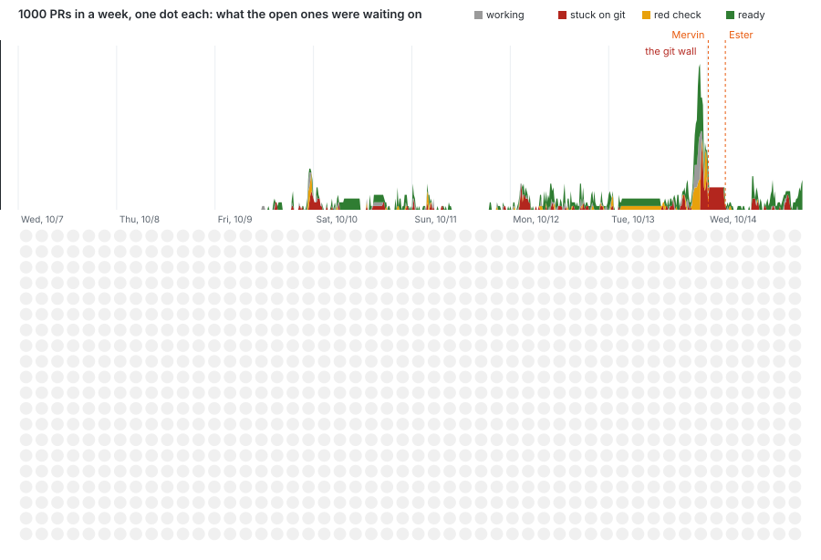

# codeSplitter

**Git for the agentic era.
Every line is its own record, every agent and person edits live, and git keeps going even when other gits don't.**

**Never let your git quit.** Run it as a desktop app and your git lives on your machine, syncing out to the cloud instead of the cloud syncing in to you.
If a cloud dies, you and your agents keep going.

Git was built for one person at one keyboard sending a patch by email.
Now a dozen coding agents work on one repo at once, around the clock, and humans review what they make.
That's automated development, a software factory, and the floor it runs on should be built for it. codeSplitter takes git apart and puts it back together at the scale of a single line:

- **Lines, not files, are the unit.** Every line has a stable id, an author and a history.
  Three agents can edit one file at the same moment and never step on each other.
- **It's still real git.** A commit is a real `git push` to Cloudflare Artifacts.
  `git clone` works, `git pull` works, your tools work.
- **People and agents use the same API, in the same ways.** The ⌘K palette, a REST API with an OpenAPI spec, personal tokens, OAuth, WebMCP in the browser, and now an **MCP server**.
  If you can click it, your agent can call it. **Copy a prompt for your agent** on the home page (or `/agent.md`, or `codesplitter prompt`) hands your own agent the CLI, MCP and WebMCP routes (in that order of preference) in one paste, so it can steer the site for you.
- **Then why not just deploy your app as well?** The repo knows how to ship itself: preview deploys, real deploys, a log of every one.
  Only a person presses the button.

**Artifacts or are they fiction?** Why artifacts are a future primitive: codeSplitter is where you can git it, get it, share it, agent it, socialize it.

Live at **[codesplitter.notryanquinn.workers.dev](https://codesplitter.notryanquinn.workers.dev)**.
It's a proof of concept, built for Cloudflare's Artifacts challenge, and it moves fast.

## Use it and start it

**Just use it:** open the [live site](https://codesplitter.notryanquinn.workers.dev), sign in, then dig up a GitHub repo or make a new one.
Open a file, edit a line, start an agent on a branch, review and merge it.

**Run it on your machine** (free; needs [Bun](https://bun.sh) and git; your data lives in `~/.codesplitters`):

```sh
git clone https://github.com/QuinnsCode/RustyBuns.git
cd RustyBuns && bun install --frozen-lockfile   # once, at the repo root
cd apps/codesplitter
bun run desktop                                  # the app, in a window
```

No window (a remote box, or an agent driving a browser)? `bun run desktop:agent` prints the URL to open.
`bun run desktop:watch` rebuilds on every save, and `bun run desktop:update` pulls the latest and restarts.
On the desktop, sign in with an alias (any handle you pick); coding agents (claude, codex, pi, opencode) use your own installed logins.

**Try it in five minutes:** `bun run welcome` digs up a small app and lets three agents edit one file at once, locally, with nothing billed.
`bun agents.ts` is the same idea in one command, printing who wrote which line.

**Hook up your own agent:**

```sh
claude mcp add --transport http codesplitter https://codesplitter.notryanquinn.workers.dev/api/mcp
curl -fsSL https://codesplitter.notryanquinn.workers.dev/install.sh | sh && codesplitter login
```

More: [the desktop app](#the-free-desktop-app-own-your-git-put-it-wherever-you-want), [REFERENCE.md](REFERENCE.md) for every feature and for deploying the site yourself.

**In progress, top priority:** the Druids-skinned Agent Office running inside codeSplitter, on the `office-preview` stage ([plan](../agent-office/MOVE.md), [runbook](../agent-office/PREVIEW.md), [#1412](https://github.com/QuinnsCode/RustyBuns/issues/1412)). That stage stays deployed until the owner has seen it. codeSplitter may also move to its own home on 2026-10-14; the run instructions stay accurate either way.

## What it does for you

The highest-value things, in order:

1. **Point your agents at one repo, all at once, safely.** Claude Code, Codex, pi and opencode edit line by line, live, blamed by name (`agent-claude`).
   A stale edit to a line someone just changed lands anyway when the two changed different words; otherwise it gets a 409 and retries.
   Nothing is silently overwritten.
   Agents work on branches, and a three-way merge **by line id** settles what git would call a conflict (a moved block that someone else edited, the same line added twice).
   What's left is a card each on the branch's merge page: keep main's, the branch's, both, or write it, with a suggestion when both sides added words at one spot and an Ask button for a coding agent's answer, which is offered only once the merged file parses and the repo's tests for that file pass with it in a throwaway clone, where you turn that on in the dependency doctor's settings. The agent hears why each side changed the file: main's commit messages, and the branch's agent task or, for a branch from upstream, its upstream commit messages.
   Agents settle the same conflicts over MCP, the CLI or WebMCP.
   The engine doing this is Mervin ([docs/mervin.md](docs/mervin.md); with Ester the tester, [why they exist](docs/mervin-and-ester.md)), your agentic git and merge guy: a deterministic, non-AI merge engine built for the agentic era, so many agents collaborate with minimal friction and merge conflicts dissolve into merge solutions without spending tokens. (Opt-in learning of your repo's merge patterns, kept in R2 and queried with R2 SQL, is designed, not built.) He is held to real history: on 470 files git itself gave up on across 400 conflicted merges in git/git, it settled 49% to what the person committed, asked on 39%, and settled 13% to other text (`bun scripts/mervin-corpus.ts`).
   Hot spots get their own rules in `.gitattributes`, as git's merge drivers do: `CHANGELOG.md merge=union` and its rewrites stack instead of conflicting.
   Each path gives an agent a budget too: past it, failing the same way twice or on a third conflict round, it stops and leaves a four-line note (DONE, NEXT, BROKE, DONT), and a fresh agent, a cheaper model or a person picks up from that.
   A branch whose merge meets changed conflicts a third time gets the same: the next answer comes from fresh eyes reading a note of what the last ones tried, or a person.
2. **Your git keeps going when the other git doesn't.** Make a repo a mirror of GitHub, GitLab or any git URL, or turn a fork you dug up on the desktop into one with a click (its About panel says which of its commits go up first, and asks).
   When upstream goes down, you keep editing, committing, branching and running agents.
   The Upstream panel says it's down and how many commits are waiting, and it catches up by itself once upstream answers.
   It never force-pushes.
3. **Make your code private one line at a time.** Select some lines in a public repo and make them private.
   Everyone else sees a blank line in the same place: on the page, in blame, in search, in git.
   Your crew gets a second git remote with the real text.
   Ship the open-source repo with the secret sauce still secret.
4. **Share some lines, not the repo.** A live link to just a range, which follows those lines by id as the file changes.
   It works from a private repo, too.
5. **Hook it to your AI in one command.**
   With `claude` running, run this in a separate terminal, then type `/mcp` in Claude, pick codesplitter and Authenticate. Then ask it to edit your page.
   ```sh
   claude mcp add --transport http codesplitter https://codesplitter.notryanquinn.workers.dev/api/mcp
   ```
   It signs in with OAuth.
   Every tool is an operation in the OpenAPI spec, so the MCP server and the API never drift, and the ones that can't be undone (merge, delete, deploy) are marked so your client asks first.
   Or from your shell, no checkout needed (Bun or Node 18+):
   ```sh
   curl -fsSL https://codesplitter.notryanquinn.workers.dev/install.sh | sh
   codesplitter login     # paste a token from your profile page
   codesplitter tools     # every MCP tool, as a command
   codesplitter triage    # something broke? your coding agent asks what, digs in, drafts the issue
   ```
6. **Deploy it.** Every repo says how easily [Rusty Buns](../../README.md) could ship it, then ships it: to Cloudflare, to a Railway or Hetzner box, from your desktop or from the site with a write-only, sealed deploy key.

## Git here, git there, git everywhere

| Where | What holds the git | What you get |
|---|---|---|
| The live site | [Cloudflare Artifacts](https://developers.cloudflare.com/artifacts/) | A repo per project, made by an API call, cloneable by anyone you hand a token |
| Your desktop | Bare repos in `~/.codesplitters`, served by `git http-backend` | Any size, private GitHub repos, your own machine's credentials |
| GitHub, GitLab, anywhere | A mirror, both ways | Two-way sync through outages, branches pushed upstream and pulled back |
| Your agent's context | MCP, OpenAPI, WebMCP | The repo as tools: `read_file`, `edit_lines`, `start_branch`, `merge_branch`, `deploy` |
| A phone | `#/m/owner/repo` | Start an agent, watch its run, review and merge its branch from the couch |

## Why Artifacts is rad

Running git at scale used to mean running a git server: disks, backups, auth, garbage collection, a fleet.
Artifacts makes a git repo a Cloudflare primitive, like a KV namespace or a D1 database.
You make one from a Worker with an API call, hand out a token scoped to that one repo, and anyone's stock `git clone` just works.

That changes what a repo is for.
When repos are that cheap, you make one per project, per fork, per experiment or per agent.
You let a visitor dig up any GitHub repo into a fork they own for a day, then throw it away.
That's what a software factory needs: lots of small, disposable, real git repos, and no server to babysit.

The catch is that Artifacts only takes writes as a `git push`.
So codeSplitter builds git's objects and pack itself, in the Worker, with Web Crypto and `CompressionStream` and no git library, and speaks git's smart HTTP protocol.
Each commit pushes only what changed on top of the parent tree, so editing one line of a big repo costs one blob, a few trees and a commit.
Repos too big even for Artifacts (Bun, Alchemy) are kept in R2, packed into chunks and dug in parallel off a queue.

## The free desktop app: own your git, put it wherever you want

You want to git commit, but is your git committed to you?

Most code hosts keep the real repo in their cloud and sync it down to you.
When the host is down, so are your pushes, your checks, your merges and every agent waiting on them.
The desktop app turns that around.
Your git lives on your machine, in bare repos under `~/.codesplitters`, and syncs **out**: mirrored both ways to GitHub, GitLab or any git remote you can reach.
When one of them goes down, you keep editing, committing, branching, running checks and merging, and your agents keep working.
It catches up by itself once upstream answers, and it never force-pushes.

You say where git truth lives, on your profile: codeSplitter, the artifact (this copy's git) or GitHub, or ask each time.
We don't mind which.
Mirrors sync both ways whatever you pick, and the setting only says whose side wins when both changed the same lines or upstream rewrote its history.
**Your git history never goes extinct**: whatever one side drops stays in its own git (this copy keeps it under `refs/kept/`), and every line here keeps its history, for the present and the future.

Don't let your git quit on you or your agents.

What if git was your deploy, your build, your friends, your history, yours, only yours?
As public as you want it to be, private as you want it to be: here, there, everywhere.
A line by line privacy model, making it easier to share more with human and agent alike.
Git in control of your git.
Git over your old relationship with git.
Git in charge of your history.

codeSplitter is one codebase that runs as a Cloudflare Worker and as a desktop app on your machine.
[Rusty Buns](../../README.md) gives every Cloudflare binding a local twin: sqlite for D1 and for each file's Durable Object, local bare repos for Artifacts, in-process queues, the Worker's cron as a minute timer.
Same code, nothing forked.

On the desktop you get the things a Worker can't do: coding agents run on your machine with your own logins, private GitHub repos clone with your `gh` token, any repo size, and mirrors that keep your git going through someone else's outage.
It's free and it's yours: your data lives in `~/.codesplitters`.

```sh
cd apps/codesplitter
bun install            # first, always: a fresh worktree or sandbox has no node_modules
bun run desktop        # the app in a window
bun run desktop:watch  # the same, rebuilt and restarted on every save; the window reloads itself
bun run desktop:agent  # desktop:watch with no window: prints the open URL once, for an agent's browser
bun run desktop:update # git pull, install, and restart the desktop on the new build
```

Under `desktop:watch` a pull is enough: the changed files rebuild the host and the window refreshes on its own (it
offers a Refresh button instead if you have text typed in). `desktop:update` is the one command to keep up with
merged changes: it pulls fast-forward only, and swaps a desktop that wasn't started by `desktop:watch` for a watched one.

There's no downloadable build yet; that's one command from source.

## Everything else it does

- **We got git problems with agent swarm.** `/git-problems.html` is the one page for both swarm demos below: the rush-hour station animation, and a way into the replay of a real week of this repo.
- **Git at swarm speed, with dots.** `/swarm.html`, also on the landing page, is a simulation of agents getting their work into main: the old git way's one lane, merge wall and red-check wall, then codeSplitter's layers one at a time (a Durable Object, Mervin's bullet train, Ester's stations). Story mode plays it as scenes; the others are old git, layer by layer, and side by side, with faders for speed, agents, overlap and red checks.
- **A week of the swarm, replayed.** `/swarm-watch.html` plays the week of October 7 to 14 back: 1,000 of this repo's real PRs, each a made-up agent, and what the open ones were waiting on, minute by minute. The git wall on the night of October 13 has 18 PRs stuck on conflicts at once, and the pane beside it shows the file they piled into. `bun scripts/swarm-week.ts` pulls the week (read only) a night-by-night numbers panel gives the peaks (the averages mislead), and a recorded merge round from this repo's history plays at the git wall (`bun scripts/swarm-round.ts`). `bun scripts/swarm-readme.ts` draws the animated chart below, and `--png` a still of the git wall for viewers that drop SMIL ([docs/swarm-week.png](docs/swarm-week.png)).

  
- **Blame and time travel for free.** The op log replays any file at any rev, so every line knows who wrote it and when.
- **gitpath.** Make code beautiful again: a file's commit graph comes down a guitar-neck highway in real 3D (three.js), main in the middle, branches fanning out and rejoining, an orange hot path through the churn. A rail on the right is time itself (oldest at the bottom) and two date boxes crop the history. The faint controller icon turns on a game: a tiny unicyclist, back to you, rides the hot path on left and right taps (or two keys you bind) timed to the beat, while merges (a car), forks, new branches and big squash merges (a boulder) blow gusts you have to lean into. A commit that names a piece of the stack (D1, R2, Queues, Durable Objects, Containers, Artifacts, rate limiting, static assets, Workers) turns into its 3D model, and a new piece is one registry line and one model. On a repo's page the route icon in the header opens it on that repo, read live from its git (`GET /api/repos/:o/:r/gitpath`), a file at a time. `bun run gitpath`, or feed it any clone with `bun scripts/gitpath-log.ts <clone> <path>`.
- **Live sync.** Edits go over each file's WebSocket.
  Every open page patches itself in place, and presence shows who else is there, people and agents apart.
  An agent holds the lines it was given while it works, you can hold lines of your own, and you can lift any claim.
  An agent that needs held lines can wait in line for them, granted in turn, and a soft claim just says what someone means to rewrite, keeping nobody off.
- **Agents have faces, lines take stamps.** An agent's profile (`#/u/agent-claude`) says who runs it, on which harness, the repos it works in, its runs and a 30-day pulse of its line edits.
  Stamp a line, not a pull request: a reaction that stays on the line by id through edits, shows on its blame and on both people's profiles, whoever wrote it, person or agent.
- **A code city, not a contributions chart.** Every person's profile has a city: a district per public repo, a building per file, tall where it's long and lit orange where lines landed lately, white stone where people wrote it and black glass where agents did. It is a rainy night on a floating slab: ground floors are lava-lamp walls, coffee shops, libraries and bookstores, and you can jump.
- **Make your avatar.** Click the little round you beside your name on your profile to open the full editor: face, hair, hat, glasses and clothes, with dev-flavoured extras (a rubber duck, a propeller cap, a conference lanyard). It is saved with your profile (`PUT /api/me {avatar}`) and you wear it when you walk the code city.
  Its streets run on each repo's pulse: a week of commits fills the sidewalks, crosswalks and bike lanes, and failing checks bring chaos (drivers brake-check and run reds, bikes wobble, people jaywalk, the signals go out).
  Whoever has one of its files open right now walks its streets, and you can walk them too, with its owner and their other followers (`/play.html#c/<handle>`).
  It has a postcard to share, private repos are never in it, and its owner can switch it off.
- **Dig it up = fork it.** Any level, or any public GitHub repo, becomes a git repo you own.
  Paste a URL, a remote or a `gh repo clone` line.
  It keeps listening: when upstream moves on, its About panel says how many commits, and Take them opens them here as a branch to review and merge.
- **The vein.** A repo is a dig site: its files, its crew, and its vein, the git history running through it.
  The About panel's Vein button opens it: where the repo came from and its branches.
  Tiles are joined by curves: a solid one for a mirror that keeps listening both ways, a dashed one for a fork copied once, which turns orange and says "N new upstream" once upstream has moved on since the dig (#874).
  Each curve's label says what's moving, and pointing at it shows what its button would do, before and after.
  Under the tiles, main's commits run as a row of dots: black for upstream's, orange for this copy's, a diamond for a merge, with each branch it merged curving off below and back in.
  Click a dot to revert it on main, or cherry-pick it onto main or an open branch: its changes land as line edits, so every other line keeps its blame. A binary file it touched goes back (or comes along) whole: on main in the same git commit, on a branch when it merges.
  A tagged commit wears a little tag; the owner picks a dot to tag it, and on a mirror fetches upstream's tags or pushes one up.
  The pulse travels the vein: while it's open, every line the crew lands sends a bead down main into its newest commit.
- **Levels.** Loved open-source repos to browse and fork: mitt, Hono, Preact, Cloudflare's own (Agents, workerd, PartyKit, Sandbox SDK and more), and the stack this is built on (RedwoodSDK, Effect, React, Alchemy, Bun).
- **Beam a branch.** A git branch's stack of commits (the patch, its fixups, an agent's follow-ups), or a codeSplitter branch an agent hands over with the `beam_branch` MCP tool, squashed into one clean commit on main or upstream's newest, with lockfile churn, installed packages and leftovers left out and each one named. A branch stacked on another beams as a commit per branch, in order.
  It's a link anyone can open, with the diff and a `git am` patch, and it can land in someone's inbox.
  A codeSplitter branch beams from the hosted site too, where the Worker's own git builds the commits, one per branch for a stacked one.
  It never writes to GitHub.
- **Select lines the way you'd want to.** Click, shift-click, drag, ⌘-click, arrows, Home/End, ⌘A, ⌘I to invert, ⇧⌥↑ to grow to the enclosing block, Esc or a second click to drop them; or pick by rule from ⌘K: lines matching text or a /regex/, lines an author or agent wrote. Agents get the same through WebMCP (`select_lines` with several ranges and add/remove/toggle, `select_matching`, `select_lines_by`, `expand_selection`, `invert_selection`, `deselect_lines`, `selected_lines`).
- **Cut some lines out.** Select lines, and the cut follows what they use across files.
  Run its tests alone, share a card of it on X, and merge it back line by line.
- **The dependency doctor.** It proposes updates on a branch on your schedule, skips releases too new to trust, tests them in a throwaway clone, and runs a breaking one down an on-fail chain you build from icons: retry it, have a coding agent fix it, have Claude search the web for known breakage, hold the release back, roll back to a smaller release, or alert you, stopping at the first that works, with caps on tries, minutes and dollars.
- **Repo health.** A page per repo (the heart button in the repo header, or on its Dependencies section; tabs A and B flip between two layouts) lists every dependency with what you pin, the registry's latest, how many releases and days behind, any known vulnerability and the 🪏 dig on it, under one 0-100 score; dev dependencies are marked with a wrench and weigh a quarter as much, with runtime and dev scores beside the total; icons and numbers, the words in tooltips.
  Rank the packages you care about most (drag ① rwsdk ② react ③ effect into order) and clashes settle by rule: a higher one keeps its target, and a lower one is re-picked to fit its peer range or waits.
  Rank them for one run only to bring those up and solve around them.
  Turn on previews and what passed the tests also goes up as a preview deploy, gets checked, and comes down before it lands on the branch; a deploy that fails runs down the same chain. 🪏 Dig for a future release (the next major, a beta, an exact version) and it watches for it, tries it the day it's out, and can take it once it's green.
  It also checks each dependency against [OSV](https://osv.dev) for known vulnerabilities: a vulnerable one moves to its first fixed release right away (past the level and the minimum age), and one with no fix yet is flagged as exposed.
- **The supply-chain watch.** Every hour it reads the status pages of the platforms agents lean on (Anthropic, OpenAI, GitHub, npm, Cloudflare) and OSV's new malicious-package advisories (`MAL-…`), and checks every repo's dependencies against them, doctor on or off.
  A range that could install a poisoned version shows up in the repo's Dependencies section.
  Optionally, once a day, Claude searches the news for compromised packages too, shown beside them as unverified.
- **Webhooks for CI/CD.** GitHub-shaped, HMAC-signed, retried on a queue.
- **Checks, ours and GitHub's, in one panel.** A commit to main or a branch pushed upstream starts check runs here, on GitHub Actions, or both.
  A mirror pulls the Actions jobs for each sha it sent up back in, beside codeSplitter' own, and can post its own results to GitHub as `codesplitter/<name>` statuses.
  The desktop runs its own queue, so checks just run there.
  Bring your own runners too: they pull work (`POST …/checks/claim`), so one behind a firewall or on a laptop works, and `scripts/runner.ts` is the whole loop to wrap around any build.
  On Cloudflare they can run in a container per run, off unless you turn it on (it bills container time).
  A monorepo checks each workspace a change touches, and the ones that depend on it, rather than everything.
  Checks planned from package.json install first (`bun install`, frozen when there's a `bun.lock`), since a runner's fresh clone has no node_modules.
  Required checks gate Merge, scoped by path when you like (a change in `apps/a` doesn't wait on `b-tests`), and agents watch them with the `checks` MCP tool the way they'd run `gh pr checks`.
  GitHub is the backup, not a dependency: running checks here is always on offer, and while GitHub is down the desktop checks here in its place, merges on its own checks passing, and lets GitHub's verdict catch up on main once the mirror syncs.
- **CI that heals itself.** A required check failing on a branch, or its merge tripping a guard (conflict markers, a JSON file that won't parse), starts a coding agent on that branch with the failing log, and the checks run again on its fix.
  Two tries, one at a time; then the branch waits for a person, the attempts listed beside its checks. On with hosted agents (admins only, on the hosted budget), or on the desktop with `HEAL=1`.
- **Build changes are flagged.** A branch that touches `package.json`, a lockfile, a Dockerfile, CI or the deploy config shows every changed line, and its merge waits for a person to say they've read them.
  Agents can be prompt-injected; this is where it gets caught.
- **A security model you can read, and that the tests hold to.** Your code, your app, your provisioning and your destruction: what each is promised, and the test that proves each promise, in [REFERENCE.md](REFERENCE.md#the-security-model-your-code-your-app-your-provisioning-your-destruction).
  Every delete the API offers is in a table of what goes and what stays.
  A promise whose test is renamed or dropped fails CI, and `bun run smoke` runs every cited test and the stress script with a row per promise.
- **Accounts and limits.** GitHub, Google or email sign-in.
  Rate limits on everything that costs money, which an admin can set to reject, log, flag or queue. Paid tiers named for gems (Tanzanite 2x, Alexandrite 5x, Painite 10x) multiply a person's caps and stamp their name.
- **What a stranger can browse.** There is no site-wide list of public repos: no explore page, and `/api/repos`, `/api/explore` and `/api/public` don't exist. A public repo is open to anyone with its link, with no sign-in, and a person's public repos are listed on their profile (`GET /api/users/:name`) and in their code city. Private repos show only to their owner and crew. Without a link or a handle, the imported levels are what there is to look at.
- **Pricing.** Free, and nothing here takes payment. A gem tier is set by an admin by hand (`PUT /api/admin/limits/tier`); there is no checkout.
- **Limits.** Every rule is a count per caller per window, and the defaults are the table in [`src/limits.ts`](src/limits.ts) (for example 10 new repos a day, 60 commits an hour, 20 hosted agent runs a day, 5 GitHub digs an hour). A repo's owner sees where they stand at `GET /api/repos/:o/:r/limits`, and admins tune the rules at `#/admin/limits`. Going over answers 429 with `retry-after`. Hosted agent and container runs also share a site-wide daily budget, so they can run out for everyone.
- **Stability.** This is a hackathon-stage project with no uptime promise. Don't keep your only copy of anything here; clone it out, or run the desktop app, where your git lives on your machine.
- **The game.** Every repo is a level: the backrooms of the codebase, where the lines tear off the walls as paper birds and you swat them with the rolled-up README.
  Bop your friends in the lobby. Share lines, then send a link into the game: the wrecking room (everyone smashes the repo together) or the backrooms standing in that file's folder. For a public GitHub repo you needn't sign in or dig anything: `/play#gh/<owner>/<repo>?mode=wreck` digs one shared read-only copy on the first visit and reuses it (new copies are capped at 20 an hour, site-wide).

### Point your CI here

Make a CI token for the repo (`POST /api/repos/:owner/:repo/checks/tokens`), then set your CI's GitHub API base URL (the GitHub Enterprise option) to `https://<this site>/api/gh/v3` and use that token as its GitHub token.
Its commit statuses and check runs show up in the repo's checks as `external` runs, and required ones gate Merge.

### CI for your public repo, on your own machine

Run your public repo's heavy checks on a machine you own, a spare Mac at home say, with no way in for strangers.

```
GitHub ──mirror──▶ codeSplitter ◀──pulls work── your machine
(fork PRs stay there)             (nothing listens)
```

GitHub warns against self-hosted runners on public repos because a fork PR can edit `.github/workflows` and run on your box, and a personal account can't fence runners off (that takes an organization's runner groups).
Here, fork PRs never mirror: a mirror fetches upstream's own branches, never `refs/pull/*`.
Only trusted code runs: your branches and your agents', and main as merged on GitHub, which you reviewed, queued as the mirror takes it.
Your machine pulls its runs, so it needs no open port.
A check gets none of your logins: a scrubbed environment and an empty `HOME`, as a sandbox user of its own if you like, and pinning the repo's checks runs only the commands in its settings, so a merge can't change what runs.
Make the mirror pull-only and codeSplitter never writes to GitHub either: syncs only fetch, and branch and tag pushes are turned away.
GitHub's free runners keep doing the quick PR checks.

It isn't new in kind: GitLab's CI for external repos, Buildkite's agents and GitOps (Argo CD, Flux) all pull the same way.
What's new is the size: the enterprise pull model for one person and a spare Mac, with no Kubernetes, GitLab or organization.
The caveats and what's still missing are in [REFERENCE.md](REFERENCE.md#ci-for-your-public-repo-on-your-own-machine).

## Hard to copy

What would take someone else the longest to build:

- **A merge by line identity, not by text.** Lines keep their ids through edits, moves and branches, so a merge knows a moved block is the same block,
  even one moved out of an `if` and re-indented, and carries the other side's edits into it (#1223). A clash the move split apart is still one card (#1237). Git guesses that from text.
- **A git push in a Worker with no git library.** Objects, trees rebuilt only along changed paths, the pack and receive-pack, plus a fresh start that moves a full repo to a new Artifact with the very same tree.
- **One codebase on the edge and the desktop.** Durable Objects, D1, Artifacts, Queues and Cron all have local twins, so the desktop isn't a port.
  It's the same app.
- **Private lines in a public repo**, kept blank in git, in search and on the live socket, with a second remote for the crew.
- **Git that survives an outage**: a two-way mirror that merges without a checkout, stops at a clash or a force-push, and never loses a commit.
- **A safety model for agents that ship.** Agents get branches, containers and their own keys, never deploy keys.
  Deploy keys are write-only and sealed; only a person deploys.
  Hosted agents run in throwaway containers that bill nothing while idle.
- **One API, every surface.** The palette, REST, OpenAPI, tokens, OAuth, WebMCP and MCP all come from one list, and a test fails if they drift.

> **⚠️ Super experimental.** Coding agents run real CLIs that can edit files and run shell commands, and hosted runs spend real API keys.
> They're off by default on Cloudflare.
> Run it on a machine you trust and read the code before you point it at anything that matters.

## Read more

- [REFERENCE.md](REFERENCE.md): every feature in detail, every route, deploying the site, accounts, hosted agents and deploys, and where the code lives
- [Rusty Buns](../../README.md): what lets the same app run on the edge and on your desktop
