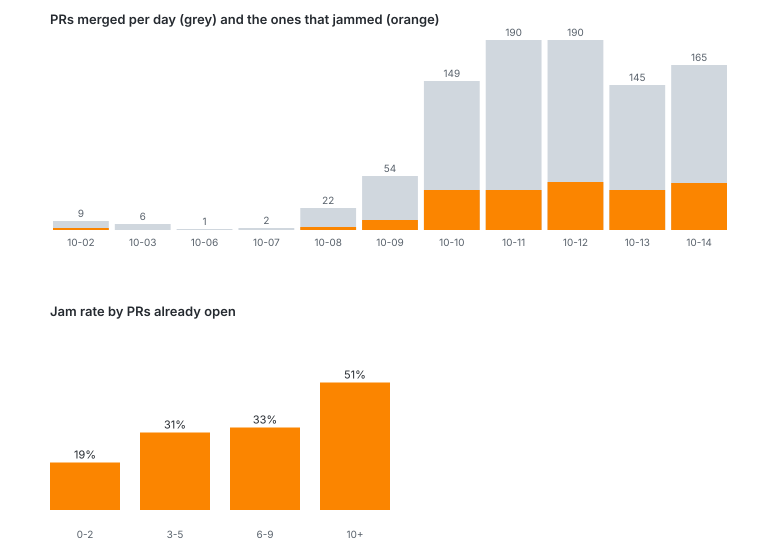

# Where a swarm of agents gets stuck

"Why not just have agents do the coordinating, the testing and the merging?" Because the stuck parts are mechanical,
and they repeat. This page counts them in our own history: every PR on this repo (933 merged between Oct 2 and Oct 14,
2026), read with `bun scripts/jam-report.ts` (read-only `gh` and `git`; `--svg` redraws the chart).

## The curve

Merges went from 9 a day to 150-190 a day in a week, and the share that jammed stayed near a quarter, so the number
of jams a day grew with the crowd: 2, 3, 10, 40, 40, 48, 40, 47. A PR is **jammed** here when it merged `main` back in,
mentioned a conflict or a rebase, or was force-pushed. By how many PRs were already open when it was created:

| PRs already open | PRs | Jammed |
|---|---|---|
| 0-2 | 597 | 19% |
| 3-5 | 224 | 31% |
| 6-9 | 61 | 33% |
| 10+ | 51 | 51% |

A jammed PR stayed open 0.78 h on average against 0.24 h for a clean one, and took 2.6 commits against 1.1. Overall 230
of 933 PRs (25%) jammed and 121 (13%) had a red CI run.

## Toe stepping, by file

Pairs of PRs that were open at the same time and both changed the file:

| File | PRs that changed it | Overlapping pairs |
|---|---|---|
| `apps/codesplitter/src/client.html` | 237 | 222 |
| `apps/codesplitter/README.md` | 150 | 150 |
| `apps/codesplitter/src/api.ts` | 100 | 76 |
| `apps/codesplitter/src/worker.ts` | 111 | 62 |
| `apps/codesplitter/REFERENCE.md` | 104 | 55 |

PRs that touched one of those five jammed 32% of the time, the rest 20%. The README is the usual one: every feature
adds a line to the same list, so agents working apart still edit the same lines.

## What each helper would have unjammed

**Mervin** (a deterministic line-id merge and a plan that puts clashing PRs in waves, [mervin.md](mervin.md)) is aimed
at the 230 jammed PRs. Real cases from the history:

- #1538 and #1539 were open together; each had to merge `main` and **renumber its migration** after the other landed.
  22 PRs mention a renumber or migration stamp. Two PRs with one stamp merge clean as text and break at deploy, the
  clash the board lists.
- #244 has 7 commits that merge `main` or fix a conflict; #893, #250 and #243 have 4 each. That is a person or agent
  redoing a merge, the kind the line-id merge is built to blend.
- The README and `client.html` rows above: both sides added lines, which the line-id merge keeps instead of asking.

**Ester** (sorts a red check by owner: main, flaky, the PR's own, or the merged tree, [mervin.md](mervin.md#ester-the-tester))
is aimed at the 121 PRs with a red run. 115 of the 146 failed runs on record are the `apps` check, 16 are `typecheck`.

- #1356 sat 10.7 h from its first red run to merge; #1533, #1534 and #1535 about 5 h each. How much of that was
  someone reading logs to learn whether the failure was theirs is the question Ester answers in seconds.
- Across the red PRs, about 100 hours passed between a PR's first red run and its merge.

## What this does not show

- Jams are counted from commit titles and force pushes, so quiet ones (a conflict fixed in the merge commit with a
  generic title) are missed: these numbers are a floor.
- It measures that the jams happened, not that Mervin or Ester would have cleared them. For Mervin that replay is
  `scripts/mervin-score.ts` and `scripts/merge-plan.ts`; for Ester, a failing test's log is not on GitHub after the
  run expires, so "flaky or real" cannot be split here.
- The sample is one repo built by many agents in a hurry: the one a swarm looks like.

## A demo of the curve (proposed, not built)

The landing intro already shows a calm file, then a flock of lines. The same room can show the problem first:

1. A **code city** street (the hidden city, `src/city.js`) with one building, the README. One agent walks in.
2. More agents crowd into the same room. Each one's edit flashes the README red; the flashes speed up with every
   arrival, drawn from the curve above.
3. "What if a whole class of conflicts could be gone?" The red lines separate into their own ids and stop flashing.
4. "These are the real ones": the same lines, now in the app's editor, with the person's own cursor in them.
5. The bottom-left Getting started guide takes over, one step at a time, so the visitor explores from there.

An agent that is steering the site (a browser tool) can drive the same tour step by step.
