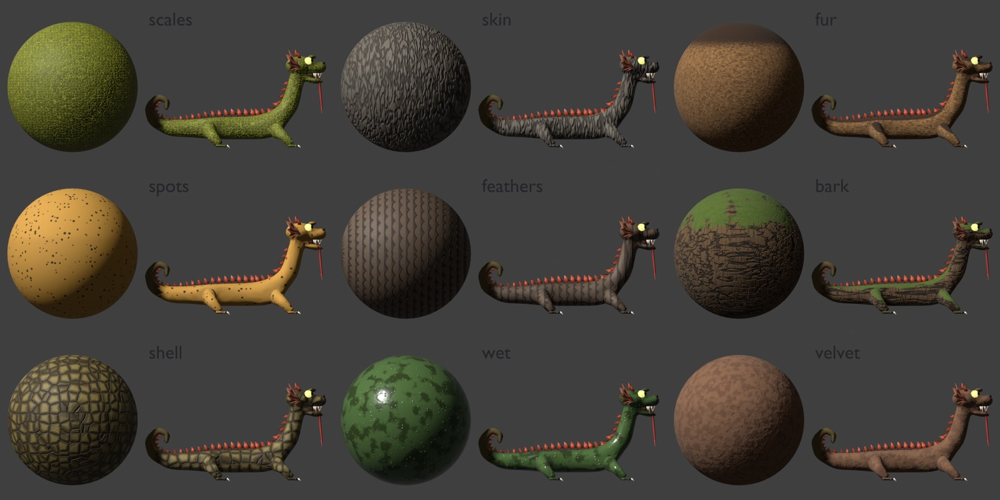

# Hides: baked beast skins

A sheet's `hide` key gives the beast's body a skin finer than its mesh can colour. `blender/beast.py` (`bake_hide`)
unwraps the body's faces after decimation, builds the pattern from procedural Blender nodes in the body's own space
(metres), and Cycles bakes three maps from it in about a second:

- **colour** (`map` px, 1024): a share of the vertex tone, so the belly, paint and occlusion still work over it
- **normal** (tangent space, same size): the pattern's height through a Bump node, so scales and plates catch light
- **roughness** (half size): the pattern's gloss, so wet skin shines and a seam stays dull

The GLB carries them as glTF `baseColorTexture`, `normalTexture` and `metallicRoughnessTexture`, and the game's
`stylize` (`src/beasts.ts`) lets the roughness map set the roughness.



## Wearing one

Add `hide` to the sheet, then look at it up close:

```json
"hide": { "pattern": "feathers", "size": 0.1, "colours": [[0.16, 0.13, 0.12], [0.4, 0.34, 0.28]],
          "band": { "colour": [0.2, 0.14, 0.1], "width": 0.18 } }
```

```sh
bun scripts/beasts.ts --close <id>      # blender/out/<id>.close.png, the GLB's own mesh, filling the frame
bun run probe mythic-masters "?gallery=<page>" --shot out.png   # in the game; see the gallery's focus(id, view)
```

The patterns, their `colours` and their extra keys are in the header comment of `blender/beast.py`; each one's
example is its row in `EXAMPLES` in `blender/hides.py`. Overlays go over any pattern: `spots`, `moss` (tufts on the
surfaces that face up) and `band` (a dorsal stripe down the spine). Sheet-wide, `black: true` lets a body be truly
black (otherwise its luminance is floored and lifted toward the belly's hue so it can still be shaded).

Judge in close-ups and the gallery, never the contact sheet or a fight: at fight size (a beast about 80 px tall) no
grain reads, only tint and big marks. A beast with fine scales wants `map: 1024`; one with only big marks does at 512.

## Seeing them all

```sh
bun scripts/beasts.ts --swatch                    # blender/out/hides.png: every pattern on a sphere and on the Tatzelwurm
bun scripts/beasts.ts --swatch feathers bark      # just those
bun scripts/beasts.ts --swatch --sample hodag     # on another beast
```

Each cell is baked exactly as a GLB is (`low_poly`, `shade`, `bake_hide`), so what shows there is what the game gets.

## Adding a pattern

1. In `hide_nodes` (`blender/beast.py`), add an `elif pattern == "<name>":` branch that sets three things from
   nodes: `c` the colour (a multiple of the body's: build it with `mix`, `scaled` and `cols`, the sheet's colours
   already turned into multiples), `ht` the height 0..1 (high stands proud), and `gl` the gloss 0..1 (1 the shiniest
   part). The helpers there (`noise`, `voronoi`, `warped`, `ramp`, `math_`, `mix_f`, `xyz`, `vmath`) cover most of it;
   `co` is the point in the body's space, +x toward the head, +z up.
2. Give it a roughness range in `ROUGH` (shiniest, dullest). The game's rim light glazes anything under about 0.6,
   so keep a dry pattern above that; a sheet can still pass its own `rough`.
3. Add an example row to `EXAMPLES` in `blender/hides.py` (the body's colour and the hide), and a line for it in
   `beast.py`'s header under `hide`.
4. `bun scripts/beasts.ts --swatch <name>` and look at the sphere and the beast. Then put it on a sheet and check
   `--close` and the gallery.

Gotchas, learned the hard way:

- Blender exits 0 on a script error unless it gets `--python-exit-code 1` (`scripts/beasts.ts` passes it). If a tweak
  changes nothing, suspect a stale GLB or a node that never got linked.
- Two meshes that share a material share its maps: `bake_hide` wires the map into the material, so the last bake wins.
- A mesh that arrives with its own UVs must read the map through the `hide` layer; `bake_hide` makes it the active one.
- A pattern that depends on an exact feature point is hard to get right in nodes: an explicit lattice (`floor`,
  `fract` on the coordinates, as `feathers` does) is easier to reason about than Voronoi's Position output.
- Vertex occlusion is baked from rays against the whole scene: keep other meshes clear of the one being shaded.
