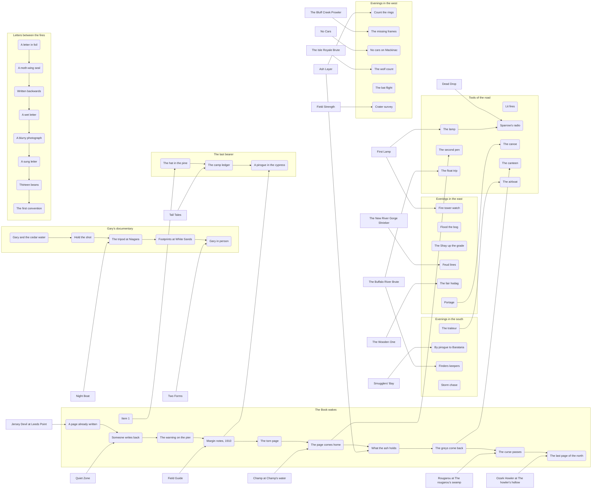

# The story bible

<!-- Written by `bun run story` from content/story.json and the game's own files. Edit those, not this. -->

Every storyline in Mythic Masters, region by region down the road. The words live in `content/story.json` (edit by hand,
in `bun run cms`, or on the map with `bun run story --serve`); the shape is `src/story/model.ts`; beats the game already
plays (each mythic, the faction quests, the sighting boards, the roads) are read from the game itself (`src/story/infer.ts`),
so this page can't drift from it. `bun run story --check` runs in the app's tests: a beat that names a place, a beast or
another beat that doesn't exist fails CI.

Open `docs/story.html` for the map: regions as columns, the four kinds as rows, threads drawn between beats.

- **main**: the Book's ledger, region to region. **sub**: a thread over several regions. **side**: one place, one evening.
  **unlock**: what opens the next thing (a road, a line-up slot, a tool), at a level.
- **idea** is written down, **approved** the owner said yes, **built** the game plays it. Beats marked *owner* are the
  owner's to write (anything about what the Book is).

## Story card

| | check | rate | points |
| --- | --- | --- | --- |
| S1 | every playable region has 1 main, 2 sub, 3 side, 1 unlock | 100% | 1.00 |
| S2 | every playable region's world names all 7 senses (place, life, weather, sound, people, history, craft) | 100% | 1.00 |
| S3 | written beats tied to another arc (40% is full marks) | 100% | 1.00 |
| S4 | written beats the game plays (built) | 20% | 0.20 |
| S5 | world wants the game has (built) | 10% | 0.10 |
| | **total** | | **3.30 of 5** |

## Where the game disagrees with itself

Read from the game, not the JSON: each is an issue to fix in the game.

- beat office-5 needs office-4, which is further down the road
- beat institute-5 needs institute-4, which is further down the road
- beat lamplighters-5 needs lamplighters-4, which is further down the road

## Threads

| thread | kind | beats | built | pitch |
| --- | --- | --- | --- | --- |
| The ledger: every region's mythic *(game)* | main | 8 | 8 | The trail of each playable region ends at its mythic. The Book wants them all. |
| The roads *(game)* | unlock | 7 | 7 | Each mythic beaten opens the roads to its neighbours; some need a flier or a swimmer in the line-up. |
| The line-up grows *(game)* | unlock | 2 | 2 | The line-up starts at 3 and gains a place for each of the first mythics, up to 5. |
| The Office of Unlisted Fauna *(game)* | sub | 8 | 8 | The Book is government property. It is a register. It left its shelf without Form 9-C. The Office will log it, seize it and file it. A register does not talk. Reports that this register talks are errors in the report. |
| The Halloway Institute *(game)* | sub | 8 | 8 | The Book is a field instrument. It is a catalogue that sorts specimens by a measure. We do not have that measure yet. We will have it before the grant ends. Then we will not need the Carrier. |
| The Lamplighters *(game)* | sub | 8 | 8 | The Book is a cage with pages. A cage cannot walk, so it hires a hand. You are the hand. We read the tracks for years and we are sure. Do not ask the cage. A cage says what a cage says. |
| Sighting boards *(game)* | side | 16 | 16 | Two cryptid contracts a region, pinned in a town: read the report, follow three signs, find the named creature. |
| The Book wakes | main | 11 | 1 | The Book's ledger, region by region. Each mythic you bring it is a name it already knew, and each region shows a little more of why something is waking the cryptids. What the Book is stays the owner's to write; these beats only point at it. |
| Gary's documentary | sub | 5 | 0 | Gary narrates the found tapes, always one region ahead of you and always just missing the shot. His tapes get stranger and closer, until you meet him at Fouke, where the old drive-in still shows a monster film. |
| The last bearer | sub | 3 | 0 | The rust thumbprint on every page belongs to someone. Their trail runs through lumber camps, a ghost town and a bayou: a hat, a field guide, a pirogue. Who they were is the owner's to write. |
| Letters between the fires | sub | 8 | 8 | The eight believer groups write to each other but never meet. Carry their letters camp to camp along the road and, at the end, they hold their first convention at the Howl-Back Club's ridge. Each letter makes the next camp trust you sooner. |
| Evenings in the east | side | 6 | 0 | One place, one evening each: a fire tower, a flooded bog, a logging train, a feud, a county fair, a portage. |
| Evenings in the west | side | 6 | 0 | A fallen giant, a missing reel, an island with no cars, a wolf count, a cave of bats, a crater survey. |
| Evenings in the south | side | 4 | 0 | A faith healer, a smugglers' bay, a diamond field, a storm chase. |
| Tools of the road | unlock | 8 | 1 | What you carry decides where you can go: a lamp for the night, a radio for rumours, a canoe for the lakes, a bicycle for the island, a second pen for the Book. Each comes from someone you meet, at a level. |

## 1. Pine Barrens

Region 1, from level 2.

*Flat, sandy, hushed and endless: pitch pine and scrub oak to every edge, tea-brown rivers, white sugar-sand roads, and ghost towns where iron was once made from the bogs.*

**main**

- **Item 1** (Pine Barrens: Batsto Village, level 2; built). The two greys drop you in the pines at Batsto with a book that talks. Its first demand is written in rust over the printed page: every cryptid on earth, start with three. The rust on the page is the same colour as the bog iron in the streams.
- **Jersey Devil at Leeds Point** (Pine Barrens: Leeds Point, level 10; built, from the game). The last stone of the Pine Barrens trail: the region's mythic, Jersey Devil, in its lair. Beat it and the Book can hold it.
- **A page already written** (Pine Barrens: Leeds Point, level 10; idea, owner writes). When the Jersey Devil's ink holds, its page is not blank. A faded entry is already there, in the same rust hand, older than the Leeds house. The Book says nothing about it. Owner writes what the Book says, if anything. *After: Jersey Devil at Leeds Point.*

**sub**

- **A letter in foil** (The Hatters of Ong's Hat; built). The Hatters of Ong's Hat give you a letter wrapped in tin foil for the Porchlight Vigil, 'so the mothmen can't read it'.
- **Gary and the cedar water** (Pine Barrens: Mullica River, level 2; idea). The first Gary tape: cedar water, tannins, 'the water just moved'. Nobody knows who Gary is; the Lamplighters have heard of a man with a camera.
- **First Lamp** (Lamplighters: First Lamp, level 3; built, from the game). Wren Ashby stopped me at a path light in Wharton Forest and asked why I carry the Book.
- **Form 9-C** (the Office: Form 9-C, level 4; built, from the game). The Office stopped you under the fire tower on Apple Pie Hill and opened a file.
- **Baseline** (the Institute: Baseline, level 6; built, from the game). Toby Reyes of the Halloway Institute asked for a baseline at Blue Hole.
- **The hat in the pine** (Pine Barrens: Ong's Hat, level 7; idea). Ong's Hat is named for a hat thrown into a pine that never came down. It is still up there. Climb for it and the hat band has a rust thumbprint inside. *After: Item 1.*

**side**

- **Fire tower watch** (Pine Barrens: Apple Pie Hill, level 4; idea). The warden at Apple Pie Hill's fire tower needs a night watcher. From the cab you can see Philadelphia's glow and Atlantic City's. Mark three lights moving over the pines that are not planes; the third one is the Jersey Devil, and its route shows the 1909 trail. *After: First Lamp.*
- **Flood the bog** (Pine Barrens: Cranberry bogs, level 5; idea). At harvest a grower floods the cranberry bog so the ripe berries float. Open the sluice gates in order. When the red rises, something heavy is moving under it.
- **The Mullica River Prowler** (The Mullica River Prowler, level 6; built, from the game). A sighting board in Mullica River: the ranger saw the Wampus Cat. Three signs lead to its lair.
- **The Cranberry bogs Brute** (The Cranberry bogs Brute, level 9; built, from the game). A sighting board in Cranberry bogs: the birdwatcher saw the Rougarou. Three signs lead to its lair.

**unlock**

- **Lit fires** (The Hatters of Ong's Hat; built). Every campfire you light is a rest and a place to travel back to. *Opens: travel between lit fires.*
- **The lamp** (Lamplighters: First Lamp, level 3; idea). Wren Ashby gives you a Lamplighters' lamp. With it lit, the wild ones keep back a little after dark, and the dim lights on the night paths show you the way. *Opens: walking the night paths by lamp.* *After: First Lamp.*
- **The road to the Appalachian hollows** (Pine Barrens: Leeds Point, level 10; built, from the game). Beating Jersey Devil opens the road from the Pine Barrens to the Appalachian hollows; a gorge too wide to walk: bring a flier in your line-up (the Jersey Devil, once you have beaten it and bound it). *Opens: region 2, Appalachian hollows, from level 10 (needs a flier).* *After: Jersey Devil at Leeds Point.*
- **The road to the Great North Woods** (Pine Barrens: Leeds Point, level 10; built, from the game). Beating Jersey Devil opens the road from the Pine Barrens to the Great North Woods. *Opens: region 3, Great North Woods, from level 18.* *After: Jersey Devil at Leeds Point.*
- **A line-up of 4** (Pine Barrens: Leeds Point, level 10; built, from the game). Beating Jersey Devil gives the line-up one more place. *Opens: line-up slot 4.* *After: Jersey Devil at Leeds Point.*

**world**

- [ ] place: Batsto Village: the ironmaster's mansion, the sawmill, the gristmill and the workers' cottages along the lake, built of local stone and cedar.
- [ ] place: Apple Pie Hill's steel fire tower with a cab on top, the only high point for miles, the Batona Trail passing its foot.
- [ ] place: Sugar-sand roads: white, soft and deep-rutted, with the pines close on both sides and puddles the colour of tea.
- [ ] place: Cranberry bogs in rows behind low dykes and sluice gates, flooded red at harvest.
- [ ] life: Pitch pines with fire-blackened bark and new tufts growing straight from the trunk, scrub oak under them, Atlantic white cedar in the wet ground.
- [ ] life: The Pine Barrens tree frog (green with a lavender stripe), northern pine snakes, deer, turkey vultures over the plains.
- [ ] weather: Summer thunderstorms that roll in at dusk; spring smoke from controlled burns lying low in the pines.
- [ ] sound: Whip-poor-wills calling at dusk, the tree frog's nasal 'quonk', wind in pitch pine needles, sand squeaking underfoot.
- [x] people: Pineys: old families who cut cedar, pick berries and know every sand road by name; the Hatters of Ong's Hat at the first fire.
- [ ] history: Bog iron, glass works and charcoal pits of the 1700s and 1800s; cannonballs for the Revolution cast at Batsto.
- [ ] craft: Cedar shingles, wood-fired glass, cranberry scoops, a diner on the highway with a neon sign that hums.

## 2. Appalachian hollows

Region 2, from level 10.

*Steep green ridges folded close, fog in every hollow at dawn, coal towns down by the rivers, and radio silence around a giant dish.*

**main**

- **Someone writes back** (Appalachian hollows: Green Bank, level 13; idea, owner writes). Inside the Radio Quiet Zone, where no phone works, the Book's hand moves on a page you did not open. A line is added under the last demand, in a hand that is not the Book's. The Office's agents are at Green Bank for the same silence. *After: A page already written, Quiet Zone.*
- **The warning on the pier** (Appalachian hollows: Silver Bridge, level 16; idea). At the Silver Bridge's old piers, Mothman stands on the far bank and does not fight. In the legend it comes before a disaster. It looks at the Book, not at you. The next section's stone is where you fight it. *After: Someone writes back.*
- **Mothman at Point Pleasant** (Appalachian hollows: Point Pleasant, level 18; built, from the game). The last stone of the Appalachian hollows trail: the region's mythic, Mothman, in its lair. Beat it and the Book can hold it.

**sub**

- **A moth-wing seal** (The Porchlight Vigil; built). The Porchlight Vigil reads the letter by porch light and writes back, sealed with a moth wing, to the Backwards Lodge. *After: A letter in foil.*
- **Quiet Zone** (the Office: Quiet Zone, level 13; built, from the game). At Green Bank the Office ordered the Book switched off, and Agent Quist asked about the mothman. *After: Form 9-C.*
- **Hold the shot** (Appalachian hollows: New River Gorge, level 13; idea). Gary at the New River Gorge bridge: something on the far cliff waves. If you go to that cliff, his tripod marks are still in the moss and there is a dropped lens cap with a name scratched on it. *After: Gary and the cedar water.*
- **Dead Drop** (Lamplighters: Dead Drop, level 14; built, from the game). Pip asked me to carry a paper message past the Office cordon on the Tug Fork. *After: First Lamp.*
- **Cold Room** (the Institute: Cold Room, level 15; built, from the game). Dr. Vale offered Reagent 12 at the McClintic igloos, for data on the Book. *After: Baseline.*

**side**

- **The Shay up the grade** (Appalachian hollows: Cass, level 12; idea). Ride the geared Shay locomotive from Cass up to Bald Knob. Halfway, the snallygaster drops on the train. Fight on the flatcar while the grade gets steeper.
- **The Skyline Drive Shrieker** (The Skyline Drive Shrieker, level 14; built, from the game). A sighting board in Skyline Drive: the trucker saw the Snallygaster. Three signs lead to its lair.
- **Feud lines** (Appalachian hollows: Tug Fork, level 14; idea). Two families on either side of the Tug Fork both say they saw the wampus cat first, and both want it shot. Walk both banks, read the tracks, and find it saw them. *After: The New River Gorge Shrieker.*
- **The New River Gorge Shrieker** (The New River Gorge Shrieker, level 17; built, from the game). A sighting board in New River Gorge: the birdwatcher saw the Snallygaster. Three signs lead to its lair.

**unlock**

- **Sparrow's radio** (Lamplighters: Dead Drop, level 14; idea). Pip gives you a radio tuned to the Lamplighters' channel. Sightings come in as rumours and show on the big map. In the Quiet Zone it hisses. *Opens: rumours on the big map.* *After: Dead Drop, The lamp.*
- **The road to the Bayou and Everglades** (Appalachian hollows: Point Pleasant, level 18; built, from the game). Beating Mothman opens the road from the Appalachian hollows to the Bayou and Everglades. *Opens: region 7, Bayou and Everglades, from level 50.* *After: Mothman at Point Pleasant.*
- **A line-up of 5** (Appalachian hollows: Point Pleasant, level 18; built, from the game). Beating Mothman gives the line-up one more place. *Opens: line-up slot 5.* *After: Mothman at Point Pleasant.*

**world**

- [ ] place: The New River Gorge Bridge, a rust-brown steel arch 876 feet over the river, with rafts far below.
- [ ] place: The Green Bank telescope, a white dish as wide as a football field, rising over farm fields.
- [ ] place: Seneca Rocks: a thin fin of pale sandstone standing up from the trees.
- [ ] place: The McClintic igloos: concrete bunkers half-buried in grass in the woods, doors rusted shut.
- [ ] life: Rhododendron and mountain laurel thickets on the slopes, red spruce on the high knobs, tulip poplars in the coves.
- [ ] life: Black bears, wild turkeys, timber rattlesnakes on warm rocks, luna moths at the porch light.
- [ ] weather: Morning valley fog that burns off by ten; cold at night on the knobs even in summer.
- [ ] sound: Creek water over rocks, a far coal train, a banjo on a porch, the hum of the ridge after dark.
- [x] people: The Porchlight Vigil in moth capes; coal families; whitewater guides; the Office's sedan that won't start.
- [ ] history: The 1859 raid at Harpers Ferry, the Hatfield and McCoy feud, the Silver Bridge's fall in 1967.
- [ ] craft: Quilts on porch rails, moonshine stills in the hollows, company-town houses all alike.

## 3. Great North Woods

Region 3, from level 18.

*Lakes beyond counting, dark spruce and white birch, the cold edge of Superior, and the tall tales of the lumber camps told round a stove.*

**main**

- **Margin notes, 1910** (Great North Woods: Cox's field guide, level 24; idea). A copy of Cox's Fearsome Creatures of the Lumberwoods, left in a camp stove, has notes in its margins in the Book's own rust hand: the Book was carried through the lumber camps before. Dr. Vale wants the copy; the Book wants you to burn it. *After: The warning on the pier, Field Guide.*
- **Hidebehind at The hidebehind** (Great North Woods: The hidebehind, level 26; built, from the game). The last stone of the Great North Woods trail: the region's mythic, Hidebehind, in its lair. Beat it and the Book can hold it.

**sub**

- **Written backwards** (The Backwards Lodge; built). The Backwards Lodge answers in mirror writing. Hold it to your lamp at the Frog Watch's landing to read it. *After: A moth-wing seal.*
- **The Wooden One** (the Office: The Wooden One, level 18; built, from the game). At Rhinelander, Agent Pell guarded a crate that holds the wired wooden hodag of the 1896 fair. *After: Quiet Zone.*
- **Tall Tales** (Lamplighters: Tall Tales, level 19; built, from the game). Old Dutch asked me at the logging camp to leave the hidebehind alone. *After: Dead Drop.*
- **The camp ledger** (Great North Woods: Logging camp, level 19; idea, owner writes). The logging camp's 1908 ledger has one man paid in cryptids: hodag, squonk, agropelter, the Book's own starters, with the same thumbprint by his mark. *After: The hat in the pine, Tall Tales.*
- **Field Guide** (the Institute: Field Guide, level 24; built, from the game). Dr. Vale asked for squonk tears at Cox's field guide. *After: Cold Room.*

**side**

- **The fair hodag** (Great North Woods: Rhinelander, level 18; idea). Rhinelander's fair wants Shepard's 1896 wired wooden hodag rebuilt. Find the parts in town. On fair night a real one comes to look at it. *After: The Wooden One.*
- **Portage** (Great North Woods: Boundary Waters, level 21; idea). In the Boundary Waters you carry a canoe lake to lake over the portage trails. Every portage has a snapped spruce on it, snapped from the inside: a splintercat's trail.
- **The Nicolet Brute** (The Nicolet Brute, level 22; built, from the game). A sighting board in Nicolet: the birdwatcher saw the Beast of Bray Road. Three signs lead to its lair.
- **The Boundary Waters Brute** (The Boundary Waters Brute, level 25; built, from the game). A sighting board in Boundary Waters: the deputy saw the Splintercat. Three signs lead to its lair.

**unlock**

- **The canoe** (Great North Woods: Boundary Waters, level 21; idea). After the portage, the canoe is yours. Lakes and slow rivers in the north woods become roads. *Opens: paddling lakes and slow rivers.* *After: Portage.*
- **The road to the Great Lakes and Lake Champlain** (Great North Woods: The hidebehind, level 26; built, from the game). Beating Hidebehind opens the road from the Great North Woods to the Great Lakes and Lake Champlain. *Opens: region 5, Great Lakes and Lake Champlain, from level 34.* *After: Hidebehind at The hidebehind.*

**world**

- [ ] place: A logging camp: bunkhouse, cook shack, a saw pit and a stack of white pine logs stamped with the company's mark.
- [ ] place: The giant Paul Bunyan and Babe the blue ox statues standing in a lakeside town.
- [ ] place: Boundary Waters portages: worn trails between lakes, a canoe rest, granite shores.
- [ ] place: Lake Superior's shore of basalt and agate pebbles, cold clear water, a lighthouse on a cliff.
- [ ] life: White pine, black spruce bogs, paper birch, tamarack gone gold in autumn, blueberries on the burns.
- [ ] life: Loons on every lake, moose in the shallows, timber wolves, black flies in June.
- [ ] weather: Deep snow and lake-effect squalls in winter; northern lights on clear cold nights.
- [ ] sound: The loon's wail across water at night, ice booming on a frozen lake, the axe and the crosscut saw.
- [x] people: The Backwards Lodge with mirrors on their headbands; old lumberjacks; Ojibwe rice harvesters on the lakes (setting, told with care).
- [ ] history: The white pine logging boom of 1870-1910; Eugene Shepard's hodag hoax of 1893.
- [ ] craft: Peaveys and pike poles, birchbark canoes, wool plaid coats, a cook shack's tin plates.

## 4. Great Lakes and Lake Champlain

Region 5, from level 34.

*Water as wide as a sea, lighthouses and ferries, an island with no cars, and a long lake between mountains where something keeps surfacing.*

**main**

- **The torn page** (Great Lakes and Lake Champlain: The photograph, level 39; idea). In the corner of the 1977 Champ photograph there is a pale square on the water: a page. The Book has a stub where a leaf was cut. Champ's water holds it; beating Champ lets you dive for it. *After: Margin notes, 1910.*
- **Champ at Champ's water** (Great Lakes and Lake Champlain: Champ's water, level 42; built, from the game). The last stone of the Great Lakes and Lake Champlain trail: the region's mythic, Champ, in its lair. Beat it and the Book can hold it.
- **The page comes home** (Great Lakes and Lake Champlain: Champ's water, level 42; idea, owner writes). The wet page goes back in at the stub and the Book reads it out: a list of names, crossed through, region by region. Owner writes what the page says. *After: The torn page, Champ at Champ's water.*

**sub**

- **A wet letter** (The Frog Watch; built). The Frog Watch dry the letter by their torches and add a pressed frog (rubber) for the Blurry Society. *After: Written backwards.*
- **The tripod at Niagara** (Great Lakes and Lake Champlain: Niagara, level 34; idea). Gary's tripod stands on the Canadian side of the falls, still running. The tape in it is of you, from the day before. He is ahead of you on purpose. *After: Hold the shot, Night Boat.*
- **No Cars** (the Office: No Cars, level 37; built, from the game). On Mackinac Island Control started Protocol QUIET, and Agent Quist asked what the Book does with them. *After: The Frames.*
- **The Long Study** (the Institute: The Long Study, level 37; built, from the game). Toby Reyes asked for one specimen out of the cold room on Isle Royale. *After: Ash Layer.*
- **Night Boat** (Lamplighters: Night Boat, level 38; built, from the game). Pip asked me to ride the night boat over Lake Champlain with three passengers. *After: The Road Shut.*

**side**

- **No cars on Mackinac** (Great Lakes and Lake Champlain: Mackinac Island, level 37; idea). Cars have been banned on Mackinac Island since 1898. The Office's sedan is stuck at the ferry dock. Deliver their forms by bicycle before the last boat. *After: No Cars.*
- **The wolf count** (Great Lakes and Lake Champlain: Isle Royale, level 37; idea). Wolves and moose on Isle Royale have been counted every winter since 1958, the longest study of its kind. Help the count from a snow camp; one set of tracks is not a wolf's. *After: The Isle Royale Brute.*
- **The Lake Erie Prowler** (The Lake Erie Prowler, level 38; built, from the game). A sighting board in Lake Erie: the trucker saw the Dover Demon. Three signs lead to its lair.
- **The Isle Royale Brute** (The Isle Royale Brute, level 41; built, from the game). A sighting board in Isle Royale: the trucker saw the Beast of Bray Road. Three signs lead to its lair.

**unlock**

- **The road to the Pacific Northwest rainforest** (Great Lakes and Lake Champlain: Champ's water, level 42; built, from the game). Beating Champ opens the road from the Great Lakes and Lake Champlain to the Pacific Northwest rainforest. *Opens: region 4, Pacific Northwest rainforest, from level 26.* *After: Champ at Champ's water.*
- **The road to the Ozarks and the southern plains** (Great Lakes and Lake Champlain: Champ's water, level 42; built, from the game). Beating Champ opens the road from the Great Lakes and Lake Champlain to the Ozarks and the southern plains. *Opens: region 8, Ozarks and the southern plains, from level 58.* *After: Champ at Champ's water.*
- **The second pen** (Great Lakes and Lake Champlain: Champ's water, level 42; idea). The Book grows a second pen loop in its spine and wants it filled. With two pens, a bind gets a fourth try. *Opens: a fourth try when binding.* *After: The page comes home.*

**world**

- [ ] place: Niagara Falls: the horseshoe curve of the Canadian falls, spray rising, a boat in the mist below.
- [ ] place: Mackinac Island: white Victorian hotels, horse carts, bicycles, fudge shops, no cars.
- [ ] place: Lake Champlain: a long narrow lake between the Adirondacks and the Green Mountains, Valcour Island in it.
- [ ] place: Lighthouses on every point, and ore freighters 300 m long passing slowly.
- [ ] life: Moose and wolves on Isle Royale, lake sturgeon, gulls, sand dunes on Lake Michigan's east shore.
- [ ] weather: Gales in November that sink ships; lake-effect snow; still summer evenings with the water like glass.
- [ ] sound: Foghorns, horse hooves on Mackinac's streets, waves on shingle, a freighter's horn.
- [x] people: The Frog Watch in waders with torches; ferry crews; lighthouse keepers' families.
- [ ] history: The 1977 Champ photograph; the Battle of Valcour Island in 1776; shipwrecks of the lakes.
- [ ] craft: Fudge, birch-bark souvenirs, lake boats, a lighthouse lens of brass and glass.

## 5. Pacific Northwest rainforest

Region 4, from level 26.

*Green on green: moss over everything, giant trees, mist off the sea, a volcano with its side blown out.*

**main**

- **What the ash holds** (Pacific Northwest rainforest: Mount St. Helens, level 28; idea, owner writes). The 1980 ash under the Mount St. Helens forest has rust-coloured flecks in it, and the wild ones roam thickest where the ash lies deepest. Dr. Vale's ash cores say the flecks are not from the volcano. The land itself is waking them. *After: The page comes home, Ash Layer.*
- **Sasquatch at Sasquatch's ridge** (Pacific Northwest rainforest: Sasquatch's ridge, level 34; built, from the game). The last stone of the Pacific Northwest rainforest trail: the region's mythic, Sasquatch, in its lair. Beat it and the Book can hold it.

**sub**

- **A blurry photograph** (The Blurry Society; built). The Blurry Society send their best photograph, which shows nothing at all, to the Antler Choir. *After: A wet letter.*
- **Ash Layer** (the Institute: Ash Layer, level 28; built, from the game). Ms. Carrow counted deliverables at Mount St. Helens: twelve needed, nine held. *After: Field Guide.*
- **The Frames** (the Office: The Frames, level 30; built, from the game). The Office called your camcorder evidence and asked for the tape. *After: The Wooden One.*
- **The Road Shut** (Lamplighters: The Road Shut, level 30; built, from the game). Wren Ashby shut the road at Redwood Creek and asked me for a promise about the giant. *After: Tall Tales.*

**side**

- **Count the rings** (Pacific Northwest rainforest: Hoh Rain Forest, level 26; idea). Toby Reyes needs the rings of a fallen Sitka spruce in the Hoh counted before dark. Every ring has a year; one ring is scorched in a year with no fire on record. *After: Ash Layer.*
- **The Lake Quinault Brute** (The Lake Quinault Brute, level 30; built, from the game). A sighting board in Lake Quinault: the birdwatcher saw the Splintercat. Three signs lead to its lair.
- **The missing frames** (Pacific Northwest rainforest: The film, level 30; idea). The 1967 Bluff Creek film runs about a minute. A collector says there were more frames, cut and lost. Find three cans of film at the creek's old camps. *After: The Bluff Creek Prowler.*
- **The Bluff Creek Prowler** (The Bluff Creek Prowler, level 33; built, from the game). A sighting board in Bluff Creek: the farmhand saw the Wampus Cat. Three signs lead to its lair.

**unlock**

- **The road to the Southwest desert** (Pacific Northwest rainforest: Sasquatch's ridge, level 34; built, from the game). Beating Sasquatch opens the road from the Pacific Northwest rainforest to the Southwest desert. *Opens: region 6, Southwest desert, from level 42.* *After: Sasquatch at Sasquatch's ridge.*

**world**

- [ ] place: The Hoh rain forest's Hall of Mosses: big-leaf maples hung with club moss, nurse logs with saplings in a row.
- [ ] place: Mount St. Helens' blast zone: grey pumice plain, standing dead trees all fallen one way, the crater open to the north.
- [ ] place: Multnomah Falls: a two-tier fall with a stone footbridge across between them.
- [ ] place: Crater Lake: deep blue water in a caldera, Wizard Island's cone in it.
- [ ] life: Sitka spruce, western red cedar and Douglas fir, sword ferns, banana slugs, Roosevelt elk.
- [ ] life: Salmon running up the rivers in autumn, bald eagles on the snags, ravens.
- [ ] weather: Rain most days, soft and steady; sea fog in the morning; snow on the volcano tops all year.
- [ ] sound: Drip from every branch, the raven's knock, surf on Cape Flattery, a wood knock in the distance with no one there.
- [x] people: The Blurry Society in smeared goggles; loggers and tree planters; the Sts'ailes hold the sásq'ets as real: setting, asked first, never a fighter.
- [ ] history: The 1958 Bluff Creek tracks; the 1967 film; the 1980 eruption.
- [ ] craft: Plaster track casts, cedar plank houses (setting), fire lookouts, a coffee stand by the highway.

## 6. Southwest desert

Region 6, from level 42.

*Red rock and white sand under a huge sky, saguaros like people, a canyon a mile deep, and lights in the sky everyone has a story about.*

**main**

- **The greys come back** (Southwest desert: Roswell, level 42; idea). Lights over Roswell, and the same two greys, very nervous, land in a dry wash. They did not lose the Book: they left it, because of what came after it. They will not say what. They ask if it has been fed. *After: What the ash holds.*
- **Chupacabra at The ranch** (Southwest desert: The ranch, level 50; built, from the game). The last stone of the Southwest desert trail: the region's mythic, Chupacabra, in its lair. Beat it and the Book can hold it.

**sub**

- **A sung letter** (The Antler Choir; built). The Antler Choir can't write; they sing the answer, and you carry the tune to the Thirteen Counters. *After: A blurry photograph.*
- **Annex 9** (the Office: Annex 9, level 42; built, from the game). You stood inside Annex 9, the Office store at Roswell, and the cordon showed you out. *After: No Cars.*
- **Annex Raid** (Lamplighters: Annex Raid, level 43; built, from the game). Wren Ashby led a night raid on Annex 9 from the dunes at White Sands. *After: Night Boat.*
- **Footprints at White Sands** (Southwest desert: White Sands, level 43; idea). At White Sands the gypsum keeps tracks for days. Gary's boot prints walk beside something with three toes, then the boot prints run. *After: The tripod at Niagara.*
- **Field Strength** (the Institute: Field Strength, level 44; built, from the game). Dr. Vale read the Book with her meter at Meteor Crater and did not say the result. *After: The Long Study.*

**side**

- **The bat flight** (Southwest desert: Carlsbad Caverns, level 43; idea). Summer dusk at Carlsbad Caverns: hundreds of thousands of Mexican free-tailed bats pour out of the cave mouth. Sit in the amphitheatre with the ranger. One shape in the swarm is far too big.
- **Crater survey** (Southwest desert: Meteor Crater, level 44; idea). Meteor Crater is about 1.2 km across and 50,000 years old. Walk the rim with a survey stake and place five marks. The fourth mark is already there, in rust. *After: Field Strength.*
- **The Roswell Prowler** (The Roswell Prowler, level 46; built, from the game). A sighting board in Roswell: the ranger saw the Fresno Nightcrawler. Three signs lead to its lair.
- **The Monument Valley Prowler** (The Monument Valley Prowler, level 49; built, from the game). A sighting board in Monument Valley: the diner cook saw the Hoop Snake. Three signs lead to its lair.

**unlock**

- **The canteen** (Southwest desert: Roswell, level 42; idea). A rancher outside Roswell fills you a canvas canteen. Without it the deep desert in the heat of the day wears your line-up down; with it you can cross the flats at noon. *Opens: crossing the open desert by day.* *After: The greys come back.*

**world**

- [ ] place: White Sands: gypsum dunes so white they look like snow, ripples on every crest.
- [ ] place: The Grand Canyon rim at sunset, layered rock in red and cream, the river too far down to hear.
- [ ] place: Roswell's main street with alien shop signs, and the dry ranch land outside town.
- [ ] place: Meteor Crater's rim and bowl, about 1.2 km across.
- [ ] life: Saguaro and cholla, creosote bush, Joshua trees; roadrunners, coyotes, jackrabbits, rattlesnakes.
- [ ] weather: Monsoon thunderstorms in July and August, flash floods in dry washes, very cold clear nights.
- [ ] sound: Coyotes at night, wind over sand, a far freight train, the click of cooling rock after sunset.
- [x] people: The Antler Choir round their fire; ranchers; road-trippers at a motel pool. The skinwalker is held sacred: never shown.
- [ ] history: The 1947 Roswell report; the 1995 Puerto Rico goat deaths that named the chupacabra; Douglas, Wyoming's jackalopes.
- [ ] craft: Neon motel signs, adobe walls, turquoise and silver (setting), a jackalope mount over the bar.

## 7. Bayou and Everglades

Region 7, from level 50.

*Slow black water, cypress knees, Spanish moss in the heat, Cajun French on the radio, and a river of grass to the edge of the sky.*

**main**

- **Rougarou at The rougarou's swamp** (Bayou and Everglades: The rougarou's swamp, level 58; built, from the game). The last stone of the Bayou and Everglades trail: the region's mythic, Rougarou, in its lair. Beat it and the Book can hold it.
- **The curse passes** (Bayou and Everglades: The rougarou's swamp, level 58; idea, owner writes). In the legend the rougarou's curse passes to whoever draws its blood. After the bayou's mythic is bound, the hand that writes the demands starts to look like yours. Owner writes the turn. *After: The greys come back, Rougarou at The rougarou's swamp.*

**sub**

- **Thirteen beans** (The Thirteen Counters; built). The Thirteen Counters send a jar of beans, counted. Don't spill it on the way to the Ozarks. *After: A sung letter.*
- **Jurisdiction** (the Office: Jurisdiction, level 52; built, from the game). In Barataria the Office chased Lamplighter boats in a pirogue and asked you where they go. *After: Annex 9.*
- **Smugglers' Bay** (Lamplighters: Smugglers' Bay, level 52; built, from the game). Old Dutch and I held the bay at Barataria against an Office boat. *After: Annex Raid.*
- **Grant Review** (the Institute: Grant Review, level 53; built, from the game). At Okeechobee the grant review needed a tagged rougarou, and Toby Reyes was the lure. *After: Field Strength.*
- **A pirogue in the cypress** (Bayou and Everglades: Big Cypress, level 54; idea, owner writes). In Big Cypress a sunk pirogue has a tin box under its seat. In it, the bearer's last note. Owner writes the note. *After: The camp ledger, Margin notes, 1910.*

**side**

- **The traiteur** (Bayou and Everglades: Acadiana, level 51; idea). In Acadiana a traiteur, a Cajun folk healer, treats your knocked-out beast with a prayer said under the breath. It works. She won't take money; she asks for one true story about the rougarou.
- **By pirogue to Barataria** (Bayou and Everglades: Barataria, level 52; idea). Jean Lafitte's smugglers used the Barataria marshes. Pole a pirogue through the cuts at night with Old Dutch's cousin, lamps out, past the Office's boat. *After: Smugglers' Bay.*
- **The Atchafalaya Prowler** (The Atchafalaya Prowler, level 54; built, from the game). A sighting board in Atchafalaya: the deputy saw the Hoop Snake. Three signs lead to its lair.
- **The Okeechobee Prowler** (The Okeechobee Prowler, level 57; built, from the game). A sighting board in Okeechobee: the diner cook saw the Hoop Snake. Three signs lead to its lair.

**unlock**

- **The airboat** (Bayou and Everglades: River of Grass, level 53; idea). After the traiteur's story, her nephew lends you his airboat. The sawgrass and the open marsh become fast roads, loud enough that the wild ones hear you coming. *Opens: fast travel over marsh and sawgrass.* *After: The traiteur.*

**world**

- [ ] place: Atchafalaya Basin: cypress-tupelo swamp, a stilt camp on the water, a boat landing with a bait shop.
- [ ] place: The Everglades' river of grass: sawgrass to the horizon, tree islands, a boardwalk.
- [ ] place: Barataria's marsh cuts and shell middens.
- [ ] life: Bald cypress with knees, Spanish moss, water hyacinth; alligators, herons, egrets, roseate spoonbills, crawfish.
- [ ] weather: Heavy wet heat, an afternoon storm every day in summer, hurricanes in the fall.
- [ ] sound: Bullfrogs and cicadas, an airboat far off, a Cajun accordion and fiddle from a dance hall.
- [x] people: The Thirteen Counters on their jetty; Cajun families; shrimpers; the traiteur.
- [ ] history: The Acadians' arrival after 1755; Lafitte's smugglers; the rougarou of Lent.
- [ ] craft: Pirogues, crawfish traps, a gumbo pot, Mardi Gras masks, a bottle tree.

## 8. Ozarks and the southern plains

Region 8, from level 58.

*Old worn hills full of caves and springs, giving way west to flat open plains and enormous storms.*

**main**

- **Ozark Howler at The howler's hollow** (Ozarks and the southern plains: The howler's hollow, level 66; built, from the game). The last stone of the Ozarks and the southern plains trail: the region's mythic, Ozark Howler, in its lair. Beat it and the Book can hold it.
- **The last page of the north** (Ozarks and the southern plains: The howler's hollow, level 66; idea). With the Ozark Howler bound, every North American mythic is in the Book. It turns to a new block of pages, all blank but one name, and points south over the gulf. The road needs a swimmer. *Opens: the south: regions 9-16, with a swimmer in the line-up.* *After: The curse passes, Ozark Howler at The howler's hollow.*

**sub**

- **The first convention** (The Howl-Back Club; built). All eight groups at the Howl-Back Club's ridge, one big fire, hats, capes, mirrors, goggles, waders, antlers, beans and earmuffs. They tell you where a cryptid you don't hold yet roams, in every region at once. *Opens: every believer's hint at once, on the big map.* *After: Thirteen beans.*
- **The Long Haul** (Lamplighters: The Long Haul, level 61; built, from the game). Wren Ashby and the four who walk with her met me at Old Dutch's truck on Route 66. *After: Smugglers' Bay.*
- **Two Forms** (the Office: Two Forms, level 62; built, from the game). In Texarkana, Section Chief Brandt came in person with two forms and Asset 0. *After: Jurisdiction.*
- **Final Report** (the Institute: Final Report, level 62; built, from the game). On the plains Dr. Vale ran her last test: the Book on the scale. *After: Grant Review.*
- **Gary in person** (Ozarks and the southern plains: Fouke, level 63; idea). In Fouke, Arkansas, Gary is editing his film in a motel room. He is not a hunter; he wants one true shot so people believe him. Show him the Book, or don't. Either way he joins the believers' fire at the Howl-Back Club's ridge. *After: Footprints at White Sands, Two Forms.*

**side**

- **Finders keepers** (Ozarks and the southern plains: Crater of Diamonds, level 60; idea). At Crater of Diamonds State Park you keep any stone you find. Dig in the ploughed field after rain, when the stones shine. One of them is warm. *After: The Buffalo River Brute.*
- **The Buffalo River Brute** (The Buffalo River Brute, level 62; built, from the game). A sighting board in Buffalo River: the ranger saw the Lizard Man of Scape Ore Swamp. Three signs lead to its lair.
- **Storm chase** (Ozarks and the southern plains: Tornado Alley, level 62; idea). Ride with a storm spotter under a supercell in Tornado Alley. Call the hail size and the wall cloud. In the roar a howl answers, and the spotter writes it down as wind.
- **The Wichita Mountains Prowler** (The Wichita Mountains Prowler, level 65; built, from the game). A sighting board in Wichita Mountains: the farmhand saw the Hoop Snake. Three signs lead to its lair.

**unlock**

- **The float trip** (Ozarks and the southern plains: Buffalo River, level 58; idea). An outfitter on the Buffalo River rents you a jon boat. Float the river from bluff to bluff; each gravel bar you camp on is a fire to travel back to. *Opens: floating rivers downstream, gravel-bar fires.* *After: The Buffalo River Brute.*

**world**

- [ ] place: The Buffalo River's tall limestone bluffs over a clear green river, gravel bars to camp on.
- [ ] place: Hot Springs' bathhouse row, and steaming water coming out of the hill.
- [ ] place: A Route 66 stretch: an old gas station, a motel court, a diner, a roadside giant.
- [ ] place: Caves and sinkholes in the karst, cold air breathing out of the cave mouths.
- [ ] life: Oak-hickory forest, dogwood in spring; elk on the Buffalo, armadillos, bison on the Wichita grassland.
- [ ] weather: Supercell thunderstorms and tornadoes in spring, hail, then hot still summers with fireflies.
- [ ] sound: A tornado siren, cicadas, a fiddle at a pickin' night, rain on a tin roof.
- [x] people: The Howl-Back Club with earmuffs and tin cups; storm spotters; float-trip outfitters.
- [ ] history: The Fouke Monster sightings of the 1970s and the 1972 film; the old Route 66.
- [ ] craft: Jon boats, quilts, fiddles, a diamond sieve at the crater park.

## Threads as a graph

The written threads and what they wait on (game beats in square boxes).

