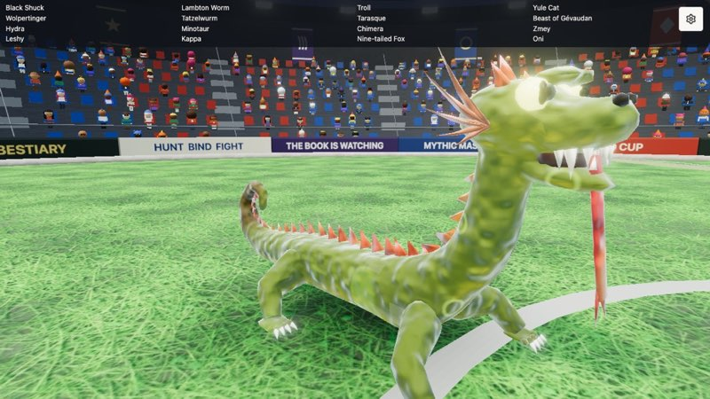
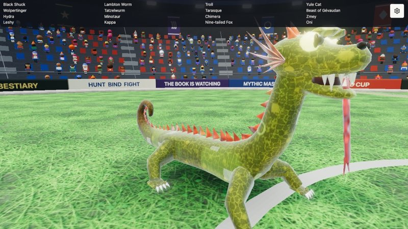
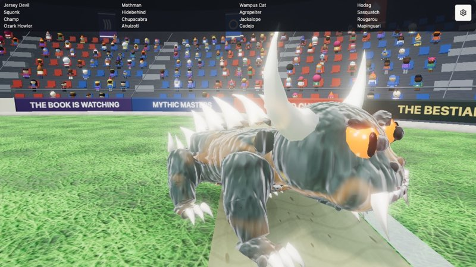
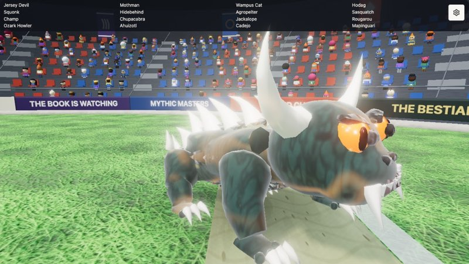
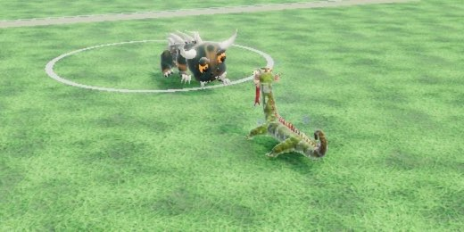
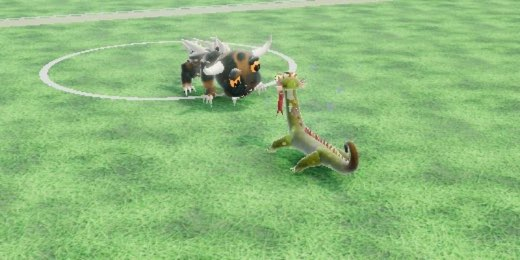

# Baked hides: the texture spike (#4189)

A sheet can now ask for a `hide` (`blender/beast.py`, `bake_hide`): after the mesh is decimated, the body's faces get
their own UVs (Smart UV Project), procedural Blender nodes in the body's own space (Voronoi scales and spots, noise
folds and fur) are baked by Cycles into a map, and the body's material draws the map times the vertex tone, so the
belly, paint and occlusion still work over it. A sheet without `hide` builds exactly as before.

```json
"hide": { "pattern": "scales", "size": 0.035, "colours": [[0.8, 0.8, 0.3], [0.4, 0.42, 0.18]],
          "spots": { "size": 0.1, "colour": [0.88, 0.85, 0.34], "cover": 0.5 }, "map": 1024 }
```

`bun scripts/beasts.ts --close <id>` writes `blender/out/<id>.close.png`, the GLB's own mesh up close, for judging a hide.

The owner's look and the rollout call: MANUAL RUN #4196, with these shots side by side on
https://claude.ai/artifact/8vFCToNrwCkzBKVAT2HZn2.

## Shots (in the game, gallery focus, 1280 x 720)

| | before | after |
|---|---|---|
| Tatzelwurm: olive scales with yellow rims and dots, after the [Haus der Natur figure](https://commons.wikimedia.org/wiki/File:Salzburg_Haus_der_Natur_-_Europa_Tatzelwurm.jpg) |  |  |
| Hodag: leathery folds and dark blotches |  |  |
| Fight size (both, stadium) |  |  |

Blender's close-ups: `tatzelwurm-blender.jpg`, `hodag-blender.jpg`. The Tatzelwurm's map: `tatzelwurm-map.jpg`.
At 512: `tatzelwurm-512.jpg`.

## What worked

- Scales (Voronoi cells, a rim colour and a thin seam) and spots read clearly up close, in Blender and in the game.
- The map is a share of the tone, held at 1/lift, and the tone is lifted to match (as far as its brightest channel
  allows, at most 3), so a mark lighter than the hide (the yellow rims) fits in an 8-bit map with its hue.
- The game's own shader grain (`src/hide.ts`) washed the map out on top (the Hodag barely changed), so a material
  with a map skips it now.
- The rig is unchanged: same joints, tips and feet as before for both.

## What didn't, or costs

- **At fight size no grain reads**, at 512 or 1024: the beast is about 80 px tall. What shows there is tint and the
  big marks (blotches, bands). A map pays off in close-ups: the gallery, the case-file intros, the Book's cards.
- **512 is too small for 3.5 cm scales** (about 4 texels a scale: mush). 1024 is the pick for a beast with fine
  scales; 512 does for one with only big marks.
- **UV seams double the vertices** (Tatzelwurm 3220 to 5933, Hodag 3802 to 7040), and that costs as much as the map:
  the GLB's position, normal, colour and UV data, and the rig's weights in `<id>.rig.json`. A wider angle limit doesn't
  help (66 to 89 degrees: 5933 to 5909). Seams cut per chain (one island a leg, the tail, the body) would.
- The field looks (`src/effects.ts`) still paint over every hide, the Hodag's included.

## Numbers

| | GLB | rig.json | both, gzipped | map | bake |
|---|---|---|---|---|---|
| Tatzelwurm before | 158 KB | 101 KB | 151 KB | none | |
| Tatzelwurm, 512 | 363 KB | 186 KB | | 62 KB | |
| Tatzelwurm, 1024 | 521 KB | 186 KB | 447 KB | 220 KB | 0.5 s |
| Hodag before | 184 KB | 120 KB | 178 KB | none | |
| Hodag, 1024 | 463 KB | 221 KB | 386 KB | 110 KB | 0.5 s |

The JPEG map (quality 85) decodes in about 4 ms in desktop Chrome and takes about 5.6 MB of GPU memory at 1024 with
mipmaps. A fight loads two beasts, so about +0.5 MB over the wire: about 0.4 s more at 10 Mbit/s.

## A rollout to every beast would take

- A `hide` per sheet (76): a pattern, sizes and colours from the beast's references, and a close-up look each, about
  10 minutes a beast with the references in hand.
- Seams per chain in `bake_hide`, to stop the vertex doubling before the roster's download grows by about 20 MB.
- Then the build itself is cheap: half a second of bake per beast.

The other road is the game's shader (`src/hide.ts`), which draws its grain from the rest pose with no UVs or bytes:
spots and scale rims could go there with per-beast colours, at a per-pixel cost on phones and with no painting by hand.
The owner picks.
