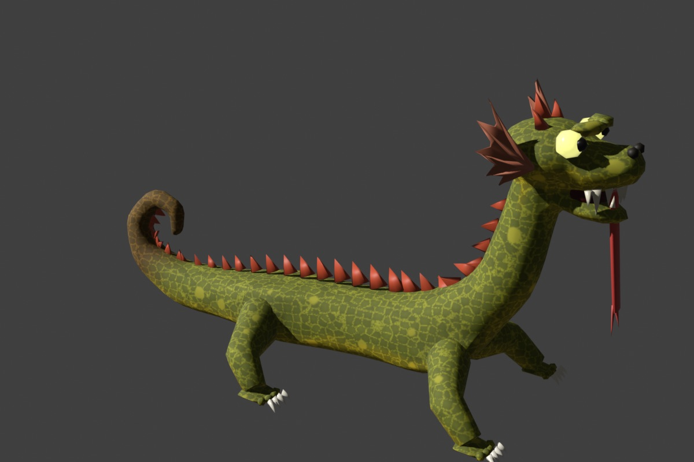
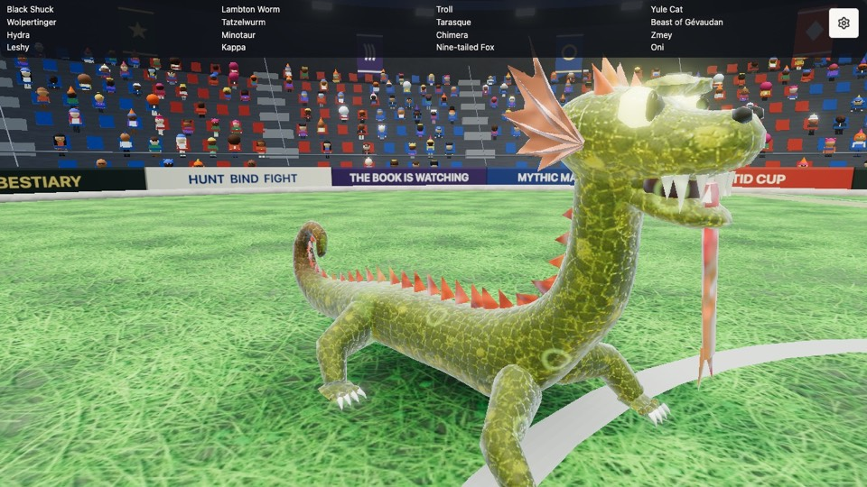
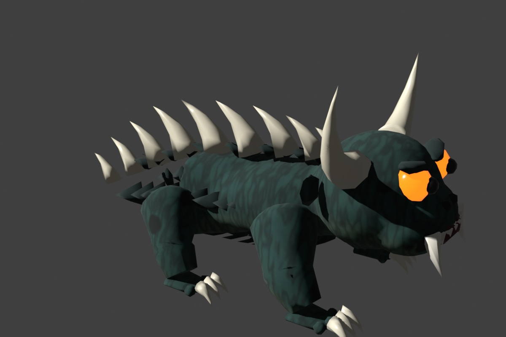
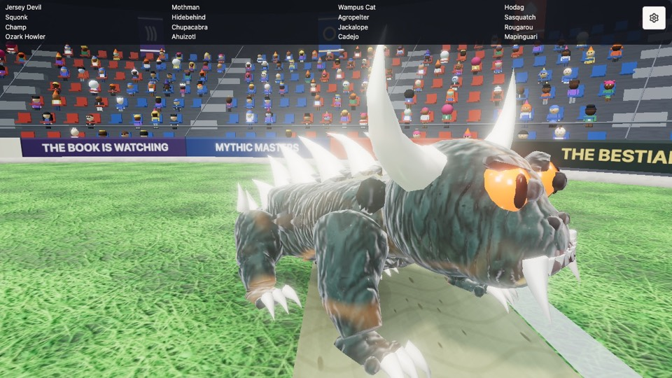
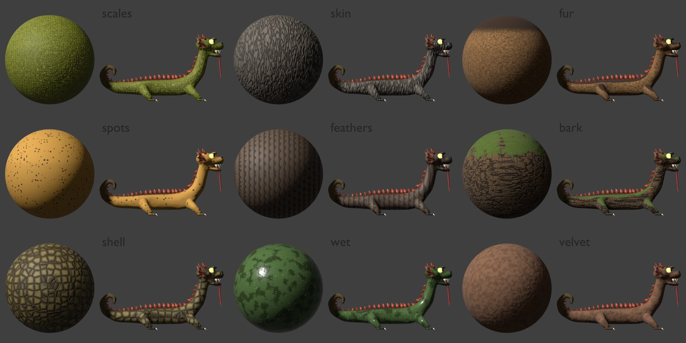
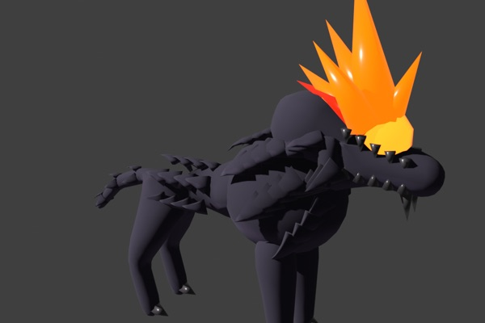
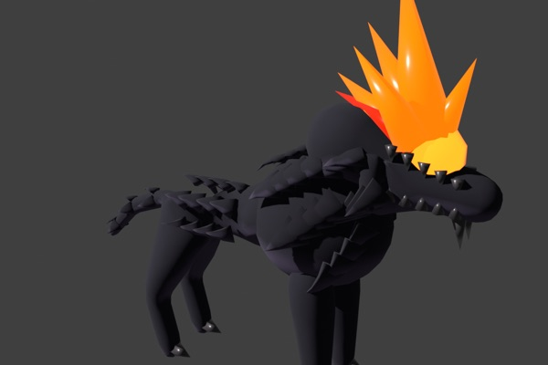
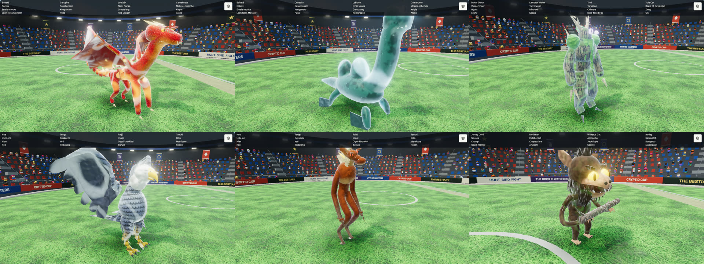
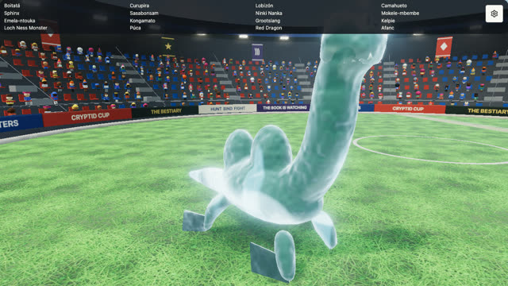

# Hides v2, part 1: normal and roughness maps (#4249, lane 1)

`bake_hide` (`blender/beast.py`) now bakes three maps from one procedural pattern: the colour map as before, a
tangent-space normal map from the pattern's height (a Bump node on the flesh's own normals, baked by Cycles against
the `hide` UVs) and a roughness map from its gloss. The GLB carries them as glTF's `normalTexture` and
`metallicRoughnessTexture` (green channel); the game's `stylize` (`src/beasts.ts`) lets the roughness map rule
instead of its 0.78 floor. Sheet keys: `rough` [shiniest, dullest], `bump` (depth, 1), `normal_map` (px).

| | Blender before | Blender after | game after (gallery focus) | before in the game |
|---|---|---|---|---|
| Tatzelwurm, scales |  |  |  | [part 0](../shots-2026-11-11-hide/tatzelwurm-after.jpg) |
| Hodag, skin |  |  |  | [part 0](../shots-2026-11-11-hide/hodag-after.jpg) |

## Costs

| | GLB before | GLB after | normal map | roughness map |
|---|---|---|---|---|
| Tatzelwurm | 535 KB | 695 KB | 1024 px, 144 KB | 256 px |
| Hodag | 464 KB | 590 KB | 1024 px | 256 px |

Bake: under a second a beast for all three. Fight budget (`bun scripts/fight-budget.ts --seconds 15 tatzelwurm hodag`):
desktop median 16.6 ms either way; phone (4x CPU) median 36.0 ms on main, 42.3 and 34.3 ms over two runs after, so
within the run-to-run noise (the particle peak moves more than the maps do).

## Still lacking

- The game's rim light still glazes every beast near the silhouette; under 0.6 roughness reads as plastic there,
  so the patterns' ranges (`ROUGH`) stay above it. A truly wet hide wants a softer rim on that material.
- No tangents are exported: three builds the frame from screen derivatives, close enough on smooth flesh.

# Part 2: patterns, overlays and the swatch

New patterns: `feathers` (staggered shingles, `lie: "down"` for an upright bird), `bark` (with a `moss` overlay on
the surfaces that face up), `shell`, `wet`, `velvet`. New overlays: `moss`, `band` (a dorsal stripe down the
spine). New sheet key: `black: true`, no luminance floor. The Black Shuck before and with `black: true`:
  (a local check; its sheet belongs to lane 3).

How to add a pattern and the gotchas: [../HIDES.md](../HIDES.md). `bun scripts/beasts.ts --swatch` draws the sheet above.

# Part 3: the rollout

60 sheets outside lanes 3 and 4 get a hide by kind of creature, colours taken from each body's own: reptiles,
dragons and serpents `scales`; the Tarasque `shell`; water beasts and worms `wet`; leathery and bare ones `skin`;
bulls, lions and the horse-headed `velvet`; the furred `fur`; the Leshy and the Troll `bark` with moss; the Roc
`feathers`. The suited and cloth-like ones (Flatwoods Monster, Fresno Nightcrawler) keep their plain material.

Red Dragon, Nessie, Leshy / Roc, Tikbalang, Agropelter, gallery focus:

The pale glassy look on Nessie and the Leshy is the gallery's rim light, the same on main (),
filed as #4265.

Maps: colour and normal at 1024 for scales, feathers, shell and bark, 512 for the rest; roughness at a quarter.
The roster's models go from 10.6 to 25.2 MB gzipped, mostly UV seams doubling vertices: #4264.
