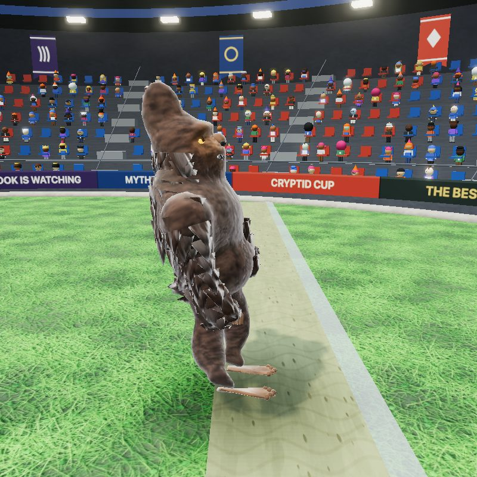
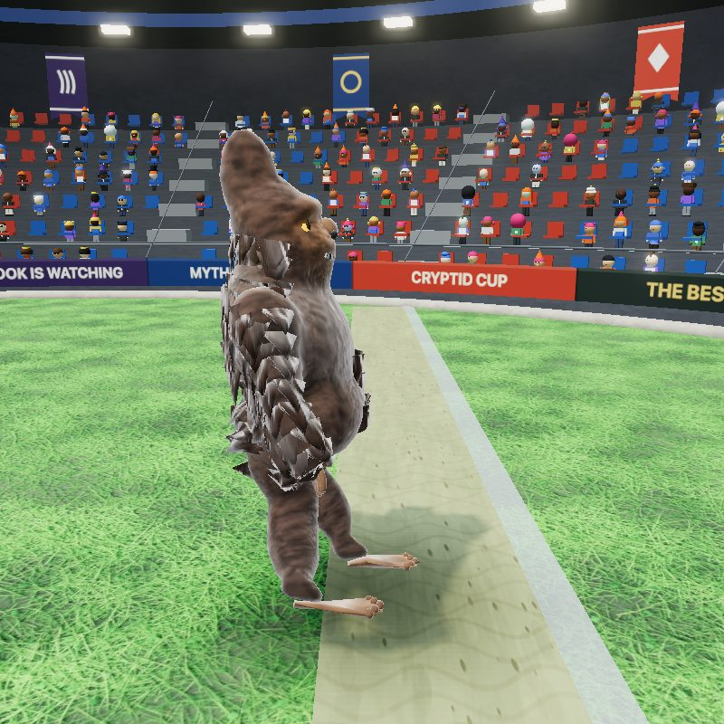
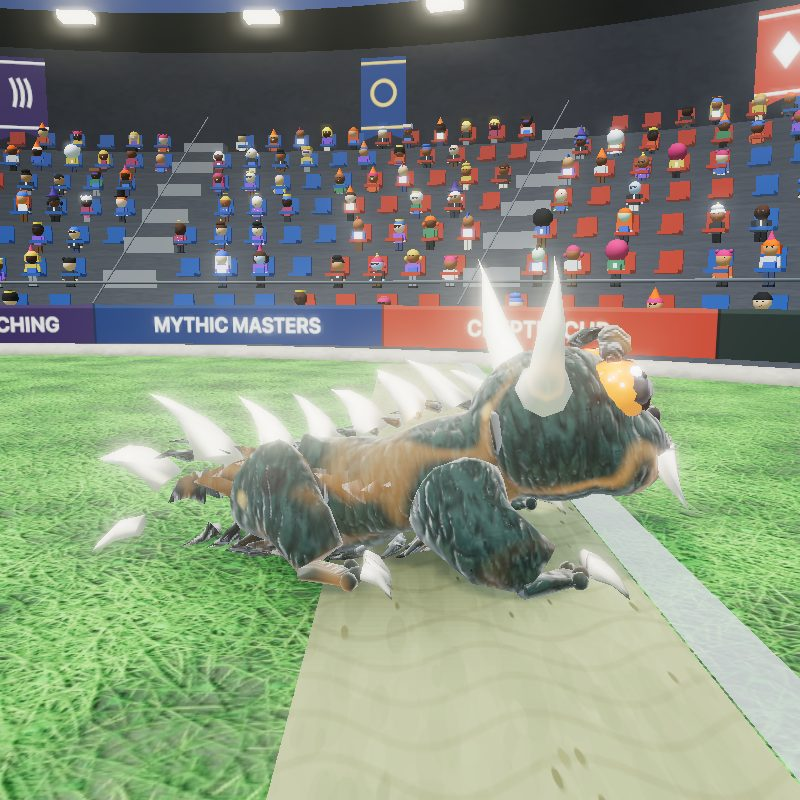
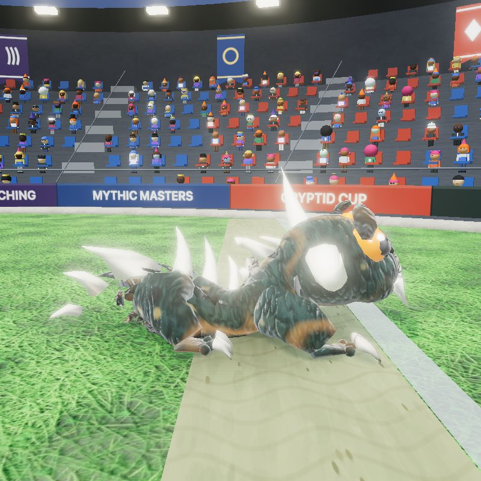
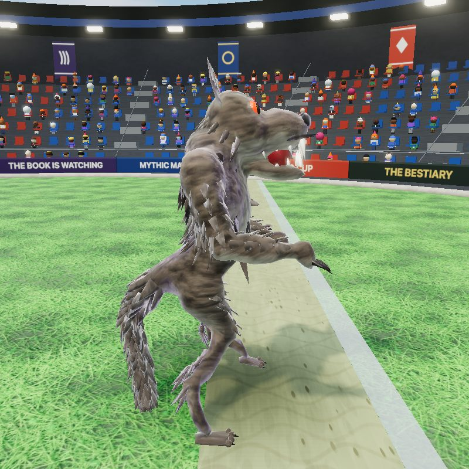
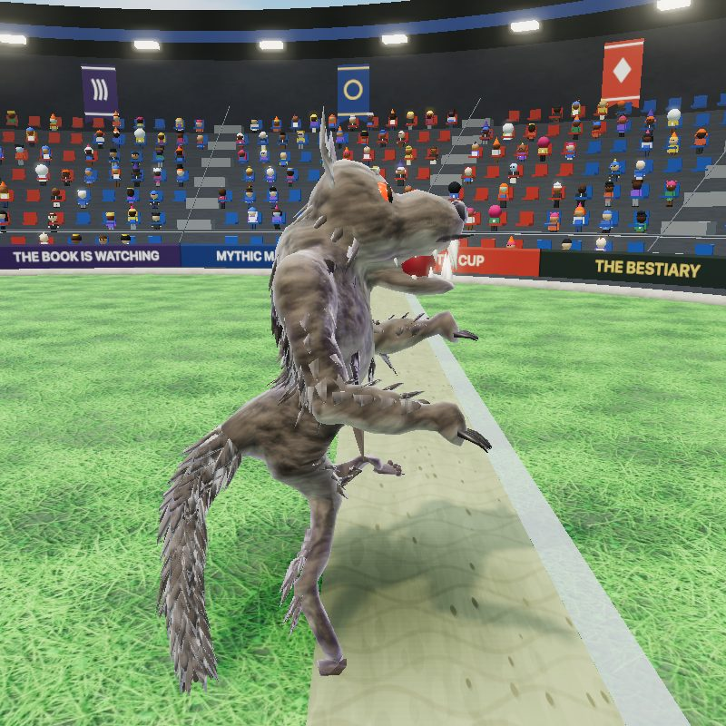
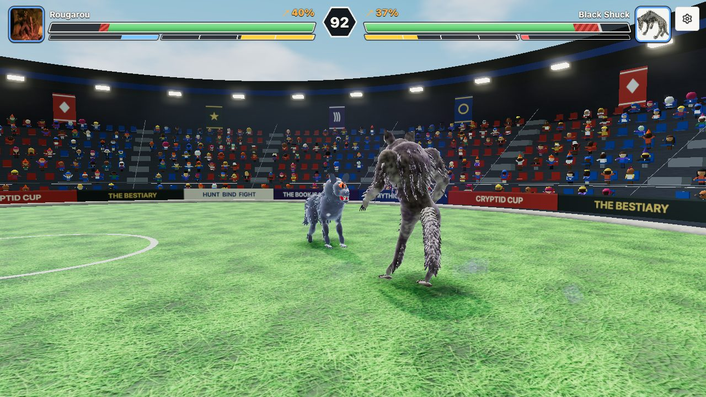
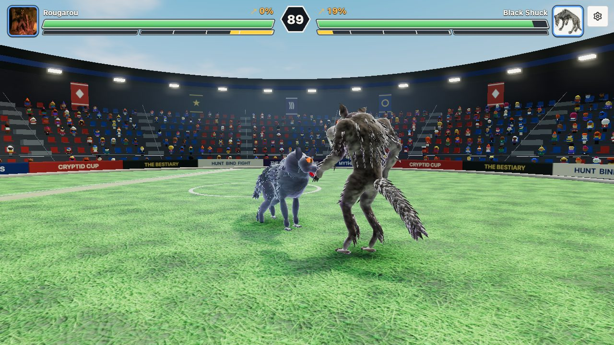

# Animation and graphics climb, round 24: dropped (no gain)

Part of #4713.

**What was tried.** When a blow landed, the tail, the hanging limbs and the loose fur cards and quills were each given a
direct push back toward the striker and up. Before this they reacted only to the shove's acceleration. That reaction is
capped at 60-80 m/s², and the knockback goes past the cap in one frame. Three other limits were raised with it: the
limbs could swing further (`LIMB_SWING` from 0.55 to 0.8 rad), and a card could move further from its bone (from 0.6 to
0.9 of its own reach).

**Scores.** Two fresh judges looked at lock bursts plus the scripted side-on blow (`--hit`). Both scored 5.5 -> 5.5.

- Judge A: tails trail further (Rougarou, dragon), and the Sasquatch's fur hangs softer. The Hodag stays curled longer
  at 0.35 s, but that reads as a broken spine.
- Judge B: the Hodag's crumple lasts longer, and the Rougarou leans back a little more. The Sasquatch and the Yeti show
  no change from frame to frame.

**What we learned.** A bigger shove on what hangs from the body moves the tail and the cards, but in a still it does not
read as the body answering the blow. Both judges still see the Yeti and the Sasquatch take the hit with their feet
planted. Their eyes went to how the surfaces draw:

- the Hodag's brow horn swings over its eye as a flat, blown-out white disc (`now-hit-hodag-3`);
- the Sasquatch's fur cards look like stacked cardboard shingles with hard white edges (`now-hit-sasquatch-2`).

| | BEFORE | NOW |
|---|---|---|
| Sasquatch, 0.12 s after the blow |  |  |
| Hodag, 0.35 s after |  |  |
| Rougarou, 0.05 s after |  |  |
| lock, contact2 |  |  |
