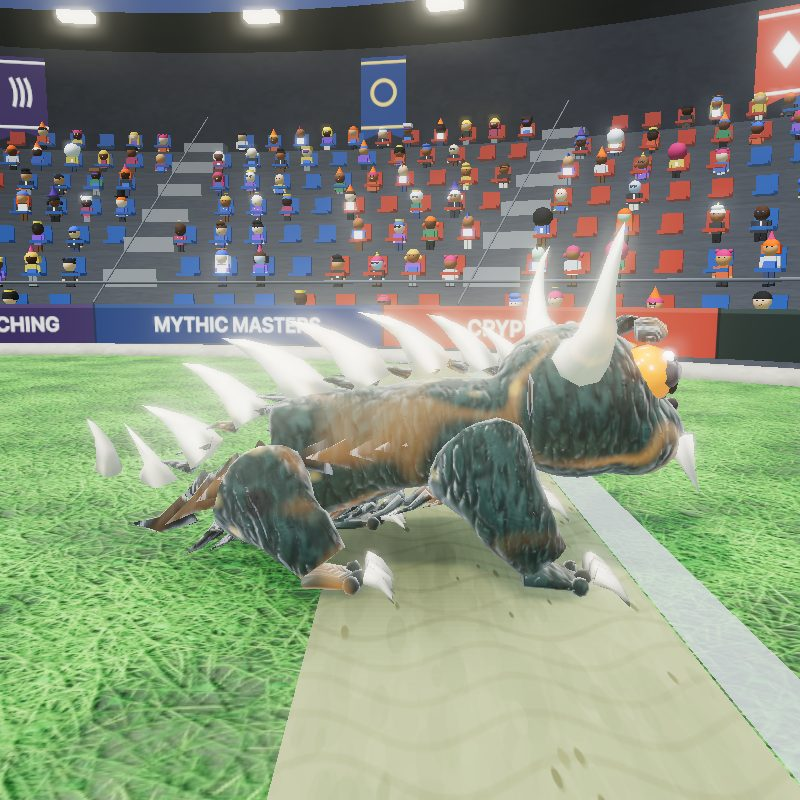
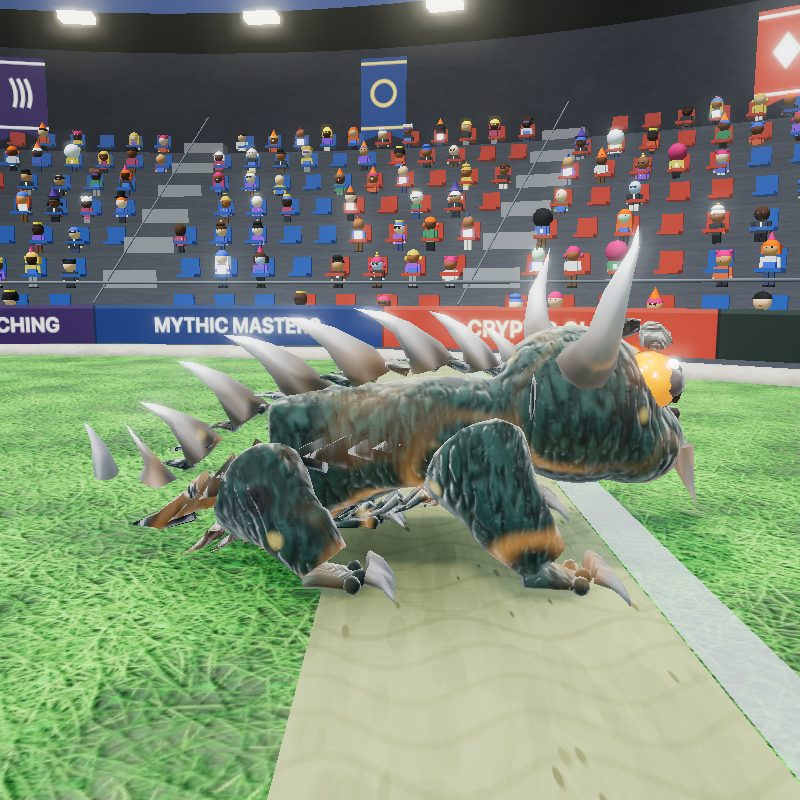
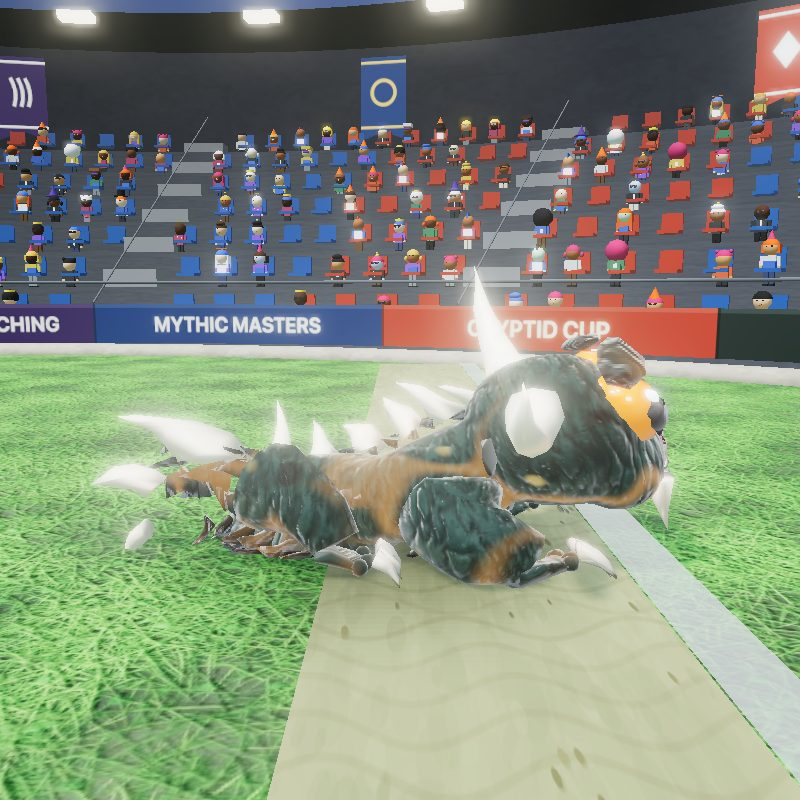
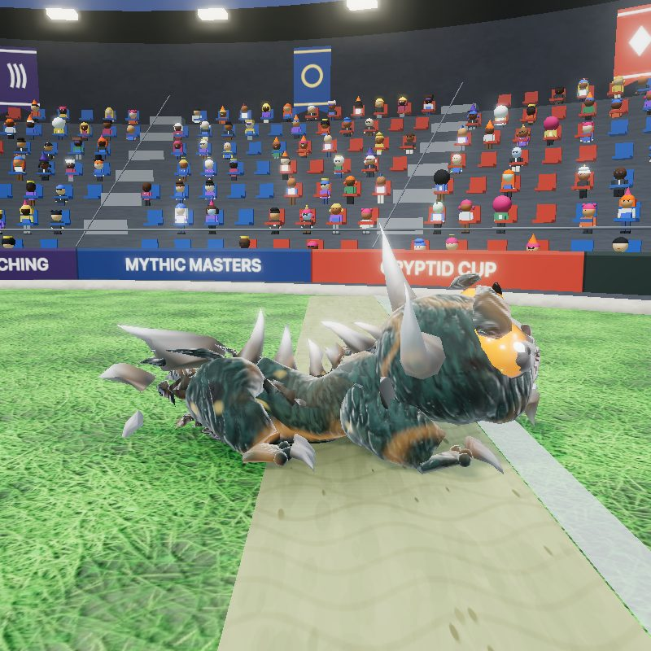
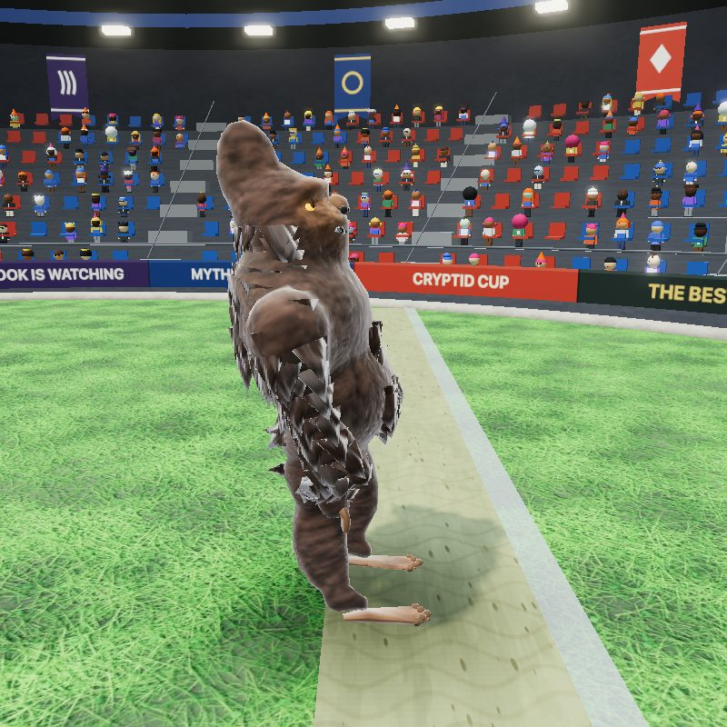
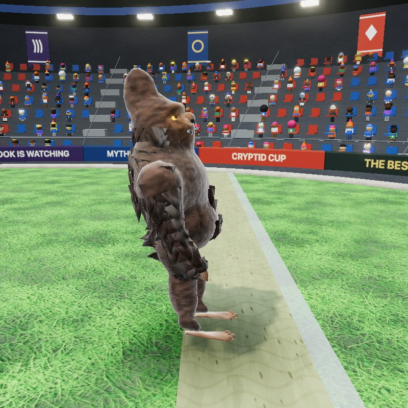
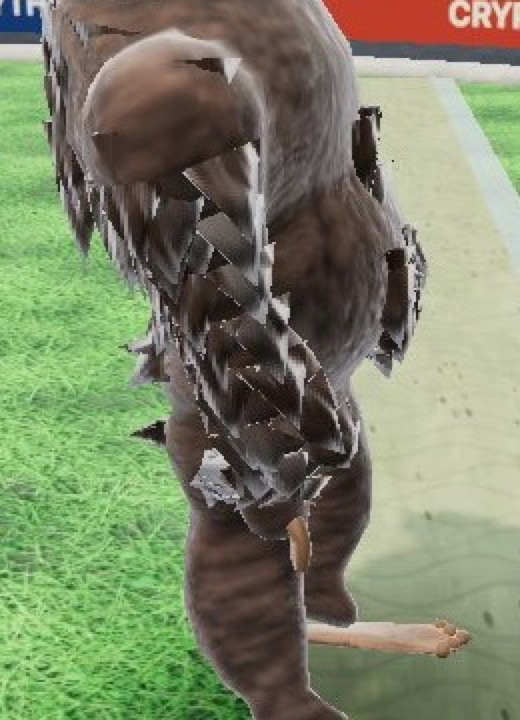
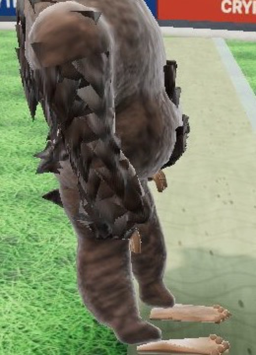
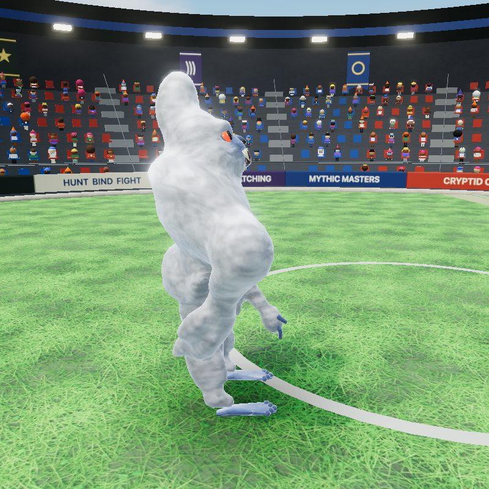
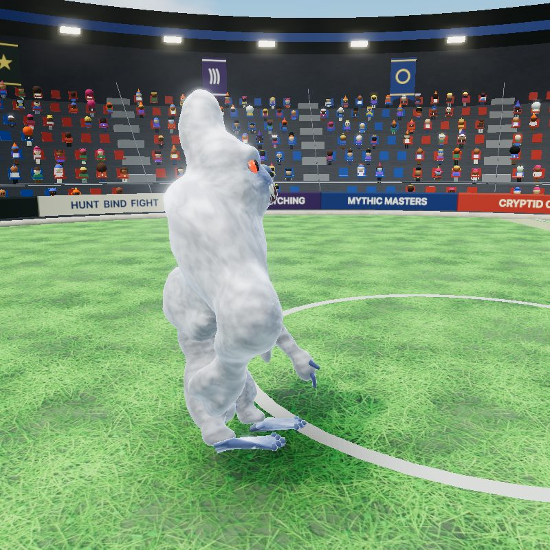

# Animation and graphics climb, round 25: dropped (no gain)

Part of #4726.

**What was tried.** Each small piece that grows out of a body (a horn, claw, tooth, spike, quill, tuft or mane card) was
shaded from root to tip. Every vertex got its distance from the body, scaled within its own piece: 0 at the root and 1
at the tip. Pieces were found by welding faces by position, because a flat-shaded cone splits every face. Horns and
claws went from a dark, stained root to a pale tip. They were also kept below the bloom threshold, and their finish went
from lacquered to waxy (roughness 0.45-0.55, clearcoat at most 0.15). Fur cards got darker roots and only a fifth of
the rim light. The code is in `tip-shading.patch` next to this file.

**Scores.** Two fresh judges looked at lock bursts plus the scripted side-on blow (`--hit`). Judge A scored 5 -> 5 and
Judge B 4.5 -> 4.5.

- The Hodag's white brow-horn disc is gone, and its spikes read as horn (dark root, pale tip). Judge B noticed the
  change, but read the old white spikes as part of the hit flash, so to them NOW "loses some of the hit pop".
- The Sasquatch's cards lost their white edges and now read as darker cards. Judge A still called them "shards cut
  into the mesh", and Judge B called them "papery".
- Neither judge rated the surfaces as the main gap. Both put the hit reaction first: the Sasquatch and the Yeti take a
  blow standing upright, with no stagger, head snap or weight shift.

**What we learned.** A surface fix that a judge has to look for doesn't move the score while the bodies don't answer
the blows. Round 24 tried what hangs from the body (tails, cards). Next, try the whole body: a head snap, a step back,
the weight shifting. Stall count: 2 (rounds 24 and 25).

| | BEFORE | NOW |
|---|---|---|
| Hodag at rest |  |  |
| Hodag, 0.35 s after |  |  |
| Sasquatch, 0.12 s after |  |  |
| Sasquatch cards, close |  |  |
| Yeti, 0.12 s after |  |  |
