# Animation and graphics climb, round 26: a blow the whole body answers

Part of #4740.

**What changed.** A blow now gets a recoil: one envelope set by the blow's size. It lands in two or three frames on a
stiff spring, holds through the stun (half gone in about 0.3 s), and lets go faster once the body is free. On top of
the old lean it:

- throws the chest back (0.2 to 0.4 rad, more for an upright body),
- twists the body away from the striker's side (it turns about on alternate hits when the striker is dead ahead),
- tips an upright body onto its far legs and drops its hips (a four-legged one keeps its feet under it, so its ankles
  stay over its toes: the round-22 test),
- punches the hips back,
- whips the head back, up and aside. This goes straight to the solver, past the look's soft spring, so it lands with the blow.

The spring steps in eighths of a frame. A first try stepped it once per frame, and at 30 fps it blew up and flung the
Yeti across the frame.

Code: `src/beasts.ts` (`recoil`). Test: `test/beasts.test.ts`, "a blow throws the yeti's / sasquatch's head back and holds
it". The head's distance from rest against where the body stands: the old lean was about 0.4 of the height at 0.12 s
and 0.1 by 0.35 s; the recoil is about 0.75 and 0.3, at 60 and 30 fps.

**Scores.** Two fresh judges looked at lock bursts plus `--hit`: **5.5 -> 6** and **5 -> 5.5**. Both named the
scripted blows first: the head snaps back, the chest opens and the knees buckle. Judge B also saw the Rougarou thrown
back onto one leg in the lock-camera `contact2` burst. The lock-camera fights were otherwise about the same (timing).

**Still standing.** Judge A: under the bigger bend the Sasquatch's fur cards splay into flat grey-white plates, and the
Hodag's horn sweeps over its face as a white disc (round 25's `tip-shading.patch` cleared that disc: try it now, paired
with this). Judge B: the fighters don't push on each other (paws hover near the other body, the two dragons overlap),
and the lock camera lets a flyer drift small and high in `wings1`.

| | BEFORE | NOW |
|---|---|---|
| Yeti at rest | 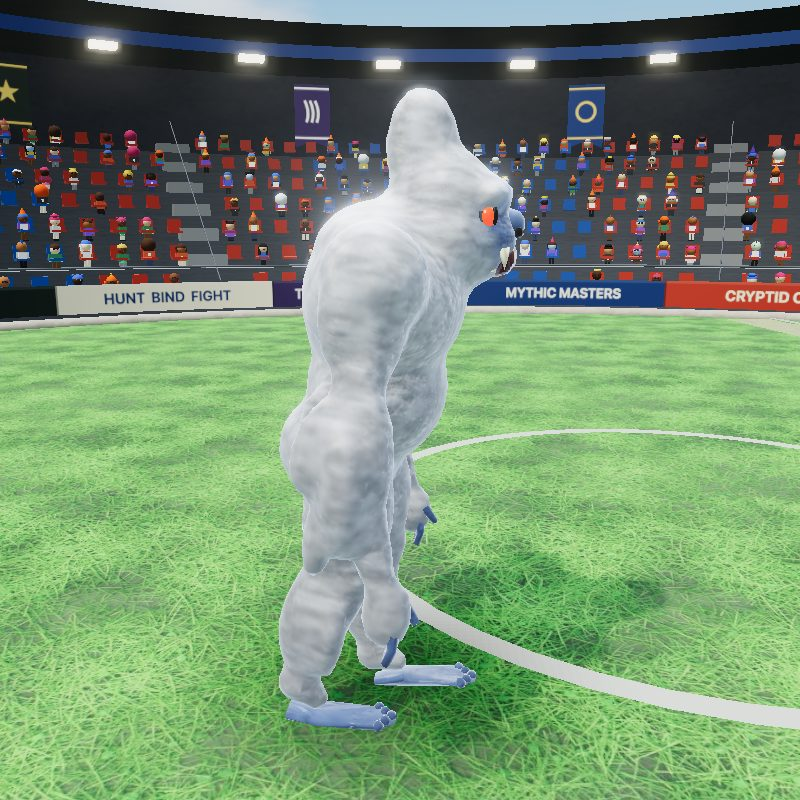 | 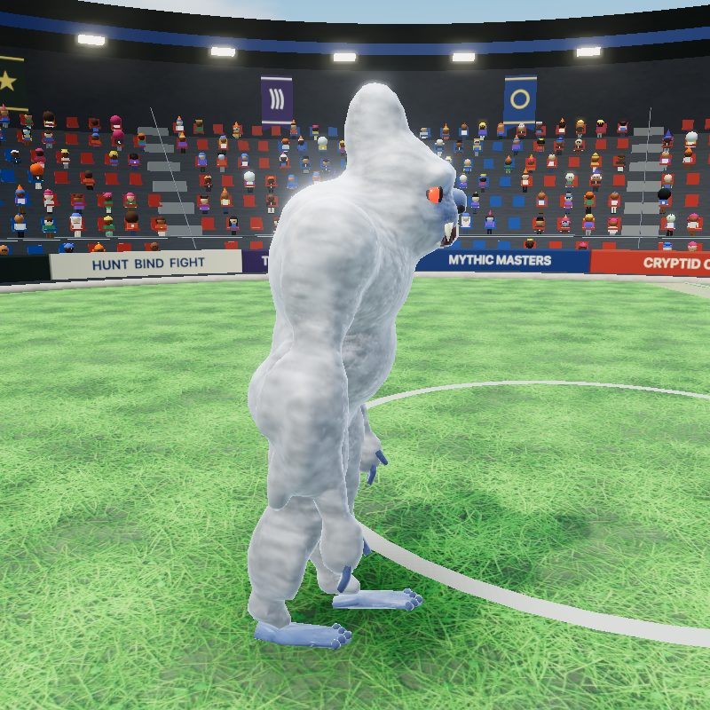 |
| Yeti, 0.12 s after | 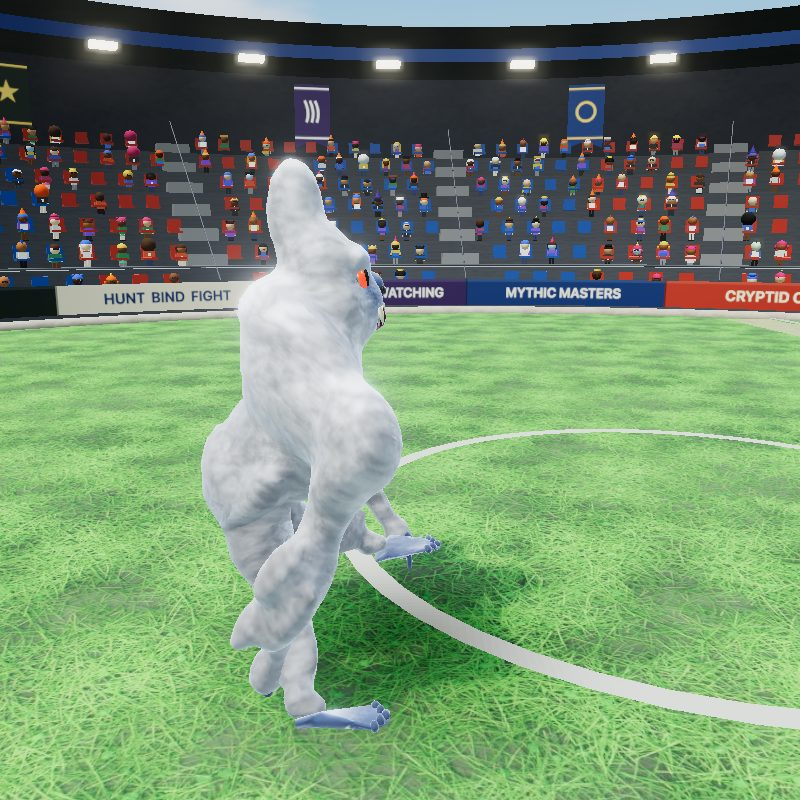 | 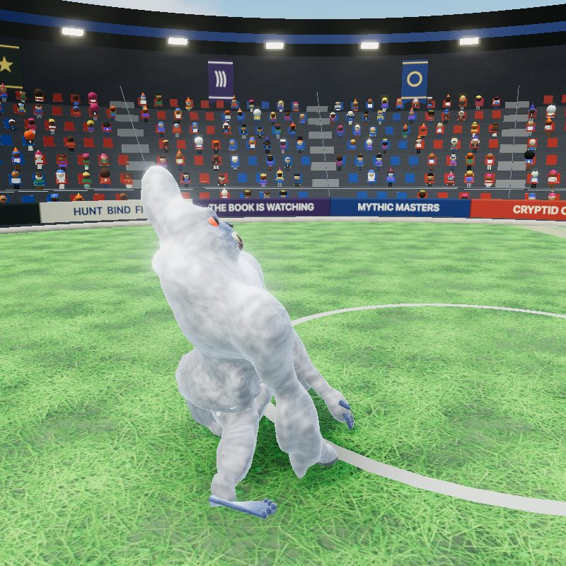 |
| Yeti, 0.35 s after | 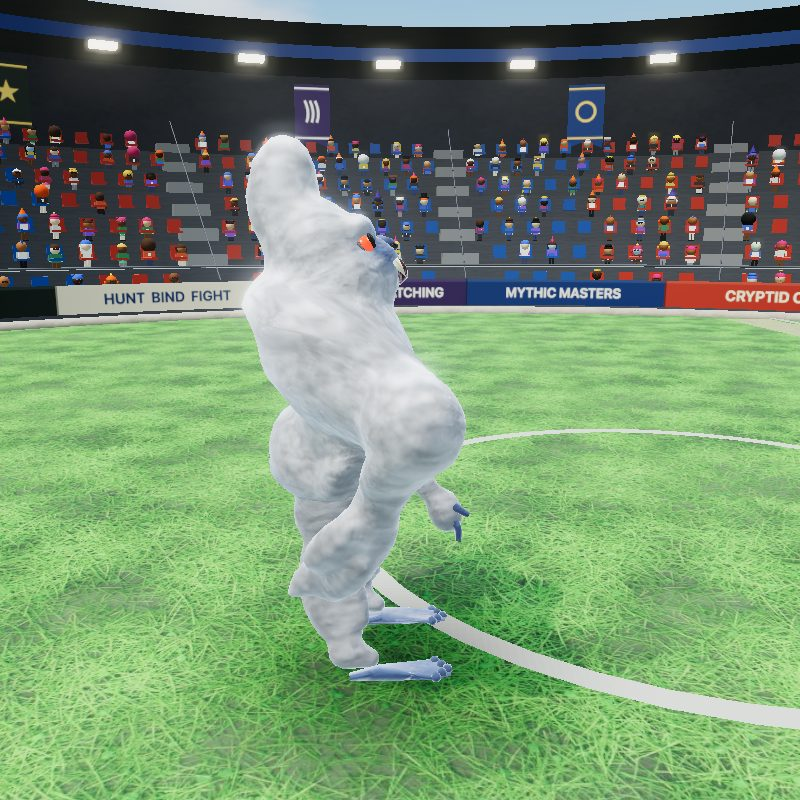 | 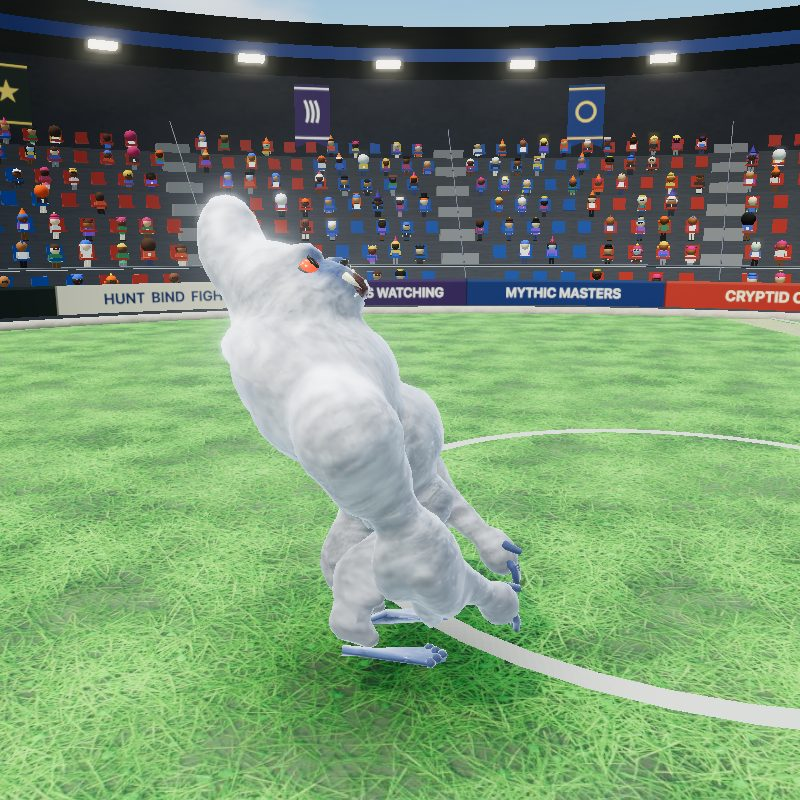 |
| Sasquatch, 0.12 s after | 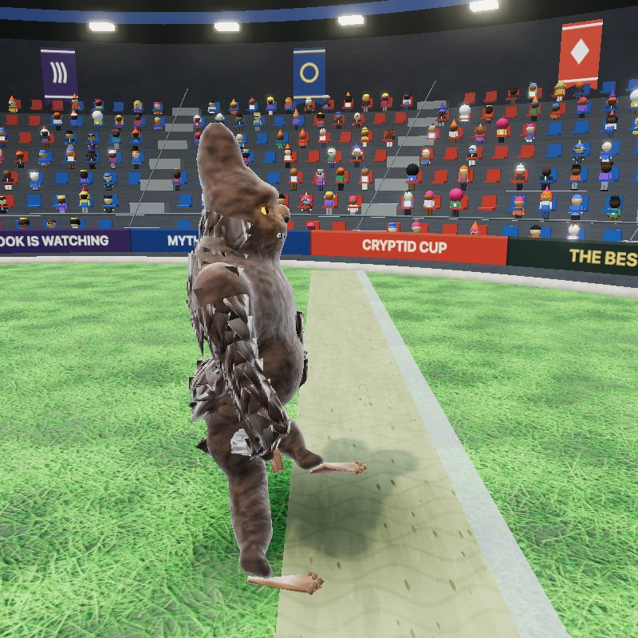 | 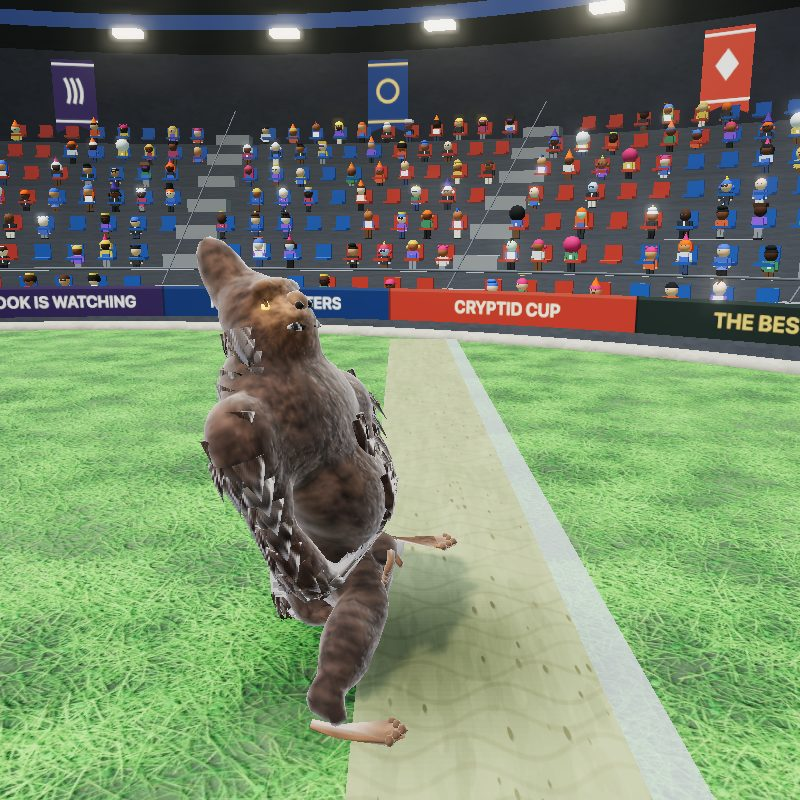 |
| Rougarou, 0.12 s after | 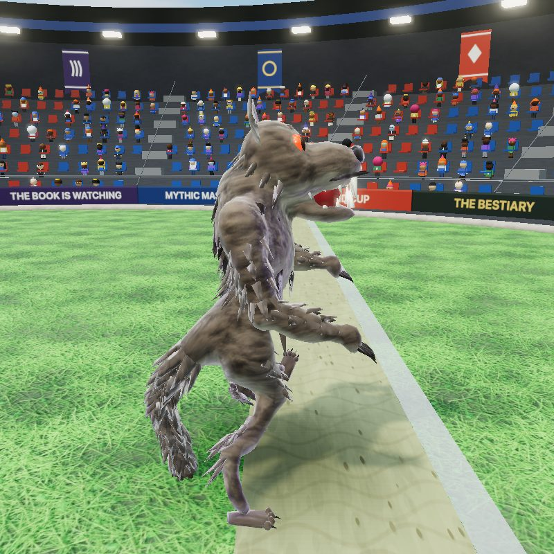 | 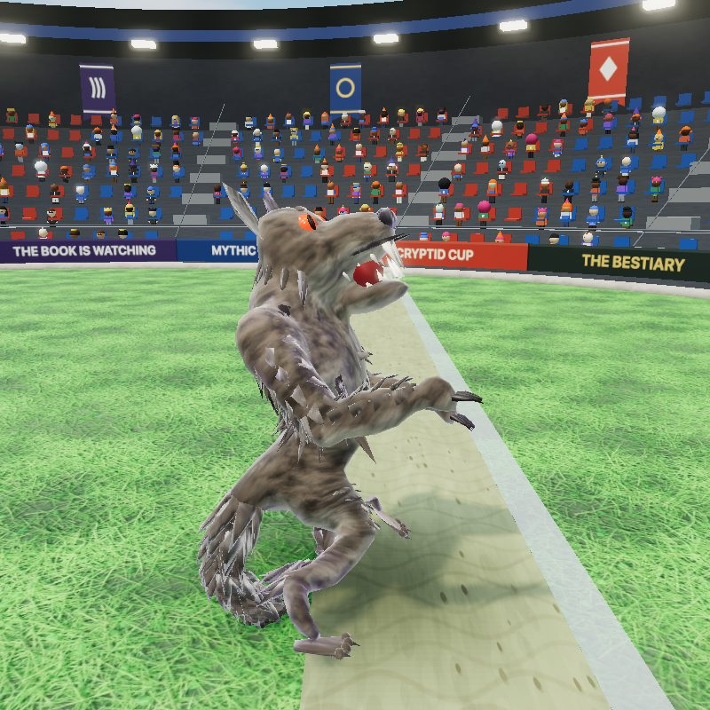 |
| Hodag, 0.05 s after | 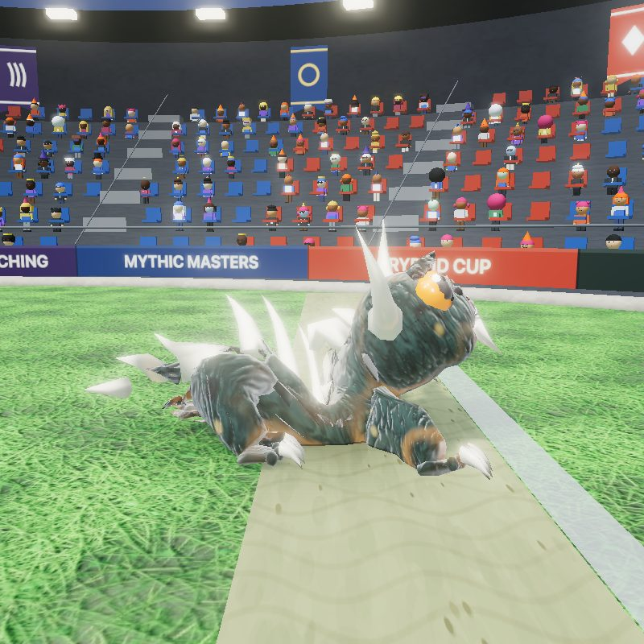 | 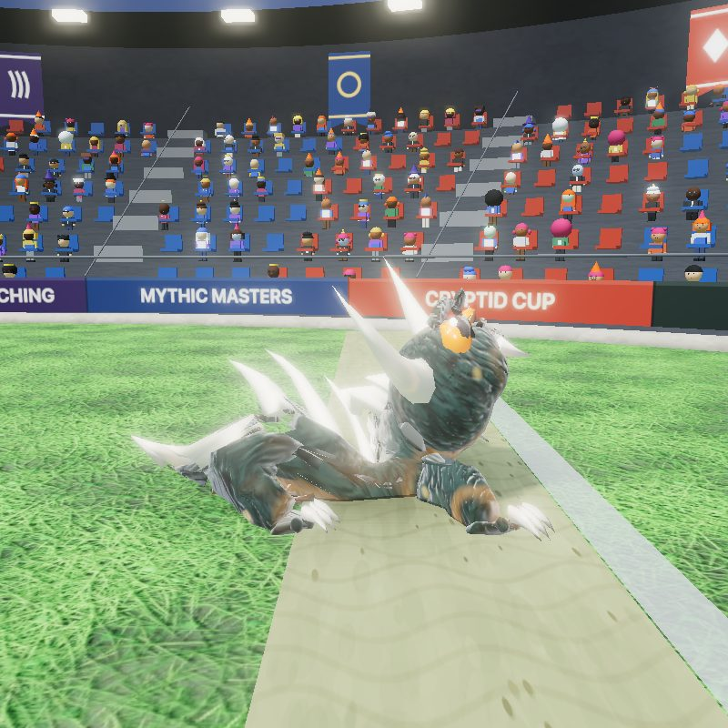 |
| lock camera, a hit (different fight moments) | 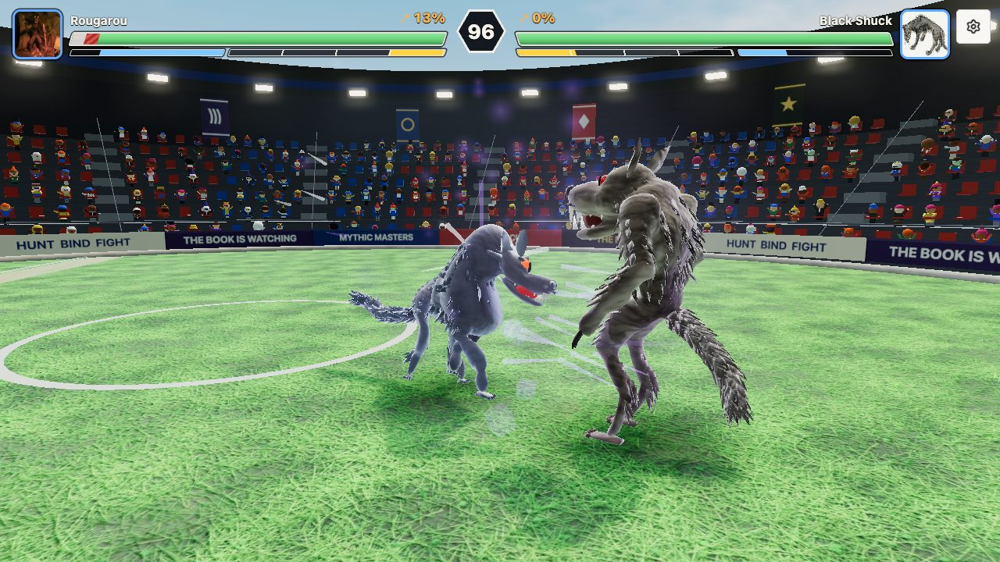 | 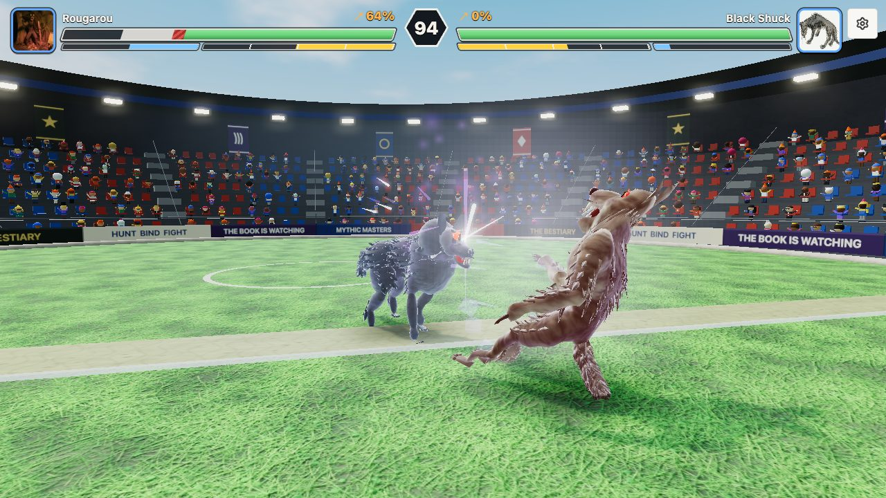 |
