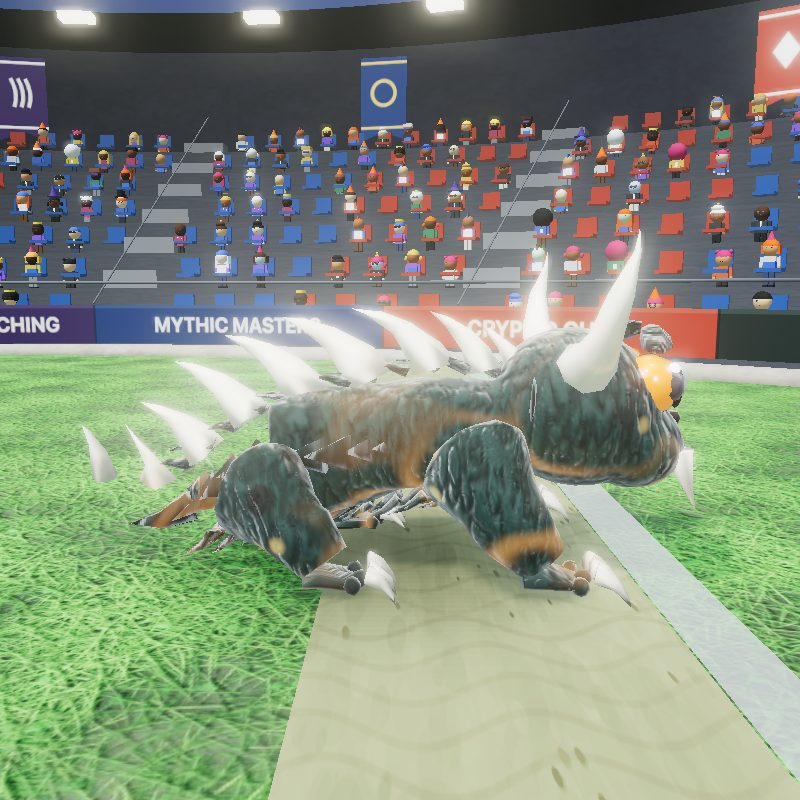
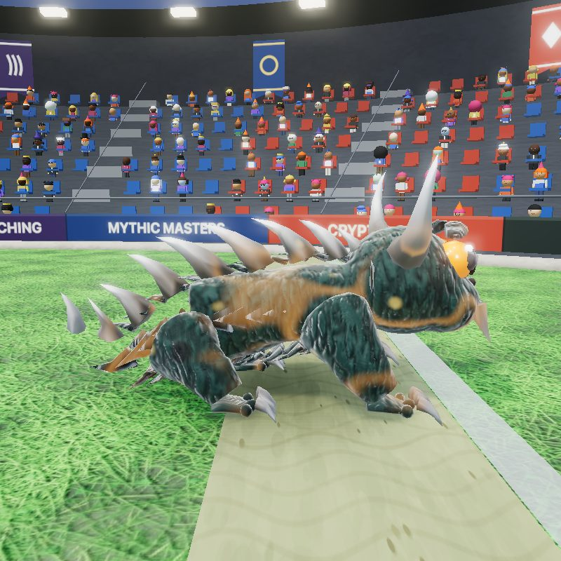
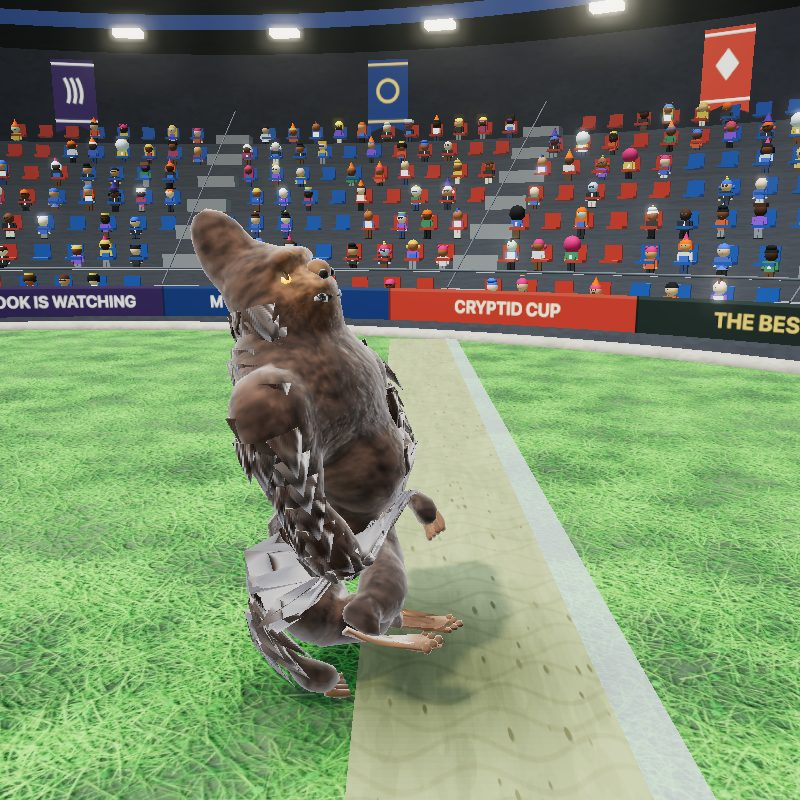
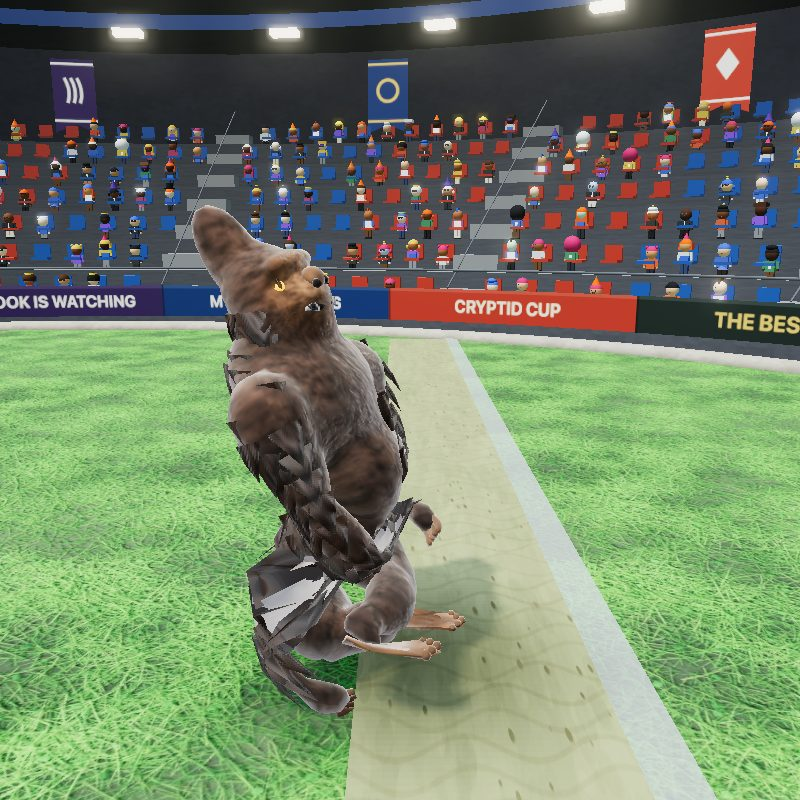
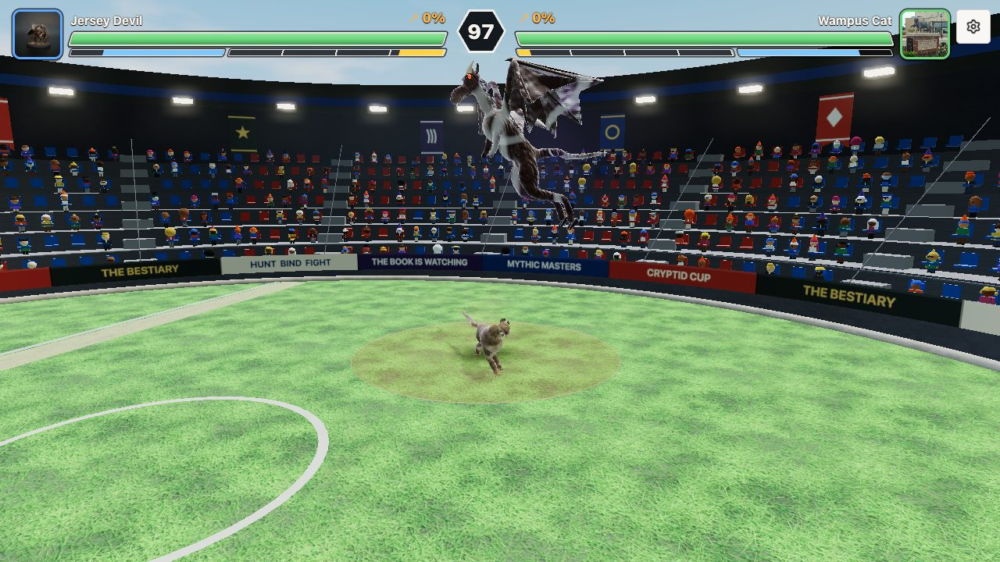
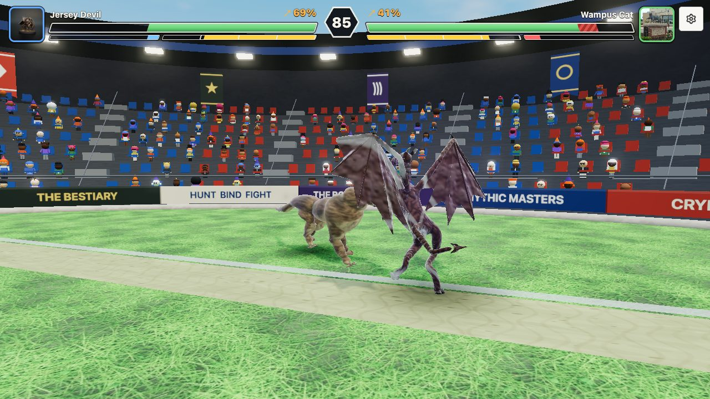
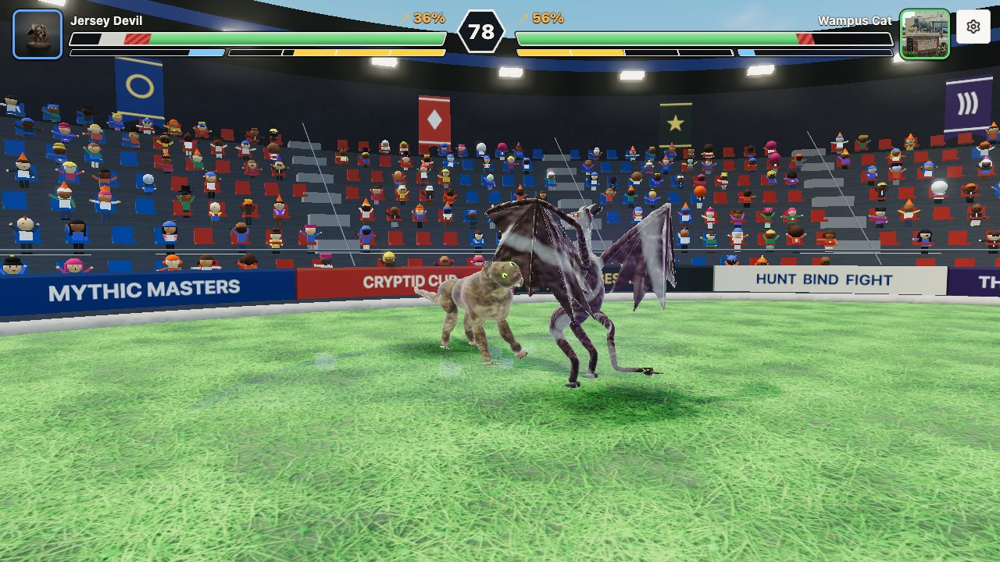
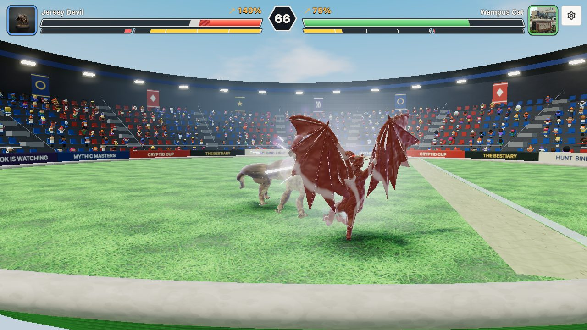

# Animation and graphics climb, round 27: dropped (no gain)

Part of #5101.

**What was tried.** Round 25's root-to-tip shading (`../shots-2026-11-15-anim-r25/tip-shading.patch`), applied again
on top of round 26's recoil. Horns, claws and spikes go from a dark root to a pale tip and stay under the bloom, and
fur cards get darker roots and a fifth of the rim light. The patch still applies cleanly to `main`.

**Scores.** Two fresh judges looked at lock bursts plus the scripted side-on blow (`--hit`). Both scored 5 -> 5.

- Neither judge named the spikes or the cards. The Hodag's white spikes and horn disc are gone (see the rest pair
  below), but the judges looked at the fights first.
- The bot fights diverged (wings2 at clock 66 vs 79), so the lock bursts landed at different moments. NOW's wings1
  framed the two fighters closer (better), and NOW's wings2 had the lock camera low against the ring's rim, with the
  rim filling the bottom of the frame (worse). Both judges put that down to the run, not the shading.
- Judge B's top gap is in both builds: when the Sasquatch recoils (`hit-sasquatch-2`, `-3`), its hip and thigh fur
  cards tear into stretched silver triangles and its pale feet bend into thin tubes. Judge A's top gap is the wings2
  lock camera, which pulls back to the ring wall instead of rising over it.

**What we learned.** This is the second time the shading has scored flat. Shading the cards can't fix them while
the recoil's bend stretches them into plates. The cards need to hold their shape under the bend first (skin weights,
or keeping each card rigid on one bone). Stall count: 1.

| | BEFORE | NOW |
|---|---|---|
| Hodag at rest |  |  |
| Sasquatch, 0.2 s after |  |  |
| wings1, lock camera |  |  |
| wings2, lock camera |  |  |
