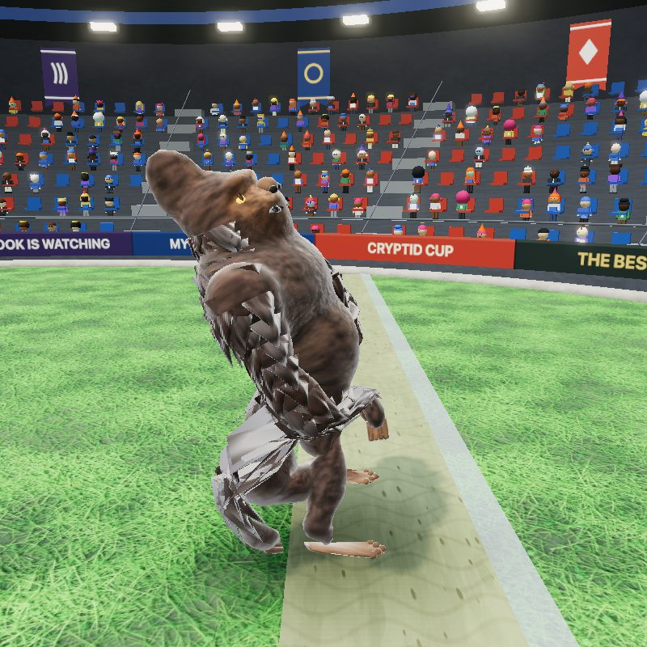
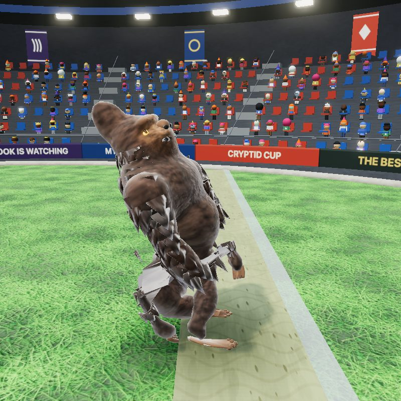
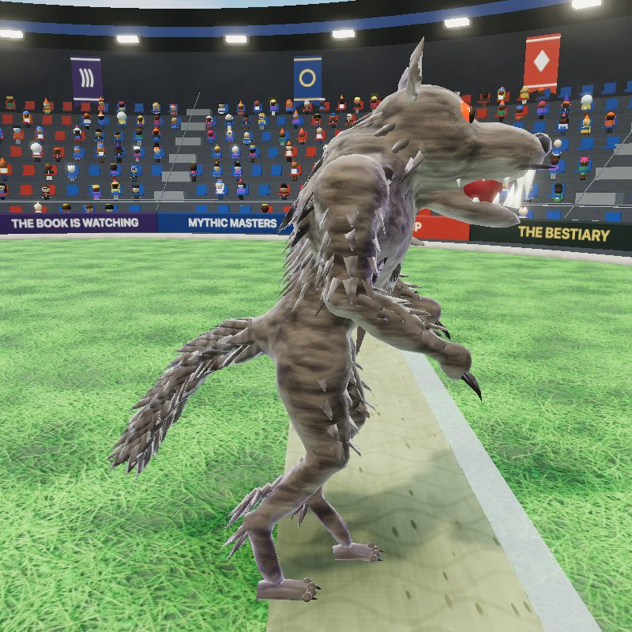
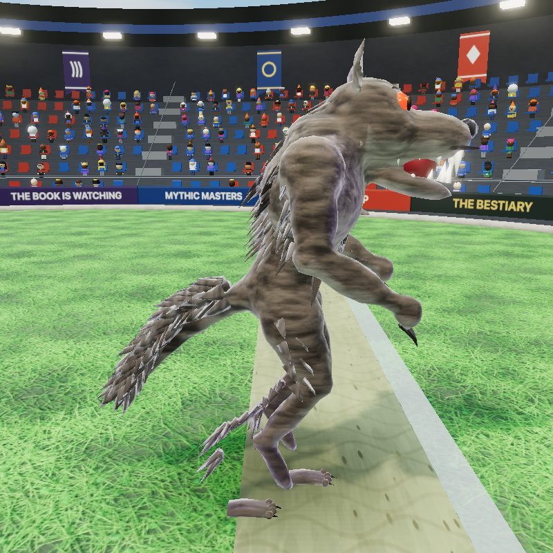
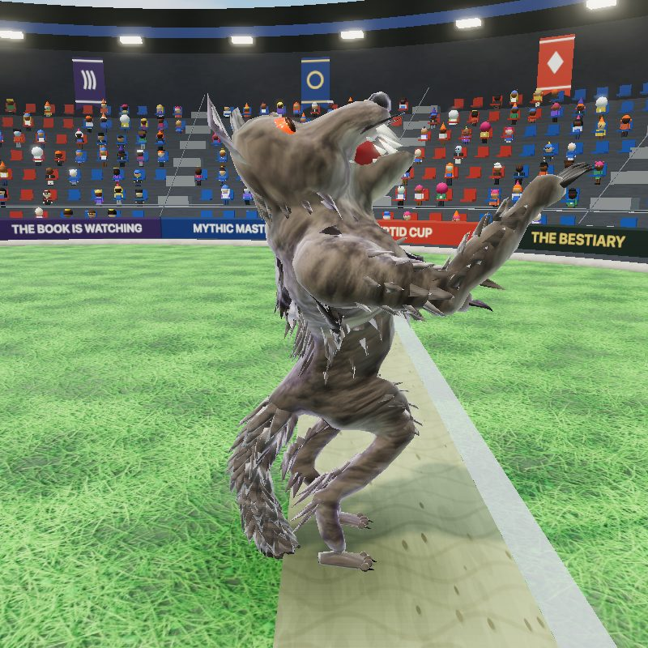
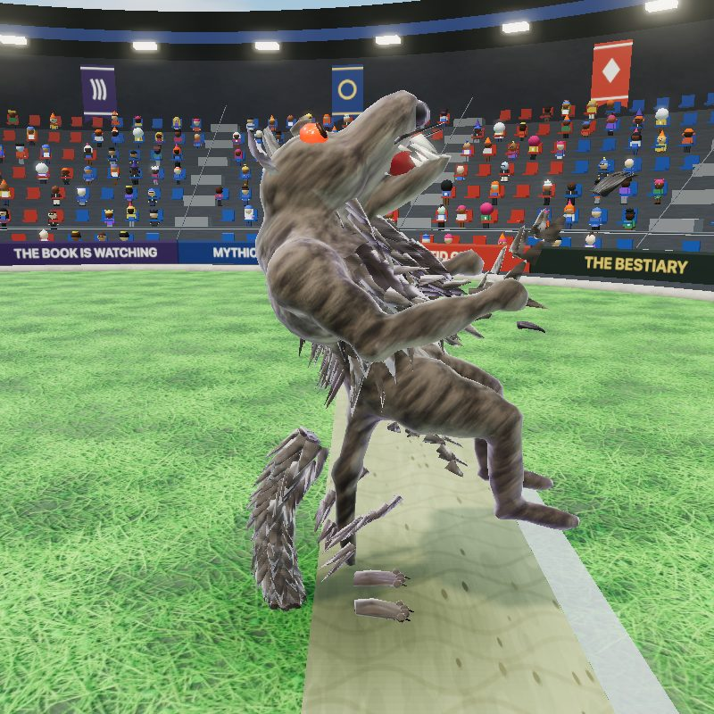
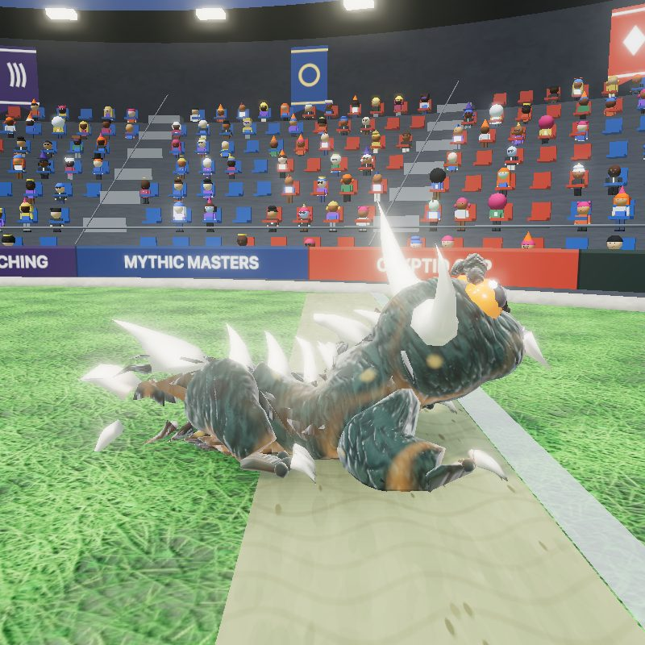
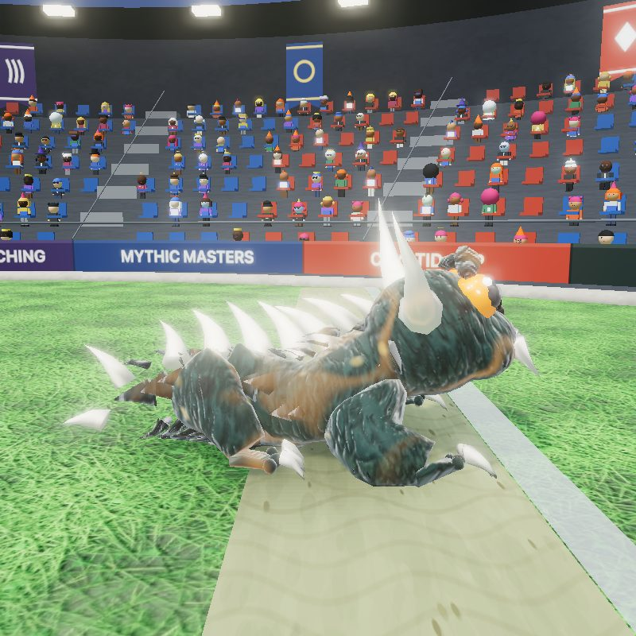

# Animation and graphics climb, round 28: dropped (no gain)

Part of #5183.

**What was tried.** Each fur card holds its shape: `rigidCards` in `src/loose.ts` groups a loose part's triangles into
cards (welded by position) and gives every vertex of a card the skin weights of its root (the vertex with the least
reach). The aim was to stop a card spanning hip and thigh from stretching into a silver plate under the recoil. The
code is in `rigid-cards.patch` (it applies to `main` at `c1130ea9`, with a unit test).

**Scores.** Two fresh judges looked at lock bursts plus the scripted side-on blow (`--hit`): 4.5 -> 4.5 and 5 -> 4.5.

- The Sasquatch's long hip-to-thigh sheet got shorter (`hit-sasquatch-3`), but neither judge saw a real change there.
  Cards still read as pale glassy shards, and a white flat patch stays at the hip.
- It broke the Rougarou. Its feet are in its `tuft` part, so each foot piece was bound to the bones of its root
  and stayed behind: feet lie on the path apart from the shins, even at rest (`now-hit-rougarou-rest`, `-4`).
  Tufts that no longer follow the limb spray off the body as shards.
- Judge B saw the Hodag recover sooner (`hit-hodag-5`), but that alone isn't a gain.

**What we learned.** Rigid cards don't fix the look. The problem is the card itself: a flat, hard-edged, pale quad
reads as broken glass in any pose. Binding to the root also has to skip pieces that aren't cards (a foot in a
`tuft` material). Fur that reads as fur needs softer cards: alpha-faded tips, the body's own colour at the root,
no rim highlight. Fewer, smaller cards would also help. Stall count: 2.

| | BEFORE | NOW |
|---|---|---|
| Sasquatch, 0.35 s after |  |  |
| Rougarou at rest |  |  |
| Rougarou, 0.55 s after |  |  |
| Hodag, 0.9 s after |  |  |
