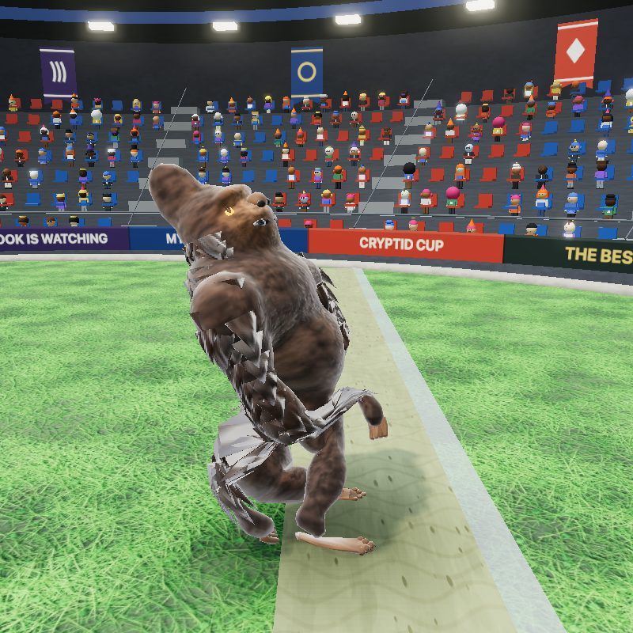
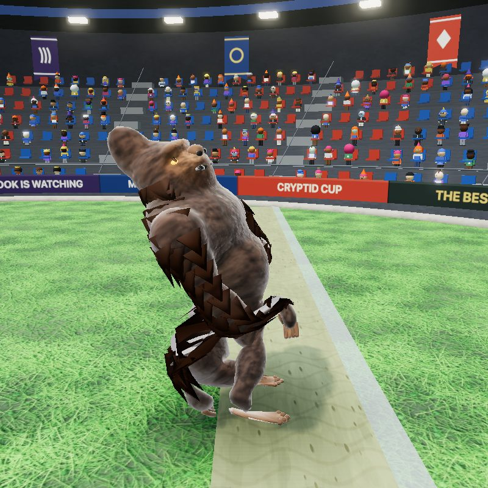
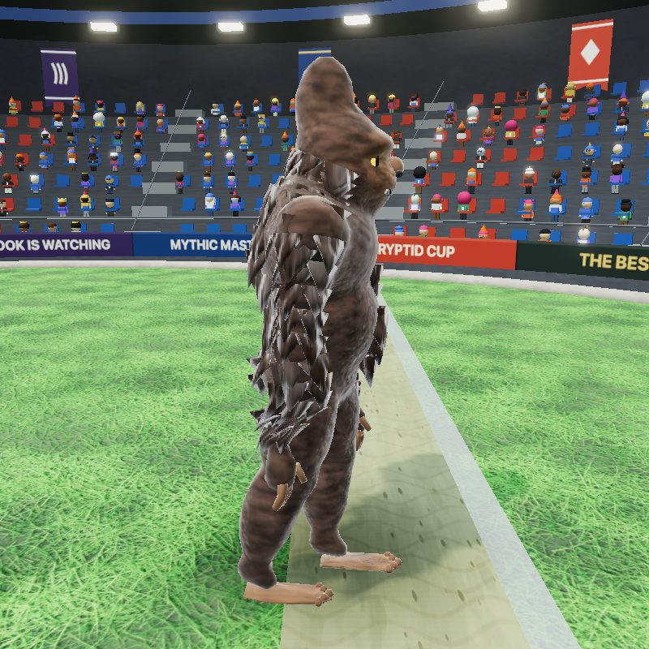
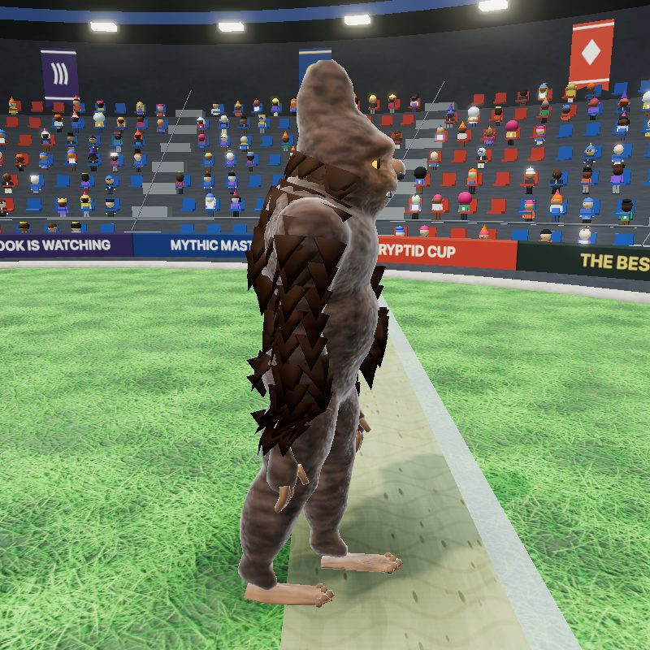
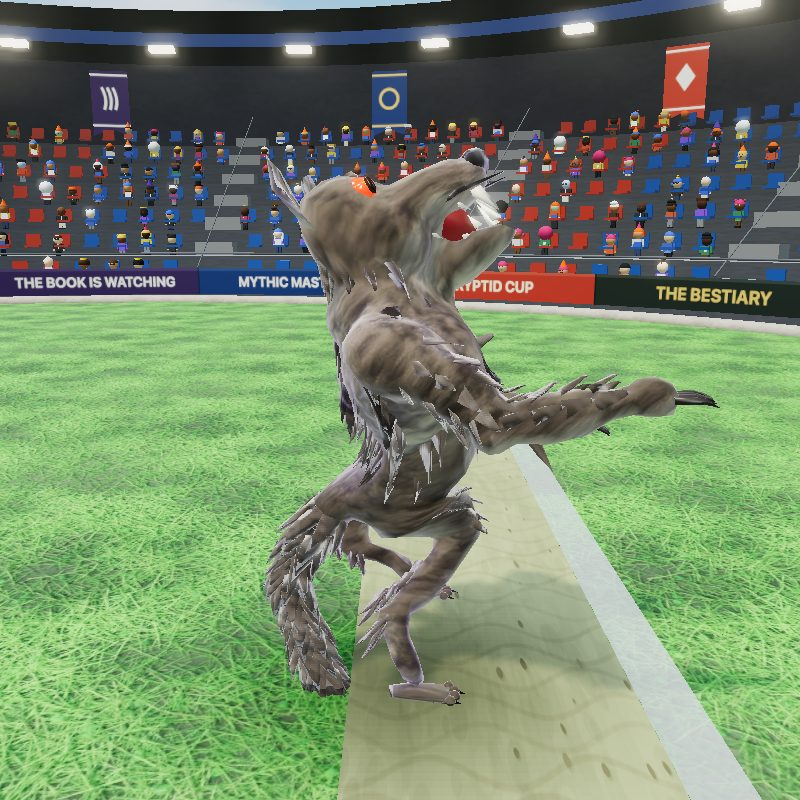
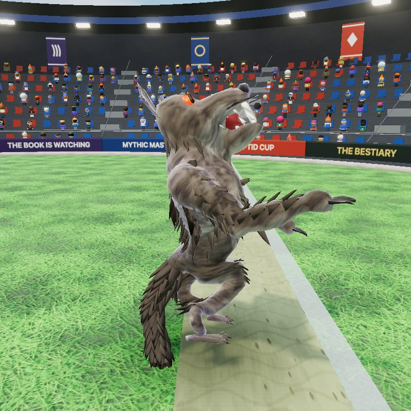
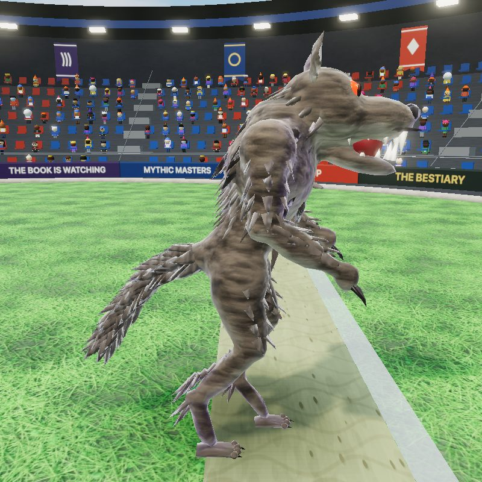
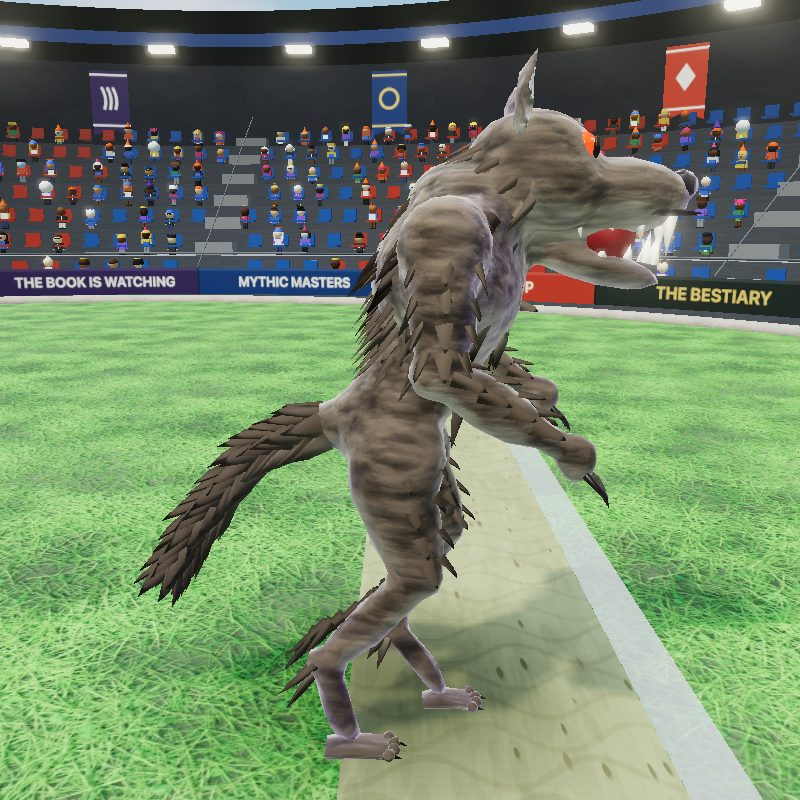
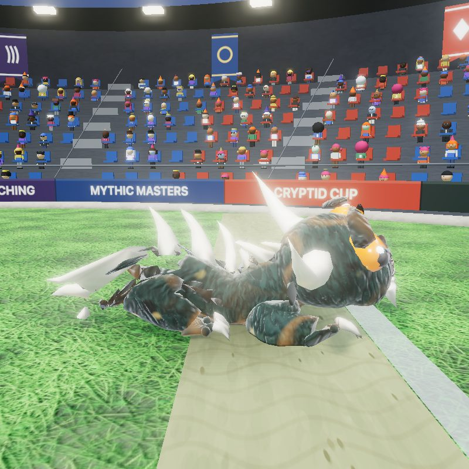
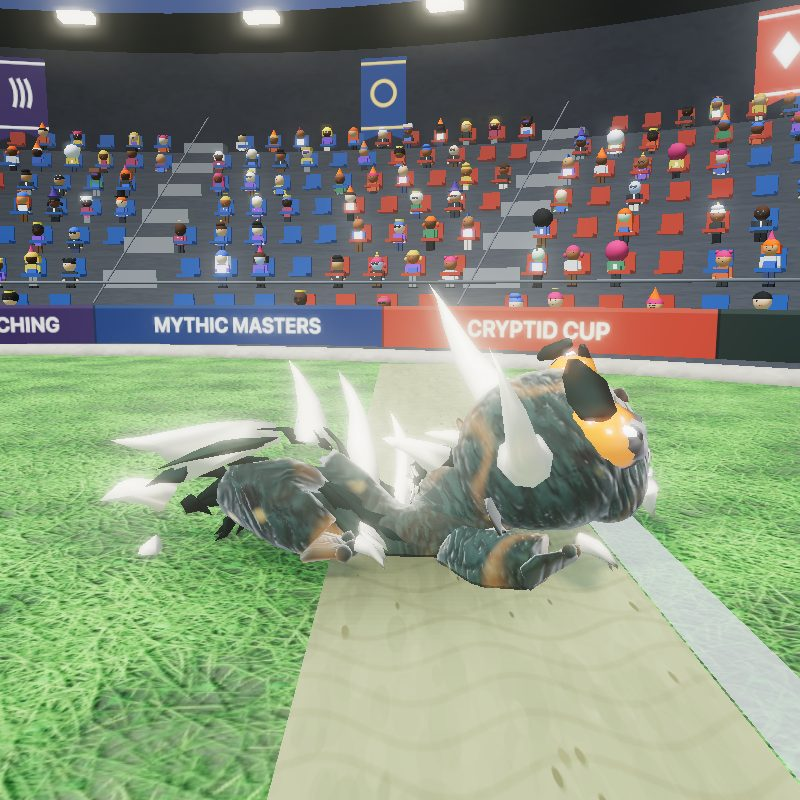

# Animation and graphics climb, round 29 (#5199)

Fur cards that read as fur, not glass. Three things lit a card silver: the fur grain's strand tips lightened toward
white (`src/hide.ts`, `* 0.6 + 0.4`), a field look's edge glow (`totalEmissiveRadiance` in `src/effects.ts`) and the
sky's reflection and rim at every grazing angle. A near-black mane card lit like foil. A card (`cardParts` in
`src/loose.ts`) is now matte and plain: no grain, specular, rim or edge glow. Its root takes the coat's colour where it
grows (the nearest coat vertex's colour, because a Sasquatch's brown lives in its vertex colours, not its grey map), and
it darkens toward the tip. The coat is the mapped part, not the biggest: a Rougarou's biggest part is its spiky `tuft`,
so its real fur had been treated as the body's odd one out.

Tried and dropped: a noise fringe that cut the tips into strands. It didn't show at fight distance, and it would have
eaten the Rougarou's foot pieces, which live in its `tuft` part.

Judges (fresh, lock bursts plus `--hit`): 4.5 -> 5 and 5 -> 5.5. Both named the cards first: silver foil before, brown
fur now. Both named the same top gap left: the cards are still flat paper triangles with pale backfaces that splay off
the hip and arm in a hit (`now-hit-sasquatch-3.jpg`).

| | BEFORE | NOW |
|---|---|---|
| Sasquatch, 0.35 s after |  |  |
| Sasquatch at rest |  |  |
| Rougarou, 0.35 s after |  |  |
| Rougarou at rest |  |  |
| Hodag, 0.35 s after |  |  |
