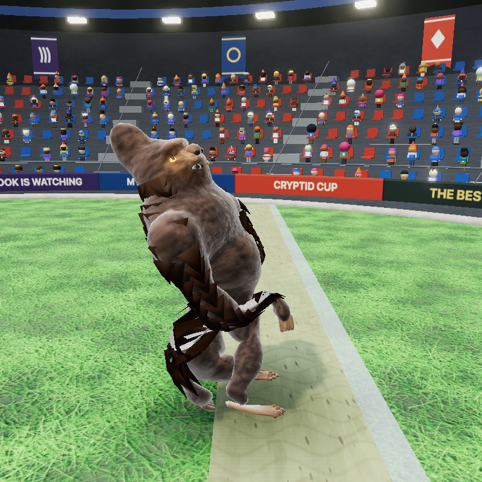
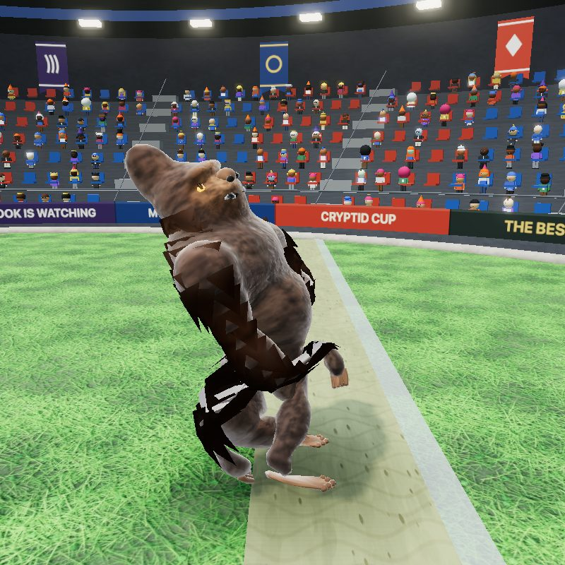
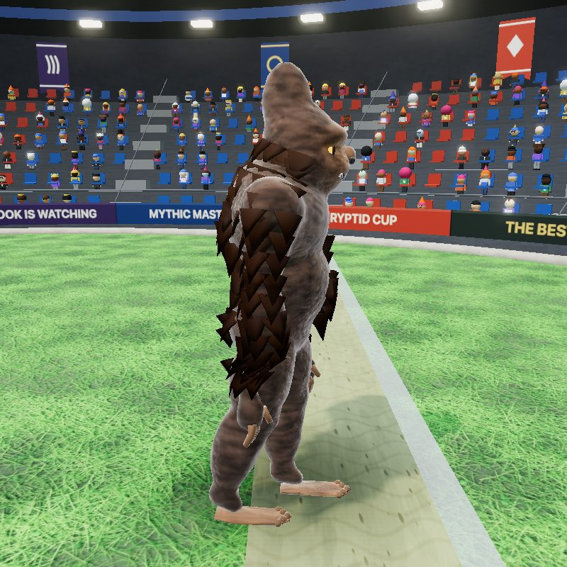
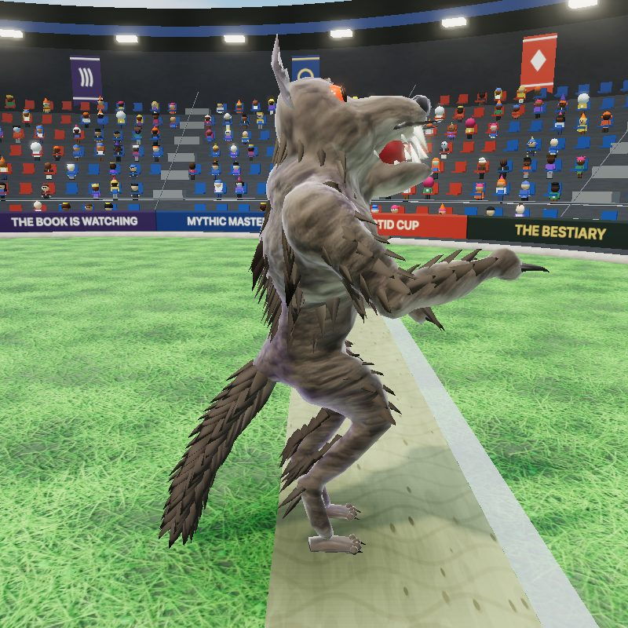
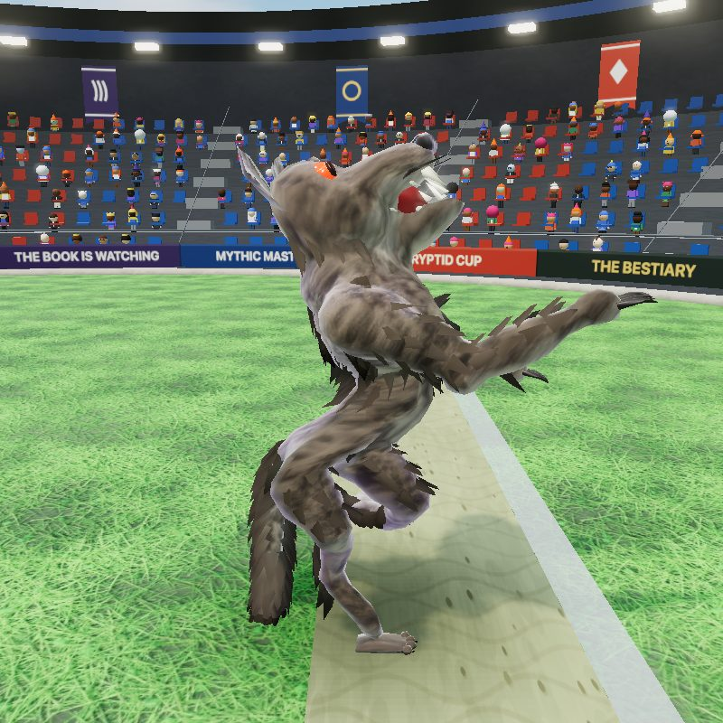
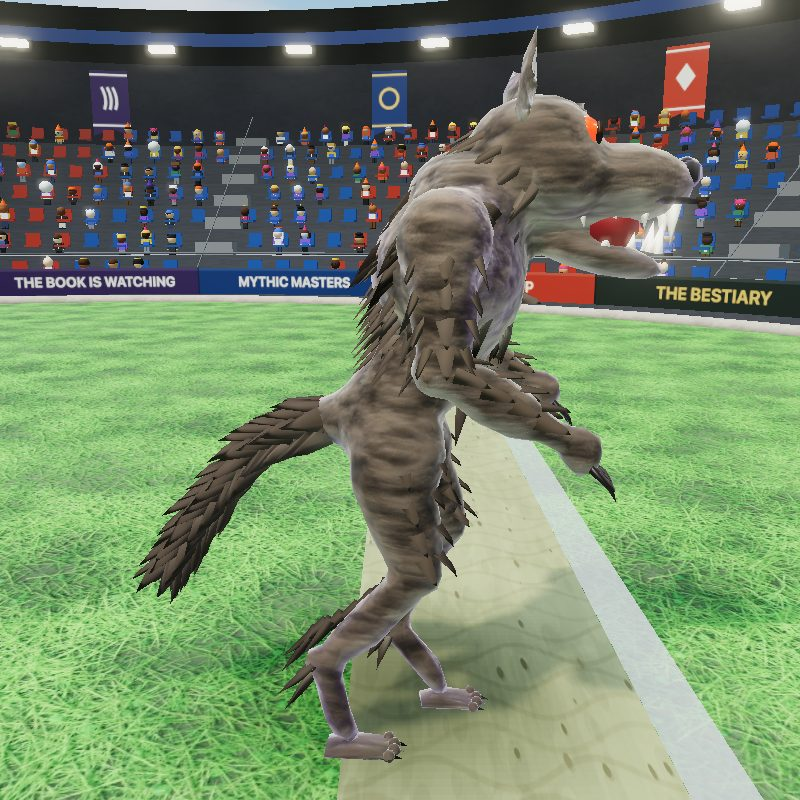
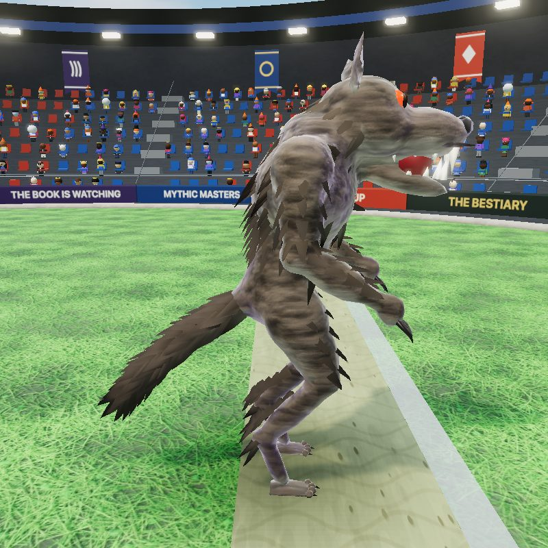

# Animation and graphics climb, round 30 (#5202): dropped

Tried: fur cards that sit in the coat. Each card was lit with the coat's normal where it grows (the nearest coat
vertex's normal, `rootOf` over the coat's normals, as `aRootN`), on both faces (no `faceDirection` flip), so a card's
two sides no longer lit one dark and one pale. And the part of a card's spring offset that points out of the coat was
held to a fifth of its reach, so a hit drags cards back over the hide, not off it. The code is in
`coat-normal-cards.patch` (`src/loose.ts`, `src/beasts.ts`; applies to main at 1f8149264).

What it did: the Sasquatch's cards lost their pale undersides and shade with the coat as one darker, streaky mass. The
Rougarou's tail reads as a fur brush, not a bundle of spikes, and its cards lie flatter. The splay in a hit hardly
changed: it comes from skinning (a card weighted across bones that bend apart), not from the spring.

Judges (fresh, lock bursts plus `--hit`): 4.5 -> 4.5 and 5.5 -> 5.5. Both named the cards as the top gap left: hard-edged,
opaque black triangles with no taper or strand breakup at the tip, "torn leather glued onto a smooth body". One judge
suggested soft alpha-tested tips with a root-to-tip fade into the hide; the other, cutting the cards on the heavy beasts.

| | BEFORE | NOW (dropped) |
|---|---|---|
| Sasquatch, 0.35 s after |  |  |
| Sasquatch at rest |  |  |
| Rougarou, 0.35 s after |  |  |
| Rougarou at rest |  |  |
