# Animation and graphics climb, round 31 (#5213): kept, small gain

Changed: fur cards break into strands toward the tip. Each card is cut by a value noise over its rest position with the
along-the-card part taken out (the gradient of its root-to-tip value), so the noise runs as strands from root to tip,
and each strand is cut at its own length and shaded a little lighter or darker (`CARD_FRAG_PARS`, `CARD_COLOR` in
`src/loose.ts`). The cut is a discard, so a card stays opaque for sorting. Round 30's coat-normal lighting
(`../shots-2026-11-18-anim-r30/coat-normal-cards.patch`) is in too: both faces of a card take the coat's normal where it grows.

What it did: the Sasquatch's shingled triangles and the Rougarou's spike tail turned into ragged fur edges; the tail
reads as a brush. But the strands are a pixel or two wide, so at fight distance the edge reads as stipple.

Judges (fresh, lock bursts plus `--hit`): 5.5 -> 6 and 5.5 -> 5.5. Both named the stippled edges as the top gap left: "a
dithered speckle", "noise or a broken texture rather than fur", and a hard white strip at the Sasquatch's hip in a hit
(`now-hit-sasquatch-2`).

| | BEFORE | NOW |
|---|---|---|
| Sasquatch at rest | 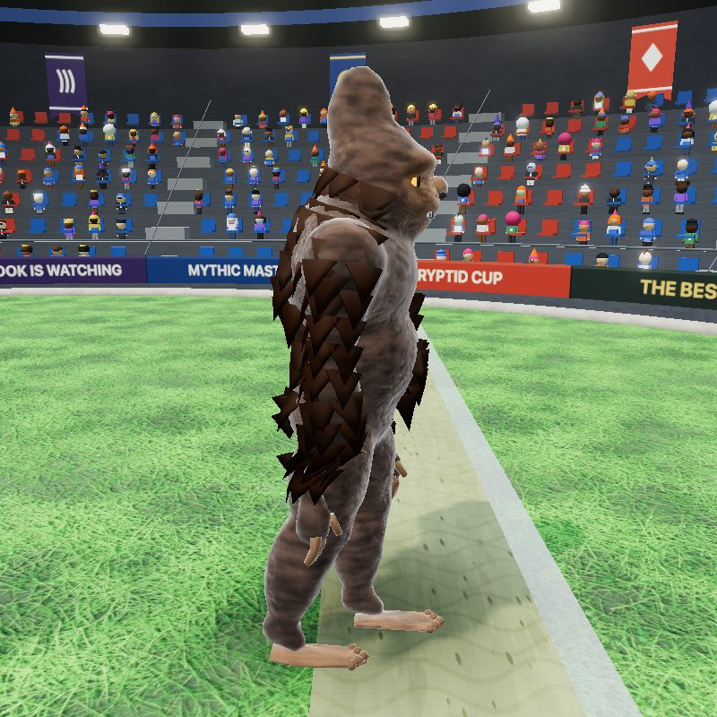 | 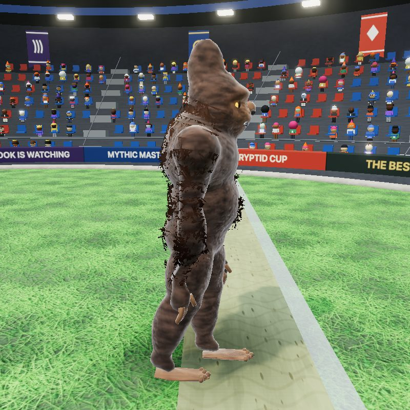 |
| Sasquatch, 0.2 s after | 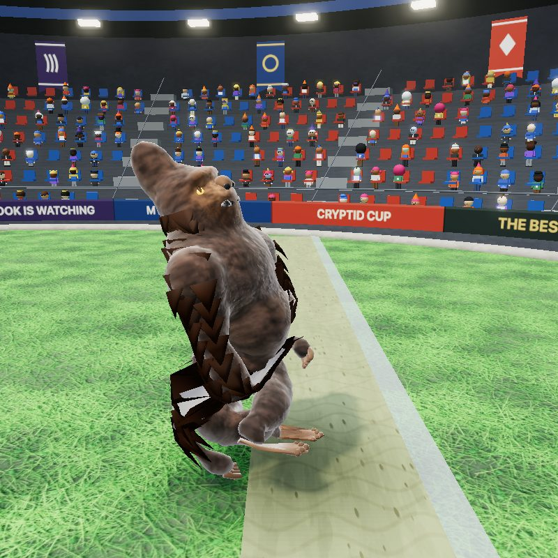 | 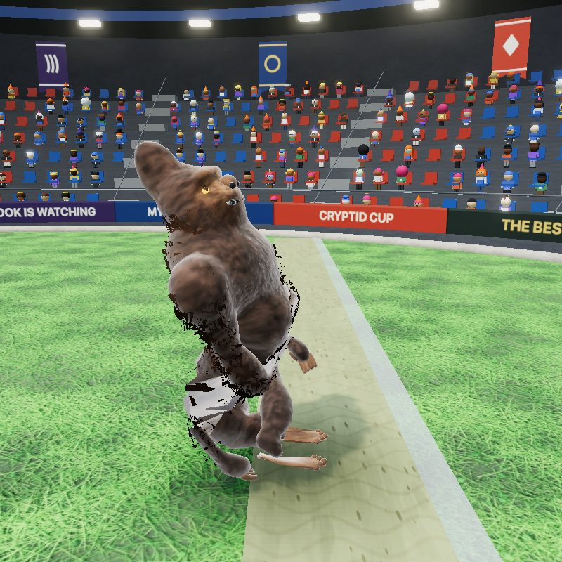 |
| Sasquatch, 0.35 s after | 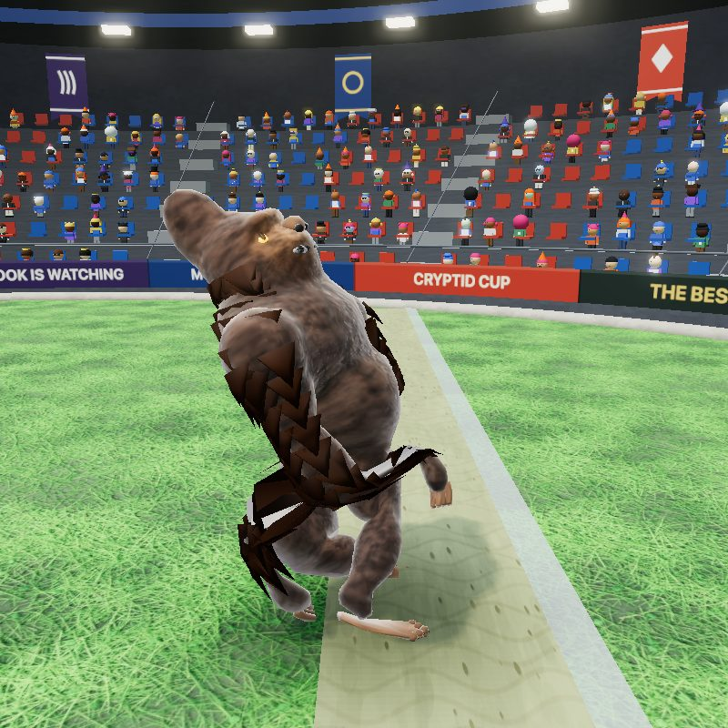 | 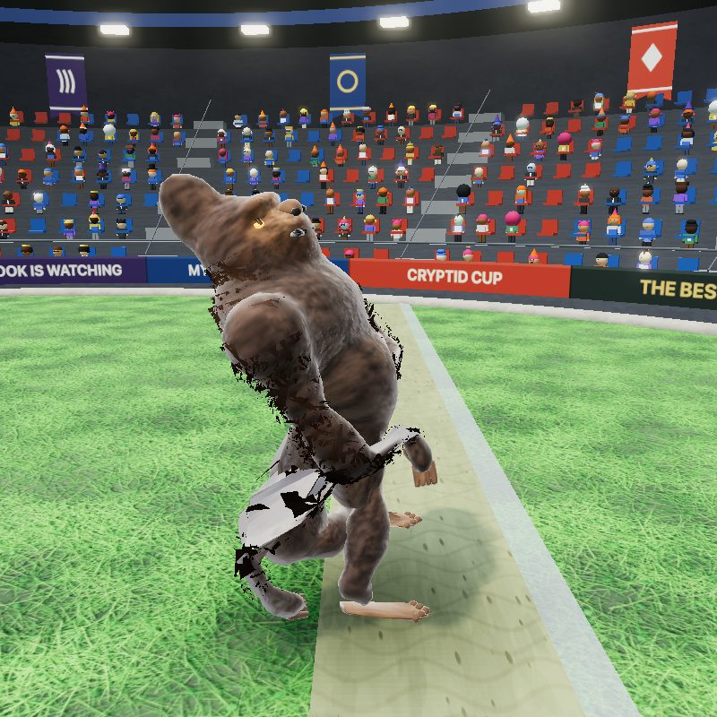 |
| Rougarou at rest | 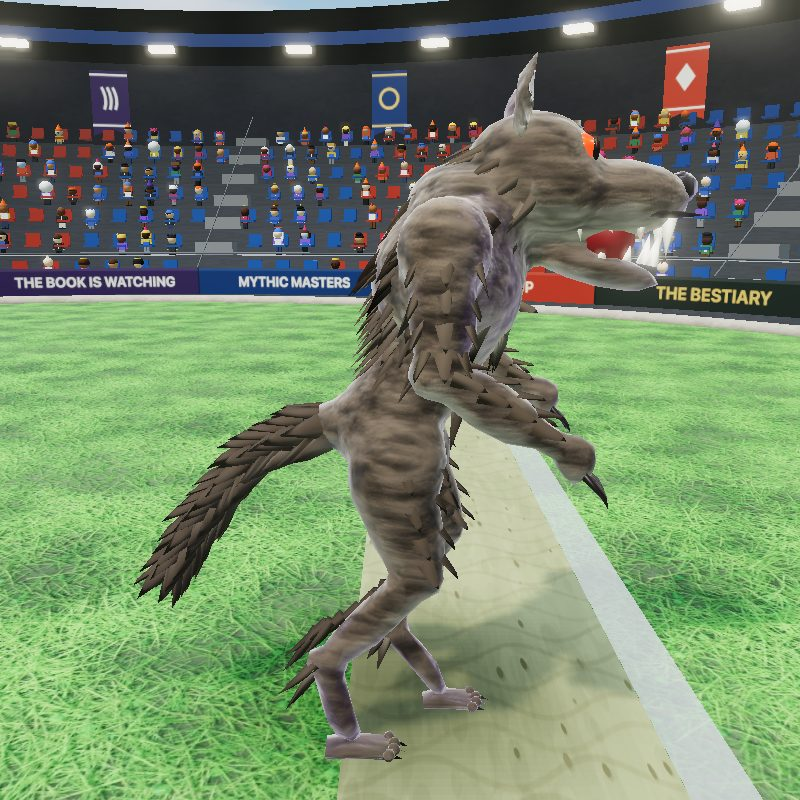 | 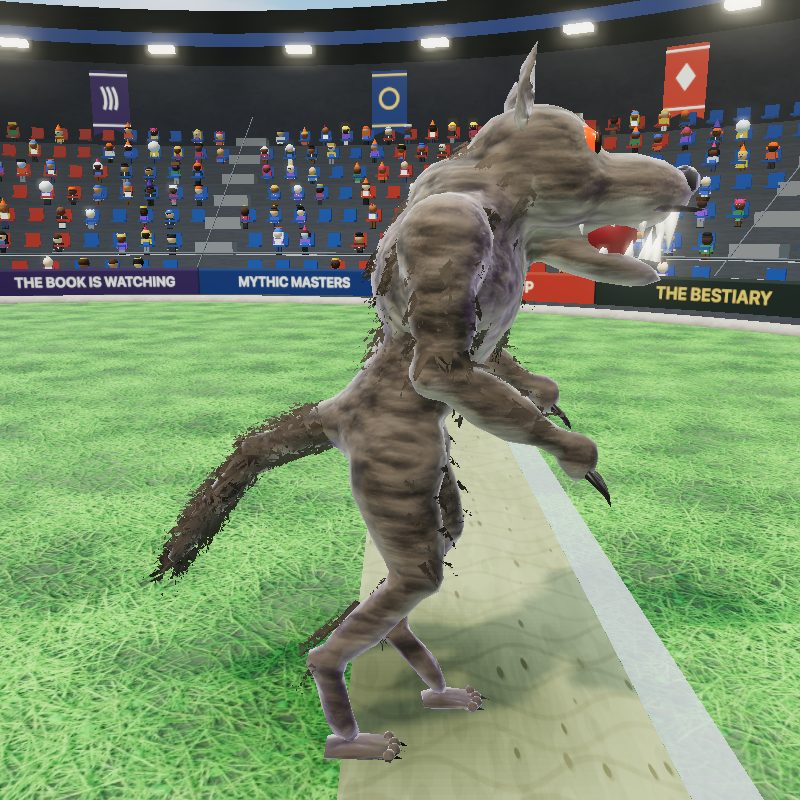 |
| Rougarou, 0.2 s after | 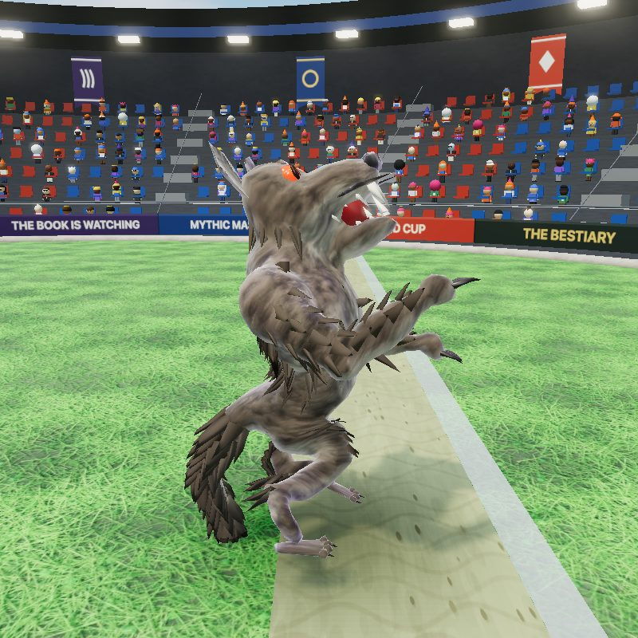 | 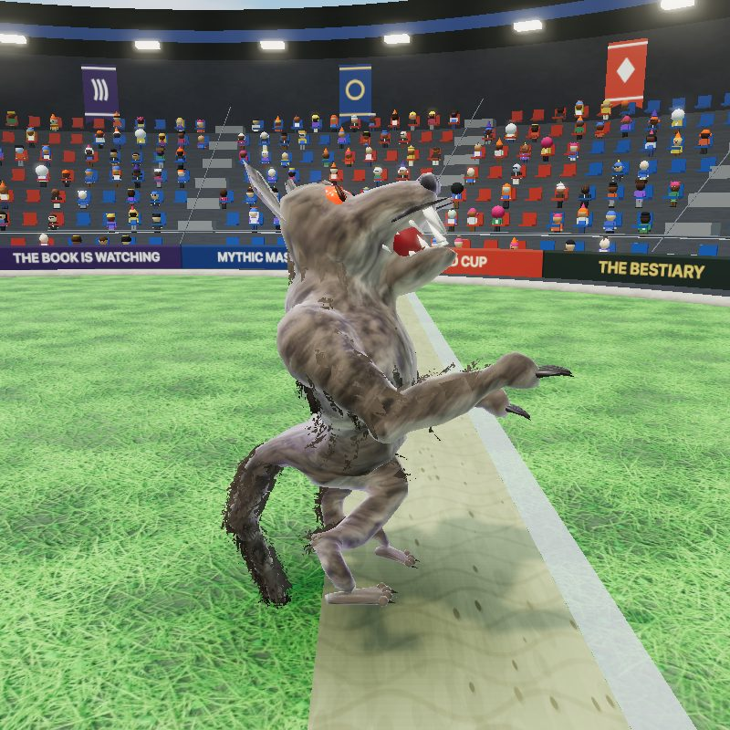 |
| Lock camera, contact | 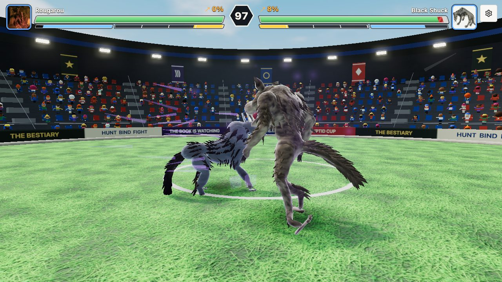 | 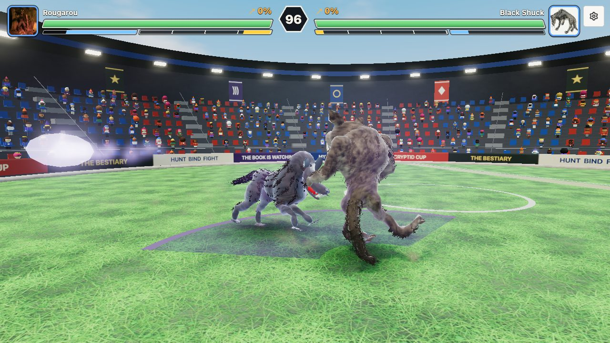 |
