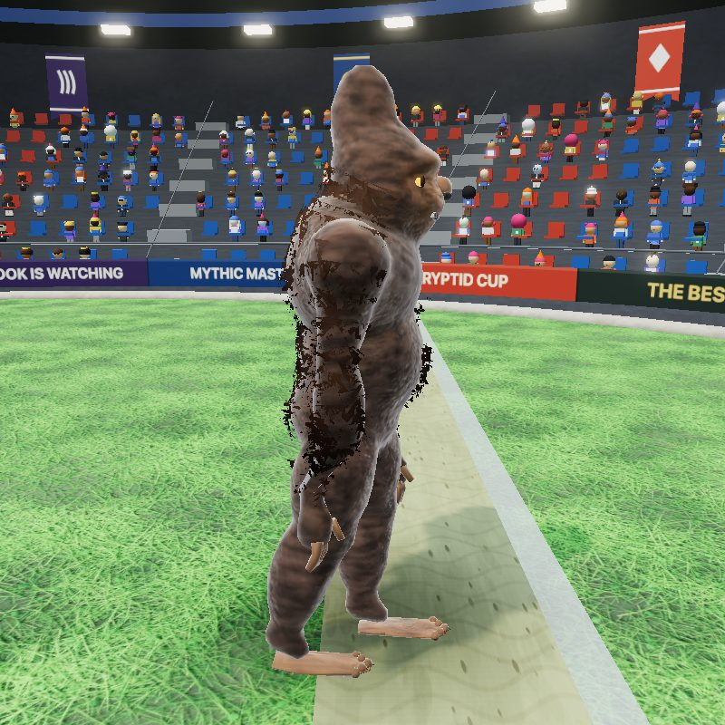
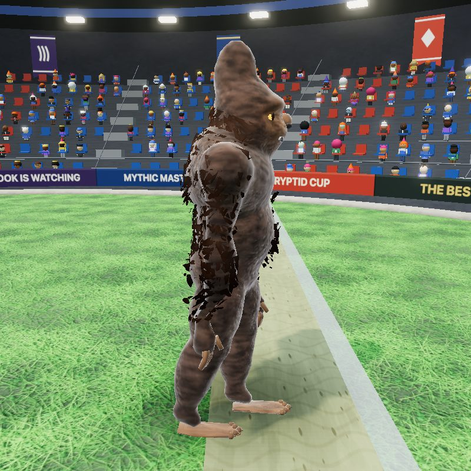
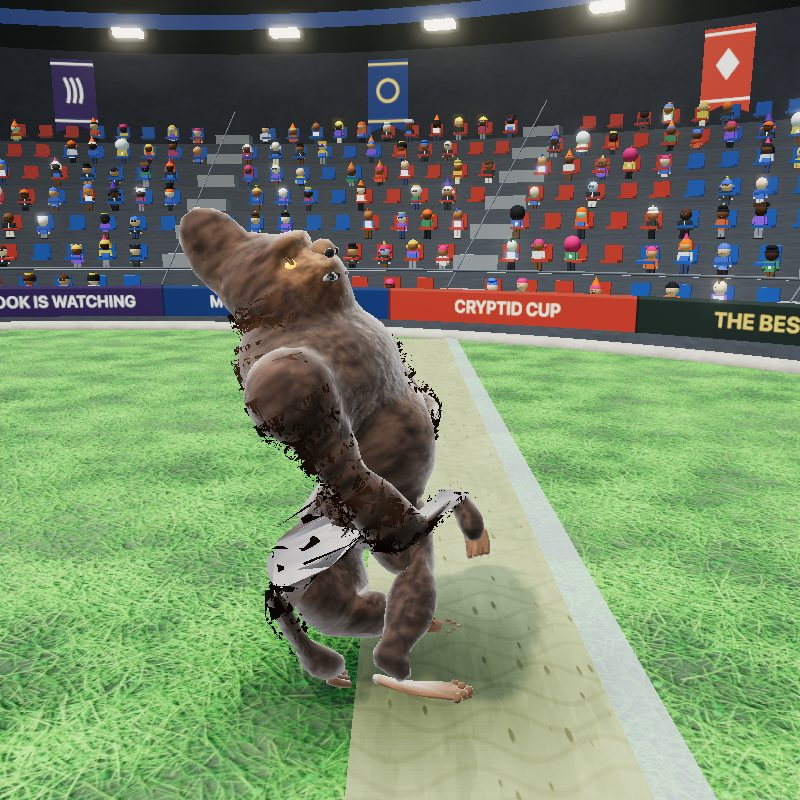
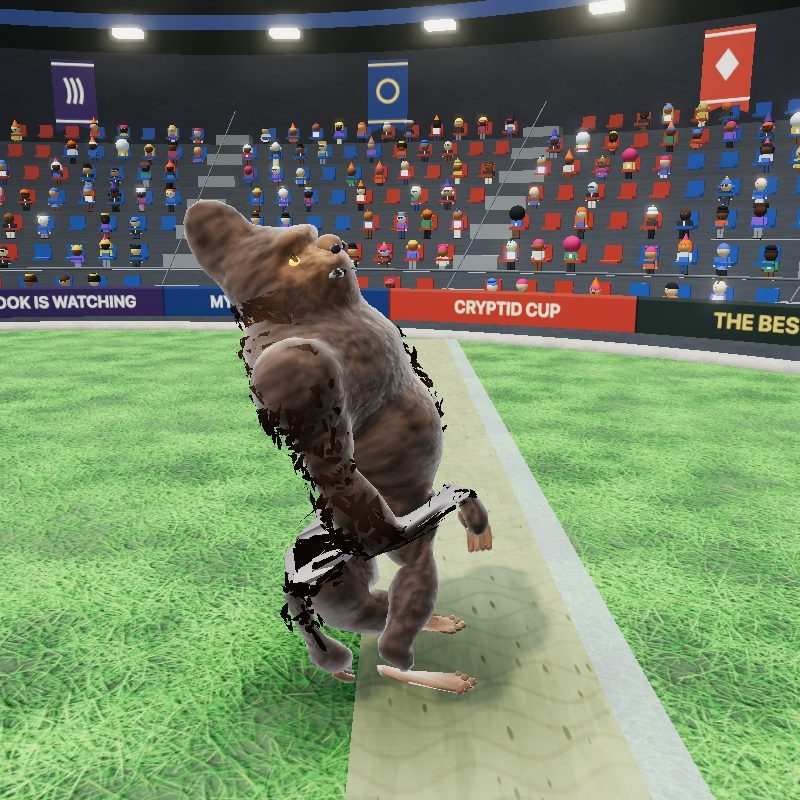
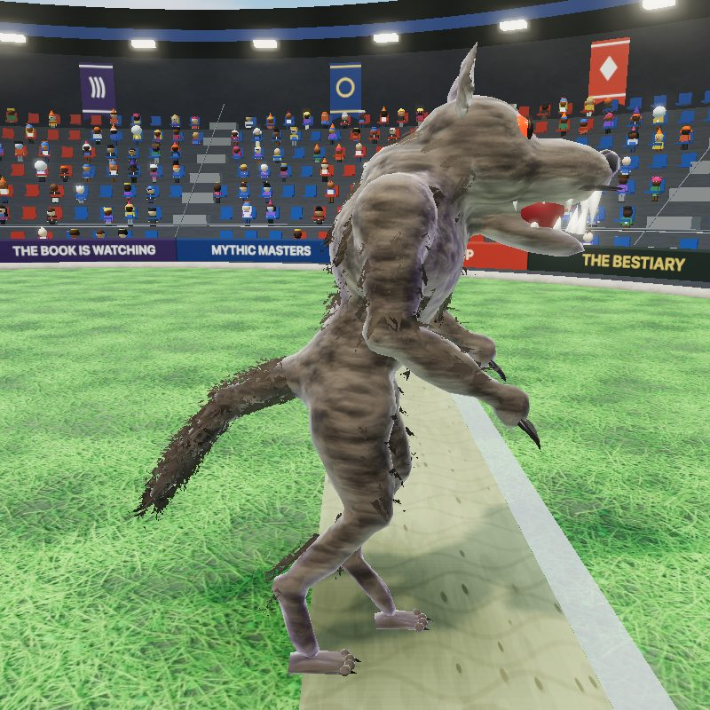
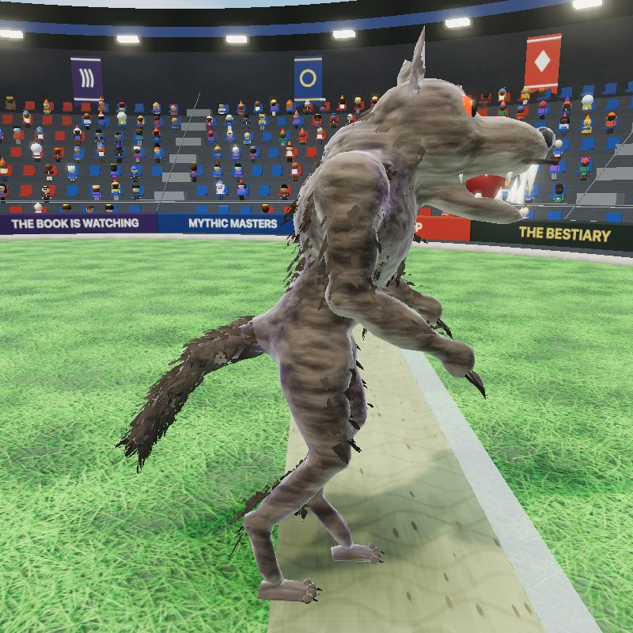
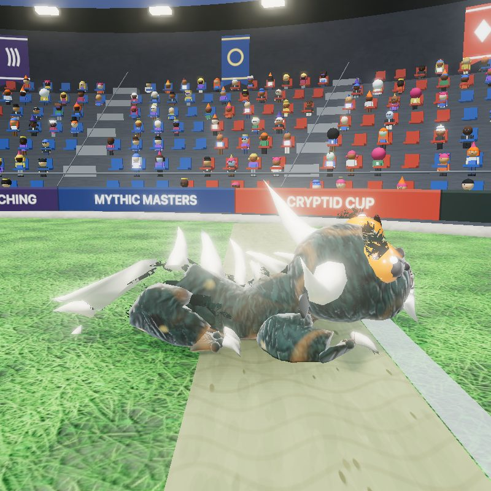
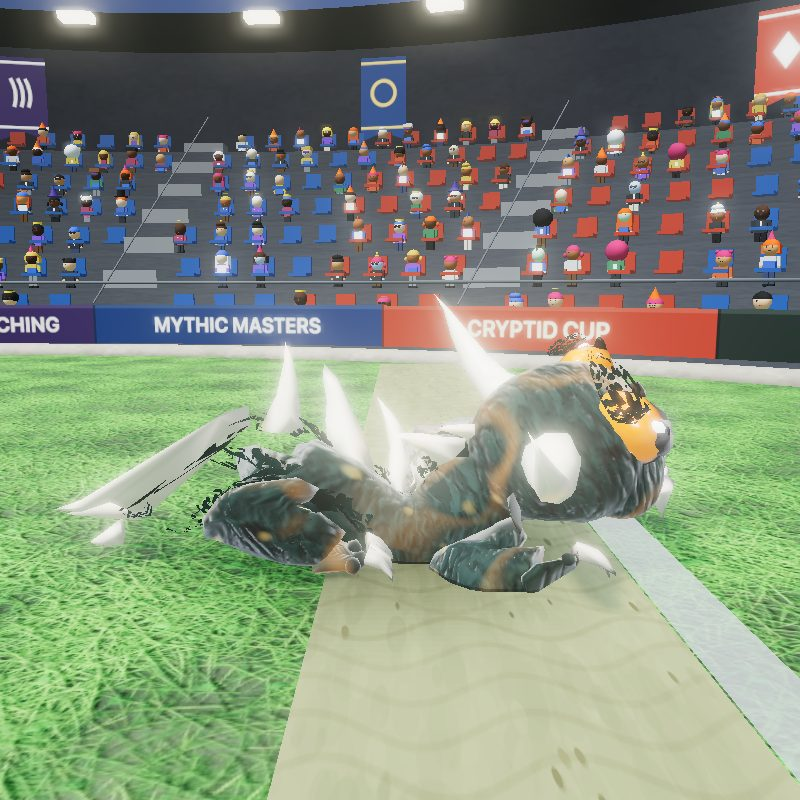

# Animation and graphics climb, round 32 (#5222): no gain, dropped

Tried: wider fur strands with pointed tips. Round 31's fine value noise (frequencies 160 and 410) gave strands a pixel
or two wide. This round put cells about a seventieth of the body wide across each card. Each cell is one strand, cut at
its own length, narrowing to a point near its end, and darker at its sides. The code is in `strand-cells.patch`
(`strandOf` in `src/loose.ts`, plus a test). It applies to main at this commit.

Lessons:

- Cells over the screen-space along direction (round 31's `dFdx` of the tip value) jump at every triangle edge. With
  wide cells this draws the card's triangles as light and dark shards. `strandOf` fixes it: a per-vertex strand
  coordinate from the tip gradient, summed over welded corners and taken from each card's own middle.
- At 34 cells a strand is the whole card, and the edge reads as big black shards. At 70 the edge reads as tapered flakes.
  Both judges said that is about the same as round 31's stipple.
- **The white and black sheet at the Sasquatch's hip in a hit is lighting, not colour.** With every card's colour forced
  to dark magenta (`debug-flat-colour-sasquatch-4.jpg`), the sheet still burns white. Some light is added after
  `CARD_LIGHT`, or the skinned normal blows up where the card splays. Main shows it too.

Judges (fresh, lock bursts plus `--hit`): 4.5 -> 4.5 and 5 -> 5. Both named that hip sheet as the top gap: "torn black and
white shards that look like z-fighting" (`now-hit-sasquatch-3`).

| | BEFORE | NOW |
|---|---|---|
| Sasquatch at rest |  |  |
| Sasquatch, 0.35 s after |  |  |
| Rougarou at rest |  |  |
| Hodag, 0.35 s after |  |  |
