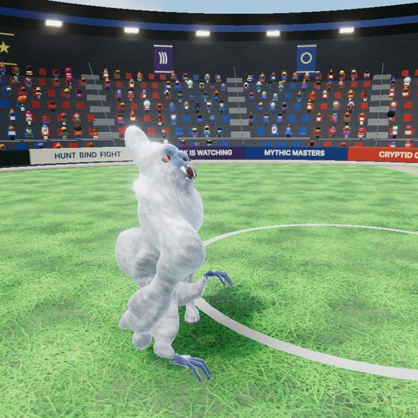
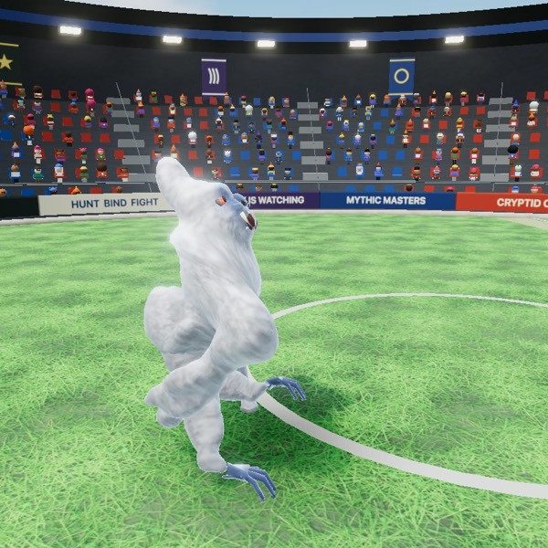
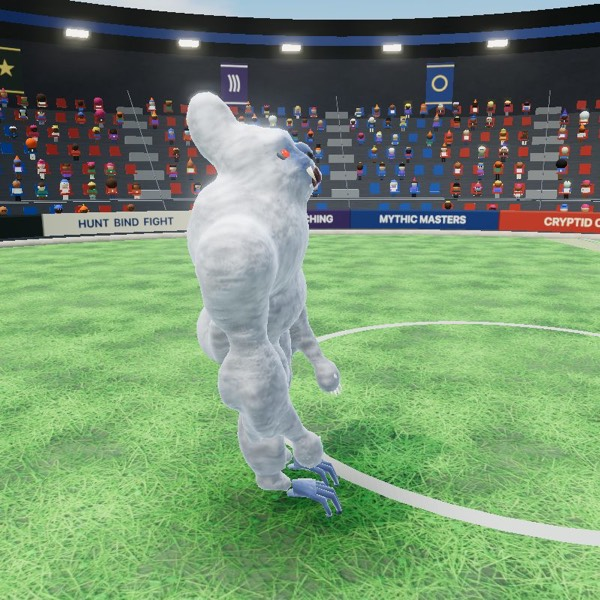
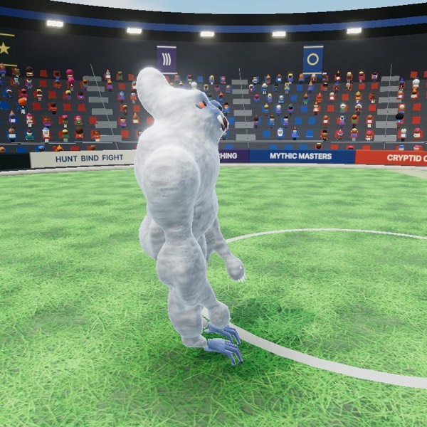
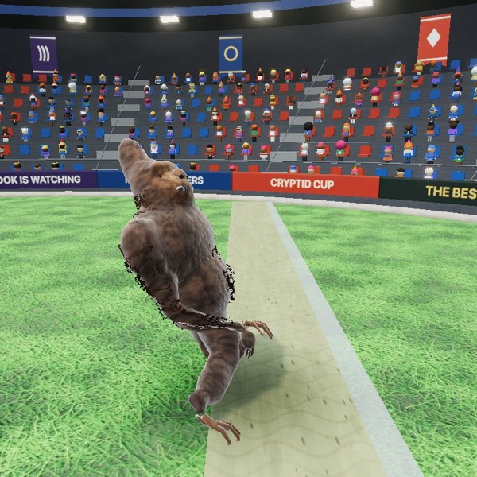
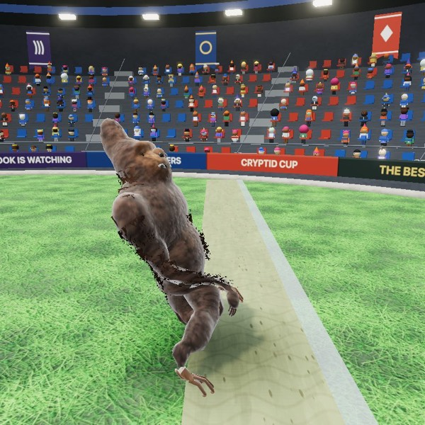
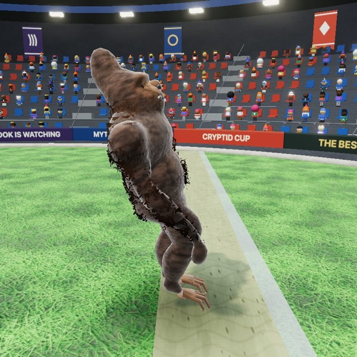
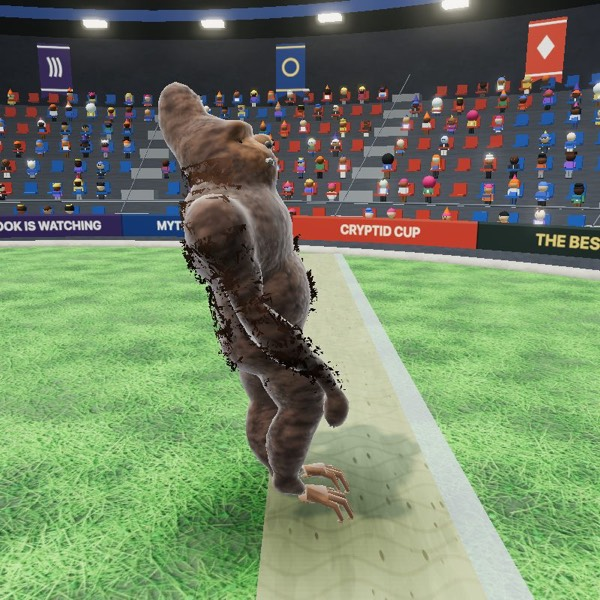

# Animation climb, round 10 (#5185 gap 1): a hit's turn that comes back. Kept, small gain.

Changed: the recoil's twist has its own spring. Before, the body's yaw was `recoilSide * recoil * (0.1 + 0.3 * upright)`.
It rode the recoil, which is held through the stun, so a biped turned about 20 degrees off the blow and only eased back.
Now a blow kicks `turn` (in `Puppet.update`, spring numbers in `TURN` in `src/beasts.ts`). It peaks near 12 degrees on
a biped about 0.12 s on, swings about 2.5 degrees past square by 0.35 s, and is square again by 0.9 s.

Measured on the Yeti (pivot yaw, gallery blow): 0.12 s: 20 -> 12 degrees. 0.35 s: 11 -> -2.5. 0.9 s: 3.3 -> 0.4.

What the frames show: at 0.12 s the body shows less chest to the camera. At 0.9 s the Sasquatch stands closer to side
on. The Yeti at 0.9 s still looks a little open to the camera. That is not yaw now: in the gallery the stun never
counts down, so the stun's sit-back lean (about 17 degrees at 0.9 s) holds, and the feet that stepped back on the
blow stay where they landed.

Test: "a blow's twist swings the sasquatch back past square, then settles" in `test/beasts.test.ts` (fails on main:
main's peak is 20 degrees and never crosses square).

| | BEFORE | NOW |
|---|---|---|
| Yeti, 0.12 s after |  |  |
| Yeti, 0.9 s after |  |  |
| Sasquatch, 0.12 s after |  |  |
| Sasquatch, 0.9 s after |  |  |
