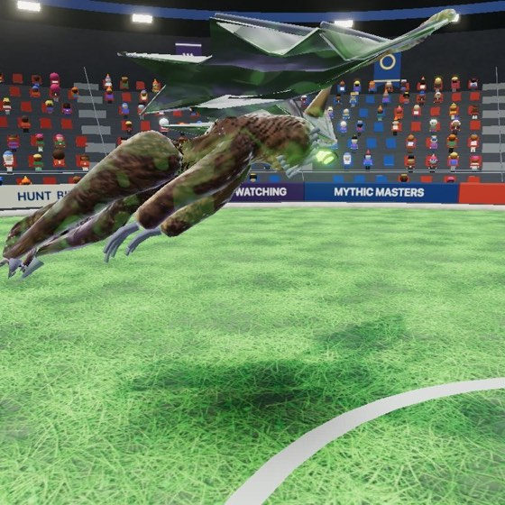
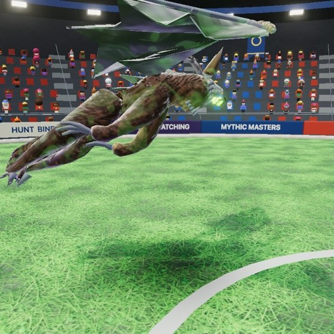
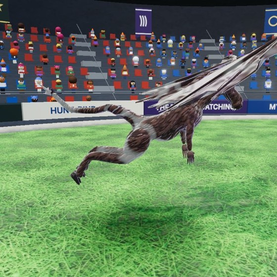
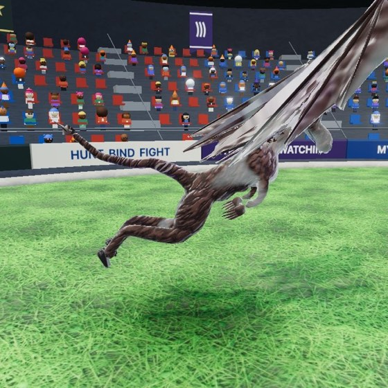
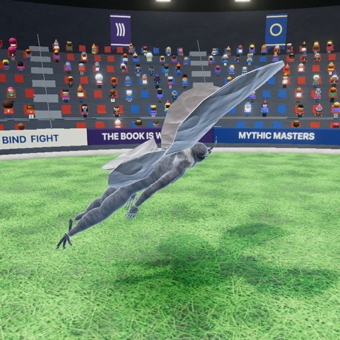
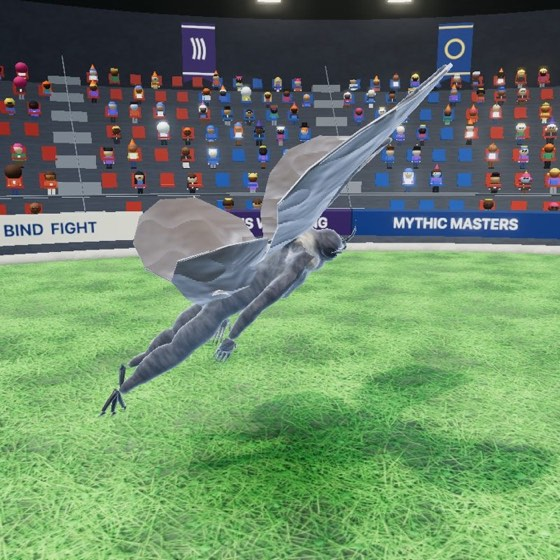

# Animation climb, round 11 (#5185 gap 3): a flyer's arms in flight. Kept.

Changed: flying, a flyer's arms sweep back along its flanks. Before, they hung from the shoulders as at rest, so under
a chest-down body they pointed at the ground (the Sasabonsam's) or reached ahead of the hips (the Jersey Devil's).

Where: `swingLimbs` in `src/beasts.ts`. Each frame it turns an arm's top bone toward where the arm trails. Flying, that
aim is blended toward a fixed sweep (back, down and a little out, in the body's own frame: `FLY_TUCK`). The blend
`tuck` eases in and out over about 0.2 s, so a take-off or a landing doesn't snap. `armSide` says which hanging limbs
are arms: hung from over a third of the height up, off the centreline. A tail or a fin is left alone.

What the frames show: the Sasabonsam's arms lie back under its body instead of hanging down. The Jersey Devil's forearm
folds up under its chest. The Mothman's arm lies along its body. Grounded beasts don't change (`tuck` is 0 there).

Test: "the %s flies with its arms swept back" in `test/beasts.test.ts`. On main the Jersey Devil's arm tips are ahead
of its hips and the Sasabonsam's are 0.4 of its height under them.

| | BEFORE | NOW |
|---|---|---|
| Sasabonsam |  |  |
| Jersey Devil |  |  |
| Mothman |  |  |
