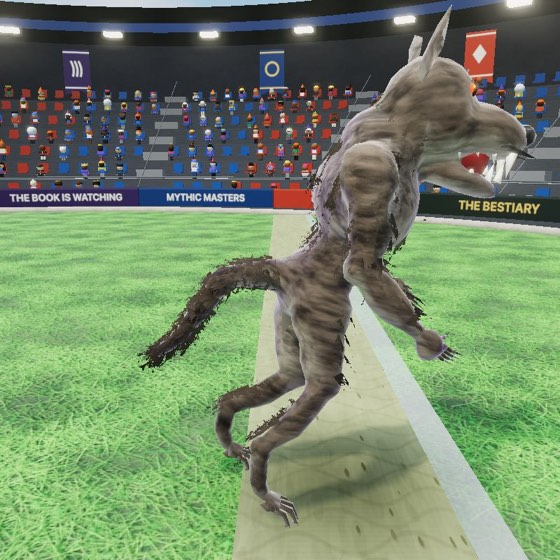
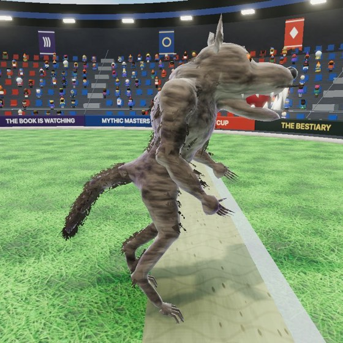
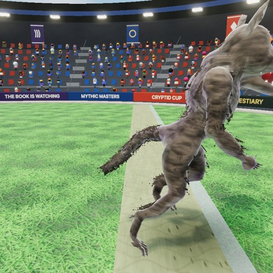
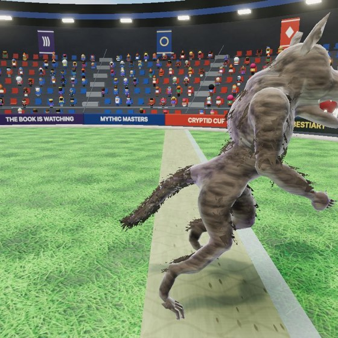

# Animation climb, round 12 (#5185 gap 5): grounded locomotion. Kept, small gain.

Changed, in `Puppet.update` (`src/beasts.ts`, numbers in `GAIT`):

- The body's bob comes from the feet. Before, it was a free sine (`abs(sin(tick * 0.22))`) that ran on whatever the
  feet did. Now the hips rise while a foot swings (`sin(pi * t)` of that step) and drop as it lands.
- The body rolls onto the standing leg while the other swings (`sway`), more on a biped.
- The standing feet stay down. The hips sit no higher than every planted leg reaches. Before, a bob that lifted the
  hips past that pulled the planted foot off the ground to the leg's full stretch, so the Rougarou ran on one lifted
  foot or none. The drop (`sink`, up to 0.06 of the height) is eased, so a foot leaving the ground doesn't pop the hips.

Measured (`scratchpad probe-walk.ts`, the Rougarou walked straight for 3 s): frames with no foot on the ground, at 0.6
of its top speed 5% -> 0%; at full speed 8% -> 1%. The Sasquatch and the Hodag had none before and have none now.

Frames: the Rougarou walked through the gallery side on at 0.35 of its top speed (a scratch script, `walk-shots.ts`; the
burst script has no walk shot). BEFORE, mid-step, both feet are off the ground and its shadow is clear of them. NOW one
foot stays planted while the other swings. The two runs' frames fall at different moments of the stride.

Test: "a running rougarou keeps a foot on the ground" in `test/beasts.test.ts` (main: about 5% of frames with none; the test allows 2 of 180).

| BEFORE | NOW |
|---|---|
|  |  |
|  |  |
