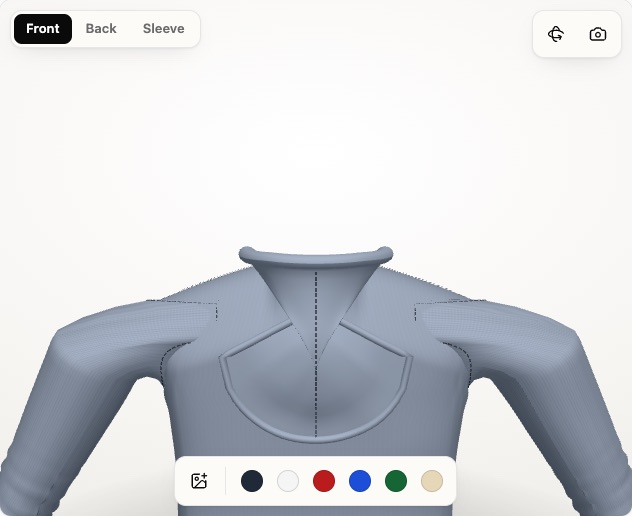
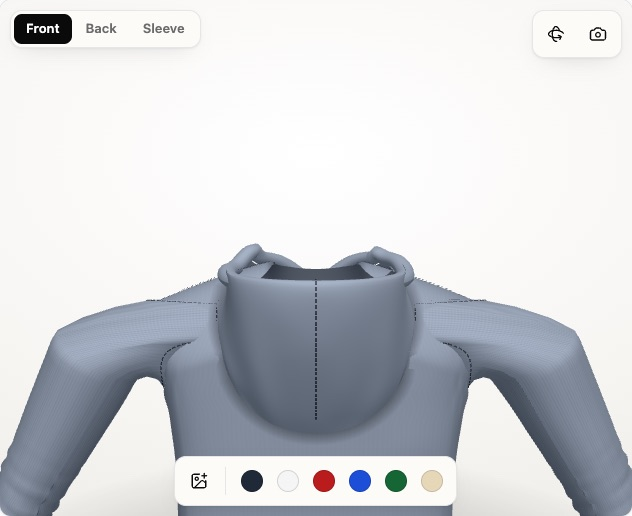
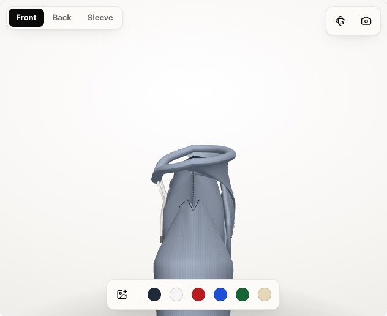
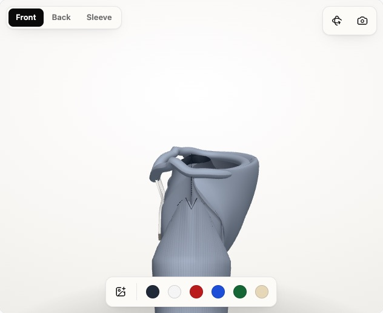
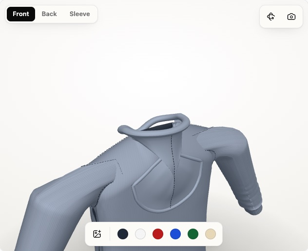
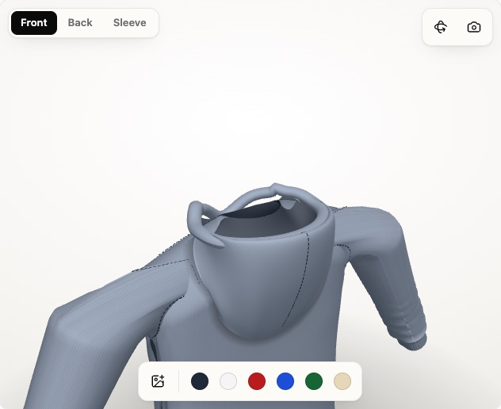

# The hoodie's hood, lying back (#4637)

Before, the hood lying back was a thin U-shaped panel flat on the upper back, and a reviewer took it for the pouch
pocket printed through. Its sides were also crossed: the panel's left end at the neck ran down to its right end on
the back, which pinched it into a heart. Now (`hood()` in `src/widget/tops.ts`) it is two layers:

- **The opening's rolled edge** crosses at the front of the neck as before, lies on the shoulders where they slope
  away (with a few folds there), and swings back behind the neck to the crown's lip.
- **The lining** runs from the neckline back to that lip and sinks into a bowl, in the cloth's darker inside shade.
- **The shell** rolls over the crown from the lip, stands about 0.2 off the back (it was 0.08), and comes down to a
  rounded point lying on it, with soft folds and a centre seam. A contact shadow runs round its edge.

`test/tops.test.ts` checks that the hood stands more than 0.15 off the back. Main's hood measured 0.076 there.

| | before | after |
|---|---|---|
| back |  |  |
| side |  |  |
| from above, behind |  |  |

A blind judge (shown the back, side and quarter shots, told the title was wrong, not told what to look for) named it
"the hood, hanging down the back". It still found it moulded rather than draped.

The shots are close-ups from the probe, with the camera set by hand (`az` 3.14 back, 1.57 side, 2.5 at polar 1.2):

```sh
cd apps/qview3d && QVIEW_PORT=5377 bun run dev
bun run probe qview3d / --url http://localhost:5377 --shot out.png --js "const e = document.querySelector('qview-3d');
  e.model = 'hoodie'; e.color = '#8b95a5'; await new Promise(r => setTimeout(r, 1500));
  const v = e.viewer; v.controls.target.set(0, 1.15, 0); v.camera.position.setFromSphericalCoords(3.4, 1.4, 3.1416).add(v.controls.target);
  v.camera.lookAt(v.controls.target); v.controls.update(); v.dirty = true; await new Promise(r => setTimeout(r, 800)); return 'ok'"
```
