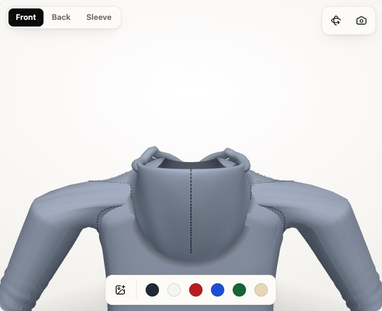
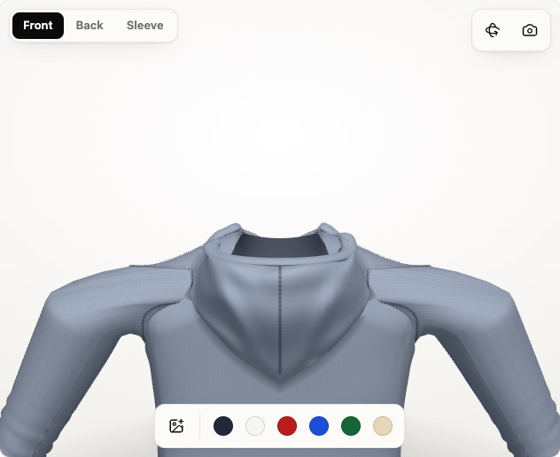
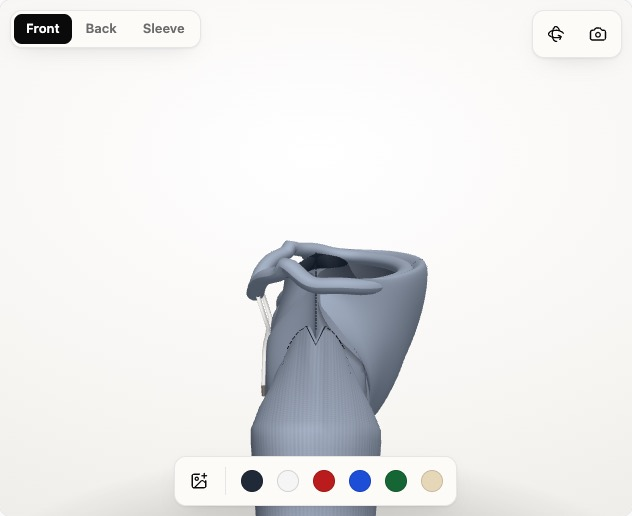
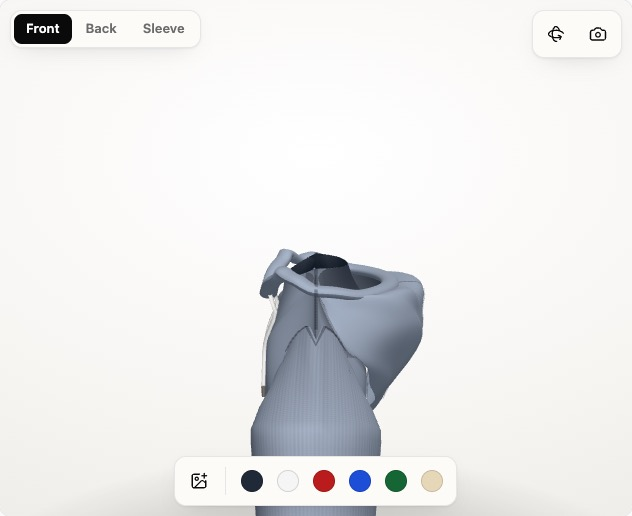
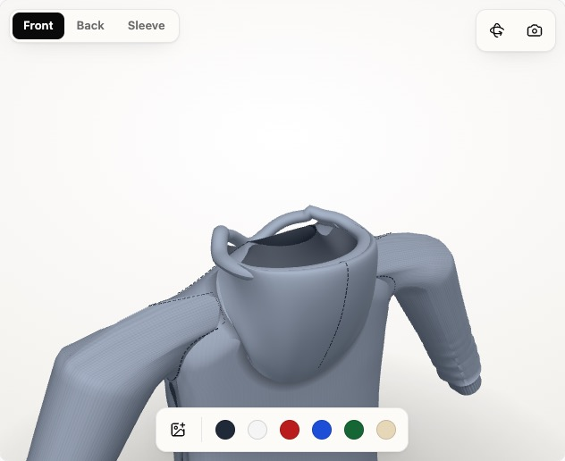
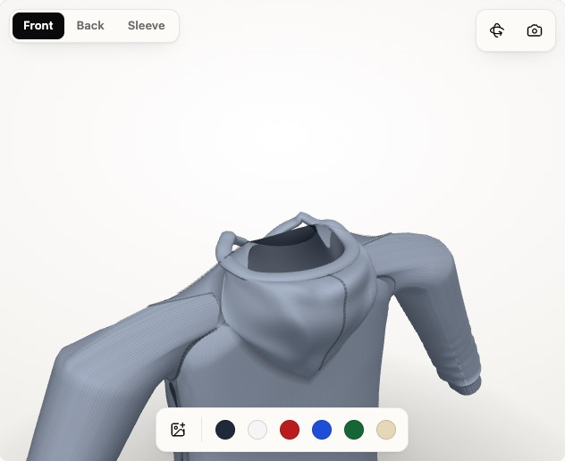

# The hoodie's hood, draped (#4657)

After #4637 the hood lying back read as a hood, but as a moulded bowl: smooth, round-bottomed and standing up like a
vase from the side. Its opening's edge also stood up in loops at the neck. Now (`hood()` in `src/widget/tops.ts`):

- **The shell is slack.** The crown barely rises before it falls back, its sides slump out and down onto the
  shoulders, and it comes down to a soft point instead of a U.
- **It creases where cloth gathers**: just past the lip at the neck and where the point bunches on the back, with two
  long folds running from the neck's sides toward the point. The valleys are sharp and the ridges round.
- **The opening's edge lies down.** It sits on the shoulders' slope, not on top of the neck, its back is pulled in
  toward the neck (no vase lip), and the tube is flatter. Its front sits closer to the chest.
- **Seams are soft grooves.** Every stitch line is now a blended groove with a row of thread dashes either side. It
  used to be one alpha-tested dash row, which stair-stepped up close.

The print zones and UV atlas are untouched. `test/tops.test.ts` passes, including the hood standing more than 0.15 off the back.

| | before | after |
|---|---|---|
| back |  |  |
| side |  |  |
| from above, behind |  |  |

A blind judge was shown both sets as A and B and not told which was new. It scored the new hood 6/10 for soft draped
cloth ("mostly cloth: a few soft creases, its point droops") and the old one 3/10 ("a rigid moulded shell, like plastic
or foam"). Agent judges run about 2 points high, so read this as the direction, not the score. What it still saw: a
hard crease down the centre seam from the side, the shell's wall looking like a stiff sheet there, and drawcords that
read as stiff loops above the neck, with one hanging dead straight.

Same probe recipe as [the #4637 shots](../shots-2026-11-14-hood/README.md), with the "Add your picture" hint hidden
(`e.shadowRoot.querySelectorAll('.hint')`) and the shot cropped to the viewer.
