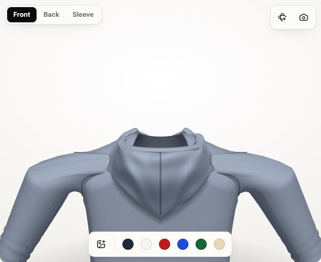
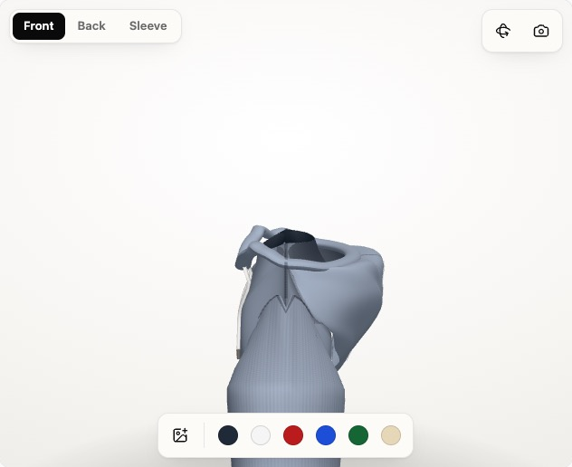
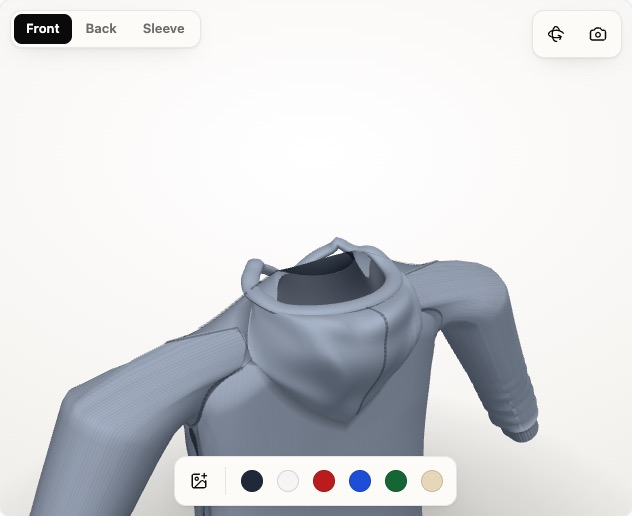
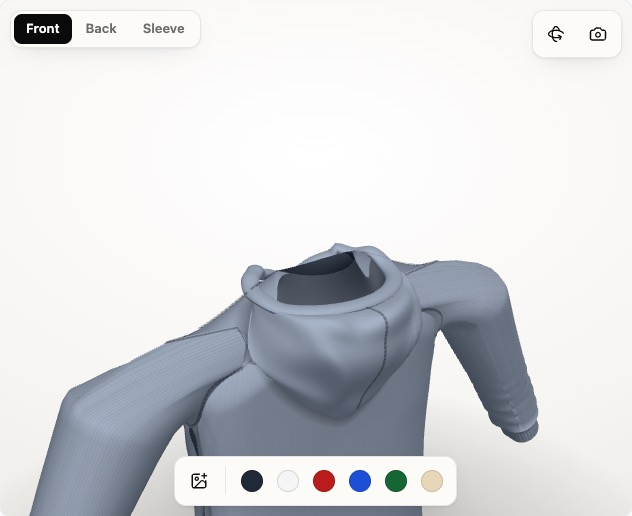
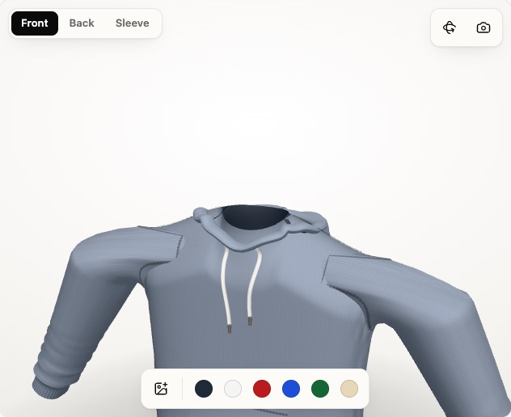

# The hoodie's hood, round 2: neck edge and cords (#4657)

[Round 1](../shots-2026-11-15-drape/README.md) made the hood lying back slack and creased. Its judge still saw stiff
loops above the neck and cords that hung like rods. Now (`hood()` in `src/widget/tops.ts`):

- **The neck edge lies down at the neck's sides.** Before, it rose into a stiff "^" loop above the hood's edge seen from
  above-behind. Its roll is also uneven now, fatter in some places and squashed in others, not an even pipe.
- **The cords lie on the chest.** They come out of the rim's underside, ease down onto the cloth, sway a little and
  hang at different lengths. They are a touch thicker and flatter.
- **The point is rounded at the centre.** The point's shape had a kink there, which made a hard ridge down the seam.
  The middle also drifts a little as it hangs, so the centre seam isn't ruler-straight.

| | before (round 1) | after |
|---|---|---|
| back |  |  |
| side |  |  |
| from above, behind |  |  |
| front |  |  |

Two blind judges were each shown round 1 and this round as A and B. Both scored them about the same for soft cloth
(5/10 each). One said this round looks more like cloth "by a hair": its rim and cords sit flatter. The other called it
a tie and named round 1's stiff loop above the hood edge, which is gone here. So this fixes the loops and the cords,
but not the softness score. What both still see is the rim: a thick, round, moulded-looking tube.
