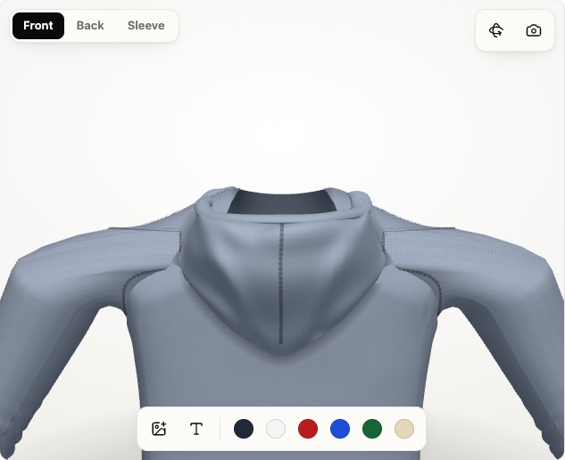
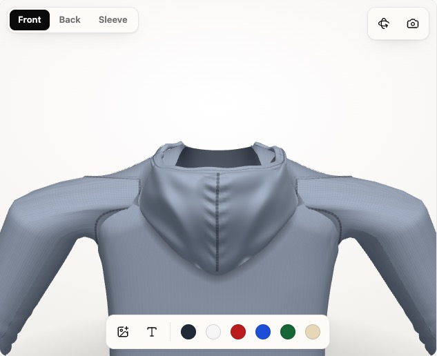
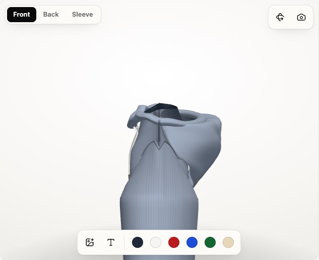
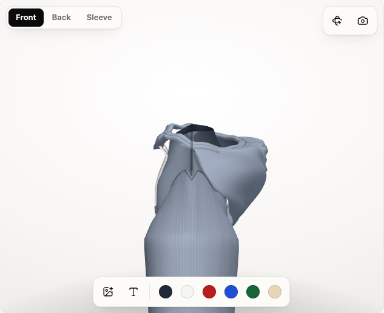
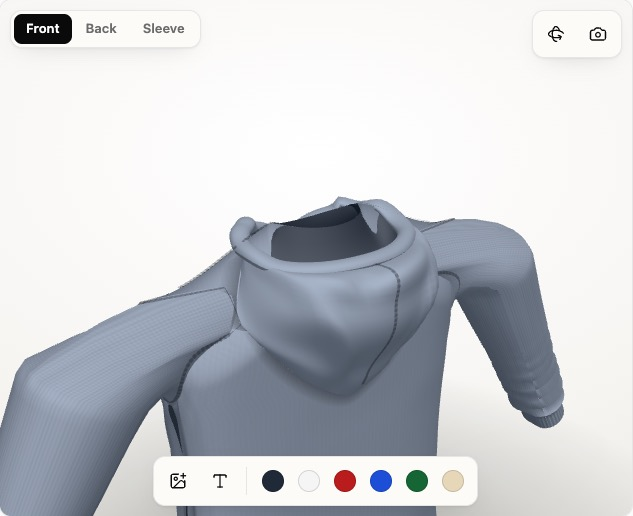
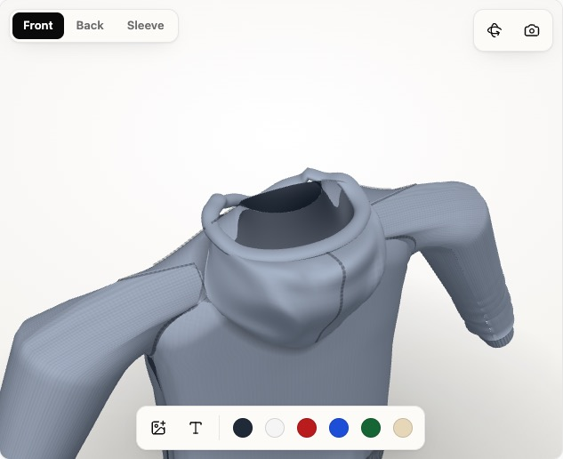
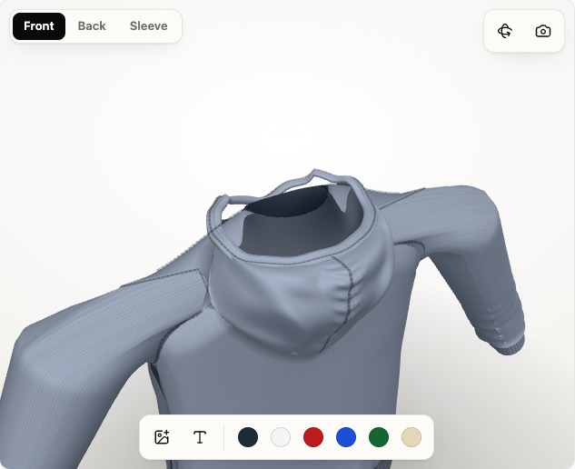

# The hoodie's hood: a flat folded band at the opening (#4657, round 3)

Rounds 1 and 2 ([shots](../shots-2026-11-15-drape/README.md)) made the shell slack and laid its edge down, but two
blind judges still saw the rim round the opening as **a thick, round, even tube**: a moulded collar ring. Real
fleece there is a flat band folded over, with the drawcord's channel showing as a slight ridge. Now (`hood()` and
`bandGeo()` in `src/widget/tops.ts`):

- **The rim is a flat band, not a tube.** Its section is two layers folded over at the opening (a tight round fold),
  about 5 cm across and 2 cm thick. Both faces bulge as lofty fleece does, and it thins late, sloping down to where it
  is sewn to the shell, so it never comes to a wire-thin edge. It is a little wider and
  flatter where it bunches, and it ripples gently along its length.
- **The cord channel is a ridge** just behind the fold, and a row of topstitching runs along the band near its sewn edge.
- **Round the front it sits up on the cloth.** Where no shell or lining joins it from below, a flat band sank into the
  shoulders' cloth (the old tube's height had kept it clear), so it is lifted there, and the cords come out from under it.
- **The centre seam puckers.** Small slanting ripples run off the seam on both sides, where its stitching pulls the
  cloth in. The shell's grid is finer (64 by 48, from 32 by 24) so the ripples resolve.

The tube helper lost its closed-loop and per-point size options; nothing else used them.

| | before | after |
|---|---|---|
| back |  |  |
| side |  |  |
| from above, behind |  |  |
| from higher, behind |  |  |

Two blind judges were each shown both sets as A and B, the labels swapped between them. The first saw an earlier,
1 cm band: it scored main 5 and the band 4, reading it as "a stiff wire or ridge". The band was then thickened to 2 cm
with fuller faces, and the puckers were made deeper. The second judge scored the result 5 and main 4. It called main's
rim "a rigid rolled-plastic collar, the most obvious tell", and the new one "a narrow flat band of cloth with a visible
seam line". Agent judges run about 2 points high, so read that as a step in the right direction, not as "soft cloth".
What it still sees: loops at the opening's top corners that look like stiff wire, and a shell with too few wrinkles
for cloth.

The probe recipe is [round 1's](../shots-2026-11-14-hood/README.md), with the camera closer
(`setFromSphericalCoords(1.7, polar, az)` round `target (0, 0.98, 0)`; polar/az 1.4/3.14 back, 1.4/1.57 side,
1.2/2.5 quarter, 1.0/2.6 higher), the hint hidden and the shot cropped to the viewer (`sips -c 516 633 --cropOffset 84 97`).
