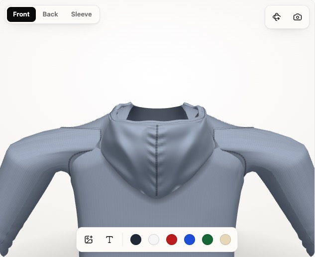
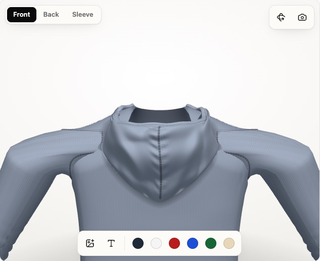
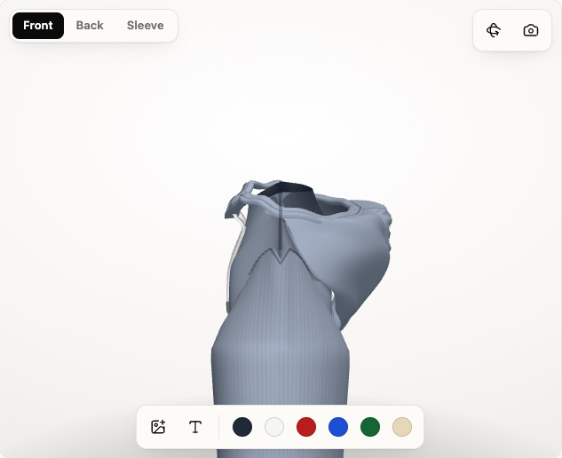
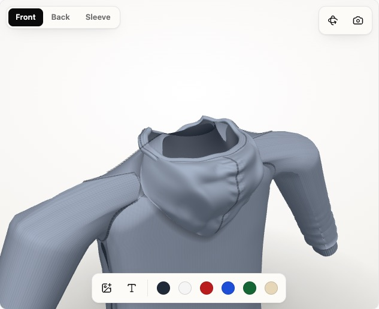
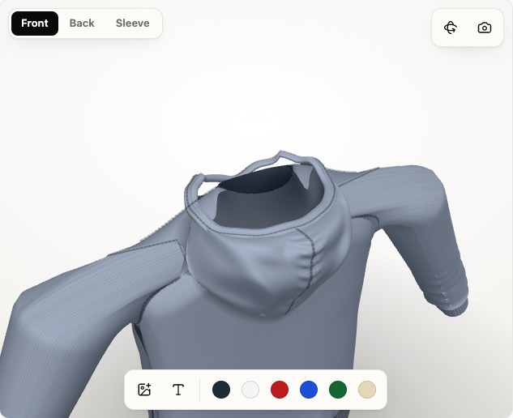
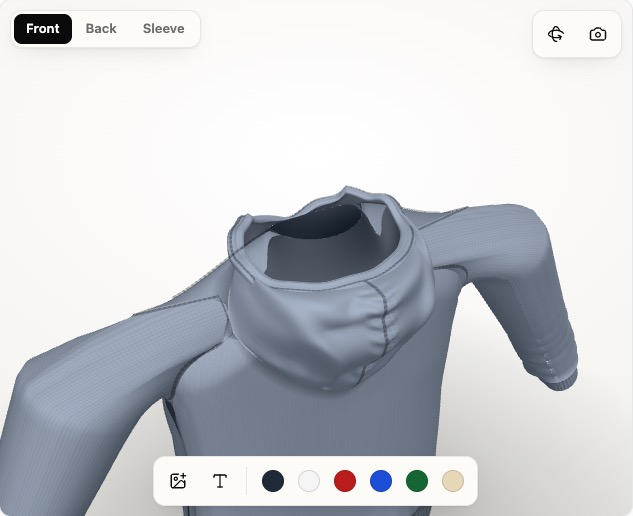

# The hoodie's hood: no wire loops at the corners, more cloth wrinkles (#5126)

After [round 3's flat band](../shots-2026-11-17-band/README.md), a judge still saw thin wire loops at the opening's
top corners, and a shell too smooth for cloth with a dead-straight centre seam. Now (`hood()` in `src/widget/tops.ts`):

- **The band is sewn to cloth all the way round.** The shell and lining joined the band's middle, but round the front
  the band sits up on the cloth (`sitUp`), so at the corners it stood 1 to 2 cm clear of them. Between the shoulders
  and the shell (`|a|` 0.8 to 1.3) nothing joined it at all, and daylight showed under it. Both are now sewn to its
  underside, and the lining runs on round to just short of the front crossing: there it is the hood's side lying on
  the shoulder, the hood's colour outside and the inside's shade within. Seen from behind, the front crossing has
  cloth under it, so it no longer reads as a strap over the neck.
- **More, softer wrinkles.** Where the sides rest on the shoulders, a few uneven folds run down and in toward the
  point (their line, depth and spacing wander), and a couple of broad shallow ones cross the middle. The centre seam
  meanders gently instead of running ruler-straight.

`test/tops.test.ts` checks that every part of the band from the corners back has hood cloth within 6 mm.

| | before | after |
|---|---|---|
| back |  |  |
| side |  |  |
| from above, behind |  |  |
| from higher, behind |  |  |

The probe recipe is [round 3's](../shots-2026-11-17-band/README.md).
