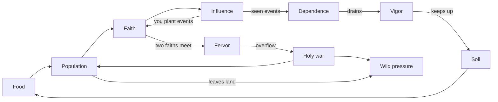

# Game idea 4: Branch of Influence

Working title, and probably the real one. A real-time pixel sim for 2 to 6 players. Each player is
a rival **Influence**: an unseen power with followers. You start looking down on one city, where people
are a few pixels tall. Followers make influence for you, and influence leaks all the time. Hold
enough and you can zoom out, from the city to its region, a land, the world, its sky and the stars,
and the clock speeds up as you go. Fall below and the view pulls back in.

You never click a unit. You **plant events in time**: a prophecy for year 340, a plague held back
twenty years, an idea that sprouts in eighty. Rival faiths meet, convert each other, split and go to
holy war. Every game writes into the world's git repo for good, and the **branch** in the name is a
branch of time: the winner of a holy war decides which timeline is the real one.

Every rate in the world is a leaky bucket: something filling it, something draining it, and a curve
for each. The constants are rolled from the world's seed and bent by every game played on it, so no
two worlds play the same.

### What changed from draft 1 (owner's calls, 2026-11-20)

| Draft 1 | Now |
|---|---|
| One player, a god-like influence | 2 to 6 rival Influences, multiplayer from the start (Qollab rooms, eqosys accounts). Solo is a room with AI rivals |
| Influence drawn as a literal tree's branches | No tree. The "branch" is a branch of time: events you plant, timelines that split and merge |
| Your reach only shrinks | You earn reach by holding influence, which unlocks zooming out. It leaks, so stop earning and the view closes back in |
| Start on a wide valley map | Start on one city, people a few pixels tall, RTS-style |
| A few nature miracles | Events planted in time, and holy wars between rival faiths |
| Peoples | Unchanged: ways of living, not real nations, with real history only as design notes |

## Pillars

1. **Steer, don't command.** You never click a unit. You plant events and raise omens, and crowds
   decide. Every visible act makes your followers lean on you a little more.
2. **Reach is earned and leaks.** Holding influence lets you see and act wider. Stop earning and
   the world closes back in on you.
3. **Everything is a bucket.** Food, faith, fervor, plague, soil, climate: each fills and drains
   on its own curve. The drama is in what happens when one overflows or runs dry.
4. **Time is the board.** The best moves are placed in the future: prophecies, delays, seeds.
5. **The world remembers.** It is a real repo, not a save slot. Each game leaves marks every later
   game on that world (or any fork of it) has to live with.
6. **The Wild wins by default.** Land nobody works goes back to grass, scrub and forest. A city its
   Influence gave up on is a forest in three hundred years.

---

## 1. The loop

1. **Watch** your followers live. Crowds walk, farm, build, trade and pray on their own.
2. **Earn** influence from the faith of people who follow you. It leaks every tick.
3. **Plant** events in time: now, or years ahead. They cost influence, and seen ones add dependence.
4. **Collide** with rival faiths at your borders. Fervor builds. Convert them, or let it boil
   over into holy war.
5. **Zoom out** when your influence is high enough. The clock speeds up, and the whole city
   becomes a few pixels on a bigger map.
6. **Leave marks** at the end of each age: the calendar, a founding creed, saints, sealed
   prophecies. They are commits, and they stay in the world.

## 2. Zoom is reach, and reach sets the clock

You start on the City tier. Each tier above it costs a level of influence to open and to keep.
When your influence drops under a tier's level, your view snaps back one step, and anything you
had planted out there carries on without you.

| Tier | You see | A person is | A tile is | Clock | 30 minutes is about |
|---|---|---|---|---|---|
| City | one city and its fields | 2-3 px, single sprites | 10 m | 1 week / s | 35 years |
| Region | a few towns, roads, a river | a dot; crowds read as blobs | 100 m | 1 month / s | 150 years |
| Land | a whole land and its peoples | gone; towns are a few px | 1 km | 1 season / s | 450 years |
| World | one planet (Epoch II) | - | 100 km | 1 year / s | 1,800 years |
| Sky | planet, moons, orbits | - | a body | 10 years / s | 18,000 years |
| Stars | a cluster of systems (Epoch III) | - | a system | 50 years / s | - |

Region is where you watch a city you stopped caring about turn back into forest.

**One clock for everyone.** In a shared world the clock runs at the speed of the highest tier any
player holds. Time is the leader's tax: a faster clock drains everyone's buckets faster, and the
leader has the most to lose. Anyone can pay for a **Moment** (below) to slow the whole world to day
speed for a battle or a birth, and keep paying to hold it.

The zoom works like a map. You can always zoom back into any tile you can see, but you only *act*
at your tier or below, and events are sized for the tier: a City event moves a crowd, a Land event
moves a river.

## 3. Everything is a leaky bucket

Every quantity in the sim is the same small thing:

```
bucket = { level, capacity, inflow(level, world), leak(level, world), onFull, onEmpty }
```

The curve of each inflow and leak is one of a few shapes, and the shape is the personality:

| Shape | Formula feel | Feels like |
|---|---|---|
| Flat | constant per tick | Rations, upkeep |
| Linear | rate times level | Interest; leaks faster the fuller it is |
| Log | fast at first, then less and less | Learning, faith from repeated sightings |
| Exponential | grows on itself until it hits the cap | Trade wealth, fervor, plague, rumors |
| Logistic (S) | slow, fast, then flat at capacity | Population, a forest filling a field |
| Threshold | nothing until a level, then a jump | Revolt, schism, a city founding |
| Seasonal | rises and falls with the year | Harvest, floods, pilgrimages |

**The buckets** (per people unless it says otherwise):

| Bucket | Fills from | Drains by | Overflows into | Empties into |
|---|---|---|---|---|
| **Influence** (per player) | followers' faith (linear) | flat leak that grows with your tier | nothing: hold it to keep your zoom | view snaps back a tier |
| **Faith** (per people, per player) | events they see (log), legends, saints | time (linear), rival preaching | converts the neighbours | the people drops you |
| **Dependence** (per people, per player) | every event they *see* you do | slow (log) | Vigor leaks faster | - |
| **Vigor** | need: hunger, threat, hardship | comfort, dependence (linear) | wonders, expansion | upkeep fails, decay starts |
| **Population** | food surplus (logistic) | hunger, plague, war | new town founded | the people is gone (a `git rm`) |
| **Food** | fields times soil times season | eating (flat per person), rot | stores, trade | famine, Unrest pulse |
| **Soil** | fallow years, floods (slow) | every farmed season | - | fields turn to dust: the Wild moves in |
| **Memory** | scribes, trade, saints (log) | collapse (a threshold drop) | a new age's techs | a dark age |
| **Wealth** | trade (exponential while routes hold) | upkeep, war | wonders | routes close |
| **Unrest** | hunger, mixed faiths, wealth gaps | festivals, Vigor | revolt or **schism** (a faith splits) | - |
| **Fervor** (per border) | two faiths touching (exponential) | conversion, distance | **holy war** | border goes quiet |
| **Plague** | crowding, trade routes (exponential) | herbalists, time | spreads to neighbours | gone, leaves Memory of it |
| **Wild pressure** (per tile) | nobody working it | farming, building | grass, scrub, forest (logistic) | - |
| **Climate** (world) | industry, burning forest (slow, huge) | forest cover | droughts, floods, ice everywhere | - |
| **Legend** (per event) | retelling (log) | time | the event becomes a saint or a holy day | forgotten |

**Why no two playthroughs match:** each world's seed rolls every curve's constants inside a band
(food rot 0.8 to 1.2, faith leak, fervor growth...). Exponential buckets turn small differences
into big ones within a few decades, and legacy marks shift the bands for good. One world rots food
fast and its peoples live by trade; another keeps faith long and holy wars come early.



**Engineering note:** buckets use whole-number fixed-point math, never floats, so every player's
browser computes exactly the same world. That is what makes multiplayer cheap (section 7).

## 4. Bending time: events you plant

An event is data, not code: `{ bucket, shape, size, delay, duration, where, seen }`. A plague is
a pulse into Plague; a prophecy is a promise checked at a tick; a seed is an inflow that starts
later. Because events are data, new kinds can be written into a world's repo and played by
everyone who forks it.

| Event | What it does | The catch |
|---|---|---|
| **Prophecy** | Name a thing and a year ("the river will move before 340"). If it comes true, faith in you multiplies | If it fails, faith crashes. Rivals will work to break it |
| **Seed** | Plant an idea or a tech; it sprouts years later, somewhere in your faith | You don't pick where it lands |
| **Delay** | Hold back a coming plague, famine or migration | It arrives bigger: delay charges interest |
| **Hasten** | Pull an event forward | It arrives smaller, and you spend more |
| **Echo** | Repeat an event from the chronicle (the great flood returns) | Echoes fade with each repeat |
| **Ripple** | A tiny nudge into an exponential bucket | Cheap and slow, and nobody controls where it ends |
| **Dam** | Stop a bucket draining for a while | When the dam breaks, it all goes at once |
| **Floodgate** | Empty a bucket on purpose, now | Seen by everyone |
| **Omen** | A sign crowds walk toward: the RTS rally point | Followers who chase omens chase rivals' omens too |
| **Moment** | Slow the shared clock to day speed | Costs influence every second you hold it |
| **Fixed Point** | Lock a moment: no one can branch from before it | Very costly; it also locks your own mistakes |
| **Fork** | Split the timeline now. Players pick a side and play their branch | The branches meet again later, and only one stays canon |
| **Rewind** | Branch from an earlier commit and play from there | The timeline you left becomes a ghost branch anyone can visit |

**Seen or hidden.** An event people see gives faith and dependence. A hidden one costs three times
as much and gives neither: the rain just comes. That is the old pillar kept: the best Influence is
the one its people barely notice.

## 5. Legacy marks: our own ways to stamp a world

Each one is a commit to the world repo. None copies the board-game mechanics this idea grew from;
they come from what this world already has (faiths, a calendar, timelines).

| Mark | When | What stays forever |
|---|---|---|
| **The Calendar** | The strongest Influence at an age's end | Picks the event the world counts years from. Every later game dates things "Year 312 after the Drowning of Ash" |
| **Founding Creed** | Your faith first holds a whole region | You write one law for that region from a deck of rule changes (fire spreads faster, wells run deeper, the dead are buried in the fields) |
| **Canon Rights** | You win a holy war across a Fork | You decide which branch is the trunk. The loser's timeline isn't deleted; it becomes a branch anyone can play from |
| **Saints** | A follower does something huge (holds a pass, ends a plague) | A named saint file. In later games they are born again, loyal to whichever faith finds them first |
| **Sealed Prophecies** | Each player at game end | Writes one prophecy with a trigger ("the first time any people crosses the sea"). It waits sealed in the repo and fires in some later game, maybe in someone else's fork |
| **Sacred and Cursed Ground** | Big battles and big events | The tiles keep a bucket modifier: crops fail on the field of the Ten-Year War |
| **Pilgrim Roads** | Paths crowds walk often | Become roads in the base map |
| **Schisms** | A faith splits on Unrest overflow | The new faith is its own file. A player can take it up in the next game |
| **Relics** | Wonders and ruins | Stay in the map. Digging one up restores a bucket from an old commit |
| **Myths** | A faith with no followers left | Becomes a myth. Anyone can revive it, at great cost |
| **Fossil Laws** | A rule change that survives two ages | Can't be changed by a Founding Creed any more, only worn down slowly |
| **Your Name** | Always | Your Influence's name, sigil and record live on your eqosys account across every world. Peoples in a forked world still tell stories about you |

## 6. Faiths and holy wars

- Every Influence has a faith: a name, a sigil, a colour and a few tenets (picked from a deck,
  so faiths play differently). All made up; no real religion appears anywhere.
- Each people carries a Faith bucket per Influence. The biggest one is its creed. A people split
  between faiths gains Unrest.
- Where two creeds touch, Fervor fills. You can drain it with conversion (preachers, festivals,
  shared saints) or let it overflow into **holy war**.
- Holy war is crowds: a few hundred pixels marching under your Omens, towns changing colour,
  smoke over fields. No gore. War burns Vigor and Population and feeds the Wild, so the winner of a
  long war often rules a forest.
- Winning in a shared world: at each age's end, followers times tier, with a **Light Hand** bonus
  for the most followers per influence spent. The campaign ends at Last Light; a faith that has
  died out can still win on marks left in the world.

## 7. Multiplayer from day one: Qollab and eqosys

Qollab is the multiplayer layer (rooms, seats, reconnect, late join, chat), eqosys is the account.
The game keeps its own tick and sync.

- **eqosys:** sign in once. Your Influence (name, sigil, faith tenets, record) and your library of
  worlds hang off your account. Friends come from there too.
- **Qollab:** a party opens a room for one world session. 2 to 6 seats for Influences, plus
  spectators. Reconnect and late join are Qollab's job; chat too.
- **Sync: deterministic lockstep.** The room (the game's own Durable Object) only orders the
  players' event casts and stamps each with a tick. Every browser runs the same integer sim, so the
  server never simulates the world, and a room costs almost nothing. A checksum every few hundred
  ticks catches drift.
- **Late join:** load the world's last commit, replay the session log.
- **Between sessions nothing runs.** A world is just its repo when nobody's in it: no server
  ticking all night, no bill. The next session picks up where the last commit left it.
- **Solo** is a room with one seat and AI Influences (simple scripted rivals to start).
- **Async play** comes free from the repo: fork a friend's world, play your timeline, send it back
  as a merge.

## 8. The world is a repo

The world lives in a Cloudflare Artifact (git). These are the ways a game rewrites it:

| What changes | Git | In the game |
|---|---|---|
| Map scars, roads, ruins | commit `map/` | The next game starts with them |
| Founding Creeds, Fossil Laws | commit `rules/` | Laws of this world |
| A people dies out | `git rm peoples/<id>.json` | Still in history |
| Digging up a relic | `git checkout <old> -- ...` | An old bucket state comes back |
| Fork, Rewind | `git branch timeline/<name>` | Both histories exist |
| Canon Rights | move `trunk` | The losing side stays as a branch |
| Ages | `git tag age/<n>` | Chapter marks |
| "When did this faith start to die?" | `git bisect` over replays | A costly event names the year |
| "Who made this desert?" | `git blame` on a tile | Shows which faith or which event |
| Two timelines meet | `git merge` (through Mervin) | Conflicts happen in the world: two creeds claim one city |
| New event kinds | commit `events/` | Everyone who forks the world can play them |
| The chronicle | pull request from a cheap model | Written from the commit log |

**CI is the laws of physics.** Each world has an invariant suite (buckets stay bounded, someone can
still survive, the map stays connected). Nothing merges into a world's trunk unless it passes.
**No game ever runs code from a world:** rules and events are JSON read through guards
(`@rustybuns/util/guard`), and peoples' habits are a tiny step-limited rule language. A stranger's
world is only data.

**Seed + log = the whole world.** The base map grows from a seed. After that the repo stores
choices (event casts with tick and target) and commits at legacy moments, not frames. Any commit
replays to any year, which is what makes bisect, blame, late join and forks cheap.

```
world.json            seed, name, calendar, current epoch and age, bucket constants
rules/                laws: growth, fire, decay, buckets.json (the curve bands)
map/                  terrain per chunk, ruins, roads, sacred ground
peoples/<id>.json     traits, roster, buckets; <id>.rules habit script
faiths/<id>.json      sigil, tenets, schisms, myths
saints/  relics/      named people and things
events/               event kinds this world knows
prophecies/           sealed prophecies and their triggers
chronicle/<age>.md    the written history
log/<session>.jsonl   event casts per tick: enough to replay
laws.test.json        the invariants a commit must pass
```

## 9. Time and the ages

15,000 years in three epochs of about 5,000: the human story we know, then one world and its sky,
then the stars. About 25 sessions of 30 to 60 minutes, one age each. Big moments slow the clock by
themselves; anyone can pay for a Moment.

**Ecology clock**, an abandoned field back to old forest (a range per tile, so it looks patchy and
creeps in from the edge): grass in 2-5 years, scrub in 10-30, young forest in 30-80, old forest in
150-300. Ruins stay under the canopy.

| Epoch | Ages |
|---|---|
| I, Earthbound (about -3000 to 2000) | 1 Kindling, 2 Furrow, 3 Crown, 4 Bronze Road, 5 Long Faith, 6 Sail & Script, 7 Powder & Press, 8 Steam, 9 Wire & Signal |
| II, Worldbound (2000 to 7000) | 10 Satellite, 11 Moonrise, 12 Inner Worlds, 13 The Belt, 14 Giants' Moons, 15 Sunshade, 16 Long Haul, 17 The Leaving |
| III, Starbound (7000 to 12000) | 18 First Light, 19 Seeding, 20 Swarm, 21 The Lattice, 22 Drift, 23 Long Silence, 24 Return Signal, 25 Last Light |

From Long Faith on, peoples grow faiths of their own that compete with every player's. From Steam
on, industry beats the Wild back faster than ever and fills the Climate bucket.

## 10. The peoples

Ways of living, not nations; the seed picks which a world gets. Each has five unit lines, a few
pixels each, that change look and job each age.

| Epoch I | Units | Lives by / breaks by | Epoch II | Epoch III |
|---|---|---|---|---|
| **River Folk** | Tiller, Canal-digger, Scribe, Granary Keeper, River Guard | flood farming, writing / drought, salt soil | Arcologists | Lattice |
| **Steppe Riders** | Herder, Outrider, Yurt-raiser, Storyteller, Horse Lord | herds, speed / overgrazing, hard winters | Ring Nomads | Swarm Dwellers |
| **Sea Traders** | Fisher, Shipwright, Merchant, Navigator, Harbour Watch | trade spreads Memory / storms, a partner's fall | Signal Guilds | Lattice, Couriers |
| **Forest Keepers** | Forager, Ranger, Grove Speaker, Herbalist, Bark Warden | living with the Wild / others cutting it | Greenwrights | Seed Clades |
| **Mountain Terracers** | Terracer, Miner, Mason, Pass Warden, Star-watcher | terraces, metal / quakes, steep decay | Deep Delvers | Swarm Dwellers |
| **Desert Caravaners** | Well-digger, Caravan Master, Salt Trader, Dune Scout, Oasis Keeper | linking peoples / wells drying | Sun Farmers | Star Tenders |
| **Island Navigators** | Wayfinder, Canoe-builder, Fisher, Chant-keeper, Reef Tender | settling empty islands / running out of trees | Void Sailors | Lightsail Couriers |
| **Ice Hunters** | Hunter, Sled-runner, Snow-builder, Lore-keeper, Ice Watcher | almost nothing breaks them | Cold Keepers | Swarm Dwellers |
| **The Wild** (not a people) | Seedling, Grass, Thicket, Forest, Swamp, Dune, Glacier, beasts | takes any tile nobody works | the planet's health | The Quiet |

Peoples merge (a new file with both parents in its history), split when they grow too wide, and
die out (a delete). A world with four starting peoples might reach Epoch II with ten, or one.

## 11. Build order (each step playable)

| Step | What ships | Proof |
|---|---|---|
| 1 | **One city.** Buckets, pixel crowds that farm and build, decay to ruins, the Wild coming back, the City and Region clocks | Headless: a city nobody helps is forest within 300 years. `window.branchOfInfluence.state()` and a `probe` row |
| 2 | **Two Influences, one screen.** Faith and dependence per player, Omens, a first six events, Fervor and a small holy war. AI rival | A run where the side that acts least still holds more followers |
| 3 | **Lockstep in a Qollab room**, signed in through eqosys. Two browsers, one world | Same checksum on both after 10,000 ticks; late join catches up |
| 4 | **Zoom tiers** and the shared clock | Gaining influence opens Region; losing it snaps back |
| 5 | **The world is a repo.** Commit at session end, Fork and Rewind, replay from seed + log | A replayed commit matches bit for bit |
| 6 | **Legacy marks**: Calendar, Founding Creed, Saints, Sealed Prophecies; the world's laws suite | A creed that breaks the laws is turned away |
| 7 | **Artifacts**: worlds in Cloudflare Artifacts (codeSplitter's code), share and fork as links, merges through Mervin | Two friends' forks merged, conflicts as events |
| 8 | All eight peoples, ages 1-9, Land tier | A full Epoch I campaign |
| 9 | Epochs II and III, World / Sky / Stars tiers | The land folds into a planet tile |

Steps 1-3 are the game. 5-7 are what make it this game.

## 12. Still open

1. **Players per world:** 2 to 6 rivals, or bigger worlds with teams?
2. **Holy war tone:** crowds and colours with no gore, as above. Is that the level?
3. **Fork in multiplayer:** do players on different branches play at the same time (two rooms,
   one world), or one branch per session?
4. **Pixel scale:** 8 x 8 or 16 x 16 tiles at City tier?
5. **Where it runs:** web canvas first, desktop through Rusty Buns later?

---

## Appendix: the real-history patterns behind each people (design notes only)

| People | Pattern | Seen in (broadly) |
|---|---|---|
| River Folk | Flood farming states that rise fast and fall to drought and salt | The early river valley states of the Near East, the Nile, the Indus, the Yellow River |
| Steppe Riders | Mobile herders who sweep across wide grassland | The peoples of the Eurasian steppe across 4,000 years |
| Sea Traders | Ports linked by sea routes, spreading goods and writing | Eastern Mediterranean traders, the Swahili coast, North Sea and Baltic trading towns, Indian Ocean ports |
| Forest Keepers | Living in and with forest, with managed gardens | Amazon and Congo basin peoples, early woodland Europe and North America |
| Mountain Terracers | Terraces, stone, mountain roads | The Andes, the Himalaya, highland Ethiopia, terraced Southeast Asian hills |
| Desert Caravaners | Oases joined by caravan routes | Saharan and Arabian routes, the overland silk routes |
| Island Navigators | Open-ocean voyaging by stars and swells | The Pacific voyagers, the Austronesian spread |
| Ice Hunters | Small, mobile groups in the far north | Arctic peoples across the polar rim |
