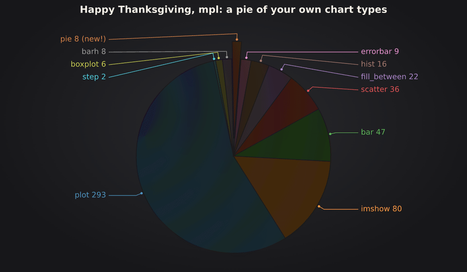

# A pie of mpl's chart types, drawn with mpl's pie

[mpl](https://github.com/ivarvong/mpl) is a TypeScript rewrite of matplotlib. We asked for pie charts in time for
Thanksgiving, and [#85](https://github.com/ivarvong/mpl/pull/85) added them. So here's a pie of the chart types in
mpl's own code, drawn with its new `ax.pie`.



Each slice is how many of mpl's 426 pixel-exact reference fixtures (`fixtures/ref/*.json`) call that chart type.
A fixture with a line and a bar counts once for each. Pie has 8 so far, all from #85, and its slice is pulled out.

- `pie.png`: the plain chart, straight from mpl's `toPNG()`.
- `oilslick.html`: mpl's `toSVG()` on a dark page, with a faint oil-slick rainbow and a sliding sheen masked to the
  slices (a second SVG of the slices alone is the mask). CSS only; open it in a browser.
- `oilslick.gif`: that page recorded. Every animation steps to an exact time per frame, and the 8 s loop has no seam.

```sh
bun notes/mpl-pie/pie.ts          # clones mpl at the pinned commit into a temp folder, counts, writes pie.png + oilslick.html
bun notes/mpl-pie/pie.ts --gif    # also records oilslick.gif (headless Chrome + ffmpeg, about 2 minutes)
```

mpl isn't on npm, so the script imports mpl's source from that clone. Nothing is added to our lockfile.
