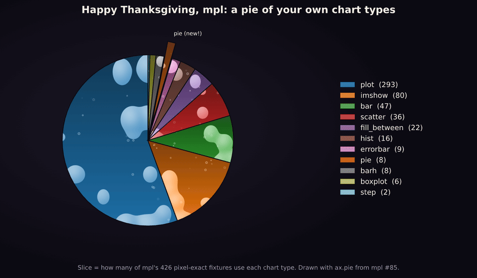

# A pie of mpl's chart types, drawn with mpl's pie

[mpl](https://github.com/ivarvong/mpl) is a TypeScript rewrite of matplotlib. We asked for pie charts in time for
Thanksgiving, and [#85](https://github.com/ivarvong/mpl/pull/85) added them. So here's a pie of the chart types in
mpl's own code, drawn with its new `ax.pie`.



Each slice is how many of mpl's 426 pixel-exact reference fixtures (`fixtures/ref/*.json`) call that chart type.
A fixture with a line and a bar counts once for each. Pie has 8 so far, all from #85, and its slice is pulled out.
The look is Cloudflare's oranges, brighter for bigger, as a donut with the fixture count in the hole. The three big slices
carry their names inside; the eight small ones are a count-and-name table down the right, each with a leader.

- `pie.png`: the chart, straight from mpl's `toPNG()`.
- `oilslick.html`: mpl's `toSVG()` with one slow warm sheen sweeping across the slices, masked to them (a second SVG
  of the slices alone is the mask). CSS only; open it in a browser. `oilslick.gif` is it recorded.
- `lavalamp.svg`: one animated SVG (SMIL, no script; open it in a browser, it scales to any size). In each slice,
  pale wax rises, stretches, merges (a blur + threshold goo filter) and sinks, while an air bubbler sends slow, steady
  streams of bubbles up from the floor, clipped to
  the slice under the labels. `lavalamp.gif` is it recorded for chat apps; the code is `lavalamp.ts`.

Both GIFs step every animation to an exact time per frame, so their loops (8 s and 12 s) have no seam, and each GIF's
palette is built with the chart's colours in it so they don't drift.

```sh
bun notes/mpl-pie/pie.ts          # clones mpl at the pinned commit into a temp folder, counts, writes pie.png, oilslick.html, lavalamp.svg
bun notes/mpl-pie/pie.ts --gif    # also records oilslick.gif and lavalamp.gif (headless Chrome + ffmpeg, 2 minutes each; --gif=lavalamp for one)
```

mpl isn't on npm, so the script imports mpl's source from that clone. Nothing is added to our lockfile.
