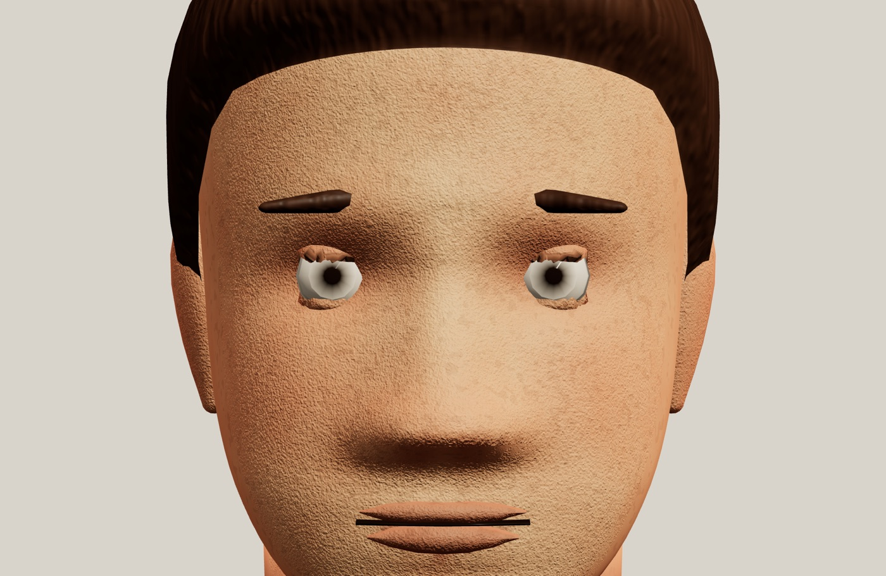
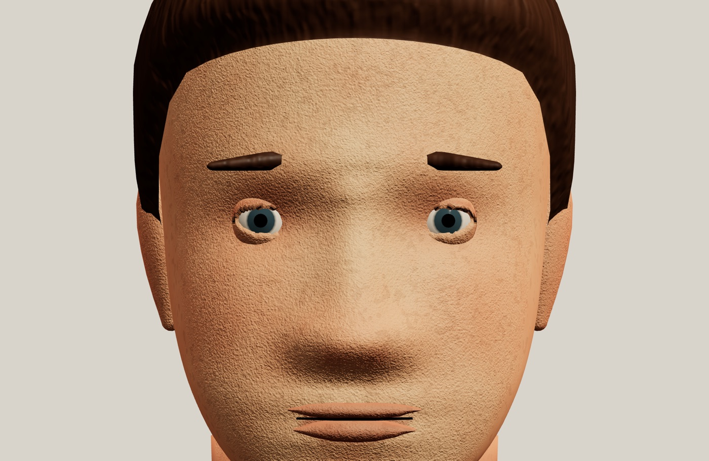
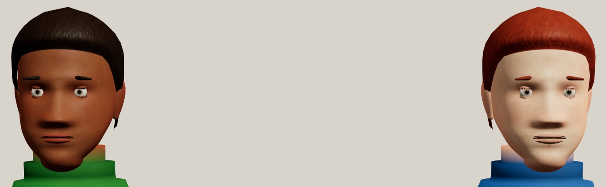
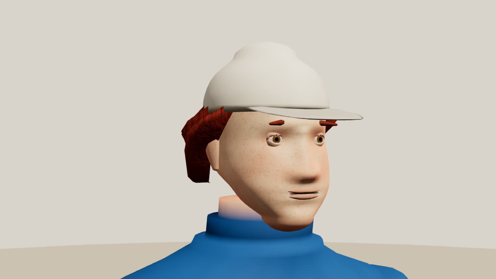

# Faces, round 2 of the people climb (#5716), 2026-11-25

`human()` in `packages/models/src/human.ts`, shot from `bun packages/models/scratch/humans/serve.ts` with
`bun scripts/probe.ts --url http://localhost:<port>/ --js '__humans.only(["average"]); __humans.view("face")' --shot x.png`.

- **A face of its own.** `Face` (jaw, chin, nose length and width, brow, cheekbones, lips, eye size and spacing, each -1
  to 1) sits beside `Build`. `human(build, outfit, palette, seed, face?)` takes it from the seed by default
  (`faceOf(seed)`), so two people of one build look different and one person keeps their face. An eye colour comes from
  the seed too, unless the palette names `iris`.
- **Eyes that look out.** A coloured iris round a black `pupil` (a new slot), under almond lids: the upper lid covers the
  top of the iris, the lower one meets its bottom, with a dark lash line along the top edge. The sockets are shallower,
  so the lids don't stand in a pit, and each ball turns a little toward the temple.
- **Nose.** The tip rounds under into the nostrils instead of ending in a ledge, with a crease round each wing.

| Before | Now |
| --- | --- |
|  |  |
|  |  |
|  |  |

Fresh judge, against the owner's Xbox 360 bar: BEFORE 1.5/10, NOW 2/10. The climb starts at half the judge's BEFORE
(0.75) and takes half the gain (+0.25): **1/10**. The judge's top gaps: the nose (a smear: no bridge, alae or nostril
holes), the mouth (two flat slivers with a black line: no cupid's bow, philtrum, tucked corners or chin crease), then the
brows (solid sausages off the skin) and the lids (no crease, no tear duct).
