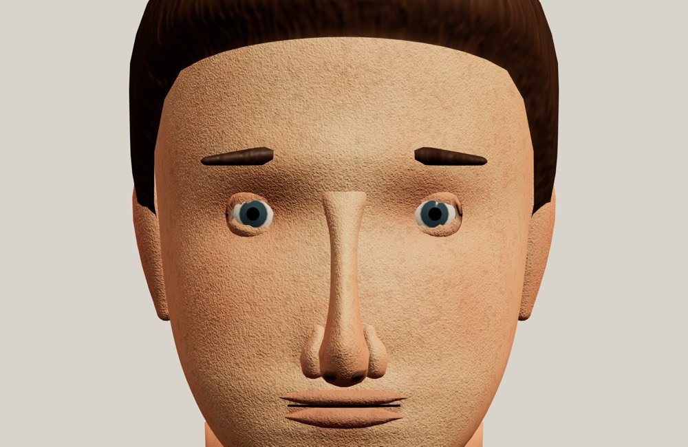
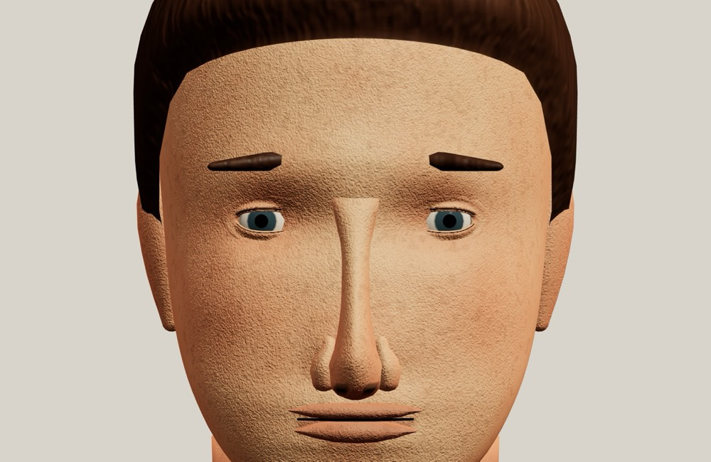
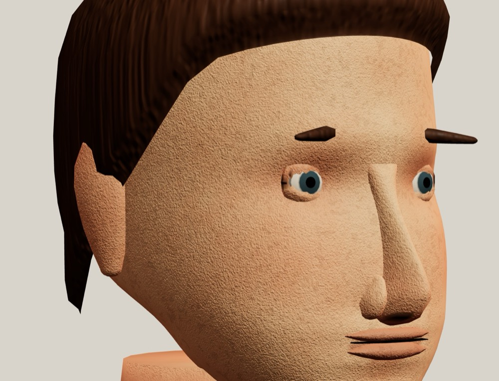
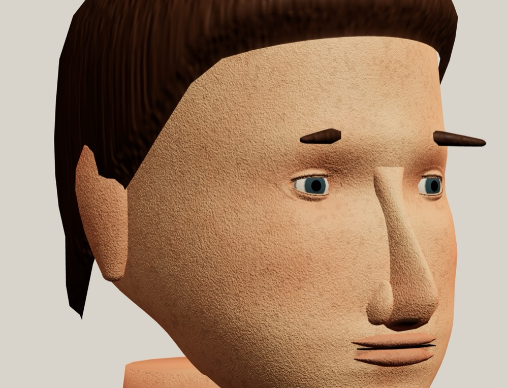
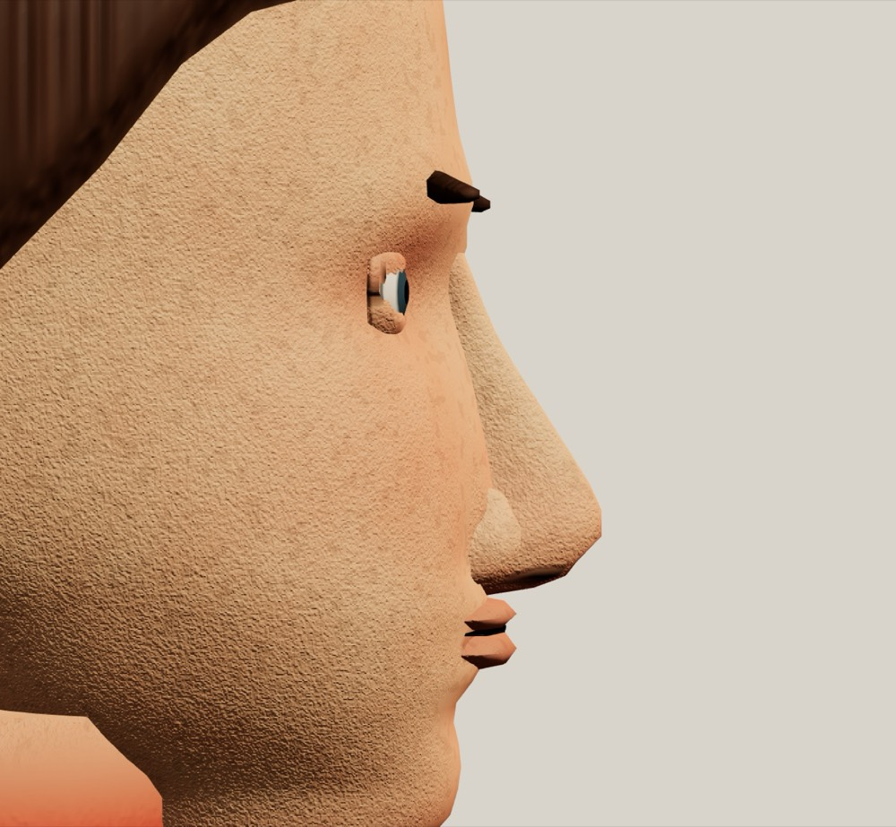
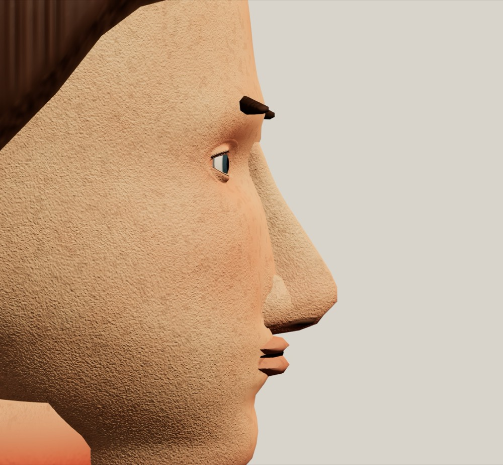

# The eyes and lids, round 4 of the people climb (#6036), 2026-11-26

`human()` in `packages/models/src/human.ts`, shot from `bun packages/models/scratch/humans/serve.ts` with
`bun scripts/probe.ts --url http://localhost:<port>/ --size 5120x2880 --js '__humans.only(["average"]); __humans.view("face"); __humans.turn(t)' --shot x.png`
at a turn of 0, 35 and 80 degrees.

- **Why the old eye looked like a ball in a hole.** The skull's rings are about 4.4 mm apart, so only two of them
  cross the eye. The old lid was a shell over the ball, and wherever it met the skin it met it almost flat. The coarse
  skull triangles then cut a round, torn edge round each eye.
- **Lids built as rings round the opening.** The lids are now a `sheet()` of 14 rings by 44 points. Each ring is
  the almond opening grown a little, from just behind the ball's front (so the edge tucks in) out to where the lid
  goes under the face. Near the edge the lid is a shell over the ball. The upper lid covers the top of the iris and
  folds into a crease with the skin under the brow over it. The lower lid is the same, narrower. Further out the lid
  lies just off the face (`surf()`, which now follows the skull's superellipse sideways and not only at the centre
  line) and then dives gently under it. The lid's own fine points draw the eye, and it meets the face along a clean
  line with the face's own tone.
- **The opening.** An almond, wider than tall: the upper edge peaks a little toward the nose, the lower one dips a
  little toward the temple, and the outer corner sits a touch higher than the inner one. There is a dark lash line
  along the top and a fainter one along the bottom.
- **The socket.** It is an almond too, with the outer end of the brow ridge over the eye's corner, a cheekbone under
  its outer half, soft fullness under the lower lid, and skin that wraps the outer corner over the ball.
- **The tear duct.** A small mound in the inner corner. It takes the lips colour, which is close to the skin's, so it
  barely shows.
- 15,120 to 16,848 triangles a figure (+1,728) in a tee and short hair.

| Before | Now |
| --- | --- |
|  |  |
|  |  |
|  |  |

A fresh judge, against the owner's Xbox 360 bar: BEFORE 1.5/10, NOW 2/10. The climb takes half the gain (+0.25):
**1.5/10**. The judge says the eyes "finally read as human". Its top gaps now: the mouth (two flat slabs with a black
slot; it needs a cupid's bow, the philtrum, a fuller lower lip, corners that tuck into the cheeks, no outline), then the
nose's seams (the wings show a seam and a colour step, and the bridge ends in a hard line between the brows), then the
slab-like head (a boxy front, the helmet hair, wedge brows, flat ears, the neck's hard edge at the jaw). It also calls
the skin's bump noise orange-peel stucco: it should be finer and softer.
