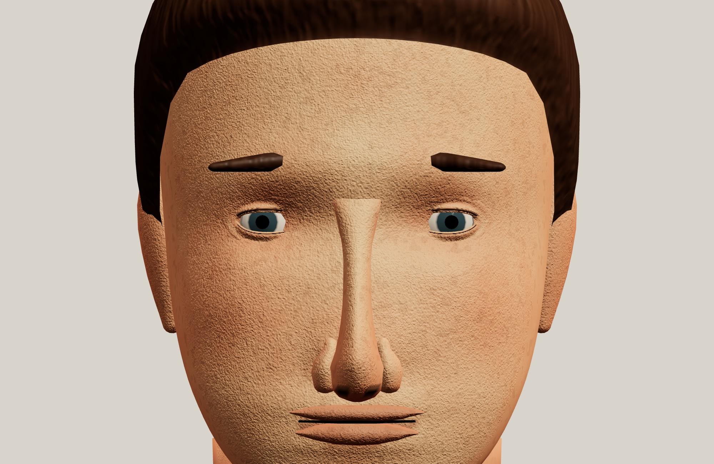
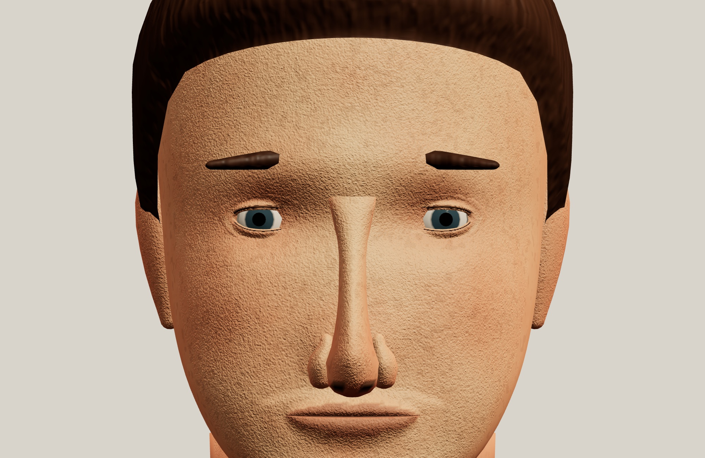
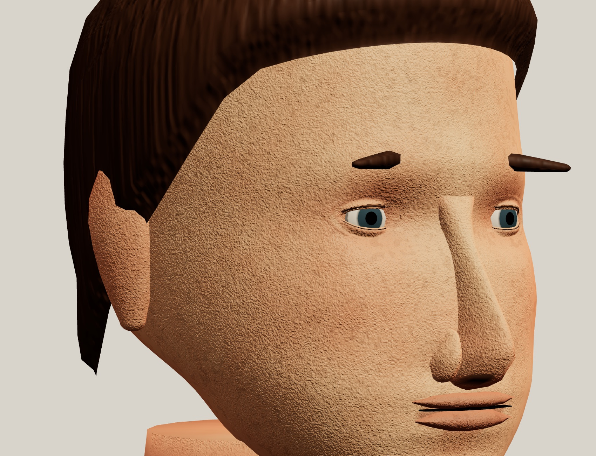
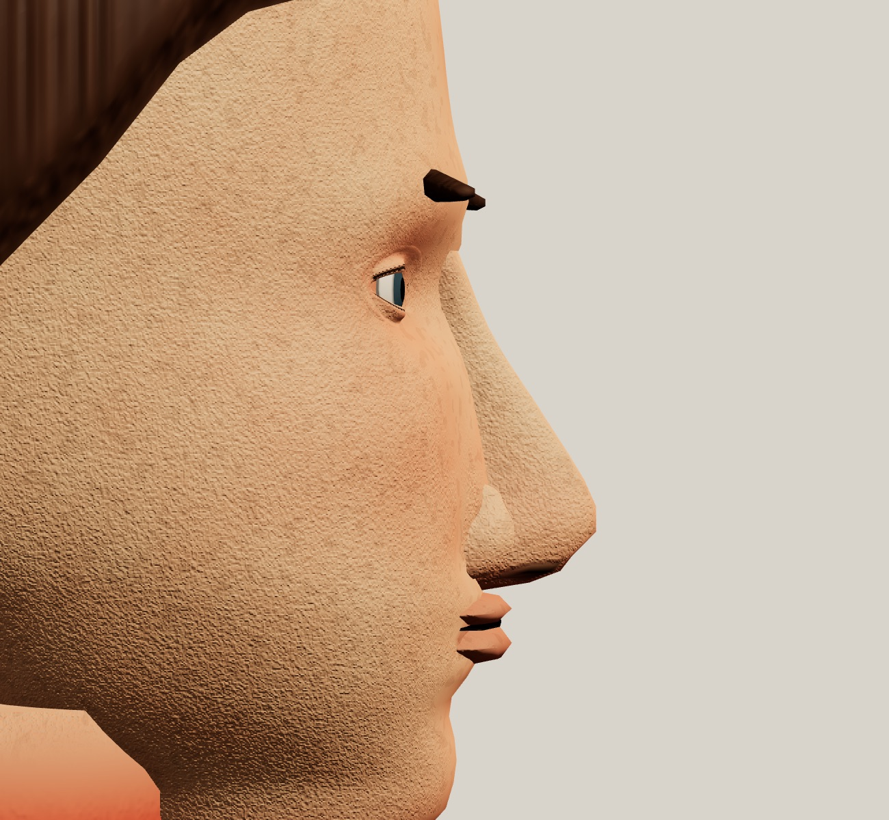
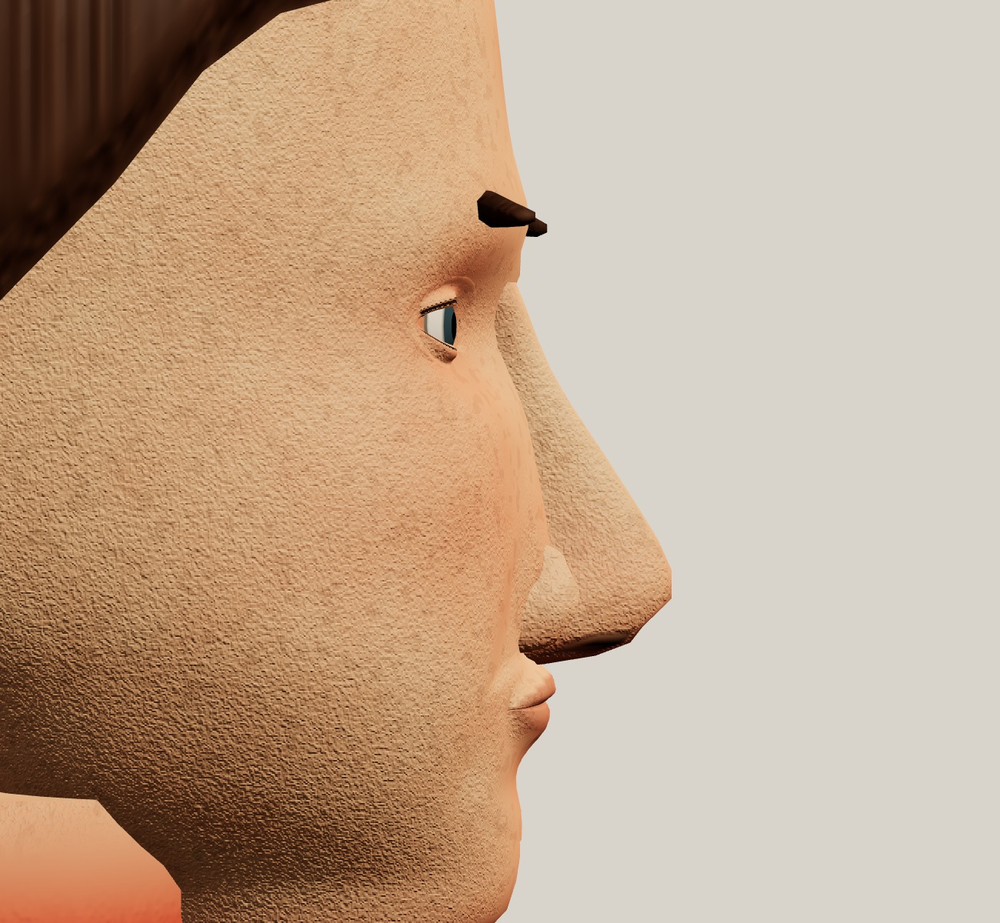
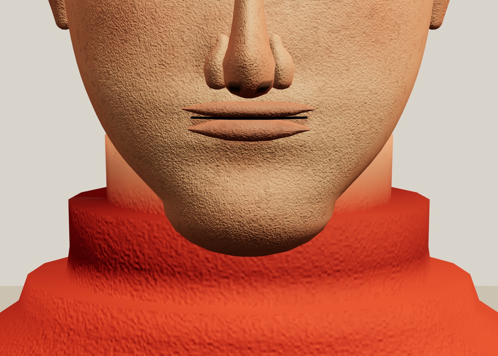
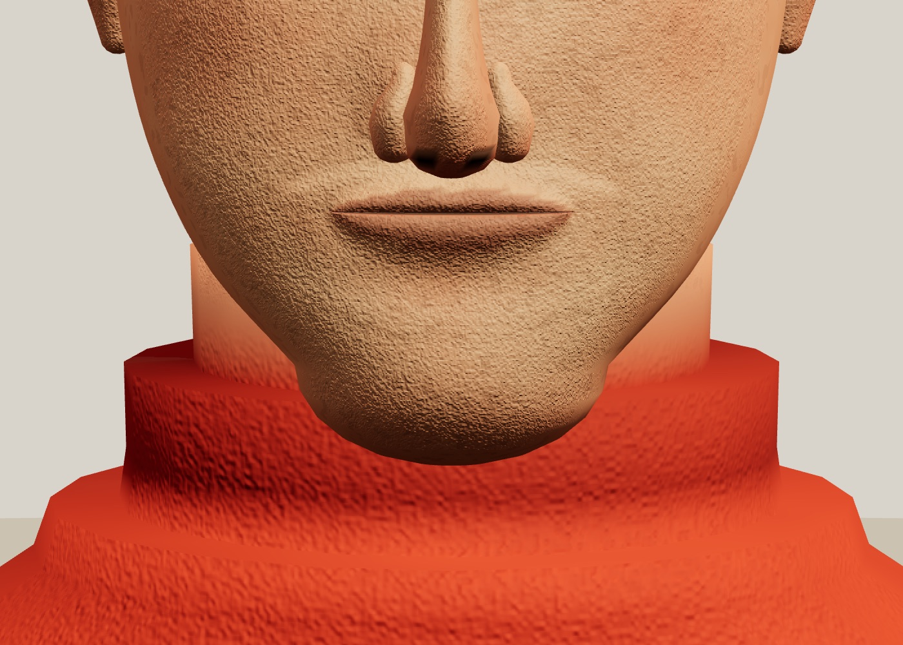
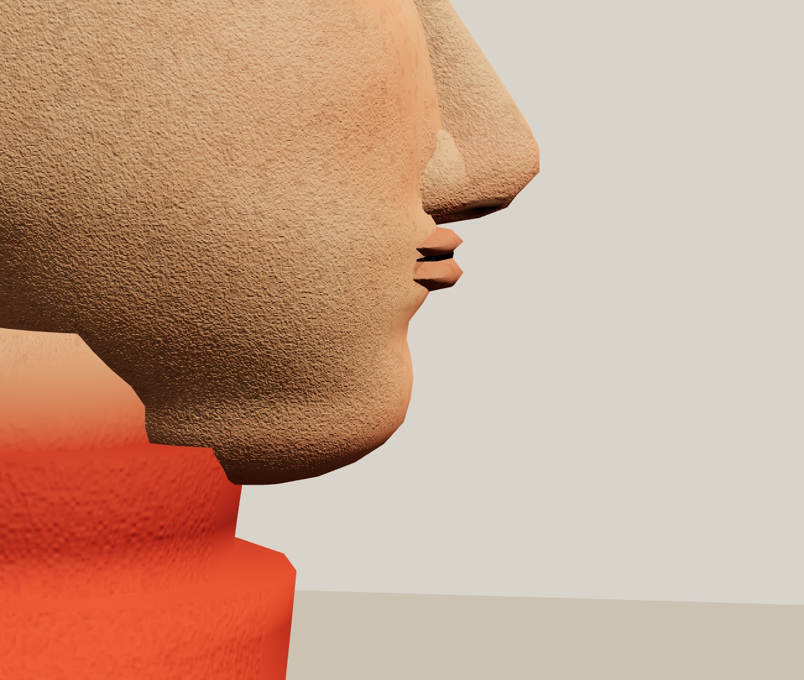

# The mouth and lower face, round 5 of the people climb (#6083), 2026-11-26

`human()` in `packages/models/src/human.ts`, shot from `bun packages/models/scratch/humans/serve.ts` with
`bun scripts/probe.ts --url http://localhost:<port>/ --size 5120x2880 --js '__humans.only(["average"]); __humans.view("face"); __humans.turn(t)' --shot x.png`
at a turn of 0, 35 and 80 degrees, plus two closer crops of the same frames: `mouth` (turn 0, `sips -c 1000 1400 --cropOffset 1650 1860`)
and `jaw` (turn 80, `sips -c 1100 1300 --cropOffset 1500 2900`).

- **The old mouth.** It was two tapered tubes, one for each lip, with a black tube between them. They were pasted on in
  front of the face, so they had a hard edge all round and stuck out like blades in profile.
- **The new mouth is a `sheet()`, built the way the lids are.** `mouth()` makes 17 rings by 72 points round the line
  where the lips meet. The rings go from just inside that line out to where the mesh goes under the face. Each point
  lies on the face (`surf()`) at the height `lipH` gives it. That one surface holds:
  - a cupid's bow (two peaks over a dip under the philtrum) over a fuller lower lip
  - a ridge along the border of the red
  - lips that roll in where they meet
  - the upper lip's skin standing out over the teeth
  - the philtrum's two ridges and the groove between them
  - the cheek bunching round each corner
  - the groove over the chin
  The red stops at its border on points about a millimetre apart. The outer rings take the face's own tone and end a
  hair under the skin.
- **A dent in the skull, only under the lower lip.** The groove over the chin sinks below where the face would be, so
  the skull has a soft dent there (`mouthDent`). It has to be broad. The skull's rings are 4.4 mm apart, and their
  triangles can't follow a sharp dent: they poke through the mouth's mesh wherever they cut across it. A first try with a
  dent under the whole mouth showed a light ring round the upper lip for this reason.
- **The edge.** A steep dive under the skin at the edge faces up into the light and shows as a light line. The mouth
  ends 0.05 mm over the skin instead, with almost no slope.
- **Also in the face.** A soft fold from each wing of the nose down past the corner of the mouth. The chin stands out a
  little more (0.005 to 0.0065).
- 18,284 to 20,316 triangles a figure (+2,032), in the scratch page's default outfit.

| Before | Now |
| --- | --- |
|  |  |
|  |  |
|  |  |
|  |  |
|  |  |

A fresh judge, against the owner's Xbox 360 bar: BEFORE 1.5/10, NOW 2/10. The climb takes half the gain (+0.25):
**1.75/10**. The judge says the lips "are now blended into the face, with a soft line between them and a believable lip
bulge in profile". Its top gaps now:
1. The hair is a hard-edged helmet. It cuts straight across the forehead and has a flat plane at the temples.
2. The brows are wedges standing off the skin, and the nose bridge starts as a rectangle between the eyes.
3. The skin is one coarse sandpaper noise everywhere, lips included.
4. The cheeks and jaw are one smooth balloon, and the chin hangs over a cylinder neck with a step.
