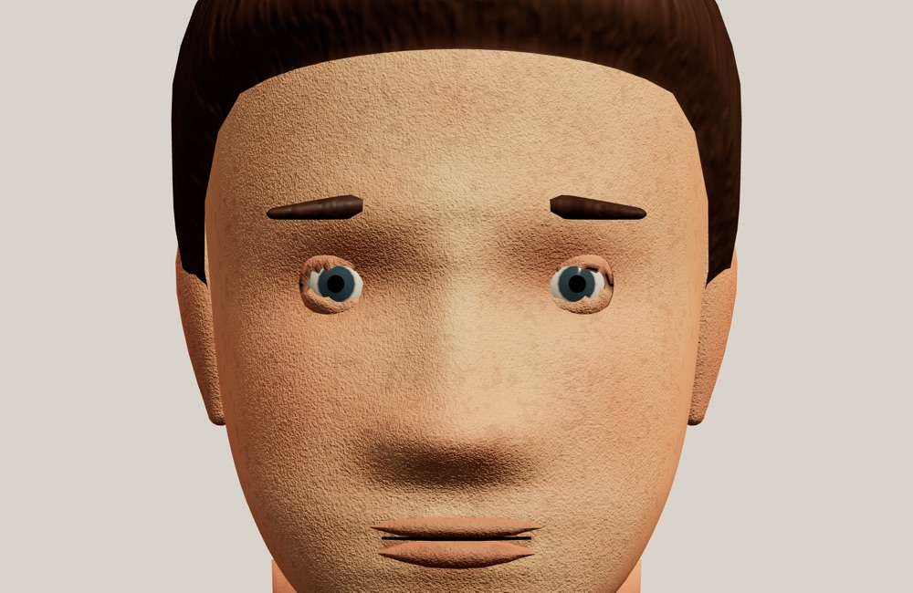
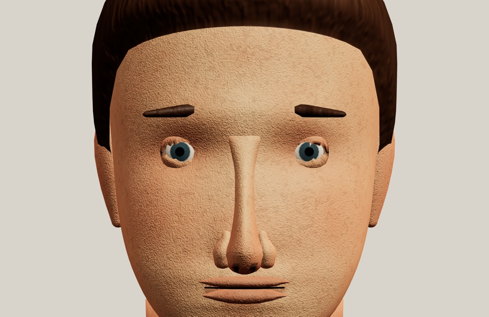
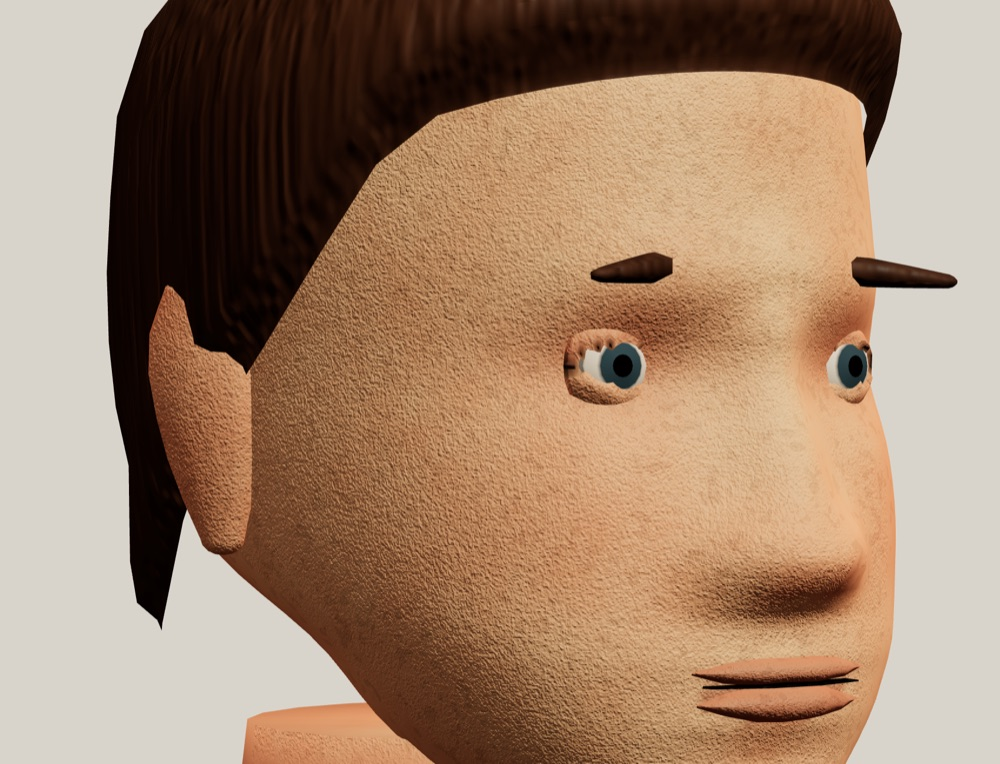
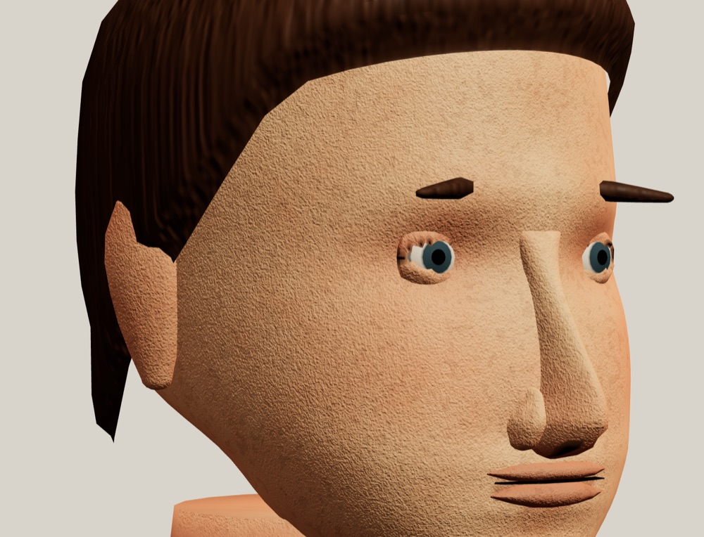
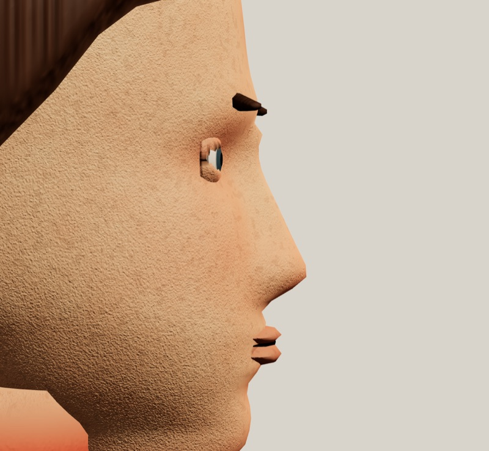
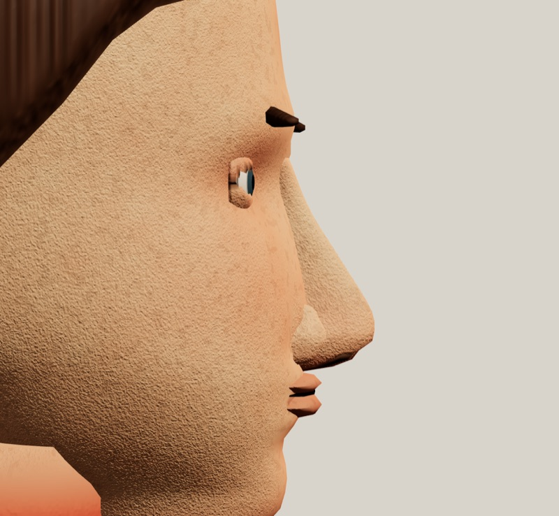

# The nose, round 3 of the people climb (#5979), 2026-11-26

`human()` in `packages/models/src/human.ts`, shot from `bun packages/models/scratch/humans/serve.ts` with
`bun scripts/probe.ts --url http://localhost:<port>/ --size 5120x2880 --js '__humans.only(["average"]); __humans.view("face"); __humans.turn(t)' --shot x.png`
at a turn of 0, 35 and 80 degrees.

- **A nose of its own.** The skull's points are too far apart to model a nose in, so `nose()` builds it as its own mesh
  on the face: a ridge of twenty rings from between the brows to a rounded tip (narrow at the bridge, broader at the
  tip, `Face.noseWidth` widens only the lower part), a teardrop wing on each side, and two dark nostrils under the tip.
  Each ring's back sits deep in the face, so its sides meet the skin at a slope. The skin still rises a little under the
  ridge and has a groove round each wing, so the pieces grow out of the face rather than sit on it.
- **Shading.** The sides of the ridge turn from the light, the underside is in shadow, the tip and wings flush.
- About 1,700 more triangles a figure.

| Before | Now |
| --- | --- |
|  |  |
|  |  |
|  |  |

Fresh judge, against the owner's Xbox 360 bar: BEFORE 2/10, NOW 2.5/10. The climb takes half the gain (+0.25):
**1.25/10**. The judge still sees a seam down each side of the nose and round the wings. Its top gaps: the eyes and lids
(no crease, no tear duct, the brow ridge and cheekbones don't frame them), then the mouth and lower face (a cupid's bow,
a fuller lower lip that blends into the skin, the philtrum, the folds from nose to mouth, a chin and jaw in profile),
then the hair, brows, ears and the seams where every part meets the face.
